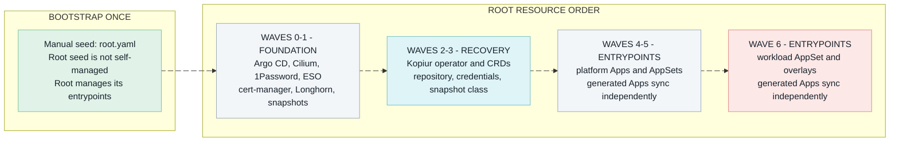

# Talos ArgoCD Proxmox Cluster

[](https://deepwiki.com/mitchross/talos-argocd-proxmox)

> Production-grade GitOps Kubernetes cluster on Talos OS with self-managing ArgoCD, Cilium, and zero-touch PVC backup/restore.

A GitOps-driven Kubernetes cluster on **Talos OS** (secure, immutable Linux for K8s) with **ArgoCD** and **Cilium**, running on Proxmox. Nodes are provisioned and managed through **[Omni](https://github.com/siderolabs/omni)** (Sidero's Talos platform) with the **[Proxmox Infrastructure Provider](https://github.com/siderolabs/omni-infra-provider-proxmox)**. There is no SSH and no manual node config.

The cluster rebuild follows one ordered runbook below. Omni provisions Talos,
then the one-time bootstrap seeds Gateway API CRDs, Cilium, 1Password
credentials, and ArgoCD. ArgoCD takes over and deploys everything else from
this repo.

## Key features

- **Self-managing ArgoCD.** ArgoCD manages its own install, upgrades, and ApplicationSets from Git
- **Directory = Application.** ArgoCD discovers apps by directory path. There are no hand-written `Application` manifests.
- **Sync wave ordering.** Core dependencies are health-gated. Applications then reconcile independently.
- **Zero-touch backups.** Label a namespace and drop in a per-PVC stub to get automatic [kopiur](https://github.com/home-operations/kopiur) (Kopia-native) backups to RustFS/S3 with restore-before-bind DR
- **Gateway API.** Ingress uses Cilium Gateway API, not legacy Ingress.
- **GPU support.** NVIDIA GPU support comes from Talos system extensions and the GPU Operator.
- **Zero SSH.** All node management goes through the Omni UI or the Talos API.

## Repositories & resources

| Resource | Description |
|----------|-------------|
| [Omni](https://github.com/siderolabs/omni) | Talos cluster management platform |
| [Proxmox Infra Provider](https://github.com/siderolabs/omni-infra-provider-proxmox) | Proxmox infrastructure provider for Omni |
| [Starter Repo](https://github.com/mitchross/sidero-omni-talos-proxmox-starter) | Full config & automation for Sidero Omni + Talos + Proxmox |
| [Reference Guide](https://www.virtualizationhowto.com/2025/08/how-to-install-talos-omni-on-prem-for-effortless-kubernetes-management/) | VirtualizationHowTo guide for Talos Omni on-prem setup |

## How it works



Waves order resources within an Application; generated applications reconcile independently.

**A directory *is* an application.** Add a directory with a `kustomization.yaml` under `my-apps/`, `infrastructure/`, or `monitoring/`, push to Git, and an ApplicationSet discovers it and creates the ArgoCD `Application`. No manual `Application` resources.

```
my-apps/ai/comfyui/                  → ArgoCD Application "my-apps-comfyui"
infrastructure/storage/longhorn/     → ArgoCD Application "longhorn"
monitoring/metrics/prometheus-stack/ → ArgoCD Application "monitoring-prometheus-stack"
```

The middle folder (`ai/`, `media/`, `metrics/`…) is a category for people; the app name comes from the last folder. Apps under a `_archive/` folder are not deployed, and their backups are kept.

### Sync wave architecture

The root Application orders its direct children using these waves. Lua health
checks gate direct child Applications. Creating an ApplicationSet does **not**
wait for all the Applications it generates. Those reconcile independently. See
[the wave scope and restore behavior](docs/domains/argocd/argocd.md#how-argo-cd-sync-waves-and-waiting-work).

| Wave | Component | Purpose |
|------|-----------|---------|
| **0** | Foundation | Cilium (CNI), ArgoCD, 1Password Connect, External Secrets, AppProjects |
| **1** | Core controllers | cert-manager, Longhorn, VolumeSnapshot Controller |
| **2** | kopiur operator | Kopia-native backup operator (CRDs + controller + webhook); serves the volume populator for restore-before-bind |
| **3** | kopiur config | kopiur `ClusterRepository` + credential fanout + `VolumeSnapshotClass` |
| **4** | Infrastructure AppSet + custom entrypoints + Database AppSet | cert-manager extras, GPU Operators, Gateway, KEDA, VPA, Temporal Worker Controller; Database AppSet (Redis + shared DB support) auto-syncs |
| **5** | Monitoring AppSet | Prometheus, Grafana, Loki |
| **6** | OTEL Operator + Observability overlays + My-Apps AppSet | OpenTelemetry Operator, KEDA/OTEL ServiceMonitors (after monitoring CRDs exist) and `my-apps/*/*` user apps |

> The backup stack is **kopiur** (since 2026-06-27). The retired pvc-plumber + VolSync stack is gone. If you see those names in old docs or git history, ignore them. See [backup system](#backup-system).

## Prerequisites

1. **Omni + the Proxmox provider are running** and reachable. See [Omni Setup Guide](omni/omni/README.md) and [proxmox-providers/](omni/proxmox-providers/)
2. **An Omni service-account key** stored in 1Password (item `talos-prod-sa`). See [cluster access](#cluster-access-omni-service-account) to create one
3. **Local tools**: `omnictl`, `talosctl`, `kubectl`, `kustomize`, Cilium CLI (`cilium` or `cilium-cli`), 1Password CLI (`op`), and `helm`

### Version pins

| Component | Version | Source of truth |
|-----------|---------|-----------------|
| Omni server + `omnictl` | `v1.12.4` | `omni/omni/omni.env.example` |
| Talos Linux | set in the template | `omni/cluster-template/cluster-template-prod-v2.yaml` |
| Kubernetes | set in the template | `omni/cluster-template/cluster-template-prod-v2.yaml` |
| Cilium | `1.20.1` | `infrastructure/networking/cilium/kustomization.yaml` |
| Gateway API CRDs | `v1.6.1` | bootstrap commands below |
| ArgoCD Helm chart | `10.12.1` + Argo CD `v3.6.1` image/CRDs | `infrastructure/controllers/argocd/` |
| Proxmox provider | `v0.3.0@sha256:ff59ae…` | `omni/proxmox-providers/docker-compose.yml` |

Keep the Omni server and local `omnictl` on the **same** release. Mismatched versions fail with obscure gRPC errors.

> **Keep the Gateway API CRDs on the version Cilium declares support for.** Cilium 1.20 supports Gateway API `v1.6.1`. Bumping the CRDs ahead of Cilium breaks route reconciliation. Check the Cilium release's Gateway API docs before moving either one.

---

## Rebuild and bootstrap

> **The active cluster is `talos-prod-cluster-v2`**, defined by
> `omni/cluster-template/cluster-template-prod-v2.yaml`. Machine classes: `hp-sff-control-plane.yaml`,
> `hp-sff-worker.yaml`, `threadripper-gpu-worker.yaml`, and `hp-micro-worker.yaml`.
> Topology: HP SFF (house, wired) has 1 control plane and 1 worker. Threadripper has 1 GPU worker. HP micro (shed, wifi) has 1 worker. 3 bare-metal mini workers PXE-boot via booter.

The HP SFF hosts the control plane and one worker; the Threadripper hosts the
100 GiB GPU VM; the shed HP hosts one worker. Three bare-metal minis
(`mini-pc-dell-ultra-worker`, `hp-elite-gen12`, `hp-elite-gen13`) run Talos without
Proxmox; see [bare-metal Talos workers](docs/domains/hosts/bare-metal-talos.md). Machine
classes define allocations for newly provisioned VMs, which can differ from
existing VM settings. See the [fleet inventory](docs/inventory/2026-11-03-fleet-inventory.md)
for measured capacity.

This is the only rebuild procedure in this README. Run it from the repository
root, in order. Every required command is shown in full. There are no
placeholder commands or omitted flags.

Before deleting, complete the [backup checklist](docs/disaster-recovery.md#pre-nuke-checklist)
and recover the private `omni/cluster-template/patches/docker-hub-auth.yaml`.
Keep NAS/RustFS and Omni/DNS running. This template targets a fresh Talos 1.14
cluster; see the [1.14 rebuild changes](docs/disaster-recovery.md#talos-114-rebuild).

### 1. Remove the old cluster

Skip this step when provisioning for the first time.

```bash
omnictl cluster delete talos-prod-cluster-v2 --destroy-disconnected-machines
omnictl get machines
```

Do not continue until the old machines disappear from Omni and their VMs
disappear from Proxmox.

### 2. Apply the machine classes and provision Talos

Machine classes and the cluster template are **snapshots stored inside Omni**.
Apply all four classes before syncing the template; template sync owns the
MachineSets. Applying a class does not mutate an existing VM. CPU, RAM, disks,
and the visible machine identity change only when Omni provisions a replacement
from that class.

```bash
omnictl apply -f omni/machine-classes/hp-sff-control-plane.yaml
omnictl apply -f omni/machine-classes/hp-sff-worker.yaml
omnictl apply -f omni/machine-classes/threadripper-gpu-worker.yaml
omnictl apply -f omni/machine-classes/hp-micro-worker.yaml
omnictl get machineclasses

omnictl cluster template validate \
  -f omni/cluster-template/cluster-template-prod-v2.yaml
omnictl cluster template sync \
  -f omni/cluster-template/cluster-template-prod-v2.yaml \
  --dry-run
omnictl cluster template sync \
  -f omni/cluster-template/cluster-template-prod-v2.yaml

omnictl get machinerequeststatuses -w
```

Stop the watch with `Ctrl-C` after all four requests show
`Provision Complete`. The bare-metal minis make no machine requests. They join
when booter on the Pi PXE-boots them; check them with `omnictl get machines`.
Reused data disks on them need a wipe before Longhorn can use them; see
[bare-metal Talos workers](docs/domains/hosts/bare-metal-talos.md). Do not use `cluster template status --wait` here. The
cluster cannot become healthy until Cilium is installed in step 5.

> **Sync this template, not a stale working copy.** A 2026-06-11 rebuild used
> a stale template snapshot and produced the wrong disk layout and a
> mid-bootstrap Talos upgrade. That forced another reprovision.

### 3. Authenticate and get cluster access

```bash
eval "$(op signin)"

export OMNI_ENDPOINT=https://omni.vanillax.me:443
export OMNI_SERVICE_ACCOUNT_KEY="$(op read 'op://homelab-prod/talos-prod-sa/OMNI_SERVICE_ACCOUNT_KEY')"

omnictl kubeconfig \
  --cluster talos-prod-cluster-v2 \
  --service-account \
  --user talos-prod-sa \
  --force

talosctl config remove omni-prod-talos-prod-cluster-v2 -y 2>/dev/null || true
omnictl talosconfig --cluster talos-prod-cluster-v2

kubectl get nodes -o wide
```

> **`OMNI_ENDPOINT` is mandatory whenever `OMNI_SERVICE_ACCOUNT_KEY` is set.** With the key exported, omnictl ignores config-file contexts. A missing endpoint fails with the cryptic `delegating_resolver: invalid target address "": missing address`.

The nodes are expected to be `NotReady` until Cilium is installed in step 5.
The explicit `talosctl config remove` prevents `omnictl talosconfig` from
creating a suffixed duplicate context after a rebuild. On a fresh
Omni, create the service account first. See
[cluster access](#cluster-access-omni-service-account).

### 4. Install Gateway API CRDs

Install the complete standard channel before enabling Cilium Gateway API support:

```bash
kubectl apply --server-side -f https://github.com/kubernetes-sigs/gateway-api/releases/download/v1.6.1/standard-install.yaml
```

Do not apply the full experimental bundle afterward. Gateway API v1.6.1's
safe-upgrades policy rejects mixing the two channels. This cluster does not use
experimental `TLSRoute` resources.

### 5. Install Cilium (CNI)

Omni provisions Talos without a CNI. This one-time seed gives ArgoCD enough
pod networking to start. ArgoCD assumes management of the same Cilium release
at Wave 0.

```bash
if command -v cilium >/dev/null 2>&1; then
  CILIUM_CMD=cilium
else
  CILIUM_CMD=cilium-cli
fi

"$CILIUM_CMD" install \
    --version 1.20.1 \
    --set cluster.name=talos-prod-cluster-v2 \
    --set ipam.mode=kubernetes \
    --set kubeProxyReplacement=true \
    --set securityContext.capabilities.ciliumAgent="{CHOWN,KILL,NET_ADMIN,NET_RAW,IPC_LOCK,SYS_ADMIN,SYS_RESOURCE,DAC_OVERRIDE,FOWNER,SETGID,SETUID}" \
    --set securityContext.capabilities.cleanCiliumState="{NET_ADMIN,SYS_ADMIN,SYS_RESOURCE}" \
    --set cgroup.autoMount.enabled=false \
    --set cgroup.hostRoot=/sys/fs/cgroup \
    --set k8sServiceHost=localhost \
    --set k8sServicePort=7445 \
    --set hubble.enabled=false \
    --set hubble.relay.enabled=false \
    --set hubble.ui.enabled=false \
    --set gatewayAPI.enabled=true \
    --set gatewayAPI.enableAlpn=true \
    --set gatewayAPI.enableAppProtocol=true \
    --set envoy.xdsMode=split
"$CILIUM_CMD" status --wait --wait-duration 5m
kubectl get nodes
```

All nodes must become `Ready` before continuing. These settings must match
what ArgoCD renders at Wave 0 (`infrastructure/networking/cilium/`), or Wave 0
will reconfigure the seed install:

> - **Routing mode matches by default.** The CLI's default (`tunnel`/vxlan) equals `values.yaml`'s `routingMode: tunnel`. If the managed values ever change routing mode, add the matching `--set routingMode=...` here or Wave 0 restarts every agent mid-bootstrap.
> - **`--version 1.20.1`** must match `infrastructure/networking/cilium/kustomization.yaml`. A mismatch makes ArgoCD upgrade Cilium at Wave 0, That regenerates some Hubble certs but not others, and `x509: certificate signed by unknown authority` blocks every later wave.
> - **`--set envoy.xdsMode=split`** must match `values.yaml`. Seeding without it leaves envoy on the ADS default while Wave 0 flips the agents to split. Envoy then holds zero listeners (every Gateway VIP refuses TCP) until `cilium-envoy` is restarted (2026-08-24 rebuild outage).
> - **`cluster.name`** must match `values.yaml` (Hubble cert SANs). Without it, certs are issued for `default`/`kind-kind`, which causes TLS failures.
> - **Hubble stays disabled at bootstrap on purpose.** ArgoCD enables it at Wave 0, so ArgoCD is the sole owner of the Hubble TLS certs (no CLI-vs-ArgoCD cert mismatch).

### 6. Pre-seed 1Password secrets

These secrets bootstrap 1Password Connect and External Secrets, which then sync
every other secret from the vault. The dry-run/apply form makes the commands
safe to rerun.

```bash
export OP_CREDENTIALS="$(op read op://homelab-prod/1passwordconnect/1password-credentials.json)"
export OP_CONNECT_TOKEN="$(op read 'op://homelab-prod/1password-operator-token/credential')"

kubectl create namespace 1passwordconnect \
  --dry-run=client -o yaml | kubectl apply -f -
kubectl create namespace external-secrets \
  --dry-run=client -o yaml | kubectl apply -f -

kubectl create secret generic 1password-credentials \
  --namespace 1passwordconnect \
  --from-literal=1password-credentials.json="$OP_CREDENTIALS" \
  --dry-run=client -o yaml | kubectl apply -f -

kubectl create secret generic 1password-operator-token \
  --namespace 1passwordconnect \
  --from-literal=token="$OP_CONNECT_TOKEN" \
  --dry-run=client -o yaml | kubectl apply -f -

kubectl create secret generic 1passwordconnect \
  --namespace external-secrets \
  --from-literal=token="$OP_CONNECT_TOKEN" \
  --dry-run=client -o yaml | kubectl apply -f -
```

### 7. Bootstrap ArgoCD

```bash
./scripts/bootstrap-argocd.sh
```

The script checks Cilium, installs ArgoCD via Helm, seeds the `argocd-redis` auth secret (so a fresh cluster doesn't hang), and applies `root.yaml` to hand control to GitOps self-management.

### 8. Verify

There are no database-specific recovery steps. Every database is a plain
Postgres Deployment whose PVC restores via kopiur restore-before-bind at
Wave 6, like every other backed-up PVC (CNPG and its guarded
recovery script were retired 2026-08-13). Backed-up PVCs sit `Pending`
while they restore. That is the restore working, not a fault. Once apps
are up, confirm each database's first post-rebuild snapshot succeeds.
Run `kubectl -n <ns> get snapshot`. The newest `Snapshot` should be
`Succeeded` with non-zero files.

```bash
omnictl cluster template status \
  -f omni/cluster-template/cluster-template-prod-v2.yaml \
  --wait 30m

kubectl get nodes

# Watch applications sync (all should reach 'Synced')
kubectl get applications -n argocd -w

# View sync-wave order
kubectl get applications -n argocd \
  -o custom-columns=NAME:.metadata.name,WAVE:.metadata.annotations.argocd\\.argoproj\\.io/sync-wave,STATUS:.status.sync.status

# (Optional) ArgoCD UI — bootstrap preserves the configured password stored in 1Password
kubectl port-forward svc/argocd-server -n argocd 8080:443
# open https://localhost:8080
```

## What happens after bootstrap

ArgoCD takes over and deploys everything from Git in the order shown in the [Sync wave architecture](#sync-wave-architecture) table, from Wave 0 (Cilium, secrets) through Wave 6 (user apps). There are **zero manual storage steps**. Longhorn registers the filesystem disks declared by each node template (for example the GPU worker's `/var/mnt/longhorn-ssd-flash`; see [disk placement](docs/storage-architecture.md#disk-placement-follows-drive-endurance)), the kopiur operator comes up at Wave 2, and any restore-before-bind PVCs populate unattended.

From here, new applications are discovered automatically. Add a directory with a `kustomization.yaml` and push to Git.

> **Multi-node prod only.** Confirm storage nodes were created with the expected layout. This catches a stale-Omni-config failure at provision time instead of at Longhorn bootstrap:
>
> ```bash
> kubectl get nodes -o custom-columns='NAME:.metadata.name,OS:.status.nodeInfo.osImage'  # expect every node on the pinned Talos version
> talosctl -n <worker-ip> get disks               # expect a single ~800G sda (sda+sdb = STALE 2-disk layout)
> kubectl get nodes.longhorn.io -n longhorn-system # expect 4 Ready storage nodes after Longhorn starts
> ```

### Mass-restore stability notes

- **Replica rebuilds are throttled to 2/node in Git** (`infrastructure/storage/longhorn/node-failure-settings.yaml`). Full-cluster restores overload any engine on this hardware. Do not raise the limit mid-bootstrap.
- A mover pod stuck for more than 15 minutes on `MountVolume … hasn't been attached yet` with an old VolumeAttachment means stale CSI state. Delete the mover pod. Its Job recreates it and forces a fresh attach.
- Pods crashlooping on `read-only file system` after a storage disruption need the volume to FULLY detach (or the pod to land on another node) to drop the stale ro mount. Scale to 0, wait for the Longhorn volume to show `detached`, then scale back. For databases, scale the postgres Deployment.
- History: this repo tried and retired the Longhorn V2/SPDK engine (2026-06-12, open Longhorn bugs #13315/#13314). Do not re-enable V2 without a fixed release and a passed DR drill. The short version is in [docs/disaster-recovery.md](docs/disaster-recovery.md).

## Cluster access (Omni service account)

The default `omnictl kubeconfig` uses OIDC exec auth, which expires and needs a browser login. For long-lived access, create a **service account** with a bearer token.

> **Use the CLI, not the Omni UI.** UI-generated PGP keys are incompatible with the CLI's gopenpgp library (`EdDSA verification failure`).

```bash
# 1. Create the service account (1 year max TTL)
omnictl serviceaccount create talos-prod-sa --use-user-role

# 2. Save BOTH OMNI_ENDPOINT and OMNI_SERVICE_ACCOUNT_KEY into 1Password immediately — the key is shown ONCE.

# 3. Generate a bearer-token kubeconfig (NOT OIDC)
OMNI_ENDPOINT=https://omni.vanillax.me:443 \
OMNI_SERVICE_ACCOUNT_KEY="<key-from-step-2>" \
omnictl kubeconfig --cluster talos-prod-cluster-v2 --service-account --user talos-prod-sa --force

# 4. Verify
kubectl get nodes
```

**talosctl without a browser.** talosctl reads the same `OMNI_SERVICE_ACCOUNT_KEY`. Without it, talosctl opens a browser login, and that fails for a service-account identity.

The dotfiles (`mitchross/dotfiles`, `dot_zshrc.tmpl`) wrap `talosctl` to do this. The first call in a shell reads the key from 1Password, and later calls reuse it. Without the wrapper, run the exports by hand:

```bash
# Run once per shell, before any talosctl command.
export OMNI_ENDPOINT=https://omni.vanillax.me:443
export OMNI_SERVICE_ACCOUNT_KEY="$(op read 'op://homelab-prod/talos-prod-sa/OMNI_SERVICE_ACCOUNT_KEY')"

# Only when ~/.talos/config is missing or stale (it then uses identity talos-prod-sa@serviceaccount.omni.sidero.dev).
talosctl config remove omni-prod-talos-prod-cluster-v2 -y 2>/dev/null || true
omnictl talosconfig --cluster talos-prod-cluster-v2

talosctl -n <node-ip> version --short
```

- `Could not authenticate: key expired` plus a browser link means talosctl has no key. Either `op` is signed out or the wrapper is missing. Run `eval "$(op signin)"` and try again. Do not click **Grant Access**.
- Each browser grant registers an extra 4-hour key on `talos-prod-sa`. `omnictl serviceaccount list` shows them. They expire on their own.
- Keep the key in 1Password only. Do not write it to dotfiles.

**Renewal** (expires after 1 year):

```bash
omnictl serviceaccount destroy talos-prod-sa
omnictl serviceaccount create talos-prod-sa --use-user-role
# Regenerate the kubeconfig with step 3 above, then update the key in 1Password.
```

**Gotchas**
- Create via **CLI**. UI keys fail with `gopenpgp: EdDSA verification failure`.
- `--service-account` gives you a bearer token. Without it you get OIDC exec, which expires.
- If the key fails with signature errors, write it to a file and use `$(cat /tmp/key.txt)` instead of inline quoting.
- Manage nodes (upgrades, config, patches) through the Omni web UI.

## Backup system

Normal application PVC backups use **[kopiur](https://github.com/home-operations/kopiur)**, a Kopia-native Kubernetes operator, and go to the RustFS/S3 repository. It replaced the retired pvc-plumber + VolSync stack on 2026-06-27.

- **How a PVC opts in.** Label the namespace `kopiur.home-operations.com/repo: cluster-kopia`, add a per-PVC stub (`SnapshotPolicy`, `SnapshotSchedule`, and `Restore`) via the shared `my-apps/common/kopiur-backup` Kustomize component, and point the PVC's `dataSourceRef` at `<pvc>-restore`. See [`.claude/commands/add-backup.md`](.claude/commands/add-backup.md).
- **Restore-before-bind DR.** A restore against an **unreachable** Kopia repository leaves the PVC `Pending` (never binds an empty volume). A brand-new PVC against a **reachable** Kopia repository with no snapshot binds empty and backs up forward (`onMissingSnapshot: Continue` is deploy-or-restore).
- **Mover permissions.** The mover runs as the **data owner's uid:gid**, not root. Under baseline Pod Security, root can't read non-root data. See [docs/domains/storage/kopiur-mover-permissions.md](docs/domains/storage/kopiur-mover-permissions.md).
- **Databases included.** Every Postgres is a plain Deployment on the same kopiur pipeline (daily by default, every 6 hours for data that can't be re-created). Redis and PostHog's ClickHouse/Kafka are backup-exempt and disposable.
- **Read first.** [docs/domains/storage/kopiur-backup-architecture.md](docs/domains/storage/kopiur-backup-architecture.md), then [docs/disaster-recovery.md](docs/disaster-recovery.md) and [docs/domains/cnpg/run-postgres-plain-english.md](docs/domains/cnpg/run-postgres-plain-english.md) (the database operator guide).

## Cluster upgrades & Talos 1.14 notes

The prod template pins Talos **1.14.5** and Kubernetes **1.37.2**. The kopiur
rendering target and Cluster CI schema stay at 1.37.0. `kubectl get nodes -o wide` shows what
each node runs, since Omni rolls an upgrade out one node at a time.

Merging a version change does not upgrade the machines. Omni performs that rollout separately. The
replacement disk layout below takes effect when new VMs are provisioned.

### Fresh GPU disk layout

The GPU gets a 16 GiB boot disk and 434 GiB `/var` disk on NVMe0, plus its
existing 450 GiB model and 440 GiB flash allocations. The smallest disk is now
the boot disk, which matches Omni's default selection. Physical drives stay put.
See [sizing](omni/docs/threadripper-gpu-cluster.md#sizing).

### Kubernetes compatibility and upgrade order

Talos 1.14 ships Kubernetes 1.37, but the shipped version is not the only
compatible version. Check Omni's `talosversion` resource for the supported
pairs. Keep the current Kubernetes version while upgrading Talos first. Once
Talos and its extensions are healthy, advance Kubernetes. The committed
template records the final target, so review the template diff before syncing
it during either stage.

Keep both cluster templates, the kopiur chart's `kubeVersion`, and Cluster CI's
`KUBERNETES_VERSION` aligned with the intended Kubernetes target. Configure the
kubelet only through `KubeletConfig` documents (`config:`), never `.machine.kubelet`.
Omni's Kubernetes upgrade adds a `KubeletConfig`, and Talos 1.14 rejects both together.
The kubelet image follows `kubernetes.version`. Kubernetes 1.37 rejects removed
cAdvisor command-line flags.

### A stalled upgrade is not a reason to delete the control plane

This cluster has **one** control-plane machine. Rebooting it temporarily stops
the Kubernetes API. Deleting it removes the only etcd member. There is no
remaining quorum. Keep it intact while diagnosing an upgrade failure, and
follow the [recovery runbook](docs/disaster-recovery.md) if recovery is required.
Worker replacement also needs a storage recovery plan, because most Longhorn volumes
still have only one replica.

### Upgrading Omni / omnictl

Run Omni and `omnictl` **on the same release** (currently `v1.12.4`, pinned in `omni/omni/omni.env.example`). When upgrading:

1. Take an Omni etcd snapshot (`omni/omni/README.md`, Backup/Recovery section).
2. Upgrade the Omni container, restart, and confirm the UI loads and existing clusters stay healthy.
3. Upgrade `omnictl` on your workstation to match. Mismatched versions fail with obscure gRPC errors.
4. Regenerate the service-account kubeconfig if it's older than ~30 days (token rotation lags server upgrades).

## Hardware

Three Proxmox hosts and three bare-metal minis run the cluster. All are wired except the
HP micro, which sits in the shed behind a Wi-Fi media bridge.

| Host | Address | CPU / RAM | Role |
|------|---------|-----------|------|
| Threadripper (X399) | 192.168.10.14 | 2950X 16c/32t · 128 GB ECC | GPU worker (2x RTX 3090 passthrough) |
| HP micro (shed) | 192.168.10.20 | i5-8500T 6c · 31 GB | CPU worker, USB radios, Wi-Fi-bridged and solar-fed |
| HP SFF (ProDesk) | 192.168.10.21 | i5-8500 6c · 63 GB | Control plane + CPU worker |
| Dell Pro Micro QCM1250 (bare metal) | DHCP | Core Ultra 5 245T 14c · 32 GB | CPU worker `mini-pc-dell-ultra-worker`, iGPU + NPU, SATA Longhorn disk |
| HP Elite Mini 800 G9 (bare metal) | DHCP | i5-12500T 12t · 16 GB | CPU worker `hp-elite-gen12`, Zigbee (Home Assistant), compute-only |
| HP Elite Mini 600 G9 (bare metal) | DHCP | i5-13500T 20t · 16 GB | CPU worker `hp-elite-gen13`, NVMe Longhorn disk |

```
Storage
├── TrueNAS (192.168.10.133) — ZFS, NFS/SMB, RustFS S3 for backups
├── Longhorn distributed storage for K8s
└── Local NVMe AI model cache on the Threadripper host

Network
├── 10G switch (Wi-Fi bridge to the shed)
├── Firewalla Gold
└── Internal DNS Resolution (Technitium on the rpi5)
```

The bare-metal minis PXE-boot into Omni through booter on the Pi; see
[omni/pi-services/booter/](omni/pi-services/booter/README.md). Wall-plug
power and cost for every host are metered. See
[docs/domains/power/metering.md](docs/domains/power/metering.md).

## Troubleshooting

| Issue | Steps |
|-------|-------|
| **ArgoCD not syncing** | `kubectl get applicationsets -n argocd` · `kubectl describe applicationset infrastructure -n argocd` · check for stale operations before reverting Git: `kubectl get application argocd -n argocd -o yaml` |
| **Cilium issues** | `cilium status` · `kubectl logs -n kube-system -l k8s-app=cilium` · `cilium connectivity test` |
| **Storage issues** | `kubectl get pvc -A` · `kubectl get pods -n longhorn-system` |
| **Longhorn manager crashlooping on the webhook / every PVC Pending** | Check cross-node pod networking first: `kubectl exec -n kube-system <cilium-pod> -c cilium-agent -- cilium-health status`. `Node 1/1` with `Endpoints 0/1` means the pod overlay is broken to that node, not Longhorn. See [nodes Ready but pods cannot cross nodes](docs/domains/networking/topology.md#nodes-are-ready-but-pods-cannot-cross-nodes) |
| **Secrets not syncing** | `kubectl get externalsecret -A` · `kubectl get pods -n 1passwordconnect` · `kubectl describe clustersecretstore 1password` |
| **GPU issues** | `kubectl get nodes -l feature.node.kubernetes.io/pci-0300_10de.present=true` · `kubectl get pods -n gpu-operator` |
| **Backup issues** | `kubectl -n <ns> get snapshotpolicy,snapshotschedule,restore,snapshot` (Snapshot should reach `Succeeded` with non-zero files) · `kubectl -n <ns> get secret kopiur-rustfs` · `kubectl get pods -n kopiur-system` |

### Emergency reset

```bash
# Remove finalizers and delete all applications, then re-bootstrap
kubectl get applications -n argocd -o name \
  | xargs -I{} kubectl patch {} -n argocd --type json -p '[{"op":"remove","path":"/metadata/finalizers"}]'
kubectl delete applications --all -n argocd
./scripts/bootstrap-argocd.sh
```

## Documentation

- **[CLAUDE.md](CLAUDE.md)** is the full development guide and patterns for this repo.
- **[docs/index.md](docs/index.md)** is the documentation landing page and doc map.
- **[docs/easy-guide.md](docs/easy-guide.md)** explains the whole system from zero: GitOps, sync waves, components, kopiur, DR. This is the doc to share.
- **[docs/domains/storage/kopiur-backup-architecture.md](docs/domains/storage/kopiur-backup-architecture.md)** covers kopiur backup/restore architecture. Start here for backups.
- **[docs/disaster-recovery.md](docs/disaster-recovery.md)** is the full-cluster destroy/rebuild runbook.
- **[docs/domains/argocd/argocd.md](docs/domains/argocd/argocd.md)** · **[entrypoints.md](docs/domains/argocd/entrypoints.md)** cover ArgoCD patterns, root entrypoints, and waves.
- **[docs/domains/networking/topology.md](docs/domains/networking/topology.md)** · **[policy.md](docs/domains/networking/policy.md)** cover network architecture and Cilium policies.
- **[omni/](omni/)** holds Omni deployment configs, machine classes, and cluster templates ([Omni setup](omni/omni/README.md)).

## Contributing

1. Fork the repository
2. Create a feature branch
3. Submit a pull request

## License

MIT License
