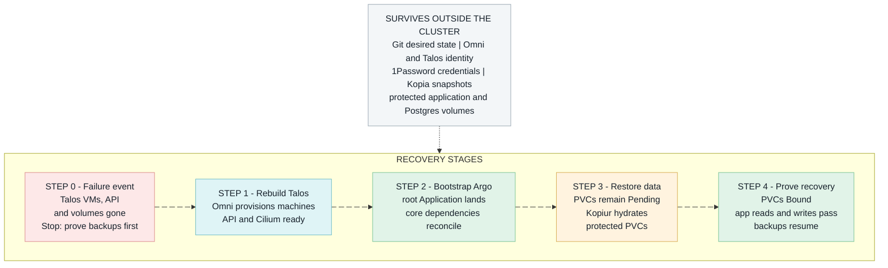

# Disaster recovery runbook

This runbook destroys the whole cluster, rebuilds it, and restores the data. It
is for the operator who runs a planned rebuild or recovers from a total loss.
The rebuild deletes every Kubernetes object and every Longhorn volume. It does
not touch the Git repo, the Kopia repository on RustFS, the 1Password vault, or
the Omni and Talos machine configuration.

!!! danger
    The destructive steps need a clear decision from the operator. Do not run
    them as routine maintenance.

Other pages own the background:

- [Storage, backup and restore architecture](storage-architecture.md) has the concepts and the per-PVC operations.
- [How kopiur backup and restore work](domains/storage/kopiur-backup-architecture.md) has the exact backup and restore flows.
- [Why the kopiur mover runs as the data owner](domains/storage/kopiur-mover-permissions.md) has the file permission rules.

All Postgres here is plain Postgres with a kopiur backup, so a database restores
like any other PVC. CNPG is retired. A restored database still needs the app
checks in [post-restore acceptance](#post-restore-acceptance).



The recovery is complete only when the objects, the credentials, and the data
are all back, and you have checked them.

The page has five parts. Use them in this order:

1. [Pre-nuke checklist](#pre-nuke-checklist): what must be true before you destroy anything.
2. [Rebuild sequence](#rebuild-sequence): the steps and the result of each.
3. [What to expect while the data restores](#what-to-expect-while-the-data-restores): normal behavior and real problems.
4. [In-cluster registry and Gitea Actions](#in-cluster-registry-and-gitea-actions): images that the cluster builds for itself.
5. [Post-restore acceptance](#post-restore-acceptance): the four checks that close the recovery.

---

## What dies and what survives

```text
  Dies with the cluster            Survives (off-cluster)
  -----------------------          -------------------------------
  - Longhorn volumes               - Git repo
  - every Kubernetes object        - Kopia repo (RustFS S3)
  - exempt data:                   - 1Password vault
      PostHog CH/Kafka/Redis,
      Redis, scratch
                                   - Omni/Talos machine config

  Survives ==[ bootstrap-argocd.sh + sync waves ]==> New cluster
      New cluster
        ==[ kopiur Restore populators hydrate PVCs from Kopia ]==>
      All protected data back, unattended
```

The cluster is replaceable. The Kopia repository, the Git repo, and the
1Password vault are not. The rebuild creates everything else from those three.

!!! warning "Longhorn runs the V1 engine. Do not switch to V2"
    Interrupted rebuilds under mass-restore load corrupt V2/SPDK replica metadata
    (upstream [#13315](https://github.com/longhorn/longhorn/issues/13315),
    [#13314](https://github.com/longhorn/longhorn/issues/13314)). Stay on V1.

---

## Pre-nuke checklist

Do not destroy the cluster until every box is checked. The restore reads from
each of these.

- [ ] GitHub is reachable, and the revision you rebuild from is pushed. Argo CD
      pulls from origin, not from your working tree.
- [ ] GHCR image pulls work.
- [ ] 1Password is reachable. The Connect token is valid, and you can get it from
      outside the cluster.
- [ ] The Cloudflare token is valid, and you can get it from outside the cluster.
- [ ] The RustFS S3 endpoint is reachable, the access key is registered on the
      RustFS server, and Kopia can authenticate. A key that RustFS does not know
      blocks every restore, even when Git is correct.
- [ ] The Talos secrets and the Omni machine configs are available outside the cluster.
- [ ] The private Docker Hub patch, the in-cluster registry images, and any data
      you protect by hand are saved outside the cluster.
- [ ] The backups are fresh. Each PVC with a backup has a recent `Succeeded`
      `Snapshot` that you accept as the restore point. Each app goes back to
      exactly that backup. Check the newest `Snapshot` per source across
      namespaces: `kubectl get snapshot -A`. Check that no `SnapshotSchedule` is
      stuck: `kubectl get snapshotschedule -A`. To make a fresh backup now, run
      `kubectl kopiur snapshot now --policy <name> -n <ns>` (CLI ≥0.5.1, krew).
- [ ] Every PVC that you expect to restore has at least one `Succeeded`
      `Snapshot`. With `onMissingSnapshot: Continue`, kopiur binds a PVC that
      has no backup as an empty volume and starts backups from there.
- [ ] The restore canary is green, with a recent `last-drill-result=pass`.
- [ ] Every Proxmox storage that the machine classes select exists on its host
      (`pvesm status`). This includes `tr-sda-vmstore` on the Threadripper. A
      reinstalled host loses it. See the
      [disk map](domains/storage/disk-map.md#rebuild-prerequisites).

## Talos 1.14 rebuild

These facts explain the cluster template. Read them before you change the
template or check the disks of new machines.

The template uses Talos 1.14 Kubernetes documents for the node settings, the
kubelet, and the control-plane components. It sets no `.machine.kubelet`. Talos
1.14
[rejects it next to a `KubeletConfig`](https://github.com/siderolabs/talos/blob/v1.14.1/pkg/machinery/config/types/k8s/kubelet.go#L163),
and Omni adds a `KubeletConfig` on every Kubernetes upgrade.

Longhorn needs no kubelet bind mount. Its data disks are user volumes under
`/var/mnt`, and Talos already exposes that path to the kubelet.

Each Talos volume selects its disk by exact size:

| Machine | Disk layout |
|---|---|
| Control plane | **32 GiB ETCD + 64 GiB EPHEMERAL** inside its 100 GiB disk |
| GPU worker | **16 GiB boot + 434 GiB EPHEMERAL** on NVMe0, so that Omni selects the boot disk |
| GPU worker data | Model, flash, and bulk allocations stay at 450, 440, and 800 GiB |

Check the disks and the mount paths before you restore data:

```bash
talosctl get disks
talosctl get volumestatus
talosctl get mountstatus
```

A fresh Talos 1.14 install enables workload isolation and weekly filesystem
trimming. Keep its mount defaults. Talos 1.14
[keeps `/var` executable](https://github.com/siderolabs/talos/blob/v1.14.0/internal/app/machined/pkg/controllers/block/internal/volumes/volumeconfig/system_volumes_test.go#L837),
so Longhorn V1 needs no `secure: false` setting.

## Rebuild sequence

The exact commands for steps 1 to 7 are in `README.md`, section "Rebuild and
bootstrap". That section is the one procedure for them. This list gives the
order and the result to expect.

1. Delete the cluster with `omnictl cluster delete`.
   Expected result: the machines drain, and the VMs are gone in Proxmox.
2. Apply the machine classes with `omnictl apply`. Then validate and sync the
   cluster template.
   Expected result: Omni holds the current machine classes and template.
3. Wait for the machines to provision from the template.
   Expected result: the nodes join the cluster.
4. Install the Gateway API CRDs.
5. Seed the Cilium CNI.
   Expected result: the nodes reach `Ready`.
6. Check cross-node pod networking. See
   [the gate below](#check-cross-node-pod-networking-before-you-bootstrap).
   Expected result: every node shows `1/1` under `Node` and `Endpoints`.
7. Seed the 1Password credentials.
8. Run `bootstrap-argocd.sh`.
   Expected result: Argo CD starts and the sync waves begin.
9. Wait for the sync waves. They install Cilium management, then Longhorn, then
   kopiur, then the database support.
10. Wait for the generated apps. Each PVC with a backup fills through
    restore-before-bind.
    Expected result: each PVC goes from `Pending` to `Bound`.
11. Confirm that the restored `longhorn` volumes reach two healthy replicas.
12. Verify app reads and writes, credentials, and fresh backups. Use
    [post-restore acceptance](#post-restore-acceptance).

!!! warning "Do not skip steps 5 and 7"
    `bootstrap-argocd.sh` assumes both seeds. Without the Cilium seed, the
    cluster has no CNI and the nodes stay `NotReady`. Without the 1Password
    seed, External Secrets cannot start.

### Apply machine classes and the template before machines provision

Omni stores the machine classes and the cluster template as its own copies.
Apply and sync them before the machines provision. Otherwise Omni builds the
VMs from the old copies, and you must provision them again.

A changed MachineClass does not resize or replace a VM that already exists. The
new virtual hardware applies only after a replacement or a full rebuild.

### Check cross-node pod networking before you bootstrap

Run this check after the Cilium install and before `bootstrap-argocd.sh`.

```bash
kubectl -n kube-system exec ds/cilium -c cilium-agent -- cilium-health status
```

Expected result: every node reports `1/1` under both `Node` and `Endpoints`.

A node in `Ready` proves only that its kubelet reaches the API server. It does
not prove that pods on different nodes reach each other. A rebuild brings new
VMs, new NICs, and new placement, so the two can differ.

`Node 1/1` with `Endpoints 0/1` means the node answers at its host IP while the
pod network to it is broken. `kubectl get nodes` and ICMP both pass in that
state.

Do not run `bootstrap-argocd.sh` while any node shows `Endpoints 0/1`. The sync
waves wait for pod readiness, and a broken pod network does not change pod
readiness. The waves continue, and the failures appear much later as unrelated
apps that wait for missing Secrets. Fix the network first.

### Bootstrap rules

- Install CRDs first, controllers second, custom resources third.
- Do not make observability a core dependency. Core apps must start without
  Prometheus. `kube-prometheus-stack` is the only owner of the
  `monitoring.coreos.com` CRDs.
- Do not raise the Longhorn replica rebuild limit during the bootstrap. It stays
  at 2 per node (`infrastructure/storage/longhorn/node-failure-settings.yaml`).
  A mass restore already loads the shared hardware fully.
- Do not rename an Argo CD Application during a rebuild. A rename needs its own
  ownership and finalizer migration. Deleting the old Application can prune the
  resources it owns.

The backup pieces arrive in this order:

| Sync wave | What arrives | Path |
|---|---|---|
| 2 | The kopiur operator: CRDs, operator, webhook | `infrastructure/backup/kopiur-operator/` |
| 3 | The kopiur configuration: namespace, `ClusterRepository cluster-kopia` on RustFS `s3://kopiur`, and the `ClusterExternalSecret` that copies the credentials | `infrastructure/backup/kopiur/` |
| 4 | Databases | |
| 6 | Each app, with its `SnapshotPolicy`, `SnapshotSchedule`, `Restore`, and the namespace label `kopiur.home-operations.com/repo: cluster-kopia` | |

## What to expect while the data restores

### Normal behavior

- Argo CD recreates each PVC from Git with a `dataSourceRef` that points at the
  `Restore` named `<pvc>-restore`. Kubernetes does not bind a PVC with that
  reference. The PVC stays `Pending` until the kopiur mover has copied the
  newest backup into it. Then it binds with the data, and the pod starts. The
  full flow is in
  [how kopiur backup and restore work, section 4](domains/storage/kopiur-backup-architecture.md#4-restore-before-bind-flow-the-dr-magic).
- If the Kopia repository is unreachable, the PVC stays `Pending` and kopiur
  retries. kopiur raises the backend error before the `onMissingSnapshot`
  decision, so the PVC never binds empty during an outage.
- A PVC binds empty in one case only: the repository is reachable and holds no
  backup for it (`onMissingSnapshot: Continue`). That is the reason for the
  `Snapshot` check in the pre-nuke checklist.
- Earlier rebuilds of about 24 PVCs took about an hour. The app count, the data
  size, the placement, and the storage load have changed since. Use the number
  as a reference, not as a recovery-time promise.
- PostHog adds almost nothing. Only `postgres-data` restores (about 165 MB,
  seconds to copy). Its ClickHouse, Kafka, and Redis volumes start empty by
  design. The PostHog cost is the migrate Job that recreates the ClickHouse
  schema, which takes minutes.
- A few movers can report "volume is currently attached to a different node"
  while Jobs recreate their pods. Longhorn clears these attach conflicts. The
  last ones finish when the load drops.

### Watch the control plane

A burst of restores can raise etcd fsync latency. The symptoms are API
readiness failures and leader-election failures. Watch for them during the
restore. If they continue, investigate storage latency and node health. Do not
assume that every API failure comes from restore load.

### Signs of a real problem

Watch the kopiur objects in a namespace with this command:

```bash
kubectl -n <ns> get snapshotpolicy,snapshotschedule,restore,snapshot
```

These states need action:

- A kopiur mover Job is `Failed`.
- A `Restore` never fills its PVC. The PVC is still `Pending` long after you
  confirmed that the Kopia repository is reachable.
- A `Snapshot` stays in an error state.

### Fix: a `Restore` is `Failed`

A `Failed` `Restore` stays failed. kopiur does not retry it. No spec change and
no Argo CD sync resets it.

One cause is a mover pod that stays Unschedulable longer than
`failurePolicy.podStartupDeadlineSeconds`. kopiur then fails the `Restore` with
reason `MoverPodWedged`. An infrastructure outage during the restore can fail
every `Restore` at once.

Delete the failed `Restore` objects and let Argo CD recreate them:

```bash
kubectl get restore -A --no-headers | awk '$3=="Failed" {system("kubectl -n "$1" delete restore "$2)}'
```

Expected result: Argo CD recreates each `Restore`. Each new `Restore` uses the
newest backup at that moment. The unbound PVC does not change during this.

### Fix: a `Restore` in a privileged-mover namespace stays blocked

This applies to namespaces that carry the `privileged-movers` annotation, for
example home-assistant, tubesync, and nginx-example. When such a namespace and
its kopiur objects arrive together, kopiur can miss the annotation (upstream
kopiur #194). A cluster rebuild has exactly that timing. The `Restore` then
shows `MoverPermitted=False` until kopiur checks again after about 5 minutes.

If a `Restore` stays blocked well past 5 minutes, change its metadata to trigger
a new check:

```bash
kubectl -n <ns> annotate restore <name> kopiur.home-operations.com/kick="$(date +%s)"
```

Any metadata change that has no other effect works the same way.

## In-cluster registry and Gitea Actions

`registry.vanillax.me` is a container registry that runs in the cluster, in the
namespace `container-registry`. Its `registry` PVC has a daily backup at 03:41,
so a rebuild restores the images through restore-before-bind. Images pushed
after the newest backup are missing until you build them again.

### 1. Check the registry catalog

Run the check inside the registry pod:

```bash
kubectl exec -n container-registry deploy/registry -- \
  wget -qO- http://127.0.0.1:5000/v2/_catalog
```

Expected result: the catalog lists the repositories that the manifests in Git
use as `image: registry.vanillax.me/...`.

If the catalog is empty, the PVC had no backup or it bound empty. The workloads
that use those images then show `ImagePullBackOff` until the images exist again.
To rebuild an image, start its Gitea Actions workflow when the runner is back.

With an empty registry, a workflow starts again at its lowest version number.
Check that the tag it pushes matches the tag that Git pins.

### 2. Bring the Gitea Actions runner online

Restore Gitea first. The runner needs `Secret/gitea-actions/act-runner-token`.
Git declares it as an ExternalSecret, and 1Password stores the token:

- vault: `homelab-prod`
- item: `gitea-actions`
- field: `act_runner_token`

Generate or rotate the token from the restored Gitea pod:

```bash
kubectl exec -n gitea deploy/gitea -- gitea actions generate-runner-token
```

Store the new token in the 1Password field above.

If 1Password does not have the new token yet, patch the Secret by hand to start
the runner:

```bash
TOKEN="$(kubectl exec -n gitea deploy/gitea -- \
  gitea actions generate-runner-token | tail -n 1 | tr -d '\r\n')"
kubectl create secret generic act-runner-token \
  -n gitea-actions \
  --from-literal=token="$TOKEN" \
  --dry-run=client -o yaml | kubectl apply -f -
kubectl rollout restart -n gitea-actions statefulset/act-runner
kubectl logs -n gitea-actions act-runner-0 -c runner --tail=50
kubectl logs -n gitea-actions act-runner-1 -c runner --tail=50
```

Expected result: each of the two runners (`act-runner-0`, `act-runner-1`) logs
this line:

```text
runner: act-runner-0 ... declare successfully
```

### 3. If a pod does not schedule

An `Insufficient cpu` scheduling event means that the pod's requests are larger
than the free allocatable CPU on every eligible node. Low CPU use on the host
does not make a pod schedulable. Check affinity, taints, and requests across the
eligible nodes:

```bash
kubectl describe node <eligible-node> \
  | sed -n '/Allocated resources:/,/Events:/p'
kubectl top nodes
```

## Post-restore acceptance

Record all four checks with evidence from the live cluster.

1. **Restore contract.** Every PVC with a backup is `Bound` through its
   `Restore`, and none is `Pending`. The first `Snapshot` after the restore
   reaches `Succeeded` for each source. Check per namespace:
   `kubectl -n <ns> get pvc,restore,snapshot`.
2. **Exemption hygiene.** Every backup-exempt PVC is bound and still carries the
   annotation `storage.vanillax.dev/backup-exempt-reason`. Count the exempt PVCs
   as well as the PVCs with a backup, or a missing exempt PVC stays unnoticed.
   The expected exempt set is PostHog's ClickHouse, Kafka, and Redis, and the
   standalone Redis. PostHog's `postgres-data` has a backup, because it holds
   the API keys and dashboards.
3. **Application recovery.** A `Bound` PVC is necessary but not enough. Make
   these checks:
    - Postgres accepts authenticated connections.
    - Each app reads existing data and completes a normal write.
    - Gitea reads a known repository and its database.
    - Paperless retrieves an existing document.
    - Temporal completes a new workflow or timer.
    - For an app with separate file and database PVCs, both restore points
      describe compatible data.
    - Compare the restored credentials with 1Password before you treat an
      authentication failure as data corruption.
4. **Second replicas.** Restored `longhorn` and `longhorn-wired-ha` volumes get
   two replicas from their StorageClass. Confirm that they reach `2 healthy`. See
   [two copies for data that can't be re-created](storage-architecture.md#two-copies-for-data-that-cant-be-re-created).

---

## The restore canary

An acceptance check proves the restore at one moment. The restore canary lets
you repeat the proof on a test volume, without touching production PVCs.

`my-apps/system/restore-canary/` runs the real restore path on its own PVC. Its
stub `kopiur/restore-canary-data.yaml` holds the `SnapshotPolicy`, the
`SnapshotSchedule`, and the `Restore`. The PVC's `dataSourceRef` points at the
`Restore`.

Two things run automatically. The `SnapshotSchedule` makes a daily backup. A
weekly quick verification checks the blobs in the Kopia repository. Neither one
proves a restore. Only the drill does, and you run the drill by hand.

### Run the drill

```
sentinel (new UID + sha256) → forced kopiur Snapshot
→ delete the canary PVC AND restore-canary-data-restore
→ Git/Argo recreate both → Restore re-resolves to the new snapshot
→ kopiur populator restore → byte-identical verification
```

1. Write a sentinel file with a new UID to the canary PVC. Record its sha256 hash.
2. Force a backup and wait until the `Snapshot` is `Succeeded`.
3. Delete the canary PVC and the `Restore` named `restore-canary-data-restore`.
4. Let Argo CD recreate both. The new `Restore` selects the new backup, and the
   kopiur mover fills the PVC.
5. Check the pin (see below).
6. Compare the restored sentinel with the recorded hash. They must be identical.
7. Record the result in the `restore-canary.vanillax.dev/last-drill-*`
   annotations on the namespace.

The canary
[README](https://github.com/mitchross/talos-argocd-proxmox/blob/main/my-apps/system/restore-canary/README.md)
repeats these rules. Destructive actions apply only to the namespace
`restore-canary` and the PVC `restore-canary-data`.

!!! danger "Delete the `Restore` too, or the drill is invalid"
    A `Restore` selects its backup once, when it is created, and never selects
    again. `status.resolved` is pinned, and `offset: 0` means "latest at
    creation", not "latest now". If you delete only the PVC, the mover copies
    the backup that the `Restore` pinned on first use. The drill then reports
    `RestoreSucceeded` against old data, whether backups work or not.

### Check the pin before the bytes

```
kubectl -n restore-canary get restore restore-canary-data-restore \
  -o jsonpath='{.status.resolved.pinnedAt} {.status.resolved.kopiaSnapshotID}'
```

Expected result: `pinnedAt` is newer than the backup you forced in step 2.

A healthy drill moves the PVC from `Pending` to `Restoring` to `Bound`. A PVC
that binds at once did not run the mover. The reason `TargetAlreadyBound` means
that the `Restore` did nothing because the PVC still existed.

### What the drill proves

A passing drill proves the whole chain: the Git render, the kopiur object
references, the Kopia upload and download, and restore-before-bind. It checks
data integrity by hash.

The drill does not prove that older backups restore, or that an app accepts its
restored data. Test those separately when they matter.

Treat a missing or old `last-drill-*` annotation as "restore not recently
proven", even when the backups and the quick verification are green. The
deletion of the PVC is not automated. Automation waits for a reviewed drill
helper that is native to kopiur and stays inside the namespace.

## Failure-mode catalog

The [common failure modes table](storage-architecture.md#common-failure-modes)
has the fixes for stale CSI attachments, read-only filesystems, stuck clone
PVCs, and resources stuck on a finalizer.
