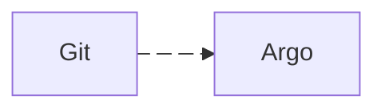

# How these docs are written

This page is the writing standard for this documentation site. Read it before you
add or change a page. It states what each page must tell the reader and how to
write, draw, and review it.

This repository is a running platform and a place to learn. The docs must help a
newcomer understand the design. They must not suggest that cluster operations are
free of risk or that they fit every setup.

## What every page tells the reader

Open each page with one to three plain sentences. State the question the page
answers and who needs it. State if the page describes the current state or a plan
that is not implemented. For a runbook, state what the procedure changes and what
it leaves alone. Write sentences, not a block of bold labels.

After the opening, a page that asks the reader to act must give these items:

| Item | What to write |
|---|---|
| Prerequisites | Access, tools, backups, and the expected starting state. |
| Action | Steps that the reader can copy, with each placeholder clearly marked. |
| Expected result | The output the reader can observe after each risky or important step. |
| Failure path | When to stop, how to inspect the problem, and how to roll back. |
| Source of truth | Links to the owning manifests and to the canonical deeper guide. |

Do not assume that the reader knows Argo CD, Kustomize, Kubernetes controllers,
or the history of this repository. Define a term the first time it appears, in one
clause. Explain why a setting that is not obvious exists, next to the setting.
Keep long background material in one canonical page.

## Write plain technical English

Write about 80% of the way to ASD-STE100 Simplified Technical English:

- Write one instruction per sentence, in the imperative. Keep it to 20 words or fewer.
- Keep descriptive sentences to 25 words or fewer. Use active voice, and name who
  or what does the action.
- Use one word for one meaning. The [glossary](glossary.md) fixes the meaning
  of overloaded words such as restore, snapshot, repository, and sync.
- Use specific verbs. Do not write "handle", "deal with", or "take care of".
- Write full sentences with articles and verbs. Spell out arrows and shorthand in
  prose. Arrows are correct inside diagrams and code.
- Simplify words, not facts. Keep gotchas, conditions, limits, and numbers.

## Describe the current state only

A page describes how the system works today. Git history records how it got there.

- Do not write incident dates, pull request numbers, migration stories, or proof
  that something once worked.
- Do not write "now", "new", "previously", "we tried", or "replaced X".
- Turn each lesson into a forward rule with its reason: "Do not set X, because Y."
- Keep a date only when it is the measurement date of data on the page.
- Keep a one-sentence "do not bring back X" rule where the root `CLAUDE.md` has one.

## Remove AI-writing patterns

These patterns make a page longer and harder to trust. Remove them.

- Do not use em dashes in prose. Use a period or a comma. Do not use a colon to
  join two halves of a sentence.
- Bold only a true warning or the term you define. Most pages need fewer than ten
  bold phrases.
- Do not write lists of bold labels that each restate their own text. Write prose
  or a table.
- Write headings in sentence case. Do not put emoji in headings or bullets. Use
  straight quotes.
- Do not write "not just X, but Y", forced groups of three, or false ranges such
  as "from X to Y".
- Write "is" or "has". Do not write "serves as", "stands as", "boasts", or "features".
- Remove filler such as "in order to" and "it is worth noting". Remove stacked
  hedges, praise words such as "powerful" or "robust", and generic closing lines.
- Name the literal thing. Do not use metaphor nouns such as "substrate" or "bedrock".
- Replace a feeling with a mechanism or a number. Cut any sentence that could
  appear in the docs of any project.

## Choose the right document shape

| Reader need | Shape | Required evidence |
|---|---|---|
| Learn a concept | Guide with a small example and diagram where useful | Reader can explain the flow and locate its manifests |
| Perform an operation | Numbered runbook | Preconditions, commands, expected output, rollback |
| Diagnose a failure | Symptom, then checks, causes, and fixes | Each check distinguishes between at least two causes |
| Review architecture | Current-state document plus explicit limitations | Links to live configuration and known trade-offs |
| Consider a future change | Plan marked as not implemented | Adoption trigger, phases, acceptance checks, deferred items |
| Understand a decision | Short decision record | Context, choice, alternatives, consequences |

## Make guides interactive safely

An interactive guide lets the reader confirm what they understand and what the
cluster state is. It does not need JavaScript on every page.

- Put read-only discovery commands before commands that change something.
- Put each destructive command behind a warning and a confirmation checkpoint.
- Follow each command with a representative result or a precise success condition.
- Use obvious placeholders such as `<namespace>` and `<cluster-id>`. Never
  publish real credentials or production identifiers that a reader could reuse
  by accident.
- Add a small exercise, render preview, diagram, or simulator when it makes
  controller ordering or failure behavior easier to understand.
- Give a path that needs no cluster where practical. Examples are `kustomize build`,
  schema validation, or a sample object that the reader can inspect.
- End an operational guide with verification and rollback, not with deployment.

## Use a consistent visual language

Open an architecture or concept page with one static diagram when the reader must
otherwise assemble a flow from several files or controllers. A runbook needs a
diagram only when ordering, state transitions, or failure boundaries are hard to
write as numbered steps.

Operational diagrams are inline `mermaid` blocks. MkDocs Material and GitHub both
render them. Keep `accTitle` and `accDescr` in each block, because they give the
diagram an accessible name and description. The hand-drawn platform map, the
Kustomize Component model, and the Postgres lifecycle illustrations are SVG assets
under `docs/assets/`.

Every diagram must do these things:

- Answer one specific question in its title.
- Use numbered stages and directional arrows for an ordered flow.
- Separate build time, runtime, and recovery when those phases differ.
- Keep box labels short, and put detailed caveats in the prose around the diagram.
- Route connectors through whitespace and enter a target from a clear edge. Never
  cross a heading, a label, or body text.
- Use a `viewBox`, text that is readable at narrow widths, and descriptive
  `<title>` and `<desc>` elements.
- Include an accessible Mermaid title and description, or SVG alt text. Put prose
  nearby that states the invariant or trade-off the reader must remember.
- Leave out credentials, private identifiers, version numbers that change often,
  and details that the owning manifests cannot prove.

Motion is permitted when it shows direction or order. A Mermaid block can use
stable edge IDs with `animation: fast` or `animation: slow`. A custom SVG
connector uses a permanent solid path with a small open chevron, plus a separate
moving packet. Its styles turn motion off under `prefers-reduced-motion: reduce`.
The reader must be able to understand every diagram with animation off.

The custom SVG connector is ordinary SVG with no dependencies:

```xml
<defs>
  <marker id="arrow" markerUnits="userSpaceOnUse"
          markerWidth="10" markerHeight="10" refX="9" refY="5"
          orient="auto">
    <path d="M1 1 L9 5 L1 9" fill="none" stroke="#087e8b"
          stroke-width="1.8" stroke-linecap="round"
          stroke-linejoin="round" />
  </marker>
  <style>
    .connector { fill:none; stroke:#70bcc4; stroke-width:3.5;
                 stroke-linecap:round; stroke-linejoin:round }
    .packet { stroke:#fff; stroke-width:2 }
    @media (prefers-reduced-motion:reduce) { .packet { display:none } }
  </style>
</defs>

<path id="git-argo" class="connector" d="M120 180 H420"
      marker-end="url(#arrow)" />
<circle class="packet" r="5" fill="#087e8b" opacity="0">
  <set attributeName="opacity" to="1" begin=".01s" fill="freeze" />
  <animateMotion dur="2s" repeatCount="indefinite">
    <mpath href="#git-argo" />
  </animateMotion>
</circle>
```

In a Mermaid block, give each animated edge an ID and an explicit speed:



For custom SVG, `markerUnits="userSpaceOnUse"` keeps the arrowhead size
independent of the connector stroke width. The packet starts with zero opacity,
so a static renderer does not show it. A browser shows the packet when the
animation begins. Use negative `begin` values to stagger packets along a flow.

Do not animate the dash offset of the connector. A short path can look detached,
and static SVG renderers do not all freeze the same frame. This approach uses the
same moving-flow idea as the
[Flow Animation](https://drawio-app.com/blog/connector-styles-and-animations-in-draw-io/)
in Draw.io, but the line stays as permanent content of the diagram.

Keep the meaning of each color the same across the site:

| Color | Meaning |
|---|---|
| Coral | per-app input or a deliberate action |
| Green | shared desired state, completed state, or healthy result |
| Cyan | controller or runtime processing and the primary data flow |
| Amber | off-cluster storage or an external dependency |
| Gray | waiting state, boundary, or inactive path |
| Dark navy | invariant, warning, or conclusion |

Choose the diagram shape from the question the reader has:

| Reader question | Diagram shape |
|---|---|
| What talks to what? | Left-to-right system map with trust and failure boundaries |
| What happens next? | Numbered request or reconciliation flow |
| Why is it waiting? | State machine with success and failure exits |
| What does Git produce? | Inputs and shared defaults, then rendered output |
| Which design should I choose? | Small decision tree or trade-off matrix |

A diagram summarizes the canonical prose. It does not replace the prose. When
behavior changes, update the owning manifest, the prose, and the diagram together.

## Teach architecture in layers

Concept guides and presentation notes use the same five-step sequence:

| Step | What to do |
|---|---|
| 1. Hook | State the failure, the question, or the observable result first. |
| 2. Mental model | Show one diagram and trace one path through it. |
| 3. Implementation | Open the smallest set of owning manifests that proves how the model is built. |
| 4. Proof | Show rendered output, controller status, a read-only command, or app behavior. |
| 5. Boundary | State what the design does not protect, automate, or guarantee. |

Do not open with a field-by-field tour of the YAML. A diagram explains
relationships. The manifests prove the desired state. Runtime evidence proves
behavior. Keep each diagram small enough that a reader can follow one path at a
time.

## Keep one source of truth

An inline YAML comment explains local syntax and the reason that nobody should
remove a setting casually. A domain page explains the complete design. A runbook
owns a procedure. Every other page links to those sources and does not copy them.

When behavior changes, update these in the same pull request:

- the manifest and its inline comment, if the setting is not obvious;
- the canonical architecture page or runbook;
- the docs navigation in `mkdocs.yml` or the parent index, if a page becomes
  easier or harder to find;
- validation commands, examples, and stated limits;
- any plan whose assumptions became current or stale.

## Review checklist

Before you publish a documentation change, check each item:

- [ ] The page opens with one to three plain sentences, not a block of bold labels.
- [ ] A new reader can tell the current state from a plan.
- [ ] The page describes the current state and contains no history.
- [ ] Each command states where it runs and which values to replace.
- [ ] Each risky step has a stop condition, an expected result, and a rollback.
- [ ] Links point to the canonical guide and the live manifest, not to a second
      copy of the same explanation.
- [ ] Examples match the rendered resources and the current controller terms.
- [ ] Diagrams use the shared color meanings, have accessible text, and match
      the current manifests and prose.
- [ ] The page is reachable from the MkDocs navigation or a parent index.
- [ ] `mkdocs build --strict` succeeds.

If nobody can explain a setting, do not let cluster recovery depend on it.
