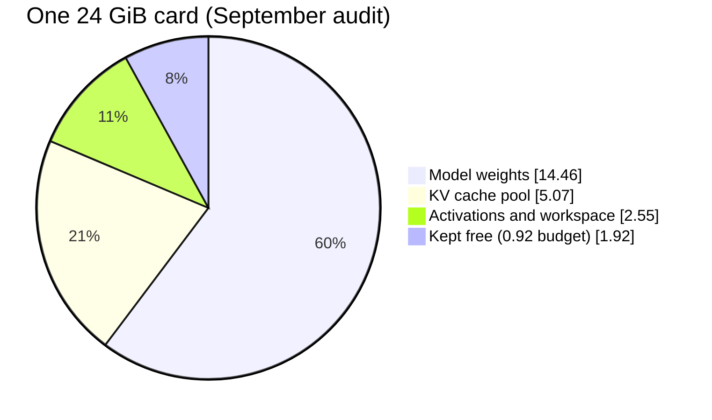

# Context and speed on RTX 3090s

This page answers how much context the local model can hold, how many requests
can run at once, and what makes it slow. Read it before you change a vLLM
memory flag or plan a workload that uses long prompts.

New to the stack? Read [Local AI starter kit](index.md) first.

!!! tip "In 10 seconds"
    - One request can hold up to 262,144 tokens.
    - All running requests share one memory pool, so one huge request leaves less room for the rest.
    - Read the real pool size from the vLLM boot log. Do not calculate it.

## How the memory works

The KV cache is the GPU memory that holds the tokens of requests in progress.
vLLM allocates it once at start as one pool, measured in tokens.

**262,144 tokens is the ceiling for one request.** vLLM runs up to 16 requests
at once (`--max-num-seqs 16`). They share the pool. Each one does not get its
own 262K.

Two words describe speed. Prefill is the model reading the prompt. Decode is
the model writing the answer. Long prompts cost prefill time.

## Current capacity

vLLM serves Qwen3.8-27B INT4 AutoRound on two cards with `--gpu-memory-utilization 0.90`
and 16 slots. The values below come from the vLLM startup on 2026-11-08.

| Measurement | Value |
|---|---|
| KV pool | 612,192 tokens |
| Full-length requests that fit | 2.3 × 262,144, so two |
| Aggregate speed, thinking off | 56 / 185 / 326 / 512 tok/s at 1 / 4 / 8 / 16 concurrent requests |

Keep `--gpu-memory-utilization` at 0.90 unless startup reports fewer than
262,144 KV tokens. In that case raise it to 0.92 through Git. Do not reduce the
context ceiling to make the model fit.

The exact flags and the rollback are in the
[vLLM runbook](https://github.com/mitchross/talos-argocd-proxmox/blob/main/my-apps/ai/vllm/README.md).

## Why 262K is the ceiling

Three limits exist: the model's native window, the configured per-request
ceiling, and the memory that vLLM allocated. **Raising a flag moves only the
second one.**

262,144 tokens is the model's native window. Going past it needs position
extrapolation (RoPE or YaRN) and a separate quality evaluation.

Raising `--max-model-len` adds no capacity. The pool is one shared token
budget, and the flag only raises the ceiling for one request. Each
`--max-num-seqs` slot also reserves a fixed recurrent-state set from that pool.

The KV cost per token explains the pool size. Only 16 full-attention layers
build KV that grows with tokens. With four KV heads, head dimension 256 and one
byte per element:

```
16 layers × 2 (K,V) × 4 heads × 256 × 1 byte = 32 KiB/token
```

| Window | Aggregate KV needed |
|---|---|
| 262,144 | ~8 GiB (~4 GiB/card) |
| 524,288 | ~16 GiB |

Trust the pool that the engine reports at start, not this arithmetic.

Two cards give 48 GiB in total through tensor parallelism, as two separate
per-card allocations. Host RAM helps loading and transport. It does **not**
enlarge the KV pool, which lives on the GPUs.

## Capacity rules

| Rule | Why |
|---|---|
| Read the pool from the boot log line `GPU KV cache size: N tokens` | It is the only trustworthy number; predictions drift |
| On a new quantization or card layout, boot at `--max-model-len 150000` first | Read the pool, then set the real ceiling. Too high a ceiling fails start with a `ValueError` |
| Keep `--max-num-batched-tokens` at 2048 on a single card | Larger prefill chunks shrink the pool; 8192 measurably costs capacity |
| Set `PYTORCH_CUDA_ALLOC_CONF=expandable_segments:True` above ~0.975 utilisation | DeltaNet prefill fragments the allocator without it. Do not add `max_split_size_mb` |
| Never drop `--enable-auto-tool-choice` or `--tool-call-parser qwen3_coder` | Perplexica sends `tool_choice=auto` and fails silently without them |
| Watch prefix-cache hit rate, not only peak context | A collapsed hit rate shows up as multi-minute stalls on 100K+ prompts |

## Everyday operation

| Do | Why |
|---|---|
| Use xhigh reasoning by default | 16,384 thinking-token cap; low=4,096, medium/high/xhigh/max=16,384; explicit client budgets win |
| Keep one image in submitted history | a second retained screenshot exceeds the one-image limit |
| Keep tool outputs bounded | dumping unrelated files burns context and triggers expensive prefill |
| Run at most two full-length sessions at once | the measured pool holds 2.3 × 262,144 tokens; a third waits or causes preemption |
| Leave image generation parked | vLLM owns both cards; use [scale-swap](gpu-scale-swap.md) to change that |

Prefer browser DOM or text output over screenshots. Keep preserved reasoning on
for agents. A stateless chat can turn it off. A thinking-off request needs
Qwen's separate non-thinking sampler. The WebUI policy and the Pi hook select
that sampler by mode.

Pi uses the 262K window, a 32K output budget, and automatic compaction that
reserves 49,152 tokens. Xhigh can use more of that output allowance. It does
not expand context or guarantee better answers. See the
[Pi and Hermes guide](pi-agent-local-dev.md).

## Re-check capacity

These commands read the cluster and open a local diagnostic tunnel. They do not
change the deployment, so they need no rollback.

```bash
kubectl -n vllm get deploy vllm-server
kubectl -n vllm exec deploy/vllm-server -- nvidia-smi
kubectl -n vllm logs deploy/vllm-server --tail=-1 | \
  rg 'Available KV|GPU KV cache size|Maximum concurrency|model loading took|MarlinFP8'
kubectl -n vllm port-forward svc/vllm-service 18000:8080
```

Then, in a second terminal:

```bash
curl -fsS http://127.0.0.1:18000/v1/models
curl -fsS http://127.0.0.1:18000/metrics | \
  rg 'cache_config_info|num_requests_running|num_requests_waiting|num_preemptions|kv_cache_usage'
```

Expect two cards, a Ready deployment, the model id `qwen3.8-27b`, and a pool
that admits at least one maximum-length request.

**Stop** on an out-of-memory error, a CUDA or Xid error, broken output, or
repeated preemption. Read the logs before you change a memory setting. A config
change needs a PR.

## Reference: FP8 baseline measurements

This section records an earlier configuration: official Qwen3.8-27B FP8, stock
vLLM, TP=2, FP8 E4M3 KV, native vision, speculation off. It is **not** the
active INT4/W4A8 configuration. Do not use these numbers as current capacity.

### Capacity audit, 2026-09-06

The audit ran with medium reasoning requested explicitly.

| Observation | Value |
|---|---|
| GPUs | two RTX 3090s, 24,576 MiB each |
| Interconnect | PHB, no NVLink; NCCL P2P disabled |
| Power cap | 220 W per card |
| Weight kernel | `MarlinFP8ScaledMMLinearKernel` |
| Model memory | 14.46 GiB per GPU |
| Available KV | 5.07 GiB per GPU |
| Engine KV pool | 325,717 tokens |
| Concurrency at 262,144 tokens | 1.24× |



The 3090 stores FP8 weights compactly with an Ampere-compatible weight-only
kernel. It gets no native FP8 tensor arithmetic.

A 524,288-token window exceeds this allocation. With 14.46 GiB of weights per
card, it also leaves too little workspace at the 0.92 memory budget.

### One card or two

Production uses two cards. One card also works. The cost is prefill latency,
not usable context.

| | 2× RTX 3090 (TP=2) | 1× RTX 3090 (TP=1) |
|---|---:|---:|
| KV cache pool | 313,367 tok | 200,826 tok |
| Peak context reached | 160,468 (51%) | 152,867 (76%) |
| Preemptions | 0 | 0 |
| Prefix-cache hits | 97.5% | 96.3% |
| TTFT mean | 3.81 s | 4.56 s |
| Prefill mean | 3.01 s | 4.24 s |
| Decode mean | 0.036 s | 0.038 s |
| Power | ~236 W | 196 W |

Dropping a card removes 36% of the KV pool. The workload still fits because
the pool reached only ~76% at peak. Decode barely changes.

This test used a text-only profile at `--max-num-seqs 3`. It does not cover
vision, because the single-card run dropped the ~2.7 GB vision tower. It also
does not cover sustained load above ~76% of the pool, or more than three slots.
The harness is in `benchmarks/ai-realworld-load/`.

To change the card count, use the [scale-swap runbook](gpu-scale-swap.md).
Changing GPU passthrough alone changes nothing.
