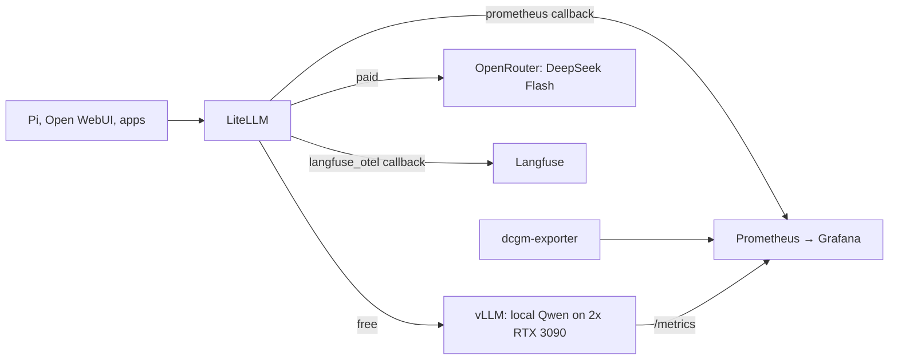
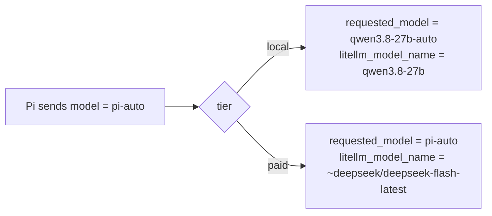

# AI gateway and analytics

This page shows how to see which model answered a request, what it cost, and
why the router sent it there. Read it when you add a client to the gateway or
when a dashboard looks wrong.

New to the stack? Read [Local AI starter kit](index.md) first.

!!! tip "Which tool do I open?"
    - To see how many requests ran, how fast, and at what cost, open Grafana. For the local and paid split, use `/d/pi-routing`.
    - To see why one request went where it did, open `langfuse.vanillax.me` and filter on the tag `pi`.
    - To check that telemetry works at all, run [Verify a deployment](#verify-a-deployment). It takes about 15 minutes.

Every LLM request in the lab goes through one gateway, LiteLLM. LiteLLM sends
each request to a backend. It then reports the request to Prometheus, which
stores metrics, and to Langfuse, which stores one trace per request.



## Who measures what

| Tool | Answers |
|---|---|
| Grafana `/d/pi-routing`, Pi Auto-Routing | local vs paid ratio, classifier health, spend |
| Grafana `/d/ai-gateway-analytics`, AI Gateway and Analytics | all gateway requests, tokens, latency, failures, Langfuse health |
| Grafana `/d/llm-engines`, Local LLM Engines | vLLM and Strata side by side: state, speed, latency, history per engine |
| Grafana `/d/vllm-inference`, vLLM Inference | vLLM queue depth, decode/prefill speed, latency, KV cache use |
| Grafana `/d/strata-inference`, Strata Inference | Strata live state, decode/prefill speed, latency, expert/prompt caches, MTP. Strata is parked at 0 replicas |
| Grafana `/d/gpu-overview`, GPU Overview | GPU power, memory, temperature, utilisation |
| Langfuse | one trace per request: input, output, tokens, session, routing reason |

Grafana shows totals and trends. Langfuse shows single requests. Start in
Grafana, then open Langfuse to see why one request went where it did.

## Reading the Qwen / DeepSeek split

Pi shows the `pi-auto` name, never the backend that answered. LiteLLM records
two model labels on each request. Compare them to see which backend ran:



| Label | Meaning | Local Qwen turn | DeepSeek turn |
|---|---|---|---|
| `requested_model` | the route LiteLLM counted | `qwen3.8-27b-auto` | `pi-auto` |
| `litellm_model_name` | what actually ran | `qwen3.8-27b` | `~deepseek/deepseek-flash-latest` |

!!! warning "Match both route names"
    LiteLLM counts a local turn under the tier route `qwen3.8-27b-auto`, not
    under `pi-auto`. A query that filters on `requested_model="pi-auto"` alone
    shows 0% local. Use `requested_model=~"pi-auto|qwen3.8-27b-auto"`. Only
    `pi-auto` can reach `qwen3.8-27b-auto`, so the query counts no other client.

`litellm_proxy_total_requests_metric_total` carries only `requested_model`, so
it cannot show the split. Use `litellm_deployment_success_responses_total`.

Pi traffic is sparse. Sparse traffic causes two wrong readings:

1. A counter that first appears at its full value makes `increase()` read
   zero for that first sample. A short window right after a LiteLLM restart can
   undercount.
2. `histogram_quantile` returns `NaN` when every bucket rate is zero. The
   classifier decision-time stat uses a `sum`/`count` average for this reason.

## Reading Langfuse

Langfuse stores the backend that answered in `providedModelName`. Add the tag
filter `tags any of [pi]` to every widget. Without it, Open WebUI and the other
gateway clients count as Pi turns.

Per trace, read `routing_decision.cause`:

| Cause | Meaning |
|---|---|
| `llm_classifier` | the classifier graded the request |
| `default_model_fallback` | classification failed, so the request went to the default, DeepSeek |

## Where the dashboards are stored

Langfuse dashboards are stored in the Langfuse database, not in Git. After a
cluster rebuild, recreate them in the UI, or with `dashboardWidgets.create`
plus `dashboard.updateDashboardDefinition`.

Grafana dashboards are stored in Git under
[`monitoring/metrics/prometheus-stack/dashboards/ai/`](https://github.com/mitchross/talos-argocd-proxmox/tree/main/monitoring/metrics/prometheus-stack/dashboards/ai).
Edit the JSON through a PR. ArgoCD then reloads the dashboards.

## Routes and credentials

Every URL, key and auth path is listed once, in
[model catalog § Wiring](model-catalog.md#wiring).

## Langfuse storage

| Store | Holds | Backup |
|---|---|---|
| PostgreSQL | identity, projects, configuration | kopiur, restore-before-bind |
| ClickHouse | AI observations | kopiur, restore-before-bind |
| Valkey | queue | backup-exempt. Losing it loses in-flight observations. |
| RustFS | event payloads, media, exports | separate bucket lifecycle |

The Langfuse chart's bundled stores are disabled. The app's own manifests run
PostgreSQL, ClickHouse and Valkey as plain Deployments, so the cluster needs no
database operator. An ArgoCD Sync hook creates the RustFS bucket before web and
worker start.

The pipeline can lose observations that are in flight. Restore all stores to
the same point in time, and test a recovery with synthetic observations first.

## Why the callback is `langfuse_otel`

Langfuse v4 has its own observations data model. The LiteLLM image ships the
legacy Langfuse SDK, so the plain `langfuse` callback does not work.
`langfuse_otel` sends the v4 header and exports to
`/api/public/otel/v1/traces`. Read data with Observations API v2. The legacy
traces APIs return 404 on a fresh v4 install.

## Verify a deployment

This check takes about 15 minutes. It sends synthetic requests and changes no
configuration.

1. Confirm that the ArgoCD Applications `my-apps-langfuse`, `my-apps-litellm`,
   `my-apps-open-webui` and `monitoring-prometheus-stack` are Synced and Healthy.
2. Sign in to Langfuse and open the project **Homelab AI**. An empty chart in
   another project proves nothing.
3. Send synthetic traffic:
   ```bash
   kubectl -n litellm exec -i deploy/litellm -- python - < scripts/smoke-litellm.py
   ```
   Expect PASS for thinking-off, streamed medium with usage, tool invocation,
   tool-result followup and vision. Record the printed
   `ai-observability-...` session marker.
4. In Langfuse Observations, filter by that `session_id` and clear the
   root-only filter. Expect at least five generations with model, input/output,
   positive token usage and latency. A successful intake HTTP response does not
   prove ingestion. Only stored observations do.
5. Check backups:
   ```bash
   kubectl -n langfuse get secret kopiur-rustfs
   kubectl -n langfuse get snapshotpolicy,snapshotschedule,restore,snapshot
   ```
   Expect a `SnapshotPolicy` for each database, and each `Snapshot` at
   `Succeeded` with non-zero files. An empty PVC that has never been backed up
   is not a tested restore.

## Check that `pi-auto` uses both models

Send one easy and one hard request:

```bash
K=$(cat ~/.pi/agent/litellm-api-key)
for p in "What is 2+2?" "Design a lock-free MPMC queue in Rust and prove it linearizable."; do
  curl -s -D - -o /dev/null https://litellm.vanillax.me/v1/chat/completions \
    -H "Authorization: Bearer $K" -H 'Content-Type: application/json' \
    -d "{\"model\":\"pi-auto\",\"max_tokens\":256,\"messages\":[{\"role\":\"user\",\"content\":\"$p\"}]}" \
    | grep -i x-litellm-model-name
done
```

Expect `openai/qwen3.8-27b` first and `openrouter/~deepseek/deepseek-flash-latest`
second. The hard request costs a fraction of a cent. Both then show on
`/d/pi-routing`.

## Check the adapter before a LiteLLM bump

Run this before you deploy a LiteLLM bump:

```bash
kubectl -n litellm exec -i deploy/litellm -- python - < scripts/verify-litellm-langfuse.py
```

The script uses synthetic in-memory spans and makes no model requests. It
fails when the pinned Langfuse adapter is not compatible with the LiteLLM
version, before that version reaches the cluster.

## When telemetry breaks

| Symptom | Cause | Fix |
|---|---|---|
| Requests work, no traces | adapter or key mismatch | run the adapter check above |
| Empty charts, project missing | signed into the wrong project | open **Homelab AI** |
| Traces stop after a version bump | v4 data-model or SDK drift | re-run the adapter check, then step 4 of the verify list |
| `/d/pi-routing` shows 0% local | query filters on `pi-auto` only | match `pi-auto\|qwen3.8-27b-auto` |
| TTFT panel empty | no streaming traffic | send a streamed request |

Availability and restart panels never prove ingestion. Only step 4 of
[Verify a deployment](#verify-a-deployment) does.

Inference does not depend on telemetry. If Langfuse is down, model requests
still succeed, and the observations for that time are lost.

## Upstream

- [LiteLLM Auto Routing](https://docs.litellm.ai/docs/proxy/auto_routing)
- [LiteLLM OpenRouter provider](https://docs.litellm.ai/docs/providers/openrouter)
