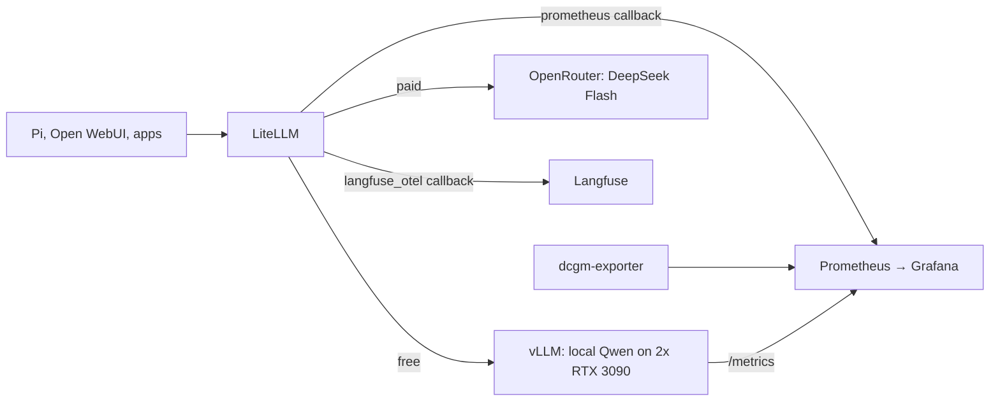
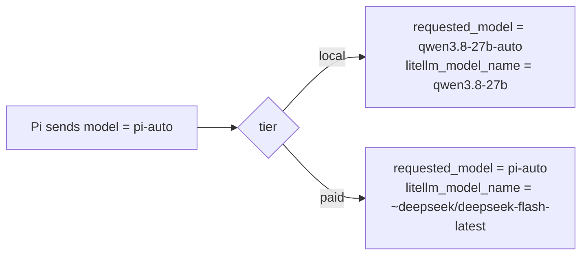

# AI gateway and analytics

**Which model answered?** Open Grafana `/d/pi-routing`.
**Why did that turn escalate?** Open `langfuse.vanillax.me`, filter tag `pi`.

New to the stack? Read [Local AI starter kit](index.md) first.

!!! tip "Which tool do I open?"
    - **How many, how fast, how much?** Grafana.
    - **Why did this one request do that?** Langfuse.
    - **Is it even running?** Run [Verify a deployment](#verify-a-deployment). About 15 minutes.

Every LLM request in the homelab goes through one gateway, LiteLLM. LiteLLM
sends each request to a backend and reports what happened to two places.



## Who measures what

| Tool | Answers |
|---|---|
| Grafana `/d/pi-routing` — Pi Auto-Routing | local vs paid ratio, classifier health, spend |
| Grafana `/d/ai-gateway-analytics` — AI Gateway and Analytics | all gateway requests, tokens, latency, failures, Langfuse health |
| Grafana `/d/vllm-inference` — vLLM Inference | Qwen queue depth, throughput, time to first token, KV cache use |
| Grafana `/d/gpu-overview` — GPU Overview | GPU power, memory, temperature, utilisation |
| Langfuse | one trace per request: input, output, tokens, session, routing reason |

Grafana shows totals and trends. Langfuse shows single requests. Start in
Grafana, then open Langfuse to see why one request went where it did.

## Reading the Qwen / DeepSeek split

Pi shows the `pi-auto` alias, never the backend that answered. LiteLLM records
two model labels on each request, and the split is the gap between them:



| Label | Meaning | Local Qwen turn | DeepSeek turn |
|---|---|---|---|
| `requested_model` | the route LiteLLM counted | `qwen3.8-27b-auto` | `pi-auto` |
| `litellm_model_name` | what actually ran | `qwen3.8-27b` | `~deepseek/deepseek-flash-latest` |

**Gotcha:** LiteLLM counts a local turn under the tier route
`qwen3.8-27b-auto`, not under `pi-auto`. A query that filters on
`requested_model="pi-auto"` alone shows 0% local. Match both names:
`requested_model=~"pi-auto|qwen3.8-27b-auto"`. Only `pi-auto` can reach
`qwen3.8-27b-auto`, so no other client gets counted.

`litellm_proxy_total_requests_metric_total` carries only `requested_model`, so
it cannot show the split. Use `litellm_deployment_success_responses_total`.

Pi traffic is sparse, and that causes two traps:

1. A counter that first appears at its full value makes `increase()` read
   zero for that first sample. A short window right after a LiteLLM restart can
   undercount.
2. `histogram_quantile` returns `NaN` when every bucket rate is zero. The
   classifier decision-time stat uses a `sum`/`count` average for this reason.

## Reading Langfuse

Langfuse stores the backend that answered in `providedModelName`. Scope every
widget with the tag filter `tags any of [pi]`; without it, Open WebUI and the
other gateway clients count as Pi turns.

Per trace, read `routing_decision.cause`:

| Cause | Meaning |
|---|---|
| `llm_classifier` | the classifier graded the request |
| `default_model_fallback` | classification failed, so the request went to the default, DeepSeek |

Langfuse dashboards live in the Langfuse database, not in Git. After a rebuild,
recreate them in the UI, or with `dashboardWidgets.create` plus
`dashboard.updateDashboardDefinition`.

Grafana dashboards live in Git under
[`monitoring/metrics/prometheus-stack/dashboards/ai/`](https://github.com/mitchross/talos-argocd-proxmox/tree/main/monitoring/metrics/prometheus-stack/dashboards/ai).
Edit the JSON through a PR; ArgoCD reloads them.

## Routes and credentials

Every URL, key and auth path is listed once, in
[model catalog § Wiring](model-catalog.md#wiring).

## Langfuse storage

| Store | Holds | Backup |
|---|---|---|
| PostgreSQL | identity, projects, configuration | kopiur, restore-before-bind |
| ClickHouse | AI observations | kopiur, restore-before-bind |
| Valkey | queue | **exempt** — losing it loses in-flight observations |
| RustFS | event payloads, media, exports | separate bucket lifecycle |

The Langfuse chart's bundled stores are disabled. The app owns PostgreSQL,
ClickHouse and Valkey, so no database operator is needed. A Sync hook creates
the RustFS bucket before web and worker start.

Do not describe this as lossless messaging. Keep all stores consistent when
planning a restore, and test recovery with synthetic observations first.

Langfuse v4 uses a new observations data model. The LiteLLM image ships the
legacy Langfuse SDK, so the plain `langfuse` callback does not work.
`langfuse_otel` sends the v4 header and exports to
`/api/public/otel/v1/traces`. Read with Observations API v2; legacy traces APIs
return 404 on a fresh v4 install.

## Verify a deployment

Roughly 15 minutes.

1. Confirm `my-apps-langfuse`, `my-apps-litellm`, `my-apps-open-webui` and
   `monitoring-prometheus-stack` are Synced/Healthy.
2. Sign into Langfuse and open **Homelab AI**. An empty chart means nothing
   until you have confirmed the project exists.
3. Send synthetic traffic:
   ```bash
   kubectl -n litellm exec -i deploy/litellm -- python - < scripts/smoke-litellm.py
   ```
   Expect PASS for thinking-off, streamed medium with usage, tool invocation,
   tool-result followup and vision. Record the printed
   `ai-observability-...` session marker.
4. In Langfuse Observations, filter by that `session_id` and clear the
   root-only filter. Expect at least five generations with model, input/output,
   positive token usage and latency. **Intake HTTP success alone proves
   nothing** — only stored observations do.
5. Check backups:
   ```bash
   kubectl -n langfuse get secret kopiur-rustfs
   kubectl -n langfuse get snapshotpolicy,snapshotschedule,restore,snapshot
   ```
   Both database policies exist and snapshots reach `Succeeded` with non-zero
   files. A brand-new empty PVC is not a tested restore.

## Check that `pi-auto` uses both models

Send one easy and one hard request:

```bash
K=$(cat ~/.pi/agent/litellm-api-key)
for p in "What is 2+2?" "Design a lock-free MPMC queue in Rust and prove it linearizable."; do
  curl -s -D - -o /dev/null https://litellm.vanillax.me/v1/chat/completions \
    -H "Authorization: Bearer $K" -H 'Content-Type: application/json' \
    -d "{\"model\":\"pi-auto\",\"max_tokens\":256,\"messages\":[{\"role\":\"user\",\"content\":\"$p\"}]}" \
    | grep -i x-litellm-model-name
done
```

Expect `openai/qwen3.8-27b` first and `openrouter/~deepseek/deepseek-flash-latest`
second. The hard request costs a fraction of a cent. Both then show on
`/d/pi-routing`.

## Check the adapter before a LiteLLM bump

Check the adapter before you deploy a LiteLLM bump:

```bash
kubectl -n litellm exec -i deploy/litellm -- python - < scripts/verify-litellm-langfuse.py
```

This uses synthetic in-memory spans, makes no model requests, and catches a
pinned-adapter incompatibility before it reaches the cluster.

## When telemetry breaks

| Symptom | Cause | Fix |
|---|---|---|
| Requests work, no traces | adapter or key mismatch | run the adapter check above |
| Empty charts, project missing | signed into the wrong project | open **Homelab AI** |
| Traces stop after a version bump | v4 data-model or SDK drift | re-run the adapter check, then step 4 |
| `/d/pi-routing` shows 0% local | query filters on `pi-auto` only | match `pi-auto\|qwen3.8-27b-auto` |
| TTFT panel empty | no streaming traffic | send a streamed request |

Availability and restart panels never prove ingestion. Only step 4 does.

Telemetry is optional to inference. If Langfuse is down, model requests still
succeed and observations for that window are lost.

## Upstream

- [LiteLLM Auto Routing](https://docs.litellm.ai/docs/proxy/auto_routing)
- [LiteLLM OpenRouter provider](https://docs.litellm.ai/docs/providers/openrouter)
