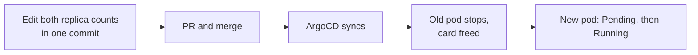

# GPU scale-swap runbook

This runbook moves a graphics card from one app to another. It changes the
committed replica counts of two apps in Git. It does not change drivers, the
power cap, or any model file.

Each graphics card runs one app at a time. To give a card to a different app,
set the current owner to 0 replicas and the new owner to 1 replica in one
commit.

New to the stack? Read [Local AI starter kit](index.md) first.

## The rule

GPU workloads own whole cards and exclude each other. Time-slicing is off,
every pod requests whole `nvidia.com/gpu` cards, and every Deployment uses
`strategy: Recreate`. **Never run two pods on one card.**

Two mechanisms enforce the rule:

1. The scheduler holds a scaled-up pod in `Pending` until the outgoing pod
   releases its card. `Insufficient nvidia.com/gpu` during a swap is normal.
2. ArgoCD selfHeal reverts `kubectl scale`. Only the value committed in Git
   moves a card.

## Who holds the cards

| App | Cards | `replicas` in Git | File |
|---|---:|---:|---|
| vLLM (Qwen3.8-27B INT4/W4A8) | 2 | `1` | `my-apps/ai/vllm/kustomization.yaml` |
| Strata (Qwen3.8-Flash-Next, parked) | 2 | `0` | `my-apps/ai/strata/kustomization.yaml` |
| NInfer-3090 (archived, not deployed) | 1 | n/a | `my-apps/ai/_archive/ninfer/deployment.yaml` |
| ComfyUI | 1 | `0` | `my-apps/ai/comfyui/deployment.yaml` |
| SwarmUI | 1 | `0` | `my-apps/ai/swarmui/deployment.yaml` |
| llmfit (archived, not deployed) | 1 | n/a | `my-apps/ai/_archive/llmfit/` |

vLLM owns both cards, so no GPU is spare while it runs. Multiply `replicas` by
cards for each active workload and add the results. The total must not exceed
two.

A `replicas` entry in an app's `kustomization.yaml` overrides the value in its
`deployment.yaml`. vLLM and Strata have that entry, so edit the kustomization
for those two.

## Before you start

- Pick the target state from the table above. Confirm the total is two cards or fewer.
- Read [What stops while vLLM is at 0](#what-stops-while-vllm-is-at-0). Every LLM client loses its backend during that time.
- If the incoming app is a different LLM backend, plan the Service and HTTPRoute change for the same commit. Both LAN hostnames, `vllm.vanillax.me` and `llama.vanillax.me`, route to vLLM.

## Swap the cards

The edit takes about 10 minutes. ArgoCD reconciliation adds more time.



1. Edit the outgoing and incoming replica counts in one commit.
2. Open a PR. The operator decides when to merge.
3. After the merge, wait for the outgoing pod to release the card. The incoming
   pod stays `Pending` until then. Do not change anything to clear `Pending`.
4. Verify the result:

    ```bash
    kubectl -n vllm get pods
    kubectl -n comfyui get pods
    kubectl -n swarmui get pods
    kubectl -n gpu-operator exec ds/nvidia-powerlimit -- nvidia-smi
    curl -fsS https://vllm.vanillax.me/v1/models
    ```

    Expect the incoming pod `Running` and two cards at the 200 W cap. When vLLM
    is the incoming app, expect the endpoint to answer with the model list.

## Roll back

Revert the swap commit through a PR. ArgoCD applies the earlier replica counts,
and the same wait-then-verify steps apply.

## What stops while vLLM is at 0

Open WebUI, Perplexica, LiteLLM, Presenton, Hermes, Home Assistant and any Pi
session on the cluster endpoint lose their local backend.

ComfyUI's vision-to-image helper calls the chat backend. vLLM needs both
cards, so the helper has no backend while ComfyUI holds a card. An archived GPU
job such as llmfit needs vLLM parked before you bring it back.

## Rules

- Do not run `kubectl scale`. ArgoCD selfHeal reverts it.
- Do not set `NVIDIA_VISIBLE_DEVICES` or `CUDA_VISIBLE_DEVICES` in workload
  pods. The device plugin assigns cards. The `nvidia-powerlimit` DaemonSet is
  the one intended exception.
- Do not switch a GPU Deployment to `RollingUpdate`. `Recreate` releases the
  whole card first and avoids a Multi-Attach error on the app's disk.
- Do not raise the power cap for more throughput. `POWER_LIMIT_WATTS` is set to
  `200` in `infrastructure/gpu/nvidia-gpu-operator/powerlimit-daemonset.yaml`.
  The house electrical circuit sets that limit.

Related pages: [model catalog](model-catalog.md),
[Context and speed on RTX 3090s](3090-llm-optimization.md).
