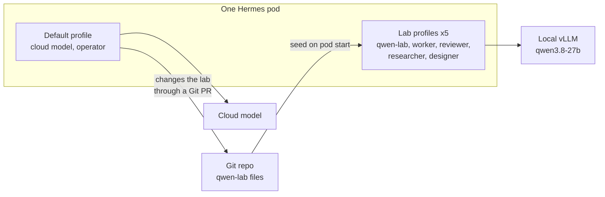
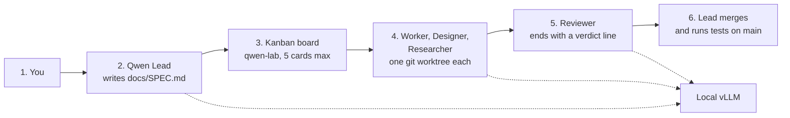
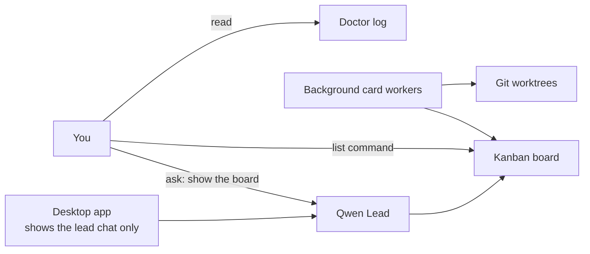
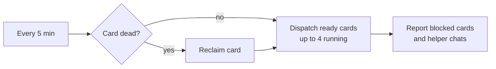

# Run the local bot team (Qwen Lab)

This page shows how to start and use Qwen Lab, a team of five Hermes bots that run only on the local vLLM model.
Read it if you want to hand a small build job to local bots and watch it finish.
It describes the current setup. [Hermes in the cluster](hermes.md#qwen-lab) has the short reference table.

## What this is

Qwen Lab is five Hermes profiles that share one self-hosted model, `qwen3.8-27b`, served by vLLM in the cluster.
A profile is a separate Hermes identity with its own config, memory and instructions.
The profiles are `qwen-lab` (titled Qwen Lead), `qwen-worker`, `qwen-reviewer`, `qwen-researcher` and `qwen-designer`.

Use the lab when you want a job done with no cloud model and no cloud cost.
Use the default profile for everything else. The default profile keeps its cloud model, and the lab never changes it.



The lab profiles have no cloud keys and no fallback provider. The only model endpoint is vLLM.

## Start the lab

Prerequisites: the Hermes desktop app is connected to your cluster's Hermes, and vLLM is running.

1. Check that vLLM is up. Run this read-only command on a machine with cluster access:

   ```bash
   kubectl -n vllm get deploy vllm-server
   ```

   Expected result: the deployment shows `1/1` ready. If it shows `0/1`, stop. The bots cannot work until vLLM is ready. See [3090 LLM optimization](3090-llm-optimization.md) for more vLLM checks.

2. In the desktop app, pick the `qwen-lab` profile (titled Qwen Lead) in the profile list or the Bots tab.
3. Open a new chat. This chat is the lead's chat.

## How to ask

Send every job to Qwen Lead. Do not send a multi-step job to a helper.
A helper replies "Send this to Qwen Lead." A small question to a helper is fine.

Write the job in plain, unambiguous words. Say what to build, what it must do, and how to test it.
A good short job:

```text
Build a small browser extension that keeps a list of rules. I can add a rule, delete a rule,
and the list stays after I close the browser. Build it with cards as usual.
```

Send bug reports and new features to the same lead chat. The lead turns each one into new cards.

## What happens next



1. You write the job to Qwen Lead in the desktop app.
2. The lead writes a one-page spec to `docs/SPEC.md` in the project repo and commits it on `main`.
3. The lead creates at most 5 cards on the Kanban board `qwen-lab` with the `hermes kanban` command. The last card is a merge card assigned to the lead.
4. Helper bots run the cards as background Kanban workers. Each code card gets its own git worktree, which is a separate checkout on its own branch.
5. Review is its own card. The reviewer passes with `VERDICT: READY TO MERGE`, or blocks the card with numbered fixes.
6. The lead merges the approved branch into the local `main` and runs the tests there.

The lead stops after it lists the card ids. The board runs the cards.

Thinking levels differ by role. The lead thinks at high, the reviewer at xhigh, and the worker, researcher and designer at medium.
Workers have no subagents. At most 4 cards run at once, because more than 4 busy bots slow every card on two GPUs.
The whole team shares one model, so a small project takes an hour or more.

## How to watch

The desktop app shows only the lead's chat. Helpers run as background card workers, so they do not open chats.



Use one of these:

1. Ask the lead: `show the board`.
2. List the cards from a shell in the Hermes pod:

   ```bash
   hermes kanban --board qwen-lab list
   ```

   Expected result: one row per card with its status. Each child card shows its parents, and the merge card is last.
3. Read the doctor log at `/opt/data/workspace/reports/qwen-lab/doctor.log`.

## Self-healing

The `qwen-lab-doctor` cron job runs every 5 minutes. It is a script with no model calls.
It repairs the board and writes a line to the log for each action.



A running card counts as dead in three cases:

- Its worker ran on a pod that no longer exists.
- Its worker process is gone, after a 2 minute grace period for a fresh claim.
- Its worker shows no heartbeat for 15 minutes.

The doctor reports a standing problem once, not on every run.
It also flags a helper chat that made 10 or more model calls on a big job outside a card.

The seed script installs the doctor from Git on every pod start. It rewrites the script and creates the job if it is missing.

## Gotchas and guards

| Gotcha | Guard |
|---|---|
| vLLM accepts one image per prompt. A second screenshot in one chat fails. | The lab pins vision to the local model so each image is read in its own call. |
| A pod restart kills every running card. A killed card starts again from zero. | The doctor reclaims dead cards and dispatches them again within 5 minutes. Do not restart the pod to stop one chat. |
| A pod that lacks the doctor script cannot heal the board. | `seed.sh` copies every Git cron script into place on every start, and creates the missing job. |
| A waiting approval prompt stalls the whole board. | The lab runs with `approvals.mode: off`. A deny list still blocks `kubectl`, `talosctl`, `omnictl`, `helm`, `git push`, `gh pr merge`, `claude` and `codex`. |
| The lead can ask a question in its chat and wait without a sound. | No guard yet. Check the lead chat. |
| A failed review blocks the board until the lead hears about it. | The doctor lists the card as `BLOCKED` in its log, but nothing wakes the lead. Tell the lead the review card is blocked. |
| A test fake written by the same bot can accept calls that the real browser rejects. | No guard. Test the result in a real browser before you trust it. |
| A job sent to a helper starts work outside the board. | Helpers refuse with "Send this to Qwen Lead." The doctor also flags helper chats that do big jobs. |

Lab bots never push, never merge a GitHub pull request, never use cluster tools and never use cloud AI.
The lead merges only into the local `main` of the lab repo.

## Switch back to the default profile

1. In the desktop app, pick the `default` profile in the profile list.
2. Open a new chat for normal work.

The running lab cards keep going in the background. The board and the doctor do not need the lead chat open.

## Source of truth

- Lab config: `my-apps/development/hermes/qwen-lab/base.yaml` and `profiles.yaml`.
- Shared rules: `my-apps/development/hermes/qwen-lab/SOUL.md` and the `skills` folder next to it.
- Seed: `my-apps/development/hermes/scripts/seed-qwen-lab.py` and `seed.sh`.
- Doctor: `my-apps/development/hermes/cron/qwen-lab-doctor.py` and `cron/jobs.txt`.
- Tests: `scripts/tests/test_hermes_qwen_lab.py` and `test_hermes_qwen_lab_doctor.py`.

To change the lab, edit those files and open a pull request. The seed applies the change on the next pod start.
