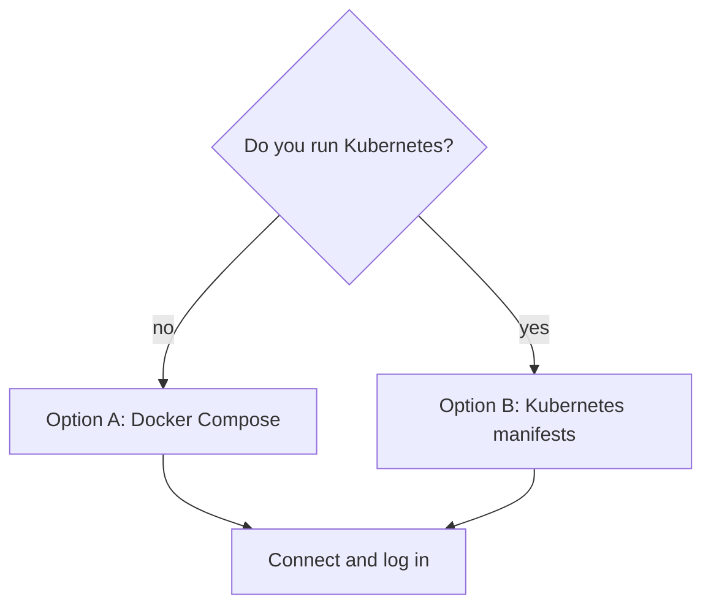

# Run Hermes on another cluster

This page shows how to run the public `hermes-dev` image in another homelab, with Docker Compose or plain Kubernetes manifests.
It is for someone who does not have this Git repo.
You need nothing from this cluster: no Argo CD, 1Password, Longhorn, Kopiur, LiteLLM or Hindsight.

Hermes is an AI agent that runs all day on a server. You talk to it through a web dashboard.
It can run shell commands and start the coding agents Claude Code and Codex, which the image includes.
[homelab-images/images/hermes-dev](https://github.com/mitchross/homelab-images/tree/main/images/hermes-dev) lists what the image installs and how it is built.

Related pages: [Hermes in the cluster](hermes.md) describes this cluster's setup.
[Run Hermes on your PC](hermes-one-computer.md) needs no server.
The [Local AI starter kit](index.md) shows how the pieces fit.



## Let a coding agent do the install

This step is optional. Skip it to follow the manual steps below.
Paste this prompt into Claude Code or Codex, inside your own cluster repo:

```text
Read https://raw.githubusercontent.com/mitchross/talos-argocd-proxmox/main/docs/domains/ai-gpu/hermes-other-clusters.md.
Deploy Hermes to my Kubernetes cluster with the manifests on that page.
Before you change anything, ask me for: hostname, Gateway API or Ingress, StorageClass, and which model to use
(Claude subscription token, or the URL of my own OpenAI-compatible LLM server).
Keep secrets out of Git. Create the Secret with kubectl and show me the command first.
```

Review every command the agent proposes before it runs.

## What you need

- An `amd64` machine. The image has no `arm64` build.
- Docker, or a Kubernetes cluster with a default `ReadWriteOnce` StorageClass.
- For Kubernetes, an HTTPS Gateway (Gateway API) or an Ingress controller that passes WebSockets.
- A DNS name for Hermes, for example `hermes.example.com`.
- One model. Use a Claude Max or Pro token from `claude setup-token` on your PC, or an OpenAI-compatible server such as vLLM, llama.cpp or LiteLLM.

The image is public at `ghcr.io/mitchross/hermes-dev`. Pin a digest, because the `main` tag moves with each build:

```bash
docker buildx imagetools inspect ghcr.io/mitchross/hermes-dev:main | grep Digest
```

The container must start as root.
s6-overlay, the process supervisor in the image, sets up the volume. It then drops the gateway and the dashboard to user `hermes` (uid 10000).

## The settings file

Hermes reads `config.yaml` from its data directory (`/opt/data`). Start with one of these two files.

For a Claude subscription, the token goes in `CLAUDE_CODE_OAUTH_TOKEN`:

```yaml
model:
  provider: anthropic
  default: claude-sonnet-5-5
terminal:
  backend: local
  cwd: /opt/data/workspace
timezone: "America/New_York"
```

For your own OpenAI-compatible server, the key goes in `MY_LLM_API_KEY`. Use any non-empty value if the server has no key:

```yaml
model:
  provider: custom
  default: my-model
  base_url: http://my-llm.example.svc.cluster.local:8000/v1
  api_key: ${MY_LLM_API_KEY}
terminal:
  backend: local
  cwd: /opt/data/workspace
timezone: "America/New_York"
```

Change `default`, `base_url` and `timezone` to your values. You can also switch models later in the dashboard's model picker.

## Option A: Docker Compose

1. Make a folder with a `data/` directory in it.
2. Save one of the settings files above as `data/config.yaml`.
3. Generate two secrets. Run this command twice and keep both values:

    ```bash
    openssl rand -base64 32
    ```

4. Save this as `compose.yaml` next to `data/`:

    ```yaml
    services:
      hermes:
        image: ghcr.io/mitchross/hermes-dev:main@sha256:<digest>
        command: ["gateway", "run"]
        restart: unless-stopped
        ports:
          - "9119:9119"
        environment:
          HERMES_UID: "1000"            # your user id (`id -u`), so you can edit files in ./data
          HERMES_GID: "1000"            # your group id (`id -g`)
          HERMES_DASHBOARD: "1"
          HERMES_DASHBOARD_HOST: 0.0.0.0
          HERMES_DASHBOARD_PUBLIC_URL: http://<server-ip>:9119
          HERMES_DASHBOARD_BASIC_AUTH_USERNAME: admin
          HERMES_DASHBOARD_BASIC_AUTH_PASSWORD: "<first secret>"
          HERMES_DASHBOARD_BASIC_AUTH_SECRET: "<second secret>"
          HERMES_GATEWAY_BOOTSTRAP_STATE: running
          CLAUDE_CODE_OAUTH_TOKEN: "<token, or delete this line>"
          MY_LLM_API_KEY: "<key, or delete this line>"
        volumes:
          - ./data:/opt/data
          - type: tmpfs
            target: /dev/shm
            tmpfs:
              size: 536870912
    ```

5. Run `docker compose up -d`.
6. Open `http://<server-ip>:9119` and sign in as `admin` with the first secret.

It worked when `curl -s http://<server-ip>:9119/api/status` shows `"gateway_state":"running"`.

Continue at [Connect and log in](#connect-and-log-in).

## Option B: Kubernetes

Create a folder with the files below, and save your settings file in it as `config.yaml`.

`kustomization.yaml` lists the files and turns `config.yaml` into a ConfigMap:

```yaml
apiVersion: kustomize.config.k8s.io/v1beta1
kind: Kustomization
namespace: hermes
resources:
  - namespace.yaml
  - pvc.yaml
  - deployment.yaml
  - service.yaml
  - route.yaml
configMapGenerator:
  - name: hermes-config
    files:
      - config.yaml
```

`namespace.yaml`. Use the `baseline` Pod Security level, not `restricted`, because the container starts as root.

```yaml
apiVersion: v1
kind: Namespace
metadata:
  name: hermes
  labels:
    pod-security.kubernetes.io/enforce: baseline
```

`pvc.yaml` requests the disk that holds sessions, memories, skills and logins:

```yaml
apiVersion: v1
kind: PersistentVolumeClaim
metadata:
  name: hermes-data
spec:
  accessModes: [ReadWriteOnce]
  resources:
    requests:
      storage: 20Gi
```

`deployment.yaml`. The `seed` init container copies `config.yaml` from the ConfigMap over the volume on every start.
Your Git copy of `config.yaml` therefore stays the source of truth, and an edit made in the pod is lost on the next start.

```yaml
apiVersion: apps/v1
kind: Deployment
metadata:
  name: hermes
spec:
  replicas: 1
  # RWO volume: a rolling update would start a second pod that cannot attach it.
  strategy:
    type: Recreate
  selector:
    matchLabels:
      app.kubernetes.io/name: hermes
  template:
    metadata:
      labels:
        app.kubernetes.io/name: hermes
    spec:
      automountServiceAccountToken: false
      terminationGracePeriodSeconds: 60
      nodeSelector:
        kubernetes.io/arch: amd64
      securityContext:
        fsGroup: 10000
        fsGroupChangePolicy: OnRootMismatch
        seccompProfile:
          type: RuntimeDefault
      initContainers:
        - name: seed
          image: ghcr.io/mitchross/hermes-dev:main@sha256:<digest>
          command: ["/bin/sh", "-c", "install -o 10000 -g 10000 -m 0644 /etc/hermes-config/config.yaml /opt/data/config.yaml"]
          securityContext:
            runAsUser: 0
            allowPrivilegeEscalation: false
          volumeMounts:
            - name: data
              mountPath: /opt/data
            - name: config
              mountPath: /etc/hermes-config
              readOnly: true
      containers:
        - name: hermes
          image: ghcr.io/mitchross/hermes-dev:main@sha256:<digest>
          args: ["gateway", "run"]
          # s6-overlay must start as root; it drops the gateway and dashboard to uid 10000 itself.
          securityContext:
            runAsUser: 0
          ports:
            - name: http
              containerPort: 9119
          envFrom:
            - secretRef:
                name: hermes
          env:
            - name: HERMES_DASHBOARD
              value: "1"
            - name: HERMES_DASHBOARD_HOST
              value: 0.0.0.0
            # Must equal the route hostname, or dashboard sign-in redirects break.
            - name: HERMES_DASHBOARD_PUBLIC_URL
              value: https://hermes.example.com
            - name: HERMES_DASHBOARD_BASIC_AUTH_USERNAME
              value: admin
            # A blank volume otherwise leaves the gateway registered but down.
            - name: HERMES_GATEWAY_BOOTSTRAP_STATE
              value: running
          resources:
            requests:
              cpu: 500m
              memory: 1Gi
            limits:
              memory: 6Gi
          # No liveness probe: a long agent run must not trigger a restart.
          startupProbe:
            httpGet:
              path: /api/status
              port: http
            periodSeconds: 5
            failureThreshold: 60
          readinessProbe:
            httpGet:
              path: /api/status
              port: http
            periodSeconds: 15
          volumeMounts:
            - name: data
              mountPath: /opt/data
            - name: shm
              mountPath: /dev/shm
      volumes:
        - name: data
          persistentVolumeClaim:
            claimName: hermes-data
        - name: config
          configMap:
            name: hermes-config
        - name: shm
          emptyDir:
            medium: Memory
            sizeLimit: 512Mi
```

`service.yaml`:

```yaml
apiVersion: v1
kind: Service
metadata:
  name: hermes
spec:
  selector:
    app.kubernetes.io/name: hermes
  ports:
    - name: http
      port: 9119
      targetPort: http
```

`route.yaml` for Gateway API. Set `parentRefs` to your Gateway and its HTTPS listener:

```yaml
apiVersion: gateway.networking.k8s.io/v1
kind: HTTPRoute
metadata:
  name: hermes
spec:
  parentRefs:
    - name: my-gateway
      namespace: gateway
      sectionName: https
  hostnames:
    - hermes.example.com
  rules:
    - matches:
        - path:
            type: PathPrefix
            value: /
      backendRefs:
        - name: hermes
          port: 9119
```

Or use this `route.yaml` for ingress-nginx. ingress-nginx closes idle WebSockets after 60 s unless you raise the timeouts:

```yaml
apiVersion: networking.k8s.io/v1
kind: Ingress
metadata:
  name: hermes
  annotations:
    nginx.ingress.kubernetes.io/proxy-read-timeout: "3600"
    nginx.ingress.kubernetes.io/proxy-send-timeout: "3600"
spec:
  ingressClassName: nginx
  tls:
    - hosts: [hermes.example.com]
      secretName: hermes-tls
  rules:
    - host: hermes.example.com
      http:
        paths:
          - path: /
            pathType: Prefix
            backend:
              service:
                name: hermes
                port:
                  name: http
```

### Deploy

1. Replace `hermes.example.com` and `<digest>` in the files.
2. Create the namespace and the Secret. Keep the Secret values out of Git. Leave out the model key that you do not use:

    ```bash
    kubectl apply -f namespace.yaml
    PASSWORD="$(openssl rand -base64 32)"
    kubectl -n hermes create secret generic hermes \
      --from-literal=HERMES_DASHBOARD_BASIC_AUTH_PASSWORD="$PASSWORD" \
      --from-literal=HERMES_DASHBOARD_BASIC_AUTH_SECRET="$(openssl rand -base64 32)" \
      --from-literal=CLAUDE_CODE_OAUTH_TOKEN="<token>" \
      --from-literal=MY_LLM_API_KEY="<key>"
    echo "$PASSWORD"
    ```

3. Save the printed password in your password manager.
4. Deploy and wait. The first pull is large:

    ```bash
    kubectl apply -k .
    kubectl -n hermes rollout status deployment/hermes --timeout=10m
    ```

### Check

```bash
kubectl -n hermes get pod,pvc
curl -s https://hermes.example.com/api/status | jq '{version, gateway_state}'
curl -s -o /dev/null -w '%{http_code}\n' https://hermes.example.com/
```

| Result | Meaning |
|---|---|
| Pod `1/1 Running`, PVC `Bound` | Ready |
| `"gateway_state": "running"` | The gateway is up |
| `302` on `/` | The dashboard sends you to its sign-in page, as it should |
| Pod in `CreateContainerConfigError` | The Secret `hermes` is missing |
| Pod rejected by Pod Security | The namespace is `restricted`; use `baseline` |

## Connect and log in

1. Open your hostname and sign in as `admin` with the password.
2. Open the dashboard terminal (bottom bar, terminal icon).
3. For Codex, first open chatgpt.com, go to Settings, then Security and login, and turn on device code sign-in.
4. Log in to Codex and GitHub once. The logins stay on the volume:

    ```bash
    codex login --device-auth
    gh auth login --web --git-protocol https
    gh auth setup-git
    ```

5. Set your Git identity: `git config --global user.name "<name>"` and `git config --global user.email "<email>"`.

Claude Code needs no login when `CLAUDE_CODE_OAUTH_TOKEN` is set.

It worked when `codex login status` and `gh auth status` both report a signed-in account.

This cluster adds Hindsight memory, `kubectl` access to the cluster and a daily digest skill.
Those extras are in [`my-apps/development/hermes`](https://github.com/mitchross/talos-argocd-proxmox/tree/main/my-apps/development/hermes), and [Hermes in the cluster](hermes.md) explains them.
Copy them after the basic pod works.
For skills and daily habits, read [How I use Hermes](hermes-how-i-work.md).

## Security

Hermes gives anyone with the dashboard password a shell with your logins. Treat the password like an SSH key.

- Use a long random password.
- Put an identity gate in front, such as Cloudflare Access or a VPN. A bare password on a public hostname is the weakest option.
- Use a fine-grained GitHub token for the repos that agents need: `gh auth login --with-token`.
- Protect your GitOps branch. A token that can push there can deploy anything.
- Do not give the pod a ServiceAccount with write access. The manifests above mount no token at all.
- Set a monthly spend limit at every paid model provider.

## Update, back up, roll back

| Task | Do this |
|---|---|
| Update | Change the digest and apply again. The volume stays. |
| Back up | Snapshot `hermes-data` (or `./data` for Compose) with your storage tool or Velero. It holds sessions, memories, skills and logins. |
| Roll back | Put the old digest back and apply again. |

**Warning:** `kubectl delete namespace hermes` deletes the PVC with your sessions and logins.
