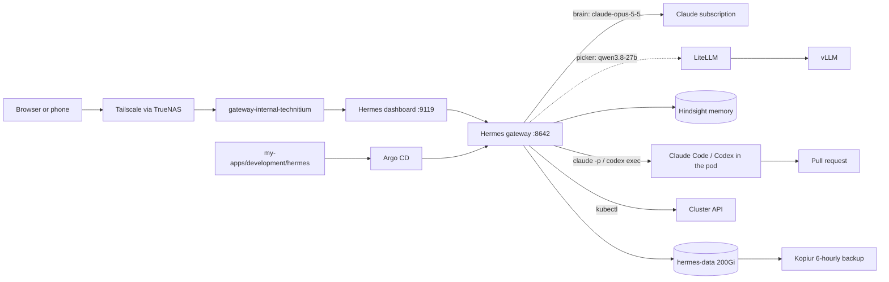
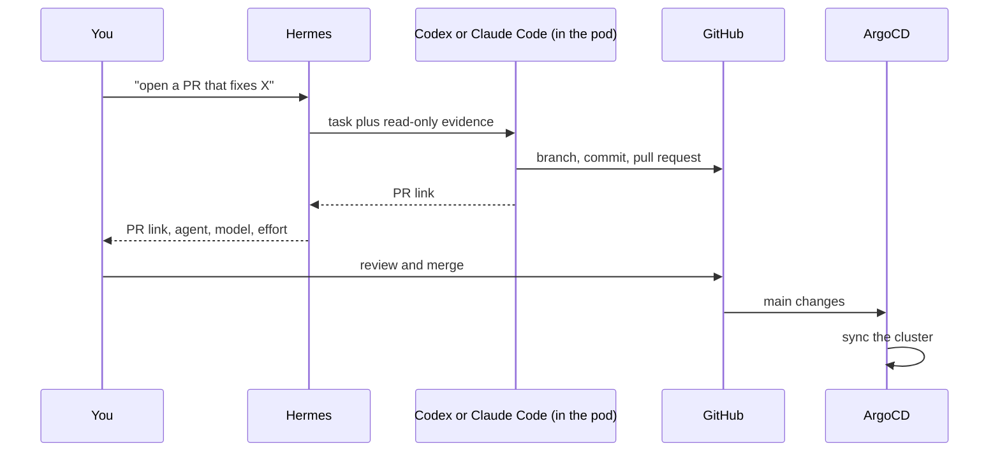
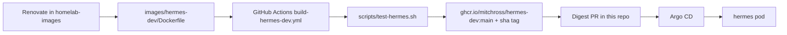

# Hermes in the cluster

This page shows how this cluster hosts Hermes Agent, how to log in, and how to keep it running.
Read it when you use, change or repair the Hermes in this cluster.
Argo CD syncs [`my-apps/development/hermes`](https://github.com/mitchross/talos-argocd-proxmox/tree/main/my-apps/development/hermes) as the Application `my-apps-hermes`.

Related pages:

- [Pi and Hermes](pi-agent-local-dev.md) helps you choose between the two agents.
- [Run Hermes on another cluster](hermes-other-clusters.md) and [Run Hermes on your PC](hermes-one-computer.md) are install guides that need nothing from this repo.
- [How I use Hermes](hermes-how-i-work.md) describes the daily workflow.
- The [Hermes CLAUDE.md](https://github.com/mitchross/talos-argocd-proxmox/blob/main/my-apps/development/hermes/CLAUDE.md) says which repo owns which change.

!!! tip "Do this first"
    1. Turn on Tailscale if you are away from home.
    2. Open `https://hermes.vanillax.me` and sign in ([Connect](#connect)).
    3. In the Chat tab, ask "is the cluster healthy". About 2 minutes.

## What Hermes is

An agent is an LLM that can also run tools, such as shell commands and file edits.
Hermes is an agent that keeps running when nobody is at a keyboard.
One pod in the `hermes` namespace runs a gateway for cron jobs and chat platforms, plus a web dashboard.
Hermes remembers across sessions through Hindsight, the memory service in this cluster, and loads skills on demand.

Hermes is the coordinator.
It reads the cluster and does day-to-day fixes such as restart, exec and cordon.
For a code or config change, it runs Claude Code or Codex inside its own pod to open a pull request.
You merge the pull request, and Argo CD deploys it.



## Connect

Hermes has no public address. Away from home, turn on Tailscale first.
The Tailscale app on TrueNAS (`192.168.10.133`) must provide two things:

| Tailscale setting | Value | Without it |
|---|---|---|
| Approved subnet route | `192.168.10.0/24` | The client cannot reach the gateway |
| Split DNS for `vanillax.me` | `192.168.10.15` (Technitium) | `hermes.vanillax.me` does not resolve |

1. Open `https://hermes.vanillax.me`.
2. Sign in with username `vanillax` and the password from the `hermes` item in the 1Password vault `homelab-prod`.
3. Open the Status page to see the gateway. Open the Chat tab to start a session.

It worked when the Status page shows the gateway as running.

## Pick the brain

The brain is the model that answers in a chat and decides what to do next.
The model picker sits at the bottom right of the chat box.
Click "Refresh models" once after a new login.

New sessions, the daily digest and Kanban workers on the default profile start on Claude Opus 5.5 (`claude-opus-5-5`) at medium effort, under the Anthropic provider.
The `litellm` provider lists `qwen3.8-27b` and `qwen3.8-27b-local`. Both run on the cluster's GPUs at no cost.
`qwen3.8-27b-local` never falls back to a cloud model. `qwen3.8-27b` can overflow to paid DeepSeek.
GitHub Copilot comes from the `gh` login.
The choice holds for that session.

When Claude rate-limits or returns an error, the chat moves to Codex (`gpt-6.1-sol`), then to DeepSeek Flash.
Hermes waits instead of switching when the limit resets within 2 minutes.

The brain only navigates and coordinates. Other models do the delegated work:

| Work | Model | Set in |
|---|---|---|
| Subagents (`delegate_task`) | Routes `local`, `fast`, `balanced`, `codex` and `deep`. Untagged tasks use `codex` (`gpt-6.1-sol`) | `config/config.yaml`, `delegation` |
| Code changes | Codex `gpt-6.1-sol` at high effort by default. Claude Code runs only when you ask for it or after a Codex run failed. Then Sonnet 5.5 does spelled-out fixes and Opus 5.5 does investigation, both at high effort | `skills/homelab-ops/SKILL.md` |
| Small helper calls, such as chat titles | `deepseek-flash` through LiteLLM | `config/config.yaml`, `auxiliary` |

Kanban workers run the profile's main model unless the card names another one.
To send a card to Codex, create it with `--provider openai-codex --model gpt-6.1-sol`.

## Log the coding agents in once

Claude Code needs no login, because its token comes from 1Password.
Codex and `gh` keep their logins on the volume.
Do each login once from the dashboard terminal (bottom bar, terminal icon):

1. Open chatgpt.com, go to Settings, then Security and login, and turn on device code sign-in.
2. Log in to Codex. Open the link, sign in with the ChatGPT account, and enter the code:

    ```bash
    codex login --device-auth
    ```

3. Log in to GitHub. Pick GitHub.com and follow the device code:

    ```bash
    gh auth login --web --git-protocol https
    gh auth setup-git
    ```

It worked when `codex login status` and `gh auth status` both report a signed-in account.

Then ask Hermes in a chat: "run `command -v claude codex; gh auth status; codex login status` in the terminal".
Hermes's terminal uses its own home directory, `/opt/data/home`, and the seed links the logins into it.
This chat check proves that Hermes itself can see the logins.

The seed runs `gh auth setup-git` again on every start.
A restored volume keeps the Codex and GitHub logins.
Interactive logins for Claude Code, Codex and `gh` live only on the volume.
Git does not hold them, and no separate credential backup exists.

After a rebuild without a backup, log in again for each account you use:

- Claude Code: `claude auth login`
- Codex: `codex login --device-auth`
- GitHub: `gh auth login --web --git-protocol https`

Claude Code does not need an interactive login while `CLAUDE_CODE_OAUTH_TOKEN` from 1Password is valid.

## Ask about the cluster

In the Chat tab, ask in plain words: "is the cluster healthy", "why is wyze-bridge degraded", "which backups failed this week".
Hermes loads the `homelab-ops` skill and runs the read-only `kubectl` checks.
It names the Git directory that owns a fix.
Config changes go through a pull request, because Argo CD reverts any change made directly in the cluster.

The daily digest is under Cron in the dashboard. Click the Trigger button to run it by hand.

To ask for a fix, write something like "open a PR that fixes the wyze-bridge secret".
Hermes starts Codex or Claude Code in its pod with the evidence, waits, and reports the pull request link.
You merge, and Argo CD deploys. Hermes never merges.



Hermes ends each hand-off report with `Agent: …, model: …, effort: …`, copied from the agent's own output.
To check the pinned models by hand, run:

```bash
kubectl -n hermes exec deploy/hermes -c hermes -- /command/s6-setuidgid hermes env HOME=/opt/data claude -p "Reply with exactly: OK" --max-turns 1 --output-format json | jq '.modelUsage | keys'
```

Expected: `["claude-opus-5-5"]`.

```bash
kubectl -n hermes exec deploy/hermes -c hermes -- /command/s6-setuidgid hermes env HOME=/opt/data codex exec --skip-git-repo-check --sandbox read-only "Reply with exactly: OK" 2>&1 | grep -E "^(model|reasoning effort):"
```

Expected: `model: gpt-6.1-sol` and `reasoning effort: high`.

## Add a chat platform

1. Add the bot token to 1Password.
2. Add the secret keys to `externalsecret.yaml` through a pull request.
3. Restart the pod after Argo CD syncs the change.

| Platform | Secret keys |
|---|---|
| Telegram | `TELEGRAM_BOT_TOKEN`, `TELEGRAM_ALLOWED_USERS` |
| Home Assistant | `HASS_TOKEN` (already wired) |

## Verify

```bash
kubectl -n argocd get application my-apps-hermes
kubectl -n hermes get pod,pvc,externalsecret,httproute
kubectl -n hermes logs deploy/hermes -c seed --tail=3
curl -s https://hermes.vanillax.me/api/status | jq '{version, gateway_state}'
kubectl -n hermes get snapshot
```

Expect `Synced` and `Healthy`, one `3/3 Running` Hermes pod, `hermes-data` `Bound`, both ExternalSecrets `SecretSynced`, and `[seed] done`.
Expect `"gateway_state": "running"` and a kopiur `Snapshot` that reached `Succeeded` within the last six hours.

## Change Hermes

Git is the source of truth. Never edit `config.yaml` or the skill in the pod, because the next start overwrites them.

| Change | Do this |
|---|---|
| Env vars, resources, route, backup | Open a PR to `my-apps/development/hermes/`. Argo CD rolls the pod. |
| Model, providers, memory, plugins | Open a PR to `config/config.yaml`. The seed copies it over the volume on the next start. |
| The ops skill or the digest | Open a PR to `skills/homelab-ops/SKILL.md`. |
| Tools or agent versions | Open a PR to homelab-images `images/hermes-dev`, wait for the CI image, then open a digest PR here. See [The image](#the-image). |
| Passwords and tokens | Edit 1Password. The ExternalSecret refreshes within 1 hour. Restart the pod when no agent work runs. |

Runtime state stays on the volume: sessions, cron jobs, skills that Hermes writes, memories and provider logins.

## Where each part lives

Paths without a prefix are under `my-apps/development/hermes/`.

| Piece | Where | Notes |
|---|---|---|
| Image | `ghcr.io/mitchross/hermes-dev` from [homelab-images](https://github.com/mitchross/homelab-images/tree/main/images/hermes-dev), pinned by digest in `deployment.yaml` | Official Hermes plus `claude`, `codex`, `kubectl`, `omnictl`, `talosctl`, `hubble`, `gh`, `tmux`. One container runs the gateway and the dashboard under s6-overlay |
| Pod | `deployment.yaml` | 1 replica, `Recreate`, starts as root, s6 drops to uid 10000. Init container `seed` runs `scripts/seed.sh` first. Limits are 8 CPU and 16 GiB. The CPU limit caps how many workers Jest and cargo start. VPA sets the requests |
| Sidecars | `deployment.yaml`, `scripts/gc-worktrees.sh`, `scripts/usage-exporter.py` | `worktree-gc` deletes idle build output. `usage-exporter` serves model usage totals on `:9464/metrics` |
| Rust toolchains | `scripts/seed.sh` | `RUSTUP_HOME=/opt/data/tools/rustup` on the volume. The image's toolchain is linked as default `hermes-image`. A repo's `rust-toolchain.toml` version installs once on first use (`RUSTUP_AUTO_INSTALL=1`) |
| Settings | `config/config.yaml` becomes a ConfigMap, and `scripts/seed.sh` copies it to `/opt/data/config.yaml` on every start | Model, providers, memory, dashboard URL, plugins, timezone |
| Plugins | `scripts/seed.sh` | Installs `hindsight`, `homeassistant` and `advanced-delegation` into the volume on first start |
| Coding agents | `scripts/seed.sh`, `skills/homelab-ops/SKILL.md` | The seed clones the talos repo into `/opt/data/workspace`, writes the Hindsight hook configs, and installs the Claude Code and Codex hooks. The skill runs `claude -p` or `codex exec` in the background |
| Brain | `claude-opus-5-5`, medium reasoning effort, through the Claude Code token (`config.yaml`) | Qwen (`providers.litellm`, local, no cost) and GitHub Copilot (`gh` login) stay selectable per session |
| Coding agents' models | `ANTHROPIC_MODEL=claude-opus-5-5` + `--effort high`; `.codex/config.toml` `gpt-6.1-sol` + `high` | The skill passes the model and the effort on every run and reports both on every hand-off. See [Pick the brain](#pick-the-brain) |
| Claude login | 1Password `claude-code/oauth_token` feeds `CLAUDE_CODE_OAUTH_TOKEN` | From `claude setup-token` on the Max plan. No browser login in the pod |
| Gitea login | 1Password `gitea/git_token` feeds `GITEA_TOKEN` | Git credential helper for `https://gitea.vanillax.me`. Clone and push work. There is no `tea` CLI |
| Dashboard login | 1Password `hermes/dashboard_password` and `dashboard_secret` feed Secret `hermes-secrets` | Username `vanillax`. The secret signs sessions, so logins survive restarts |
| Memory | Hindsight in the cluster, bank `hermes`. Plugin settings are in `config/hindsight-hermes.json`, which the seed copies to `hindsight/config.json` | Key from 1Password `hindsight/tenant_api_key` |
| Home Assistant | 1Password `home-assistant/ha-longlived-token` feeds `HASS_TOKEN` | Turns on the Home Assistant platform and entity tools |
| Route | `httproute.yaml` | `gateway-internal-technitium` only. Remote clients use Tailscale |
| Volume | `pvc.yaml` | `hermes-data`, 200Gi Longhorn, restore-before-bind |
| Scratch volume | `pvc-scratch.yaml` | `hermes-scratch`, 150Gi Longhorn, mounted at `/opt/scratch`, backup-exempt. Holds caches and Rust intermediates, so backups of `hermes-data` hold only state worth restoring. The `worktree-gc` sidecar deletes Cargo build dirs idle for 12 hours, or for 1 hour once the volume is 85% full |
| Backups | `kopiur/hermes-data.yaml` | Every 6 hours at :28. Keeps 8 hourly, 14 daily, 8 weekly, no monthly. The mover runs as 10000:10000. Longhorn also keeps 6 hourly CSI snapshots on the volume, and they do not survive loss of the volume |
| Cluster access | `rbac.yaml`, `config/kube-in-cluster.yaml` | `kubectl` from the image runs as ServiceAccount `hermes`. `hermes-viewer` reads, with no Secrets or ConfigMaps except `kube-system/cilium-config` through `hermes-cilium-config-reader`. `hermes-operator` restarts, deletes and evicts pods, scales, cordons, deletes PVCs, and execs in every namespace. `storage-bench` and `restore-canary` add Roles for the storage benchmark and the restore drill. Exec can read any Secret mounted in a pod. Job create and workload patch make this account cluster-admin in effect, by design |
| Omni and Talos | 1Password `hermes-omni-sa` (`OMNI_ENDPOINT`, `OMNI_SERVICE_ACCOUNT_KEY`) feeds `hermes-secrets`. The seed writes `~/.talos/config` | Omni Operator role, which manages clusters and machines but not users or service accounts |
| Pi SSH | `config/ssh_config`, `config/known_hosts`, `pi-egress.yaml` | `ssh pi` reaches the rpi5 as `vanillax` (Docker, sudo). Files live in `/opt/data/.ssh`, because OpenSSH uses the passwd home, not `$HOME`. The key is never regenerated. Its public half is in the Pi's `authorized_keys` |
| Personality | `config/SOUL.md` is copied to `/opt/data/SOUL.md` on every start | Tone and hard rules. Edit it in Git, never in the pod |
| Coding agent rules | `config/agent-rules.md` is installed as `~/.codex/AGENTS.md` and `~/.claude/CLAUDE.md` on every start | Git, code, comment and writing rules for `codex` and `claude` in the pod. Edit it in Git |
| Registry skills | `skills/snapshot.json` | 9 unpinned registry entries. `scripts/seed-skills.py` imports missing skills as uid 10000. Identifiers track registry contents, not immutable versions |
| Commit-pinned skills | `scripts/external-skills.txt` | All 105 pins stay pinned, including two stale registry paths and Matt Pocock's `tdd`/`teach` name collisions |
| Local and edited skills | `skills/library/<category>/<name>/` | Authored skills, saved local copies and the six modified bundled skills. The seed restores them before the snapshot import, only if missing. Refresh Git through a PR |
| Cloudflare | `config.yaml` `mcp_servers.cloudflare` points at `https://mcp.cloudflare.com/mcp`. 1Password `cloudflared-proxmox/api-token` feeds `CLOUDFLARE_API_TOKEN` | Cloudflare's OAuth login needs a browser in the pod, so Hermes sends an API token instead |
| Ops skill | `skills/homelab-ops/SKILL.md` | Six read-only checks, the digest format, and risk-based rules for Omni, Talos and the Pi. Copied to the volume on every start |
| Placement skill | `skills/hermes-change-placement/SKILL.md` | Tells Hermes which repo owns a change to itself: image, talos Git, 1Password or the volume. Copied to the volume on every start |
| Daily digest | `scripts/seed.sh` | Cron job `homelab-digest` at 08:00 (America/Detroit), skill `homelab-ops`. Output goes under `cron/output/` until a chat platform exists |
| Watch jobs | `cron/jobs.txt`, `cron/*.py`, `scripts/seed.sh` | Four script-only cron jobs. The seed restores a missing script and creates a missing job. It never overwrites a live copy |
| Drift report | `scripts/report-drift.sh` | Runs at the end of the seed. Lists volume content that Git and the image do not install, in `/opt/data/logs/seed-drift.log` |

### Where a change goes

| The change is | Put it in | A rebuild restores it from |
|---|---|---|
| A program (`helm`, `bun`, a CLI) | The `hermes-dev` Dockerfile in homelab-images | The image |
| A setting, a rule, a skill, a cron job or its script | `my-apps/development/hermes/` | Git, through the seed |
| A secret | 1Password and `externalsecret.yaml` | 1Password |
| State Hermes produces: sessions, Kanban, logins | Nothing to do. It lives on `hermes-data` | The kopiur backup only |

Never install a tool on the volume. Only the backup can restore it, and the drift report lists it on every start.

## The image

The pod runs `ghcr.io/mitchross/hermes-dev`, built in [mitchross/homelab-images](https://github.com/mitchross/homelab-images/tree/main/images/hermes-dev).
The image holds tools only. Everything Hermes writes lives on `hermes-data`.

Nous Research publishes a Docker image but no Helm chart.
The community charts and operators template many agents per cluster.
This cluster runs one agent, so it uses plain Kustomize manifests and its own image.



### What the Dockerfile adds

| Layer | Source | Pinned by |
|---|---|---|
| Base | official `nousresearch/hermes-agent` (gateway, dashboard, s6-overlay, Node, Python) | tag + digest |
| `tmux`, `jq`, `less`, `openssh-client`, `build-essential`, `pkg-config`, `libssl-dev`, `protobuf-compiler`, `libprotobuf-dev` | Debian packages | base image |
| `gh` | GitHub CLI `.deb` from the release page | `GH_VERSION` + `GH_SHA256` |
| `kubectl` | `dl.k8s.io` | `KUBECTL_VERSION` + `KUBECTL_SHA256` |
| `omnictl`, `talosctl` | Sidero GitHub releases | `OMNICTL_VERSION` (matches the Omni server), `TALOSCTL_VERSION` (matches the cluster), each with a SHA-256 |
| `hubble` | Cilium GitHub releases | `HUBBLE_VERSION` (near the cluster's Cilium release), SHA-256 checked |
| Claude Code, Codex | npm, installed into `/opt/agents` | `CLAUDE_VERSION`, `CODEX_VERSION` |
| Go, Rust | `go.dev`, `rustup` | `GO_VERSION`, `RUSTUP_VERSION`, `RUST_VERSION` |

`/opt/agents/bin` comes first on `PATH`, so the pinned CLIs win over anything on the volume.
`DISABLE_AUTOUPDATER=1` stops Claude Code from updating itself.
The build runs `hermes-image-smoke` as uid 10000. It fails if `hermes`, `claude`, `codex`, `git`, `gh`, `kubectl`, `tmux`, `jq`, `rg`, `node`, `npm`, `python3` or `ssh` is missing.
The image stays root at the end, because s6-overlay needs root to start. It then drops to `hermes` (10000:10000).
Current versions are in the [Dockerfile](https://github.com/mitchross/homelab-images/blob/main/images/hermes-dev/Dockerfile).

### How CI builds it

[`build-hermes-dev.yml`](https://github.com/mitchross/homelab-images/blob/main/.github/workflows/build-hermes-dev.yml) runs on a push or pull request that touches `images/hermes-dev/**`, `scripts/**` or the workflow itself.
It also runs on manual dispatch and every Monday at 05:17 UTC.
The Monday run skips the cache, so base-image security fixes land.

1. Build for `linux/amd64` only. There is no `arm64` image.
2. Test with [`scripts/test-hermes.sh`](https://github.com/mitchross/homelab-images/blob/main/scripts/test-hermes.sh). The script runs the smoke script as uid 10000 on an empty `/opt/data`, like a fresh PVC. It then boots the container as root and checks that `--version` prints `Hermes Agent v0.x`.
3. Push the tested image as `sha-<commit>-<run>-<attempt>`. On `main` it is also tagged `main`.
4. Print the digest in the job summary.

Pull requests from forks build and test but push nothing.

### How updates reach the cluster

| Change | Who | Then |
|---|---|---|
| Base image digest, Claude Code, Codex | Renovate in homelab-images opens a PR. The two agent CLIs are grouped as "coding agents" on Monday mornings | Merge it. CI publishes a new `main` |
| `gh`, `kubectl` | By hand. Bump the version and the SHA-256 together in the Dockerfile | Same |
| New `main` digest in this repo | Renovate's `kubernetes` manager watches `hermes-dev:main@sha256:…` in `deployment.yaml` and adds it to the "all container digests" PR | Merge it. Argo CD restarts the pod |

To pin a digest by hand, read it from the job summary or run:

```bash
docker buildx imagetools inspect ghcr.io/mitchross/hermes-dev:main | grep Digest
```

Put the digest in every `hermes-dev` reference in one PR.
The references are the four containers in `deployment.yaml` (`seed`, `hermes`, `worktree-gc`, `usage-exporter`) and `image-prepull.yaml`.
Check with `git grep -n hermes-dev@ my-apps/development/hermes`.

### Build and test it yourself

From a homelab-images checkout, on an `amd64` machine with Docker:

```bash
docker build --platform linux/amd64 -t hermes-dev:local images/hermes-dev
bash scripts/test-hermes.sh hermes-dev:local
```

It worked when the script prints the tool versions and a `Hermes Agent v0.x` line, and exits 0.

### Check what the pod runs

```bash
kubectl -n hermes get pod -l app.kubernetes.io/name=hermes -o jsonpath='{.items[0].status.containerStatuses[0].imageID}{"\n"}'
kubectl -n hermes exec deploy/hermes -c hermes -- sh -c '/opt/hermes/bin/hermes --version; claude --version; codex --version; gh --version | head -1; kubectl version --client'
```

The digest must match `deployment.yaml` on `main`.

## Qwen Lab

Qwen Lab is a team of Hermes profiles that use only the local Qwen model on vLLM.
Use it for fun and to test what a local model can do.
Your normal Hermes, the `default` profile, does not change.

| Profile | Job |
|---|---|
| `qwen-lab` | The lead. Chat with this one. It splits bigger work into Kanban cards. |
| `qwen-worker` | Does one code card in a git worktree and proves it with tests. |
| `qwen-reviewer` | Reviews a card using only the goal and the diff. |
| `qwen-researcher` | Searches with SearXNG and cites sources, or says NOT FOUND. |
| `qwen-designer` | UI work, checked with browser screenshots. |

To use it, open the desktop app and pick `qwen-lab` in the profile list or the Bots tab.
Switch back to `default` for normal work. Lab cards go on the Kanban board `qwen-lab`.

Give jobs to the lead only. The lead writes a one-page spec, makes at most 5 cards, and the last card merges into `main`.
The other bots refuse a multi-step job typed into their chat.

The whole team shares the GPUs, about 68 output tokens a second in total. A small project takes an hour or more.

| Guard | What it does |
|---|---|
| `qwen-lab-doctor` cron job, every 5 minutes | Reclaims cards whose worker died (a pod restart kills them), starts ready cards up to 4 at once, and reports blocked cards and helper bots working outside a card. Log: `/opt/data/workspace/reports/qwen-lab/doctor.log` |
| Helpers think at `medium` | Thinking was three quarters of all output at `xhigh` |
| Workers have no subagents | Stop in the desktop app does not reach a running subagent |
| Best-of-3 only after a failure | Three tries cost three times the GPU time |

Don't restart the Hermes pod to stop one chat: it kills every running card. The doctor restarts them within 5 minutes, but each bot starts its card over.

To change it, edit `my-apps/development/hermes/qwen-lab/` and open a PR.
The seed rewrites each lab profile's `config.yaml`, `SOUL.md` and lab skills on every start.

The lab talks to vLLM directly, so it has no key and no cloud fallback.
Memory is Hermes's built-in `MEMORY.md`, not Hindsight, because Hindsight extracts facts with a cloud model.
Search is SearXNG.
`web_extract` has no local backend, so the lab reads pages with the browser tool.

## Runtime limits and task recovery

### Kanban, search and memory limits

The [Hermes settings](https://github.com/mitchross/talos-argocd-proxmox/blob/main/my-apps/development/hermes/config/config.yaml) limit Kanban to four workers across profiles.
Hermes's default scales with node RAM, which gives eight on the current node. The fixed cap bounds background database writes.
Interactive chats and coding subprocesses can still run at the same time.

Hermes searches through the cluster's SearXNG service and extracts pages through Parallel's anonymous free tier.
Extraction depends on that tier's availability and rate limits.

Hindsight uses `/health/live` for liveness and `/health/ready` for readiness.
A database outage removes traffic without restarting memory work.
Native inference uses two threads per pool, with one embedding call and one reranking call at a time.
The [Hindsight Deployment](https://github.com/mitchross/talos-argocd-proxmox/blob/main/my-apps/knowledge/hindsight/deployment.yaml) caps recalls and background tasks separately.
Hermes waits up to 120 seconds for saved memories before its background prefetch continues.
These limits reduce contention. They do not guarantee that every save is visible at once.

### Recover a blocked Kanban task

At startup, [Kanban recovery](https://github.com/mitchross/talos-argocd-proxmox/blob/main/my-apps/development/hermes/scripts/reconcile-kanban.py) checks ready tasks whose latest worker crashed.
It uses Hermes's own PR guard and blocks guarded tasks through the supported CLI.
It keeps the task history and the PR links.
An expired guard or an explicit handoff keeps the task eligible for dispatch.

For a blocked task, open the Hermes dashboard terminal and run:

```bash
hermes kanban show <task-id>
hermes kanban diagnostics --task <task-id>
```

1. Inspect the linked PR and the worker's last result.
2. Verify live that prerequisite deployments are in place before you continue dependent work.
3. Use the dashboard review workflow when the existing implementation is ready for review.
4. Use an explicit handoff to the intended reviewer or implementer when the task needs more work.

Reassigning a task to the same profile does not clear the PR guard.
Keep a task blocked while it needs the owner's review or a prerequisite deployment.

### Worker receipt timeout

Hermes hard-codes a 20-second worker receipt deadline. The upstream issue is open at v0.23.0.
A database stall can end a turn with `worker_receipt_timeout` even with the limits above.
Track [upstream issue 147839](https://github.com/NousResearch/hermes-agent/issues/147839) before you treat persistence failures as resolved.
Retest persistence and concurrent compression after an upstream fix reaches the pinned image.

### Backup deadline

The Hermes backup staging deadline is one hour. The shared storage class and the six-hour schedule are unchanged.
The next scheduled run retries a failed backup.
Check the resulting `Snapshot` and the mover logs. A longer deadline cannot repair unavailable storage.

### After you change these limits

1. Check task diagnostics, both Hindsight probe endpoints, and the next backup.
2. Confirm that new logs contain no persistence failures during concurrent chat and compression.
3. If reliability gets worse, revert the PR through Git.
4. Inspect the current task status before you resume work.

A configuration rollback does not unblock tasks that startup recovery parked.

## Skill recovery

The seed restores skills on every start, so a rebuilt volume gets its skills back without manual work.
It reads these files from the checkout's fetched `origin/main`:

| Recovery source | What it restores |
|---|---|
| `skills/snapshot.json` | 9 registry skills with no external pin |
| `scripts/external-skills.txt` | All 105 commit pins, including the four registry exceptions |
| `skills/library/` | 31 saved skill directories, including local edits and archived copies |

The [skill inventory](https://github.com/mitchross/talos-argocd-proxmox/blob/main/my-apps/development/hermes/skills/README.md) lists the skills and the four exceptions.

The seed works in this order:

1. It restores missing library skills.
2. It imports missing registry skills as uid 10000 with `hermes skills snapshot import --force`.
3. It skips snapshot entries whose names a pin also installs. Pinned skills stay pinned.

The force flag allows caution findings without a confirmation prompt.
Upstream's block on dangerous community skills still applies.

Existing registry and library copies keep their local edits.
Commit-pinned external skills reinstall only when their source SHA changes.
The library keeps the old `notion` skill, because its registry identifier does not work. Upstream split it into `notion-apps` and `notion-cli`.
Pstack's `tdd` and `teach` keep the aliases `pstack-tdd` and `pstack-teach`.

### The last-good archive

After a successful seed, `/opt/data/.skills-last-good.tgz` holds the skill files and the Hub lock.
The seed replaces this archive atomically, so an interrupted save cannot leave a half-written archive.
The archive excludes disposable Hub cache and quarantine files.

If the Git fetch fails or a registry import is incomplete, the seed logs the failure.
It then restores missing skills from the last-good archive.
It does not replace local edits, and it does not replace the last-good archive after a failure.

Look for `imported from Git snapshot` or `registry unreachable, restored last-good` in the seed logs.
If no usable archive exists, the logs say so.
These failures do not block the init container.

### Limits of skill recovery

- A fresh PVC without a checkout or a last-good archive needs network access to recover all skills. This is not an offline bootstrap bundle.
- The final drift log lists volume skills that are absent from both the Git inventory and upstream's bundled skills. This log is for information. It never deletes skills or fails the init container.
- A revert of the seed change leaves the installed skills and the archive on the PVC.

## Troubleshooting

| Symptom | Check |
|---|---|
| `CreateContainerConfigError` | Run `kubectl -n hermes describe externalsecret hermes-secrets`. A 1Password field is missing |
| Dashboard login loops back to the sign-in page | `HERMES_DASHBOARD_PUBLIC_URL` must equal the route hostname |
| Status shows the gateway registered but down | `HERMES_GATEWAY_BOOTSTRAP_STATE=running` must be set in `deployment.yaml` |
| Hermes says `claude` or `codex` is not found | Restart the pod. The seed relinks the tools into `/opt/data/home`. Test through Hermes's terminal, not only with `kubectl exec` |
| An agent says it is not logged in | Repeat [Log the coding agents in once](#log-the-coding-agents-in-once) for Codex or `gh`. For Claude, check `claude-code/oauth_token` in 1Password. There is no fallback agent, so Hermes stops and hands you the prompt |
| The seed init container fails | Run `kubectl -n hermes logs deploy/hermes -c seed`. Clone and plugin failures only warn. A config copy failure stops the pod |
| `hermes-data` stays `Pending` | Check the `Restore` status and the storage events. Never delete the PVC |
| Agent tools fail with `[Errno 28] No space left on device` | Run `kubectl -n hermes exec deploy/hermes -- df -h /opt/data`. Coding agents keep whole Rust `target/` trees under `/opt/data/home/.local/share/agent-worktrees`. Seven of them wrote 79Gi in one hour, which is why the volume is 200Gi. The `worktree-gc` sidecar deletes build output that no build touched for 6 hours, including nested `rust/target` and `web/node_modules`. Read its log with `kubectl -n hermes logs deploy/hermes -c worktree-gc`. Caches and Rust intermediates live on `hermes-scratch` (`df -h /opt/scratch`) |
| Readiness flaps while a build runs | The process that serves `/api/status` also runs Cargo and Jest. The readiness probe allows 5 s. Do not shorten it, because a shorter timeout removes the endpoint during heavy work |

## Backups and rollback

```bash
kubectl -n hermes get snapshotpolicy,snapshotschedule,restore,snapshot
```

A `Snapshot` must reach `Succeeded` with nonzero files before you rely on a restore.
The [kopiur backup architecture](../storage/kopiur-backup-architecture.md) explains the backup and restore flow.

To roll back a change, revert the PR. Argo CD recreates the pod from the previous image, and the volume keeps sessions and memories.

**Never delete the app directory as a rollback.** Argo CD can prune the volume.

## Node loss

Hermes is a single writer. Sessions, cron and Codex state are SQLite files on `hermes-data`.
For that reason it runs 1 replica with `Recreate` and cannot run two active pods.
Availability comes from fast failover, not from a second pod.

- The volume must keep 2 Longhorn copies on different nodes. An older volume can still have 1. Check with `kubectl -n longhorn-system get volumes.longhorn.io <pvc> -o jsonpath='{.spec.numberOfReplicas}'` and raise it to 2.
- The pod tolerates `not-ready` and `unreachable` for 30 s (the default is 300 s), then reschedules. Longhorn's `node-down-pod-deletion-policy` detaches the volume. Expect 1 to 2 minutes for eviction, attach and start.
- `image-prepull.yaml` keeps the ~7 GB `hermes-dev` image on every amd64 node, so a failover does not wait for a pull. Bump its digest together with `deployment.yaml`.
- The `hermes-data` volume has offline rebuilding disabled. With it on, Longhorn attaches a degraded, detached volume to another node to rebuild it and holds it there, so the new Hermes pod cannot attach. The global setting stays on for kopiur clones. Longhorn stores this setting per volume, not in Git. Apply it again after the volume is recreated:

    ```bash
    kubectl -n longhorn-system patch volumes.longhorn.io "$(kubectl -n hermes get pvc hermes-data -o jsonpath='{.spec.volumeName}')" \
      --type merge -p '{"spec":{"offlineRebuilding":"disabled"}}'
    ```

- Do not move `hermes-data` to NFS or SMB. SQLite locking is unsafe there, and TrueNAS would become a single point of failure.

## Known limits

- Every device on the home LAN or the tailnet can reach the dashboard login.
- The dashboard terminal is a shell with every login in the pod: Claude, Codex, GitHub and Gitea. Treat the password like an SSH key.
- The pod's GitHub login can reach every repo of the account.
- Coding agents run with their approval prompts off. The pod is the sandbox. `kubectl` cannot read Secrets through the API or edit app resources, but cluster-wide exec can read Secrets mounted in any pod.
- The pod holds LiteLLM's master key, so an agent can spend OpenRouter credit through LiteLLM.
- The Omni Operator key, `ssh pi` (passwordless sudo) and coding agents with approvals off share one trust boundary. The ask-first rules are agent instructions, not enforced controls.
- Proxmox hosts and Longhorn evictions are not available in the pod. Hermes hands them to you.
