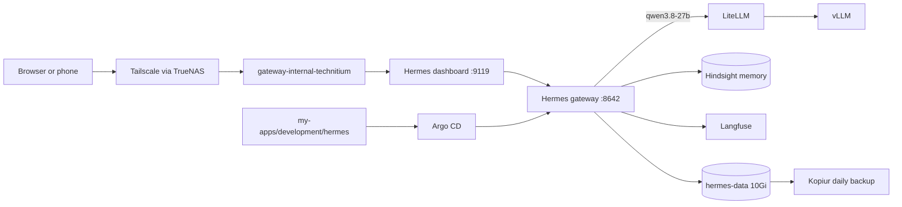

# Hermes Agent: the always-on agent in the cluster

**Purpose:** host Hermes Agent in this cluster, log in, and keep it running.
**Status:** current state. Argo CD syncs [`my-apps/development/hermes`](https://github.com/mitchross/talos-argocd-proxmox/tree/main/my-apps/development/hermes) as `my-apps-hermes`.
**Agent map:** [Hermes CLAUDE.md](https://github.com/mitchross/talos-argocd-proxmox/blob/main/my-apps/development/hermes/CLAUDE.md) says which repo owns which change.

## What Hermes is

Hermes is an agent that runs when nobody is at a keyboard. It keeps a gateway process alive for cron jobs and chat platforms, remembers across sessions through Hindsight, and loads skills on demand.
[Paseo](paseo.md) is the workspace where you watch a coding agent work. Hermes is the scheduler, memory, and chat door in front of it.

## How it is built

| Piece | Where | Notes |
|---|---|---|
| Image | `docker.io/nousresearch/hermes-agent`, pinned by digest in `deployment.yaml` | One container runs the gateway and the dashboard under s6-overlay |
| Pod | `deployment.yaml` | 1 replica, `Recreate`, starts as root, s6 drops to uid 10000 |
| Settings | `config/config.yaml` → ConfigMap → copied to `/opt/data/config.yaml` by `scripts/seed.sh` on every start | Model, memory provider, dashboard URL, plugin list |
| Plugins | `scripts/seed.sh` | Installs `hindsight`, `langfuse`, `homeassistant` into the volume on first start |
| Route | `httproute.yaml` | `gateway-internal-technitium` only; remote clients use Tailscale |
| Login | 1Password `hermes/dashboard_password` → Secret `hermes-secrets` | Username `vanillax` |
| Model | LiteLLM in-cluster, `qwen3.8-27b` | Free local model; traces land in Langfuse |
| Memory | Hindsight in-cluster, bank `hermes` | Key from 1Password `hindsight/tenant_api_key` |
| Volume | `pvc.yaml` | `hermes-data`, Longhorn, restore-before-bind, daily kopiur backup |

## 1. Connect

1. Open `https://hermes.vanillax.me`. Away from home, turn on Tailscale first.
2. Sign in with username `vanillax` and the password from 1Password `homelab-prod` → `hermes`.
3. The **Status** page shows the gateway. The **Chat** tab opens a session.

## 2. Add a chat platform

Add the bot token to 1Password, add it to `externalsecret.yaml`, and restart the pod.

| Platform | Secret keys |
|---|---|
| Telegram | `TELEGRAM_BOT_TOKEN`, `TELEGRAM_ALLOWED_USERS` |
| Home Assistant | `HASS_TOKEN` (long-lived token from your HA profile page) |

## 3. Add provider logins

Provider logins are runtime state on the volume. Open the Chat tab and run `hermes auth add openai-codex --type oauth` for Codex. Claude through the Anthropic OAuth needs a Claude Max plan.

## Rollback

Revert the PR. Argo CD recreates the pod from the previous image. The volume keeps sessions and memories.
