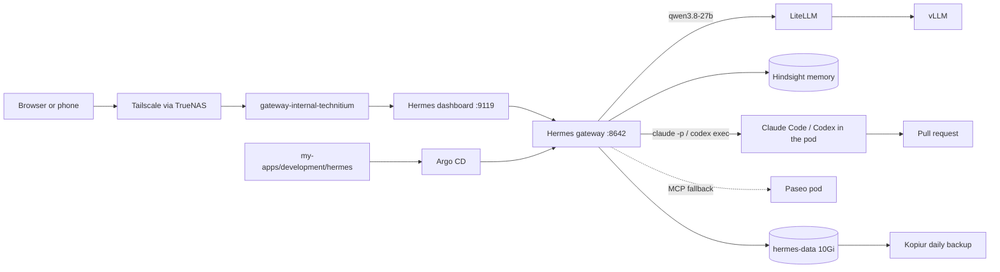

# Hermes Agent: the always-on agent in the cluster

**Purpose:** host Hermes Agent in this cluster, log in, and keep it running.
**Status:** current state. Argo CD syncs [`my-apps/development/hermes`](https://github.com/mitchross/talos-argocd-proxmox/tree/main/my-apps/development/hermes) as `my-apps-hermes`.
**Agent map:** [Hermes CLAUDE.md](https://github.com/mitchross/talos-argocd-proxmox/blob/main/my-apps/development/hermes/CLAUDE.md) says which repo owns which change.

## What Hermes is

Hermes is an agent that runs when nobody is at a keyboard. It keeps a gateway process alive for cron jobs and chat platforms, remembers across sessions through Hindsight, and loads skills on demand.
Hermes is the coordinator: it runs Claude Code and Codex inside its own pod to open pull requests. [Paseo](paseo.md) stays as a separate workspace and as the fallback door.



## How it is built

| Piece | Where | Notes |
|---|---|---|
| Image | `ghcr.io/mitchross/hermes-dev` from [homelab-images](https://github.com/mitchross/homelab-images/tree/main/images/hermes-dev), pinned by digest in `deployment.yaml` | Official Hermes plus `claude`, `codex`, `kubectl`, `gh`, `tmux`; one container runs the gateway and the dashboard under s6-overlay |
| Pod | `deployment.yaml` | 1 replica, `Recreate`, starts as root, s6 drops to uid 10000 |
| Settings | `config/config.yaml` → ConfigMap → copied to `/opt/data/config.yaml` by `scripts/seed.sh` on every start | Model, memory provider, dashboard URL, plugin list |
| Plugins | `scripts/seed.sh` | Installs `hindsight` and `homeassistant` into the volume on first start |
| Coding agents | `scripts/seed.sh`, `skills/homelab-ops/SKILL.md` | Seed clones the talos repo into `/opt/data/workspace`, writes the Hindsight hook configs, installs the Claude Code and Codex hooks. The skill runs `claude -p` or `codex exec` in the background |
| Gitea login | 1Password `gitea/git_token` → `GITEA_TOKEN` | Git credential helper for `https://gitea.vanillax.me`; clone and push work, no `tea` CLI |
| Claude login | 1Password `claude-code/oauth_token` → `CLAUDE_CODE_OAUTH_TOKEN` | From `claude setup-token` on the Max plan; no browser login in the pod |
| Route | `httproute.yaml` | `gateway-internal-technitium` only; remote clients use Tailscale |
| Login | 1Password `hermes/dashboard_password` → Secret `hermes-secrets` | Username `vanillax` |
| Model | LiteLLM in-cluster, `qwen3.8-27b` | Free local model; LiteLLM traces it in Langfuse |
| Memory | Hindsight in-cluster, bank `hermes` | Key from 1Password `hindsight/tenant_api_key` |
| Volume | `pvc.yaml` | `hermes-data`, Longhorn, restore-before-bind, daily kopiur backup |
| Cluster access | `rbac.yaml`, `config/kube-in-cluster.yaml` | `kubectl` from the image as ServiceAccount `hermes`, read-only (`hermes-viewer`), no secrets |
| Ops skill | `skills/homelab-ops/SKILL.md` | Six read-only checks and the digest format; copied to the volume on every start |
| Paseo fallback | `config/config.yaml` `mcp_servers.paseo` | Paseo's MCP endpoint, Bearer = Paseo password from 1Password `paseo/password`; used only when the in-pod agents cannot start |
| Daily digest | `scripts/seed.sh` | Cron job `homelab-digest` at 08:00, skill `homelab-ops`, output under `cron/output/` until a chat platform exists |

## 1. Connect

1. Open `https://hermes.vanillax.me`. Away from home, turn on Tailscale first.
2. Sign in with username `vanillax` and the password from 1Password `homelab-prod` → `hermes`.
3. The **Status** page shows the gateway. The **Chat** tab opens a session.

## 2. Ask about the cluster

In the Chat tab, ask in plain words: "is the cluster healthy", "why is wyze-bridge degraded", "which backups failed this week".
Hermes loads the `homelab-ops` skill and runs the read-only `kubectl` checks. It names the Git directory that owns a fix; it cannot change the cluster.

Check the daily digest under **Cron** in the dashboard. Run it by hand with the **Trigger** button.

Ask for a fix: "open a PR that fixes the wyze-bridge secret". Hermes starts Codex or Claude Code in its pod with the evidence, waits, and reports the pull request link. You merge; Argo CD deploys. Hermes never merges.

## 3. Add a chat platform

Add the bot token to 1Password, add it to `externalsecret.yaml`, and restart the pod.

| Platform | Secret keys |
|---|---|
| Telegram | `TELEGRAM_BOT_TOKEN`, `TELEGRAM_ALLOWED_USERS` |
| Home Assistant | `HASS_TOKEN` (long-lived token from your HA profile page) |

## 4. One-time logins for the coding agents

Claude Code needs nothing: the token comes from 1Password. Codex and `gh` keep their logins on the volume. Do each once from the dashboard terminal (bottom bar, terminal icon):

```bash
codex login --device-auth      # open the link, sign in with the ChatGPT account, enter the code
gh auth login --web --git-protocol https   # pick GitHub.com, follow the device code
gh auth setup-git
```

Check with `codex login status` and `gh auth status`. Expected: both report a signed-in account. The seed script reruns `gh auth setup-git` on every start.
A restored volume keeps both logins. Device-code sign-in must be enabled in the ChatGPT security settings first.

To let Hermes itself answer with Claude instead of Qwen, add the Anthropic provider later; it is not needed for the coding hand-off.

## Rollback

Revert the PR. Argo CD recreates the pod from the previous image. The volume keeps sessions and memories.
