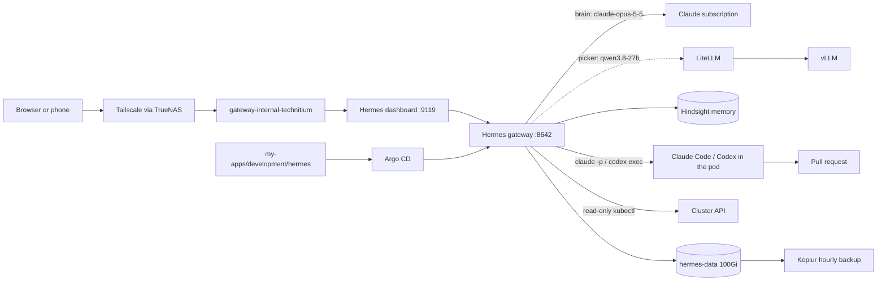
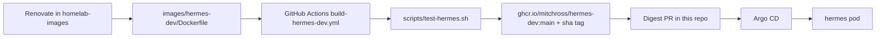
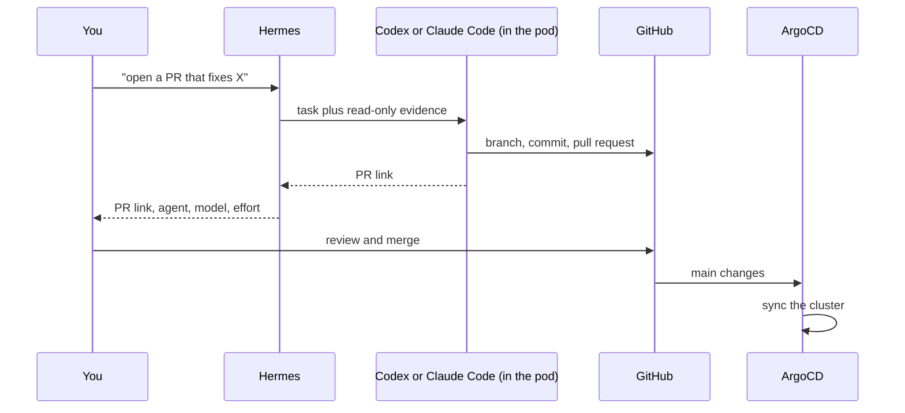

# Hermes Agent: the AI agent in the cluster

**Purpose:** host Hermes Agent in this cluster, log in, and keep it running.
**Status:** current state. Argo CD syncs [`my-apps/development/hermes`](https://github.com/mitchross/talos-argocd-proxmox/tree/main/my-apps/development/hermes) as `my-apps-hermes`.
**Agent map:** [Hermes CLAUDE.md](https://github.com/mitchross/talos-argocd-proxmox/blob/main/my-apps/development/hermes/CLAUDE.md) says which repo owns which change.
**Other clusters:** [Run Hermes on another cluster](hermes-other-clusters.md).
**New to the stack?** Read [Local AI starter kit](index.md), then [Pi and Hermes agents](pi-agent-local-dev.md) to choose an agent.

!!! tip "Do this first"
    1. Turn on Tailscale if you are away from home.
    2. Open `https://hermes.vanillax.me` and sign in ([Connect](#1-connect)).
    3. In **Chat**, ask "is the cluster healthy". About 2 minutes.

## What Hermes is

Hermes is an agent that keeps running when nobody is at a keyboard. One pod in the `hermes` namespace runs a gateway for cron jobs and chat platforms, plus a web dashboard.
It remembers across sessions through Hindsight and loads skills on demand.
Hermes is the coordinator: it checks the cluster read-only, and runs Claude Code or Codex inside its own pod to open pull requests. You merge; Argo CD deploys.

Hermes replaced Paseo, the old browser workspace for coding agents. Paseo is off; only its namespace and Git directory remain.



## How it is built

| Piece | Where | Notes |
|---|---|---|
| Image | `ghcr.io/mitchross/hermes-dev` from [homelab-images](https://github.com/mitchross/homelab-images/tree/main/images/hermes-dev), pinned by digest in `deployment.yaml` | Official Hermes plus `claude`, `codex`, `kubectl`, `omnictl`, `talosctl`, `gh`, `tmux`; one container runs the gateway and the dashboard under s6-overlay |
| Pod | `deployment.yaml` | 1 replica, `Recreate`, starts as root, s6 drops to uid 10000. Init container `seed` runs `scripts/seed.sh` first |
| Settings | `config/config.yaml` → ConfigMap → copied to `/opt/data/config.yaml` by `scripts/seed.sh` on every start | Model, providers, memory, dashboard URL, plugins, timezone |
| Plugins | `scripts/seed.sh` | Installs `hindsight` and `homeassistant` into the volume on first start |
| Coding agents | `scripts/seed.sh`, `skills/homelab-ops/SKILL.md` | Seed clones the talos repo into `/opt/data/workspace`, writes the Hindsight hook configs, installs the Claude Code and Codex hooks. The skill runs `claude -p` or `codex exec` in the background |
| Brain | `claude-opus-5-5`, medium reasoning effort, through the Claude Code token (`config.yaml`) | Qwen (`providers.litellm`, free, local) and GitHub Copilot (`gh` login) stay selectable per session |
| Coding agents' models | `ANTHROPIC_MODEL=claude-opus-5-5` + `--effort high`; `.codex/config.toml` `gpt-6.1-sol` + `high` | The skill passes `--model` on every run: Sonnet 5.5 for spelled-out fixes, Opus 5.5 or GPT-6.1-sol for investigation and design. It reports model and effort on every hand-off |
| Claude login | 1Password `claude-code/oauth_token` → `CLAUDE_CODE_OAUTH_TOKEN` | From `claude setup-token` on the Max plan; no browser login in the pod |
| Gitea login | 1Password `gitea/git_token` → `GITEA_TOKEN` | Git credential helper for `https://gitea.vanillax.me`; clone and push work, no `tea` CLI |
| Dashboard login | 1Password `hermes/dashboard_password` and `dashboard_secret` → Secret `hermes-secrets` | Username `vanillax`. The secret signs sessions, so logins survive restarts |
| Memory | Hindsight in-cluster, bank `hermes`; plugin settings in `config/hindsight-hermes.json`, copied to `hindsight/config.json` by the seed | Key from 1Password `hindsight/tenant_api_key` |
| Home Assistant | 1Password `home-assistant/ha-longlived-token` → `HASS_TOKEN` | Turns on the Home Assistant platform and entity tools |
| Route | `httproute.yaml` | `gateway-internal-technitium` only; remote clients use Tailscale |
| Volume | `pvc.yaml` | `hermes-data`, 100Gi Longhorn, restore-before-bind |
| Backups | `kopiur/hermes-data.yaml` | Hourly at :28; keeps 24 hourly, 14 daily, 6 weekly, 3 monthly. Mover runs as 10000:10000 |
| Cluster access | `rbac.yaml`, `config/kube-in-cluster.yaml` | `kubectl` from the image as ServiceAccount `hermes`, read-only (`hermes-viewer`), no secrets |
| Omni and Talos | 1Password `hermes-omni-sa` (`OMNI_ENDPOINT`, `OMNI_SERVICE_ACCOUNT_KEY`) → `hermes-secrets`; the seed writes `~/.talos/config` | Omni **Operator** role: manages clusters and machines, not users or service accounts |
| Pi SSH | `config/ssh_config`, `config/known_hosts`, `pi-egress.yaml` | `ssh pi` reaches the rpi5 as `vanillax` (Docker, sudo). Files live in `/opt/data/.ssh`: OpenSSH uses the passwd home, not `$HOME`. The key is never regenerated; its public half is in the Pi's `authorized_keys` |
| Personality | `config/SOUL.md` → `/opt/data/SOUL.md` on every start | Tone and hard rules. Edit it in Git, never in the pod |
| Third-party skills | `scripts/external-skills.txt` | i-have-adhd, Ponytail and Matt Pocock's skills, pinned by commit. Change the sha to update one |
| Ops skill | `skills/homelab-ops/SKILL.md` | Six read-only checks, the digest format, and risk-based rules for Omni, Talos and the Pi; copied to the volume on every start |
| Daily digest | `scripts/seed.sh` | Cron job `homelab-digest` at 08:00 (America/Detroit), skill `homelab-ops`, output under `cron/output/` until a chat platform exists |

## The image

The pod runs `ghcr.io/mitchross/hermes-dev`, built in [mitchross/homelab-images](https://github.com/mitchross/homelab-images/tree/main/images/hermes-dev). The image holds tools only; everything Hermes writes lives on `hermes-data`.

Nous Research publishes a Docker image but no Helm chart. The community charts and operators template many agents per cluster; this cluster runs one, so it uses plain Kustomize manifests and its own image.



### What the Dockerfile adds

| Layer | Source | Pinned by |
|---|---|---|
| Base | official `nousresearch/hermes-agent` (gateway, dashboard, s6-overlay, Node, Python) | tag + digest |
| `tmux`, `jq`, `less`, `openssh-client` | Debian packages | base image |
| `gh` | GitHub CLI `.deb` from the release page | `GH_VERSION` + `GH_SHA256` |
| `kubectl` | `dl.k8s.io` | `KUBECTL_VERSION` + `KUBECTL_SHA256` |
| `omnictl`, `talosctl` | Sidero GitHub releases | `OMNICTL_VERSION` (matches the Omni server), `TALOSCTL_VERSION` (matches the cluster), each with a SHA-256 |
| Claude Code, Codex | npm, installed into `/opt/agents` | `CLAUDE_VERSION`, `CODEX_VERSION` |

`/opt/agents/bin` comes first on `PATH`, so the pinned CLIs win over anything on the volume. `DISABLE_AUTOUPDATER=1` stops Claude Code from updating itself.
The build runs `hermes-image-smoke` as uid 10000; it fails if `hermes`, `claude`, `codex`, `git`, `gh`, `kubectl`, `tmux`, `jq`, `rg`, `node`, `npm`, `python3` or `ssh` is missing.
The image stays root at the end: s6-overlay needs root to start, then drops to `hermes` (10000:10000).
Current versions are in the [Dockerfile](https://github.com/mitchross/homelab-images/blob/main/images/hermes-dev/Dockerfile).

### How CI builds it

[`build-hermes-dev.yml`](https://github.com/mitchross/homelab-images/blob/main/.github/workflows/build-hermes-dev.yml) runs on a push or pull request that touches `images/hermes-dev/**`, `scripts/**` or the workflow itself, on manual dispatch, and every Monday at 05:17 UTC. The Monday run skips the cache, so base-image security fixes land.

1. Build for `linux/amd64` only. There is no `arm64` image.
2. Test with [`scripts/test-hermes.sh`](https://github.com/mitchross/homelab-images/blob/main/scripts/test-hermes.sh): run the smoke script as uid 10000 on an empty `/opt/data`, like a fresh PVC, then boot the container as root and check that `--version` prints `Hermes Agent v0.x`.
3. Push the tested image as `sha-<commit>-<run>-<attempt>`. On `main` it is also tagged `main`.
4. Print the digest in the job summary.

Pull requests from forks build and test but push nothing.

### How updates reach the cluster

| Change | Who | Then |
|---|---|---|
| Base image digest, Claude Code, Codex | Renovate in homelab-images opens a PR; the two agent CLIs are grouped as "coding agents" on Monday mornings | Merge it; CI publishes a new `main` |
| `gh`, `kubectl` | By hand: bump the version and the SHA-256 together in the Dockerfile | Same |
| New `main` digest in this repo | Renovate's `kubernetes` manager watches `hermes-dev:main@sha256:…` in `deployment.yaml` and adds it to the "all container digests" PR | Merge it; Argo CD restarts the pod |

To pin a digest by hand, read it from the job summary or run:

```bash
docker buildx imagetools inspect ghcr.io/mitchross/hermes-dev:main | grep Digest
```

Put it in **both** `image:` lines in `deployment.yaml`, the `seed` init container and the `hermes` container, in one PR.

### Build and test it yourself

From a homelab-images checkout, on an `amd64` machine with Docker:

```bash
docker build --platform linux/amd64 -t hermes-dev:local images/hermes-dev
bash scripts/test-hermes.sh hermes-dev:local
```

**It worked when** the script prints the tool versions and a `Hermes Agent v0.x` line, and exits 0.

### Check what the pod runs

```bash
kubectl -n hermes get pod -l app.kubernetes.io/name=hermes -o jsonpath='{.items[0].status.containerStatuses[0].imageID}{"\n"}'
kubectl -n hermes exec deploy/hermes -c hermes -- sh -c '/opt/hermes/bin/hermes --version; claude --version; codex --version; gh --version | head -1; kubectl version --client'
```

The digest must match `deployment.yaml` on `main`.

## 1. Connect

Away from home, turn on Tailscale first. Hermes has no public address.
The Tailscale app on TrueNAS (`192.168.10.133`) must provide two things:

| Tailscale setting | Value | Without it |
|---|---|---|
| Approved subnet route | `192.168.10.0/24` | The client cannot reach the gateway |
| Split DNS for `vanillax.me` | `192.168.10.15` (Technitium) | `hermes.vanillax.me` does not resolve |

1. Open `https://hermes.vanillax.me`.
2. Sign in with username `vanillax` and the password from 1Password `homelab-prod` → `hermes`.
3. The **Status** page shows the gateway. The **Chat** tab opens a session.

**It worked when** the Status page shows the gateway as running.

## 2. Pick the brain

The model picker sits at the bottom right of the chat box. Click **Refresh models** once after a new login.
New sessions, the daily digest and Kanban workers on the default profile start on **Anthropic → Claude Opus 5.5** at medium effort. **litellm → Qwen3.8 27b** runs on your GPUs for free. **GitHub Copilot** comes from the `gh` login. The choice holds for that session.

The brain only navigates and coordinates. Code changes run inside the pod: Sonnet 5.5 (high) for spelled-out fixes, Opus 5.5 (high) or GPT-6.1-sol (high) for investigation and design.

## 3. Log the coding agents in once

Claude Code needs nothing: the token comes from 1Password. Codex and `gh` keep their logins on the volume.
Do each once from the dashboard terminal (bottom bar, terminal icon):

1. Turn on **device code sign-in** in chatgpt.com → Settings → Security and login.
2. Log in to Codex. Open the link, sign in with the ChatGPT account, and enter the code:

    ```bash
    codex login --device-auth
    ```

3. Log in to GitHub. Pick GitHub.com and follow the device code:

    ```bash
    gh auth login --web --git-protocol https
    gh auth setup-git
    ```

**It worked when** `codex login status` and `gh auth status` both report a signed-in account.
Then ask Hermes in a chat: "run `command -v claude codex; gh auth status; codex login status` in the terminal".
Hermes's terminal uses its own home (`/opt/data/home`); the seed links the logins into it, and this chat check proves Hermes itself can see them.

The seed reruns `gh auth setup-git` on every start. A restored volume keeps both logins.

## 4. Ask about the cluster

In the Chat tab, ask in plain words: "is the cluster healthy", "why is wyze-bridge degraded", "which backups failed this week".
Hermes loads the `homelab-ops` skill and runs the read-only `kubectl` checks. It names the Git directory that owns a fix; it cannot change the cluster.

Check the daily digest under **Cron** in the dashboard. Run it by hand with the **Trigger** button.



Ask for a fix: "open a PR that fixes the wyze-bridge secret". Hermes starts Codex or Claude Code in its pod with the evidence, waits, and reports the pull request link. You merge; Argo CD deploys. Hermes never merges.

Hermes ends each hand-off report with `Agent: …, model: …, effort: …`, copied from the agent's own output. To check the pins by hand:

```bash
kubectl -n hermes exec deploy/hermes -c hermes -- /command/s6-setuidgid hermes env HOME=/opt/data claude -p "Reply with exactly: OK" --max-turns 1 --output-format json | jq '.modelUsage | keys'
```

Expected: `["claude-opus-5-5"]`.

```bash
kubectl -n hermes exec deploy/hermes -c hermes -- /command/s6-setuidgid hermes env HOME=/opt/data codex exec --skip-git-repo-check --sandbox read-only "Reply with exactly: OK" 2>&1 | grep -E "^(model|reasoning effort):"
```

Expected: `model: gpt-6.1-sol` and `reasoning effort: high`.

## 5. Add a chat platform

Add the bot token to 1Password, add it to `externalsecret.yaml` through a PR, and restart the pod after it syncs.

| Platform | Secret keys |
|---|---|
| Telegram | `TELEGRAM_BOT_TOKEN`, `TELEGRAM_ALLOWED_USERS` |
| Home Assistant | `HASS_TOKEN` (already wired) |

## 6. Verify

```bash
kubectl -n argocd get application my-apps-hermes
kubectl -n hermes get pod,pvc,externalsecret,httproute
kubectl -n hermes logs deploy/hermes -c seed --tail=3
curl -s https://hermes.vanillax.me/api/status | jq '{version, gateway_state}'
kubectl -n hermes get snapshot
```

Expect `Synced` and `Healthy`, one `1/1 Running` pod, `hermes-data` `Bound`, both ExternalSecrets `SecretSynced`, `[seed] done`, `"gateway_state": "running"`, and an hourly snapshot `Succeeded` within the last hour.

## Change Hermes

| Change | Do this |
|---|---|
| Env vars, resources, route, backup | PR to `my-apps/development/hermes/`. Argo CD rolls the pod. |
| Model, providers, memory, plugins | PR to `config/config.yaml`. The seed copies it over the volume on the next start. |
| The ops skill or the digest | PR to `skills/homelab-ops/SKILL.md`. Edits made in the pod are overwritten on the next start. |
| Tools or agent versions | PR to homelab-images `images/hermes-dev`, wait for the CI image, then a digest PR here. See [The image](#the-image). |
| Passwords and tokens | Edit 1Password. The ExternalSecret refreshes within 1 hour; restart the pod when no agent work runs. |

Never edit `config.yaml` or the skill in the pod to change configuration. Git is the source of truth.
Runtime state stays on the volume: sessions, cron jobs, skills Hermes writes, memories, provider logins.

## Troubleshooting

| Symptom | Check |
|---|---|
| `CreateContainerConfigError` | `kubectl -n hermes describe externalsecret hermes-secrets`; a 1Password field is missing |
| Dashboard login loops back to the sign-in page | `HERMES_DASHBOARD_PUBLIC_URL` must equal the route hostname |
| Status shows the gateway registered but down | `HERMES_GATEWAY_BOOTSTRAP_STATE=running` in `deployment.yaml` |
| Hermes says `claude` or `codex` is not found | Restart the pod; the seed relinks the tools into `/opt/data/home`. Test through Hermes's terminal, not only `kubectl exec` |
| An agent says it is not logged in | Repeat step 3 for Codex or `gh`; check `claude-code/oauth_token` in 1Password for Claude. There is no fallback agent: Hermes stops and hands you the prompt |
| The seed init container fails | `kubectl -n hermes logs deploy/hermes -c seed`. Clone and plugin failures only warn; a config copy failure stops the pod |
| `hermes-data` stays `Pending` | Restore status and storage events. Never delete the PVC |

## Backups and rollback

```bash
kubectl -n hermes get snapshotpolicy,snapshotschedule,restore,snapshot
```

Snapshots must reach `Succeeded` with nonzero files before you rely on a restore.
See the [kopiur backup architecture](../storage/kopiur-backup-architecture.md).

Roll back by reverting the PR. Argo CD recreates the pod from the previous image; the volume keeps sessions and memories.
Never delete the app directory as a rollback: Argo CD can prune the volume.

## Known limits

- Every device on the home LAN or the tailnet can reach the dashboard login.
- The dashboard terminal is a shell with every login in the pod: Claude, Codex, GitHub, Gitea. Treat the password like an SSH key.
- The pod's GitHub login can reach every repo of the account.
- Coding agents run with their approval prompts off. The pod is the sandbox: `kubectl` is read-only and cannot read Secrets.
- The pod holds LiteLLM's master key, so an agent can spend OpenRouter credit through LiteLLM.
- The Omni Operator key, `ssh pi` (passwordless sudo) and coding agents with approvals off share one trust boundary. The ask-first rules are agent instructions, not enforced controls.
- Proxmox hosts and Longhorn evictions are not available in the pod; Hermes hands them to you.

## Node loss

Hermes is a single writer: sessions, cron and Codex state are SQLite on `hermes-data`, so it runs 1 replica (`Recreate`) and cannot run active/active. Availability comes from fast failover, not a second pod.

- The volume must keep **2 Longhorn copies** on different nodes. Volumes created before #3100 may still have 1: check `kubectl -n longhorn-system get volumes.longhorn.io <pvc> -o jsonpath='{.spec.numberOfReplicas}'` and raise it to 2.
- The pod tolerates `not-ready`/`unreachable` for 30 s (default 300 s), then reschedules; Longhorn's `node-down-pod-deletion-policy` detaches the volume. Expect 1 to 2 minutes: eviction, attach and start.
- `image-prepull.yaml` keeps the ~7 GB `hermes-dev` image on every amd64 node, so a failover does not wait for a pull. Bump its digest together with `deployment.yaml`.
- The `hermes-data` volume has **offline rebuilding disabled**. With it on, Longhorn attaches a degraded, detached volume to another node to rebuild it and holds it there, so the new Hermes pod cannot attach. The global setting stays on for kopiur clones. Longhorn stores this per volume, not in Git; reapply it after the volume is recreated:

    ```bash
    kubectl -n longhorn-system patch volumes.longhorn.io "$(kubectl -n hermes get pvc hermes-data -o jsonpath='{.spec.volumeName}')" \
      --type merge -p '{"spec":{"offlineRebuilding":"disabled"}}'
    ```

- Do not move `hermes-data` to NFS/SMB: SQLite locking is unsafe there, and TrueNAS would become a single point of failure.
