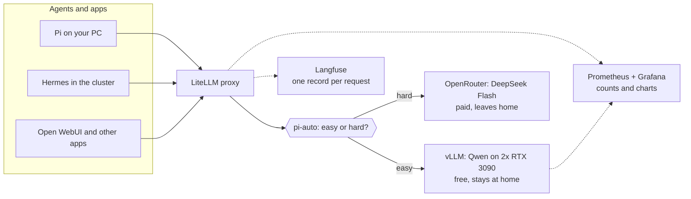

# Local AI in this homelab: start here

**Purpose:** explain, step by step, how this homelab runs its own AI, and point
to the page for each part.
**Status:** current state.

## The short version

The homelab runs a large language model (LLM) on two gaming graphics cards.
Apps and agents never call that model directly. They call one gateway, which
picks a model, forwards the request, and records what happened.

The story has five parts. Each part answers one question:

1. **Run the model** — how does an LLM run at home?
2. **Put a proxy in front** — why does everything go through LiteLLM?
3. **Decide local or cloud** — how does `pi-auto` choose a model?
4. **Use agents** — what do Pi and Hermes add?
5. **Measure it** — how do you know what ran and what it cost?



## Words you need

| Word | Means here |
|---|---|
| **LLM** | A large language model: the program that reads a prompt and writes an answer |
| **token** | A piece of a word, about 4 characters. Limits and prices count tokens |
| **context window** | The most tokens one request can hold, prompt plus answer |
| **inference** | Running the model to get an answer (not training it) |
| **vLLM** | The server program that runs the local LLM on the graphics cards |
| **Qwen** (`qwen3.8-27b`) | The local LLM. Free, and the data stays at home |
| **DeepSeek Flash** (`deepseek-flash`) | The paid cloud LLM. Prompts leave home |
| **OpenRouter** | A cloud service that sells access to many LLMs with one key |
| **LiteLLM** | The proxy. Every client calls it; it calls the LLM |
| **`pi-auto`** | A LiteLLM route that picks Qwen or DeepSeek for each request |
| **classifier** | A short Qwen call that grades each `pi-auto` request |
| **tier** | The grade: `SIMPLE`, `MEDIUM` (Qwen) or `COMPLEX`, `REASONING` (DeepSeek) |
| **reasoning effort** | How long the LLM "thinks" before it answers: off, low, medium, high, xhigh, max |
| **agent** | An LLM that can also run tools: read files, run commands, edit code |
| **Pi** | A terminal coding agent from [pi.dev](https://pi.dev). Not Raspberry Pi |
| **Hermes** | An agent that runs in the cluster all day, with chat, cron jobs and memory |
| **Prometheus / Grafana** | Prometheus stores numbers over time; Grafana draws them as charts |
| **Langfuse** | Stores each request: prompt, answer, tokens, cost, routing reason |

## Step 1: run the model

An LLM is a large file of numbers, called *weights*. To answer, the computer
multiplies the prompt through those numbers. Graphics cards (GPUs) do that
quickly, so the model runs on GPUs.

| Choice | Here | Why |
|---|---|---|
| Model | Qwen3.8 27B, FP8 | Fits in two 24 GB cards with a long context window |
| Server | vLLM | Serves many requests at once and speaks the OpenAI API |
| Cards | 2x RTX 3090, split with tensor parallelism (TP=2) | One card works, but two answer the first token faster |
| Context | 262,144 tokens per request | Enough for a large code base in one prompt |
| Power | 220 W per card | Less heat and noise for a small speed loss |

The weights download once to the NAS, then copy to fast local disk on the GPU
node. vLLM loads them from there at start.

**Where:** [`my-apps/ai/vllm/`](https://github.com/mitchross/talos-argocd-proxmox/tree/main/my-apps/ai/vllm).
**Gotcha:** one app owns a card at a time. Image generation stays off while vLLM
holds both cards. To swap, follow the [GPU scale-swap runbook](gpu-scale-swap.md).

**See it yourself:**

```bash
kubectl -n vllm get pods
curl -s https://vllm.vanillax.me/v1/models | jq -r '.data[].id'
```

Expect one `Running` pod and the model id `qwen3.8-27b`.

More: [Model catalog](model-catalog.md),
[3090 LLM optimization](3090-llm-optimization.md),
[one vs two 3090s](single-vs-dual-3090.md).

## Step 2: put a proxy in front

vLLM alone has no keys, no cloud models, and no request log. LiteLLM sits in
front of it. Every client sends the same OpenAI-style request to LiteLLM.

LiteLLM then does four jobs:

| Job | What it means |
|---|---|
| **One address** | Apps use one URL and one key, whatever model answers |
| **Model names** | `qwen3.8-27b` goes to vLLM; `deepseek-flash` goes to OpenRouter |
| **Secrets** | Only LiteLLM holds the OpenRouter key. Apps never see it |
| **Records** | It reports every request to Prometheus and Langfuse |

| Who calls | URL |
|---|---|
| Apps in the cluster | `http://litellm-service.litellm.svc.cluster.local:4000/v1` |
| Your PC | `https://litellm.vanillax.me/v1` |

**Where:** [`my-apps/ai/litellm/config.yaml`](https://github.com/mitchross/talos-argocd-proxmox/blob/main/my-apps/ai/litellm/config.yaml).
**Gotcha:** an app that calls vLLM directly still works, but it skips all
records. Always call LiteLLM.

## Step 3: decide local or cloud

Qwen is free and private, but it is not the strongest model. DeepSeek Flash is
stronger, costs money, and sends the prompt out of the house. The `pi-auto`
route lets LiteLLM choose per request.

How one `pi-auto` request flows:

1. LiteLLM sends the last few messages to the classifier, a short Qwen call with
   thinking off and fixed (greedy) output.
2. The classifier answers with one tier.
3. `SIMPLE` and `MEDIUM` go to Qwen. `COMPLEX` and `REASONING` go to DeepSeek.
4. LiteLLM forwards the request and streams the answer back.

Some cases go to DeepSeek without a hard grade:

| Case | Why |
|---|---|
| The classifier fails | A wrong cheap guess costs more than a paid answer |
| The same tool call repeats or fails 3 times in 6 | Qwen is stuck, so a stronger model takes over |
| The prompt is too big for Qwen | Cutting the prompt would make the answer wrong |
| vLLM is down | Only `pi-auto` falls back; other apps fail instead of paying |

**Gotcha:** one conversation can move between Qwen and DeepSeek message by
message. Do not use `pi-auto` for data that must stay at home.

**See it yourself:** send one easy and one hard request, and read which model
answered:

```bash
K=$(cat ~/.pi/agent/litellm-api-key)
for p in "What is 2+2?" "Design a lock-free MPMC queue in Rust and prove it linearizable."; do
  curl -s -D - -o /dev/null https://litellm.vanillax.me/v1/chat/completions \
    -H "Authorization: Bearer $K" -H 'Content-Type: application/json' \
    -d "{\"model\":\"pi-auto\",\"max_tokens\":256,\"messages\":[{\"role\":\"user\",\"content\":\"$p\"}]}" \
    | grep -i x-litellm-model-name
done
```

Expect `openai/qwen3.8-27b` first, then `openrouter/~deepseek/deepseek-flash-latest`.
The hard request costs a fraction of a cent.

More: [Model catalog § The router](model-catalog.md#the-router).

## Step 4: use agents

A chat app answers one message. An agent works in a loop: it asks the LLM what
to do, runs a tool, sends the result back, and repeats until the task is done.
One task can make dozens of LLM requests. That is why the per-request choice in
step 3 matters.

| | Pi | Hermes |
|---|---|---|
| Runs | on your PC, in a terminal | in the cluster, all day |
| Use it for | coding with you at the keyboard | health checks, a daily digest, chat, PRs while you are away |
| Models | you pick: Qwen, DeepSeek or `pi-auto` | Claude Sonnet as the brain; Qwen as a free choice |

Both call LiteLLM, so both appear in the records.

More: [Pi and Hermes agents](pi-agent-local-dev.md), [Hermes in the cluster](hermes.md),
[Hermes on another cluster](hermes-other-clusters.md).

## Step 5: measure it

You need two kinds of answer, so there are two tools:

| Question | Tool | Where |
|---|---|---|
| How many requests stayed local? What did paid cost this week? | Grafana | `/d/pi-routing`, `/d/ai-gateway-analytics` |
| Is vLLM busy? How fast does it answer? | Grafana | `/d/vllm-inference` |
| Are the cards hot or at full power? | Grafana | `/d/gpu-overview` |
| Why did this one request go to DeepSeek? What did it say? | Langfuse | `langfuse.vanillax.me`, tag `pi` |

Grafana shows totals and trends. Langfuse shows single requests. Start in
Grafana, then open Langfuse to look at one request.

**Gotcha:** Pi shows the name `pi-auto`, not the model that answered, and prices
every request as DeepSeek. Trust the dashboards, not Pi's cost line.

More: [AI gateway and analytics](ai-observability.md).

## Rules that keep it safe

- Only vLLM runs the local LLM. Do not add Ollama or another GPU server.
- One app owns a graphics card at a time.
- Apps call LiteLLM, never vLLM directly.
- Prompts sent to DeepSeek leave home and cost money. Use `pi-qwen-only` for
  private work.
- All changes go through Git and ArgoCD. Do not edit the cluster by hand.
