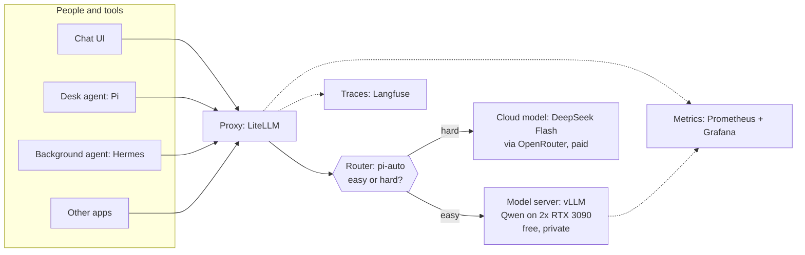

# Local AI starter kit

**Purpose:** explain the parts of a self-hosted AI setup, what each part does,
and the order to build them. This homelab is the worked example.
**Status:** current state. Every part below runs here today.

## The idea in one paragraph

Run a large language model (LLM) on your own graphics cards, so everyday work
is free and stays private. Put one proxy in front of it. Every app and agent
calls the proxy, never the model. The proxy can send hard work to a paid cloud
model, and it records every request so you can see what ran and what it cost.



## The parts

| Part | What it does | Here | Lives in |
|---|---|---|---|
| **GPUs** | Do the math that runs the model | 2x RTX 3090, 24 GB each, 220 W cap | GPU worker node |
| **Model** | The weights: a large file of numbers that produces answers | Qwen3.8 27B, FP8 | NAS, copied to local disk |
| **Model server** | Loads the model on the GPUs and answers over an OpenAI-style API | vLLM | [`my-apps/ai/vllm/`](https://github.com/mitchross/talos-argocd-proxmox/tree/main/my-apps/ai/vllm) |
| **Proxy** | One URL and key for every client; maps model names to backends; holds cloud keys; records requests | LiteLLM | [`my-apps/ai/litellm/`](https://github.com/mitchross/talos-argocd-proxmox/tree/main/my-apps/ai/litellm) |
| **Cloud model** | A stronger model for work the local one gets wrong | DeepSeek Flash via OpenRouter | OpenRouter account, key in 1Password |
| **Router** | Grades each request and picks local or cloud | LiteLLM `pi-auto` route | [`litellm/config.yaml`](https://github.com/mitchross/talos-argocd-proxmox/blob/main/my-apps/ai/litellm/config.yaml) |
| **Chat UI** | A ChatGPT-style web page for people | Open WebUI | [`my-apps/ai/open-webui/`](https://github.com/mitchross/talos-argocd-proxmox/tree/main/my-apps/ai/open-webui) |
| **Desk agent** | Codes with you in a terminal: reads files, runs commands, edits | Pi | `~/.pi/agent/` on each PC |
| **Background agent** | Runs without you: checks, daily digest, chat, opens PRs | Hermes | [`my-apps/development/hermes/`](https://github.com/mitchross/talos-argocd-proxmox/tree/main/my-apps/development/hermes) |
| **Memory** | Lets an agent remember across sessions | Hindsight | [`my-apps/knowledge/hindsight/`](https://github.com/mitchross/talos-argocd-proxmox/tree/main/my-apps/knowledge/hindsight) |
| **Metrics** | Counts and trends: requests, local vs paid, speed, GPU power | Prometheus + Grafana | [`dashboards/ai/`](https://github.com/mitchross/talos-argocd-proxmox/tree/main/monitoring/metrics/prometheus-stack/dashboards/ai) |
| **Traces** | One record per request: prompt, answer, tokens, cost, routing reason | Langfuse | [`my-apps/ai/langfuse/`](https://github.com/mitchross/talos-argocd-proxmox/tree/main/my-apps/ai/langfuse) |
| **Secrets** | Delivers keys to pods without putting them in Git | 1Password + External Secrets | `ExternalSecret` per namespace |

The proxy is the centre. Every other part either sits behind it (models) or in
front of it (people, apps, agents), and it feeds both measurement tools.

## Same parts on one PC or on Kubernetes

The design does not depend on Kubernetes. On one PC with a graphics card, run
the same parts as containers. This homelab runs them as Kubernetes apps.
The roles, the build order and the LiteLLM `config.yaml` stay the same; only
hostnames, secrets and how you ship a change are different.

| Part | One PC (containers) | Kubernetes (this homelab) |
|---|---|---|
| GPUs | the PC's graphics card, passed to the container | a GPU node; the pod requests whole `nvidia.com/gpu` cards |
| Model server | a vLLM container | a vLLM Deployment with `Recreate` |
| Proxy | a LiteLLM container at `http://localhost:4000/v1` | a LiteLLM Deployment at `litellm-service.litellm:4000`, plus an HTTPRoute |
| Proxy config | `config.yaml` on disk | the same `config.yaml` in a ConfigMap |
| Secrets | an `.env` file, never committed | 1Password + `ExternalSecret` |
| Metrics, traces | Prometheus, Grafana and Langfuse containers | kube-prometheus-stack and the Langfuse app |
| Desk agent | Pi on the same PC, pointed at `localhost` | Pi on each PC, pointed at `litellm.vanillax.me` |
| Background agent | Hermes in Docker Compose ([Option A](hermes-other-clusters.md#option-a-docker-compose)) | the Hermes pod |
| Ship a change | edit a file, restart the container | open a PR; ArgoCD applies it |
| Backups | copy the volumes | kopiur snapshots with restore-before-bind |

Start on one PC to learn the parts. Move to Kubernetes when several people or
apps share the GPUs and you want Git to record every change.

## Build order

Build in this order. Each step needs the one before it, and each ends with a
check that proves it works.

### 1. Run the model

Put the model server on the GPUs and load the model.

| Choice | Why |
|---|---|
| 27B model in FP8 | Fits two 24 GB cards with a 262,144-token context window |
| vLLM | Serves many requests at once; speaks the OpenAI API every tool expects |
| Two cards (TP=2) | One card works; two read long prompts faster ([one card or two](3090-llm-optimization.md#one-card-or-two)) |
| 220 W per card | Less heat and noise for a small speed loss |

**Done when:**

```bash
curl -s https://vllm.vanillax.me/v1/models | jq -r '.data[].id'
```

prints `qwen3.8-27b`.

**Gotcha:** one app owns a card at a time. To give the cards to image
generation, follow the [GPU scale-swap runbook](gpu-scale-swap.md).

### 2. Put the proxy in front

Point LiteLLM at vLLM and give it a master key. From now on, nothing calls vLLM
directly.

Apps in the cluster use the internal service URL; people's PCs use
`https://litellm.vanillax.me/v1`. Every URL and key: [model catalog § Wiring](model-catalog.md#wiring).

**Done when:** a request with `"model":"qwen3.8-27b"` to the proxy URL answers.

**Gotcha:** a client that calls vLLM directly still works, but skips every
record in step 4. Make the proxy the only documented URL.

### 3. Connect the first users

Point the chat UI and apps at the proxy. Each namespace gets the proxy key from
1Password through an `ExternalSecret`, never from a file in Git.

**Done when:** Open WebUI answers a chat message.

### 4. Measure before you add the cloud

Turn on the proxy's `prometheus` and `langfuse_otel` callbacks, and load the
Grafana dashboards. Do this before step 5, so the first paid request is visible.

| Question | Tool |
|---|---|
| How many requests? How fast? Any errors? | Grafana `/d/ai-gateway-analytics` |
| Is the model server busy? | Grafana `/d/vllm-inference` |
| Are the cards hot or at full power? | Grafana `/d/gpu-overview` |
| What did one request say, and why did it go where it did? | Langfuse |

**Done when:** the step 3 chat message appears in Grafana and as a trace in
Langfuse. Details: [AI gateway and analytics](ai-observability.md).

### 5. Add the cloud model and the router

Add the cloud model to the proxy, then the `pi-auto` route. A short local
call, the *classifier*, grades each request. Easy work stays local; hard work,
stuck tool loops, oversized prompts and classifier failures go to the cloud.
Only clients that ask for `pi-auto` can reach the cloud; every other client
stays local. How it decides: [model catalog § The router](model-catalog.md#the-router).

**Done when:** the [two-request check](ai-observability.md#check-that-pi-auto-uses-both-models)
shows one local and one cloud answer, and Grafana `/d/pi-routing` shows the split.

**Gotcha:** one conversation can move between local and cloud message by
message. Prompts sent to the cloud leave the building.

### 6. Give people agents

An agent works in a loop: ask the model, run a tool, send back the result,
repeat. One task can make dozens of requests, which is why the router in step 5
pays off.

Use a **desk agent** (Pi) for coding with someone at the keyboard. Use a
**background agent** (Hermes) for checks, a daily digest, chat and PRs while
nobody watches. Humans merge every PR. Side-by-side comparison:
[Pi and Hermes](pi-agent-local-dev.md).

**Done when:** Pi answers "what does this repo do?" and Hermes's Status page
shows the gateway running.
Setup: [Pi](pi-agent-local-dev.md#pi-in-five-minutes), [Hermes in the cluster](hermes.md),
[Hermes on another cluster](hermes-other-clusters.md).

### 7. Run it day to day

| Task | Where |
|---|---|
| Check the local/paid split and spend weekly | Grafana `/d/pi-routing` |
| Find why a request went to the cloud | Langfuse, `routing_decision.cause` |
| Change models, router tiers or limits | PR to `litellm/config.yaml` |
| Tune context and speed | [Context and speed on RTX 3090s](3090-llm-optimization.md) |
| Swap the cards to another app | [GPU scale-swap runbook](gpu-scale-swap.md) |

## Words you need

| Word | Means here |
|---|---|
| **LLM** | A large language model: reads a prompt, writes an answer |
| **token** | A piece of a word, about 4 characters. Limits and prices count tokens |
| **context window** | The most tokens one request can hold, prompt plus answer |
| **inference** | Running the model to get an answer, not training it |
| **FP8** | Weights stored at 8 bits each, so a bigger model fits the cards |
| **tier** | The router's grade: `SIMPLE`, `MEDIUM`, `COMPLEX`, `REASONING` |
| **reasoning effort** | How long the model "thinks" first: off, low, medium, high, xhigh, max |
| **agent** | An LLM that can also run tools |
| **Pi** | A terminal coding agent from [pi.dev](https://pi.dev). Not Raspberry Pi |

## Rules that keep it safe

- Use one model server. Here that is vLLM; do not add Ollama beside it.
- Give each graphics card to one app at a time.
- Make every client call the proxy, never the model server.
- Keep private work on the local model: use `pi-qwen-only`, not `pi-auto`.
- Change everything through Git and ArgoCD. Do not edit the cluster by hand.
