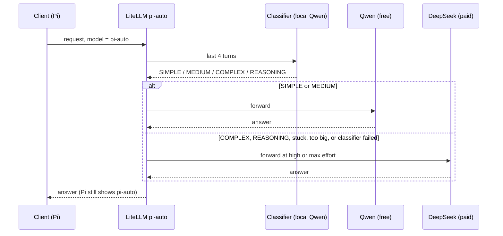

# AI model catalog

**Two models. One local, one paid.** Everything else is wiring.

This page lists each model, where it runs, what it costs, and how the `pi-auto`
router picks between them.

New to the stack? Read [Local AI starter kit](index.md) first.

| Model | Where it runs | Cost | Reached as |
|---|---|---|---|
| `qwen3.8-27b` | your two RTX 3090s | free | `qwen3.8-27b` |
| `deepseek-flash` | OpenRouter, external | paid | `deepseek-flash` |
| `pi-auto` | picks between the two | mixed | `pi-auto` |

!!! tip "In 10 seconds"
    - **Qwen**: local, free, private. The default for every app.
    - **DeepSeek Flash**: cloud, paid, prompts leave home.
    - **`pi-auto`**: picks one of the two for each request.

`pi-auto` is not a third model. It is a LiteLLM router that chooses one of the
other two per request.

## Who owns the GPUs

| Backend | Replicas | Cards | Model | Status |
|---|---:|---:|---|---|
| vLLM | `1` | **2** | `qwen3.8-27b` | production |
| NInfer | n/a | 1 | `qwen3.8-ninfer` | archived (`my-apps/ai/_archive/ninfer/`) |
| ComfyUI / SwarmUI | `0` | 1 | image generation | parked |

Both cards belong to vLLM. Other GPU workloads stay parked.
[GPU scale-swap](gpu-scale-swap.md) owns the procedure.

## Local: Qwen3.8-27B FP8

| Property | Value |
|---|---|
| Engine | stock vLLM, pinned image digest |
| Weights | official `Qwen/Qwen3.8-27B-FP8`, pinned revision |
| Placement | TP=2, two RTX 3090s, no CPU offload |
| KV / recurrent state | FP8 E4M3 / float16 |
| Context ceiling | 262,144 tokens |
| Concurrency | up to eight sequences sharing the KV pool |
| Vision | one image per request, video disabled |
| Reasoning | off / low / medium / xhigh; **xhigh** default |
| Speculation | disabled |
| Power | 220 W per card |

262K is a server ceiling, not a promise of two simultaneous full-length
sessions. Use `xhigh` by default for the accuracy-first policy; select `medium`
or `low` for less reasoning, or explicitly turn thinking off. More reasoning
can consume more time and tokens; a quality improvement is not guaranteed.

Exact flags, rollout checks and rollback live in the
[vLLM runbook](https://github.com/mitchross/talos-argocd-proxmox/blob/main/my-apps/ai/vllm/README.md).

## Paid: DeepSeek Flash

| Property | Value |
|---|---|
| Gateway model | `deepseek-flash` |
| LiteLLM upstream | `openrouter/~deepseek/deepseek-flash-latest` |
| Context | 1,048,576 tokens |
| Output | 943,718 upstream; Pi deliberately caps 32,768 |
| Input | text and images |
| Reasoning | low / high / max |
| Planning estimate | $0.30/M in, $1.20/M out, $0.03/M cached |

**Prompts leave the homelab.** They reach an OpenRouter-selected provider and
cost money. The `latest` alias can change target, limits and price with no Git
edit, so treat the price above as an estimate. OpenRouter billed usage is
authoritative.

## The router

| Property | Value |
|---|---|
| Gateway model | `pi-auto` |
| Implementation | **beta** LiteLLM `auto_router/complexity_router` |
| Local tiers | `SIMPLE`, `MEDIUM` → `qwen3.8-27b-auto` |
| Paid tiers | `COMPLEX` → `deepseek-flash` at `high`; `REASONING` at `max` |
| Classifier | local Qwen, greedy, 64 tokens |
| Classified | every request |
| Classifier failure | `deepseek-flash` |
| Stuck-task rescue | `stall_escalation_enabled`, 3 repeats in 6 tool calls |
| Manual override | `LITELLM ESCALATE` in a message bumps one tier |
| Session pin | off |
| Context escalation | on; an oversized prompt moves up rather than truncating |
| Advertised limits | 229,376 input plus 32,768 output |

One request goes to one backend. This is model selection, not response
splitting.

### What goes where

| Tier | Model | Effort | Runs on |
|---|---|---|---|
| `SIMPLE`, `MEDIUM` | `qwen3.8-27b-auto` | server default: xhigh | the two RTX 3090s, free |
| `COMPLEX` | `deepseek-flash` | `high` | OpenRouter, paid |
| `REASONING` | `deepseek-flash` | `max` | OpenRouter, paid |
| classifier failed | `deepseek-flash` | as above | OpenRouter, paid |

`SIMPLE` / `MEDIUM` work on local Qwen: greetings, renames, writing tests,
explaining code, inspecting the cluster. `COMPLEX` / `REASONING` work goes to
DeepSeek: debugging, root-cause hunts, architecture. Classification failures go
up, because a wrong cheap guess costs more than a paid answer.

### How it decides

Local Qwen grades each request through the `pi-classifier` route: thinking off,
greedy decoding, a 64-token answer. Greedy is required. Sampled classification
returned `SIMPLE`, `MEDIUM` and `COMPLEX` for one identical input across six
runs.

`classification_mode: every_request` grades every request instead of holding
one verdict through a tool loop. LiteLLM **rejects** `stall_escalation_enabled`
alongside `classification_mode: user_turn` or `session_affinity`, because a held
decision hides the tool calls that stall detection watches.

`stall_escalation_enabled` moves a task up a tier when its newest tool call
repeats, or fails, three times in the last six. It rescues a task Qwen accepted
and then got stuck on.

Include `LITELLM ESCALATE` in a message to force a one-tier bump. It picks a
stronger tier, not a specific model.

### Safety rails

| Rail | What it does |
|---|---|
| `max_tokens_from_tier_model: false` | keeps the client's 32K output cap; the default would hand Flash 943K |
| `enable_context_window_escalation: true` | an oversized prompt moves up instead of being cut |
| `router_settings.fallbacks` on `qwen3.8-27b-auto` | a vLLM outage sends **`pi-auto` only** to DeepSeek |

`qwen3.8-27b-auto` is the same vLLM backend as `qwen3.8-27b` under a second
name. LiteLLM fallbacks key on the model name, so a rule on `qwen3.8-27b` would
send every client (Open WebUI, Hindsight, bare `pi` and the rest) to paid
OpenRouter during an outage. Local-only clients must fail instead.

Source of truth: [`litellm/config.yaml`](https://github.com/mitchross/talos-argocd-proxmox/blob/main/my-apps/ai/litellm/config.yaml).
To see the split live, read [AI gateway and analytics](ai-observability.md).

## Wiring

| Caller | Endpoint | Auth |
|---|---|---|
| Apps → gateway | `http://litellm-service.litellm.svc.cluster.local:4000/v1` | namespace `ExternalSecret` |
| Workstation → gateway | `https://litellm.vanillax.me/v1` | LiteLLM key in `~/.pi/agent/litellm-api-key` |
| Gateway → Qwen | `http://vllm-service.vllm.svc.cluster.local:8080/v1` | local placeholder |
| Gateway → DeepSeek | OpenRouter | `litellm-secrets` `ExternalSecret` |
| Gateway → Langfuse | `http://langfuse-web.langfuse.svc.cluster.local:3000` | project keys |
| Direct diagnostics | `llama.vanillax.me`, `vllm.vanillax.me` | none; bypasses all telemetry |

Every namespace receives `homelab-prod/litellm/master_key` through External
Secrets. No keys sit in ConfigMaps or workflow JSON. This is one shared gateway
key, not a per-app budget or access control.

Every declared LLM consumer uses LiteLLM: Open WebUI, Perplexica/Vane,
Presenton, SurfSense, Hindsight, Hermes, Home Assistant, Karakeep,
ComfyUI's vision bridge, WorldMonitor, Deal Scout, News Reader and
Radar-ng. Paseo uses it too when it is turned on. They all stay on local
Qwen unless their model is changed explicitly. Hindsight is the exception: it
extracts facts with paid `deepseek-flash` (reasoning off), so memory saves keep
working while vLLM is down.

Direct vLLM callers bypass Langfuse. Applications must use the authenticated
gateway to appear in telemetry.

## Storage

A Git-pinned manifest records revision, size and SHA-256 for all 77 checkpoint
artifacts. A download hook writes the TrueNAS archive; a cache-sync hook
verifies and copies it to local NVMe. The serving init container requires the
readiness marker and a complete file inventory, so serving never starts against
a partial copy. Interrupted downloads resume; corrupt copies fail verification.

## Rollback

vLLM is the only GPU inference backend. Revert the commit and let the staging
hooks re-run against the retained cache.
