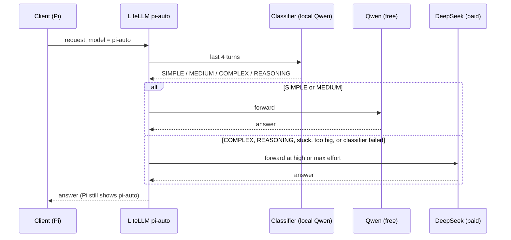

# AI model catalog

This page lists each model name a client can ask for, where that model runs,
and what it costs. It also explains how the `pi-auto` router picks between the
local model and the paid model. Read it before you point an app at the gateway.

New to the stack? Read [Local AI starter kit](index.md) first.

The gateway is LiteLLM, the proxy that every client calls. It offers two chat
models, one local and one paid, under these names:

| Model name | Where it runs | Cost | Paid fallback |
|---|---|---|---|
| `qwen3.8-27b` | the two RTX 3090s | free | yes, when vLLM is busy or down |
| `qwen3.8-27b-local` | the same vLLM engine | free | no, the request fails instead |
| `deepseek-flash` | OpenRouter, outside the lab | paid | n/a |
| `pi-auto` | one of the two, chosen per request | mixed | n/a |

!!! tip "In 10 seconds"
    - Qwen runs locally. The default and auto routes can overflow to the paid cloud model.
    - Use `qwen3.8-27b-local` for private work. It never leaves the lab.
    - DeepSeek Flash is cloud and paid. Its prompts leave the lab.
    - `pi-auto` is not a third model. It is a LiteLLM router that picks one of the two for each request.

Strata, a second local engine, is parked at 0 replicas, and LiteLLM has no
Flash-Next route. A client that still selects Flash-Next must select another
model. Hermes uses `qwen3.8-27b-local` for its local worker.

LiteLLM also has a `whisper` route for speech-to-text. It goes to the OpenVINO
Model Server in `my-apps/ai/whisper` and is not a chat model.

## Who owns the GPUs

| Backend | Replicas | Cards | Model | Status |
|---|---:|---:|---|---|
| vLLM | `1` | 2 | `qwen3.8-27b` | active INT4/W4A8 |
| Strata | `0` | 2 | `qwen3.8-flash-next` | parked |
| NInfer | n/a | 1 | `qwen3.8-ninfer` | archived (`my-apps/ai/_archive/ninfer/`) |
| ComfyUI / SwarmUI | `0` | 1 | image generation | parked |

Both cards belong to vLLM. Other GPU workloads stay parked. To give the cards
to another app, follow the [GPU scale-swap runbook](gpu-scale-swap.md).

## Local: Qwen3.8-27B INT4

| Property | Value |
|---|---|
| Engine | patched vLLM image built in homelab-images, pinned by digest in `deployment.yaml` |
| Weights | `Frozenlock/Qwen3.8-27B-int4-AutoRound`, pinned revision |
| Placement | TP=2, two RTX 3090s, no CPU offload |
| KV / recurrent state | FP8 E4M3 / bfloat16 |
| Context ceiling | 262,144 tokens |
| Concurrency | up to 16 sequences sharing the KV pool |
| Vision | one image per request, video disabled |
| Reasoning | off / low / medium / xhigh. The server default is xhigh |
| Speculation | disabled |
| Power | 200 W per card |

The KV pool is the GPU memory that holds the tokens of requests in progress.
All running requests share it. The 262,144-token ceiling is therefore a limit
for one request. It does not promise several full-length sessions at once.

Reasoning effort sets how many tokens the model may spend thinking before it
answers. The server defaults to `xhigh` with a 16,384 thinking-token cap. `low`
gets 4,096. `medium`, `high`, `xhigh` and `max` get 16,384. An explicit budget
in the request wins. More reasoning does not guarantee a better answer, and a
client can turn reasoning off.

The exact flags, rollout checks and rollback are in the
[vLLM runbook](https://github.com/mitchross/talos-argocd-proxmox/blob/main/my-apps/ai/vllm/README.md).

## Paid: DeepSeek Flash

| Property | Value |
|---|---|
| Gateway model | `deepseek-flash` |
| LiteLLM upstream | `openrouter/~deepseek/deepseek-flash-latest` |
| Context | 1,048,576 tokens |
| Output | 943,718 upstream; Pi deliberately caps 32,768 |
| Input | text and images |
| Reasoning | low / high / max |
| Planning estimate | $0.30/M in, $1.20/M out, $0.03/M cached |

!!! warning "Prompts leave the lab"
    Every `deepseek-flash` request goes to a provider that OpenRouter selects,
    and it costs money.

The `latest` alias can change its target, limits and price with no Git edit.
Treat the price above as an estimate. The usage that OpenRouter bills is the
authoritative number.

## The router

`pi-auto` sends each request to one backend. It selects a model. It does not
split one answer across two models.

| Property | Value |
|---|---|
| Gateway model | `pi-auto` |
| Implementation | **beta** LiteLLM `auto_router/complexity_router` |
| Local tiers | `SIMPLE`, `MEDIUM` → `qwen3.8-27b-auto` |
| Paid tiers | `COMPLEX` → `deepseek-flash` at `high`; `REASONING` at `max` |
| Classifier | local Qwen, greedy, 64 tokens |
| Classified | every request |
| Classifier failure | `deepseek-flash` |
| Stuck-task rescue | `stall_escalation_enabled`, 3 repeats in 6 tool calls |
| Manual override | `LITELLM ESCALATE` in a message bumps one tier |
| Session pin | off |
| Context escalation | on; an oversized prompt moves up rather than truncating |
| Advertised limits | 229,376 input plus 32,768 output |

### What goes where

| Tier | Model | Effort | Runs on |
|---|---|---|---|
| `SIMPLE`, `MEDIUM` | `qwen3.8-27b-auto` | server default: xhigh | the two RTX 3090s, free |
| `COMPLEX` | `deepseek-flash` | `high` | OpenRouter, paid |
| `REASONING` | `deepseek-flash` | `max` | OpenRouter, paid |
| classifier failed | `deepseek-flash` | as above | OpenRouter, paid |

`SIMPLE` and `MEDIUM` work stays on local Qwen. Examples are greetings,
renames, writing tests, explaining code and inspecting the cluster. `COMPLEX`
and `REASONING` work goes to DeepSeek. Examples are debugging, root-cause hunts
and architecture. A failed classification goes to DeepSeek, because a wrong
cheap answer costs more than a paid answer.

### How it decides

Local Qwen grades each request through the `pi-classifier` route, with thinking
off, greedy decoding and a 64-token answer. Do not change the classifier to
sampled decoding. Sampled classification returned `SIMPLE`, `MEDIUM` and
`COMPLEX` for one identical input across six runs.

`classification_mode: every_request` grades every request. It does not hold one
grade through a tool loop. LiteLLM rejects `stall_escalation_enabled` together
with `classification_mode: user_turn` or `session_affinity`, because a held
grade hides the tool calls that stall detection watches.

`stall_escalation_enabled` moves a task up one tier when its newest tool call
repeats, or fails, three times in the last six. It rescues a task that Qwen
accepted and then could not finish.

Include `LITELLM ESCALATE` in a message to force a one-tier bump. It picks a
stronger tier, not a specific model.

### Safety rails

| Rail | What it does |
|---|---|
| `max_tokens_from_tier_model: false` | keeps the client's 32K output cap; the default would hand Flash 943K |
| `enable_context_window_escalation: true` | an oversized prompt moves up instead of being cut |
| `router_settings.fallbacks` on default / auto | busy or unavailable vLLM sends those routes to paid DeepSeek |

`qwen3.8-27b-auto` is the same vLLM backend as `qwen3.8-27b` under a second
name. Both names have paid overflow. Open WebUI, Hindsight, bare `pi` and other
default clients can therefore reach OpenRouter during an outage or a burst. For
private requests, use `qwen3.8-27b-local`, which fails and does not fall back.

Each route name has its own cap of 16 requests per LiteLLM pod. vLLM shares one
16-sequence scheduler across all of them.

The source of truth is [`litellm/config.yaml`](https://github.com/mitchross/talos-argocd-proxmox/blob/main/my-apps/ai/litellm/config.yaml).
To see the split live, read [AI gateway and analytics](ai-observability.md).

## Wiring

| Caller | Endpoint | Auth |
|---|---|---|
| Apps → gateway | `http://litellm-service.litellm.svc.cluster.local:4000/v1` | namespace `ExternalSecret` |
| Workstation → gateway | `https://litellm.vanillax.me/v1` | LiteLLM key in `~/.pi/agent/litellm-api-key` |
| Gateway → Qwen | `http://vllm-service.vllm.svc.cluster.local:8080/v1` | local placeholder |
| Gateway → DeepSeek | OpenRouter | `litellm-secrets` `ExternalSecret` |
| Gateway → Langfuse | `http://langfuse-web.langfuse.svc.cluster.local:3000` | project keys |
| Direct diagnostics | `llama.vanillax.me`, `vllm.vanillax.me` | none; bypasses all telemetry |

An `ExternalSecret` is the object that copies a key from 1Password into a
namespace. Every consumer namespace receives `homelab-prod/litellm/master_key`
this way. No key sits in a ConfigMap or in workflow JSON. This is one shared
gateway key. It does not give each app its own budget or access control.

Every declared LLM consumer uses LiteLLM: Open WebUI, Perplexica/Vane,
Presenton, Hindsight, Hermes, Home Assistant, Karakeep, ComfyUI's vision
bridge, WorldMonitor, Deal Scout, News Reader and Radar-ng. Each one stays on
local Qwen unless you change its model explicitly. Hindsight is the exception.
It extracts facts with paid `deepseek-flash` (reasoning off), so memory saves
keep working while vLLM is down.

A direct vLLM call bypasses Langfuse. An app must use the authenticated gateway
to appear in telemetry.

## Storage

A manifest in Git, `my-apps/ai/vllm/model-manifest-int4.json`, pins the
revision, size and SHA-256 of all 17 checkpoint artifacts. A download hook
writes the TrueNAS archive. A cache-sync hook verifies the archive and copies
it to local NVMe.

The serving init container requires the readiness marker and a complete file
inventory, so vLLM never starts against a partial copy. An interrupted download
resumes. A corrupt copy fails verification.

## Rollback

vLLM is the only GPU inference backend. To roll back a model or flag change,
revert the commit. The staging hooks run again against the retained cache.
