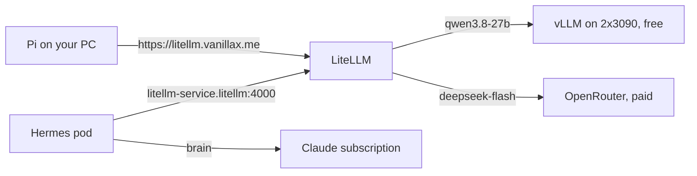

# Pi and Hermes: the two AI agents

**Use Pi at your keyboard. Use Hermes when the work should run without you.**
New to the stack? Read [Local AI starter kit](index.md) first.

An *agent* is an LLM that can also run tools: read files, run commands, edit
code. This homelab has two. Both send their LLM requests to the same LiteLLM
gateway, so both show up in Grafana and Langfuse.

| | Pi | Hermes |
|---|---|---|
| Runs on | your PC, in a terminal | one pod in the cluster, all day |
| You talk to it | `pi` in a terminal | `https://hermes.vanillax.me` (Tailscale) |
| Good for | coding in a repo on your PC | cluster health checks, daily digest, chat, opening PRs while you are away |
| Its "brain" model | your launcher picks: Qwen, DeepSeek or `pi-auto` | Claude Sonnet; Qwen in the picker as a free choice |
| Who writes code | Pi itself, with the brain model | Claude Code or Codex inside the pod |
| Config | `~/.pi/agent/` from `mitchross/dotfiles` | [`my-apps/development/hermes/config/config.yaml`](https://github.com/mitchross/talos-argocd-proxmox/blob/main/my-apps/development/hermes/config/config.yaml) |
| Gateway URL | `https://litellm.vanillax.me/v1` | `http://litellm-service.litellm.svc.cluster.local:4000/v1` |
| LiteLLM key | file `~/.pi/agent/litellm-api-key` | `LITELLM_API_KEY` from 1Password `litellm/master_key` via External Secrets |
| Can reach the cluster | only what your PC can reach | read-only `kubectl`, no Secrets |
| Change it | dotfiles PR + `chezmoi apply` | PR to `my-apps/development/hermes/`; ArgoCD rolls the pod |



Hermes does not run Pi and does not use `pi-auto`. Its LiteLLM provider lists
only `qwen3.8-27b`. To add a model to the Hermes picker, add it under
`providers.litellm.models` in its `config.yaml` through a PR. Login, coding
agents and troubleshooting: [Hermes in the cluster](hermes.md).

The rest of this page sets up Pi on a workstation.

!!! note "Paseo"
    Paseo, the old cluster workspace for Pi, is off. Its files stay in Git, but CI
    no longer checks them. Compare them with this page before you turn Paseo on.

`apiKey` in Pi takes a literal, `$NAME`/`${NAME}` for an environment variable, or
`!command`. A bare `LITELLM_API_KEY` is a literal: LiteLLM sees an unknown key,
looks for a key database it does not have, and returns `400 No connected db`.

The OpenRouter credential lives only inside LiteLLM, except for the
`pi-direct-openrouter` emergency launcher below.

## Pi in five minutes

1. Install Pi: `npm install -g @earendil-works/pi-coding-agent`.
2. Write the LiteLLM key to `~/.pi/agent/litellm-api-key` (see [Credentials](#credentials)).
3. Copy the [`models.json`](#reference-piagentmodelsjson) and
   [`settings.json`](#reference-piagentsettingsjson) references below into `~/.pi/agent/`.
4. Add the [launcher aliases](#the-four-launchers) to `~/.zshrc`, then run `source ~/.zshrc`.
5. Run `pi-withflash` in a repo and ask "what does this repo do?".

**It worked when** Pi answers and Grafana `/d/pi-routing` counts one request.

## Reasoning defaults

Direct Qwen (`pi`, `pi-qwen-only`) defaults to **xhigh** reasoning with
preserved thinking. Pick medium, low or off per session when you want less.
Xhigh uses more time and output tokens; it does not promise better answers.

`pi-auto` shows `medium` in Pi but sends no effort to Qwen. Auto-routed Qwen
uses the server default, xhigh; DeepSeek uses high or max by tier. Do not change
the auto provider to xhigh or forward Qwen kwargs into cloud routes.

A resumed session keeps its saved thinking level. Start a new session with
`/new` after you change defaults.

## The four launchers

| Launcher | Model | Use it for |
|---|---|---|
| `pi-withflash` | `pi-auto` | automatic local/cloud selection |
| `pi` / `pi-qwen-only` | local Qwen, xhigh | nothing may leave the cluster |
| `pi-flash` | DeepSeek Flash | you already know it is hard |
| `pi-direct-openrouter` | DeepSeek Flash, no cluster | the gateway is down |

In `~/.zshrc`:

```bash
# Provider name is load-bearing: scripts/pi/qwen-sampling.ts only fires on
# vanillax-vllm, so a renamed provider silently drops Qwen's sampler.
QWEN=vanillax-vllm/qwen3.8-27b
FLASH=vanillax-openrouter/deepseek-flash
AUTO=vanillax-auto/pi-auto
alias pi-qwen-only="pi --model $QWEN --thinking xhigh --models $QWEN"
alias pi-flash="pi --model $FLASH --thinking high --models $FLASH"
alias pi-withflash="pi --model $AUTO --thinking medium --models $AUTO"
unset QWEN FLASH AUTO
```

Ctrl+P does not pick the backend under `pi-withflash`. Pi always asks for
`pi-auto`; LiteLLM decides behind that alias. To override, use a different
launcher.

A later message can move the same session from Qwen to OpenRouter. Start `/new`
before a cloud-eligible task if the current conversation holds anything that
must not leave the cluster.

## What `pi-auto` does

Under `pi-withflash`, LiteLLM grades every request. Easy work stays on local
Qwen; hard work, stuck tool loops and oversized prompts go to paid DeepSeek
Flash. Tiers, grading and safety rails live in the
[model catalog § The router](model-catalog.md#the-router). Routing changes are
server-side, so they need no Pi reinstall.

## Which model answered?

Pi always displays `pi-auto`. It will not tell you.

1. Grafana `/d/pi-routing` — the ratio, the escalation count, the spend
2. Langfuse `langfuse.vanillax.me` — per trace, filter tag `pi`, read `providedModelName`

How to read both: [AI gateway and analytics](ai-observability.md).

Pi's cost readout prices every turn as DeepSeek, so local turns look paid when
they cost nothing. Trust the dashboards.

## CachyOS workstation inventory

| Item | State |
|---|---|
| OS | CachyOS rolling release, Arch-based |
| Pi | npm package under `mise`'s Node LTS |
| Launchers | interactive zsh aliases in `~/.zshrc` |
| Providers | `~/.pi/agent/models.json` |
| Defaults, Ctrl+P scope | `~/.pi/agent/settings.json` |
| Request hook | `~/.pi/agent/extensions/qwen-sampling.ts` |
| Packages | listed under `packages` in `~/.pi/agent/settings.json` |

## Tools Pi can use

Pi ships `read`, `bash`, `edit` and `write`. Packages add the rest:

| Package | Adds |
|---|---|
| `@narumitw/pi-subagents` | background subagent jobs that message the main agent |
| `@dreki-gg/pi-lsp` | LSP diagnostics, hover, definitions, references, symbols |
| `pi-web-access` | web search, URL fetch, GitHub clone, PDF extraction |
| `pi-mcp-adapter` | MCP servers as Pi tools; the built-in MCP is off (`"-builtin:mcp"`) |
| `@narumitw/pi-chrome-devtools` | Chrome DevTools Protocol tools |
| `@d3ara1n/pi-ask-user` | an ask-user tool that keeps the transcript visible |
| `@narumitw/pi-goal` | `/goal`: work one objective on its own until done |
| `pi-plan` | plan mode: read-only exploration, then execute |
| `@narumitw/pi-statusline` | replaces the footer with a detailed status line |

Install one with `pi install npm:<package>`. Pi adds it to `settings.json`.
Every tool call runs on the workstation; only the model request goes to LiteLLM.

## Keep the sampler current

The hook is a chezmoi **external** with a 168-hour refresh, so a machine can
serve a week-old copy and miss a fix.

```bash
chezmoi --refresh-externals apply ~/.pi/agent/extensions/qwen-sampling.ts
command diff -u ~/.pi/agent/extensions/qwen-sampling.ts \
        ~/src/talos-argocd-proxmox/scripts/pi/qwen-sampling.ts
```

No output from `diff` means current. Running Pi sessions need `/reload`.
The xhigh-default change does not modify the sampler extension itself.

The hook does three things: keeps only the newest image for local Qwen and
`pi-auto`, attaches the Langfuse session id and `pi` tag, and applies Qwen's
sampling to direct `vanillax-vllm` requests. Auto-routed Qwen uses the matching
vLLM server defaults instead.

## Sampling when thinking is off

Pi's thinking toggle changes template kwargs but does not switch Qwen's sampler.
The hook does, for direct Qwen only:

| Thinking | temperature | top_p | presence_penalty | repetition_penalty |
|---|---|---|---|---|
| on | 1.0 | 0.95 | 0.0 | 1.05 |
| off | 0.7 | 0.8 | 1.5 | 1.0 |

Both keep `top_k: 20` and `min_p: 0.0`. Never set `temperature: 0` here — greedy
decoding makes Qwen repeat itself. That rule is for the classifier, not for
generation.

## Images

Local Qwen accepts one image per request. The hook keeps the newest and replaces
older ones with a text marker, so a second screenshot cannot wedge a session.
Comparing two images at once needs an explicit cloud route.

## Subagents

Children inherit the parent's model. Under `pi-withflash` they inherit
`vanillax-auto/pi-auto` and LiteLLM classifies each child's work on its own
merits. Use `pi-flash` for a forced DeepSeek second opinion.

## Direct OpenRouter when the cluster is down

`pi-direct-openrouter` calls DeepSeek Flash with a workstation key, high
reasoning and a 32K output cap. It bypasses LiteLLM and Langfuse entirely and is
billed by OpenRouter.

```bash
alias pi-direct-openrouter='pi --model vanillax-direct-openrouter/~deepseek/deepseek-flash-latest --thinking high --models vanillax-direct-openrouter/~deepseek/deepseek-flash-latest'
```

Provider definition lives in
[`scripts/pi/direct-openrouter.json`](https://github.com/mitchross/talos-argocd-proxmox/blob/main/scripts/pi/direct-openrouter.json).
The sampler deliberately leaves these requests untouched.

## Credentials

Provision once, outside chezmoi. Both files are in `.chezmoiignore`.

```bash
(umask 077; op read 'op://homelab-prod/litellm/master_key' > ~/.pi/agent/litellm-api-key)
(umask 077; op read 'op://homelab-prod/open-router/api-key-open-router' > ~/.pi/agent/openrouter-api-key)
```

## Verify

```bash
pi --version
pi --list-models pi-auto
type pi-qwen-only; type pi-flash; type pi-withflash
```

Expect Qwen at roughly 262K context and 32K output, DeepSeek Flash at roughly 1M
context with the deliberate 32K Pi cap, and `pi-auto` at the safe 262K/32K
intersection. All report thinking and image support. The aliases must expand to
the provider/model pairs above, including `--thinking xhigh` for `pi-qwen-only`
and `--models $AUTO` for `pi-withflash`.

Check outgoing request kwargs, not answer length: direct Qwen should send
`enable_thinking=true`, `reasoning_effort=xhigh`, and `preserve_thinking=true`
by default. Repeat with explicit medium, low and off. The
[vLLM acceptance matrix](https://github.com/mitchross/talos-argocd-proxmox/blob/main/my-apps/ai/vllm/README.md#reasoning-acceptance-checks)
covers tools, images and multi-turn history. A run that exhausts its output
budget is inconclusive; xhigh does not expand the 32K allowance.

## Rollback

To reduce reasoning immediately, select medium on direct Qwen or launch:

```bash
pi --model vanillax-vllm/qwen3.8-27b --thinking medium --models vanillax-vllm/qwen3.8-27b
```

To revert the default permanently, revert the paired GitOps/dotfiles changes
through PRs, apply the restored settings and zshrc, then start a fresh session.
Do not change model weights, sampler or KV precision to roll back effort.

Point `pi-withflash` at `$QWEN` instead of `$AUTO` to roll back automatic routing.
Everything stays local and nothing is billed. Router behaviour reverts through
a PR to `my-apps/ai/litellm/config.yaml`.

## Reference: `~/.pi/agent/models.json`

Three providers, all pointing at the authenticated gateway. The workstation copy
is tracked in `mitchross/dotfiles`; this block is the repo's copy and CI checks
it against `litellm/config.yaml`, so keep them in step.

```json
{
  "providers": {
    "vanillax-vllm": {
      "baseUrl": "https://litellm.vanillax.me/v1",
      "api": "openai-completions",
      "apiKey": "$LITELLM_API_KEY",
      "compat": {
        "supportsDeveloperRole": false,
        "supportsReasoningEffort": false,
        "supportsUsageInStreaming": true,
        "maxTokensField": "max_tokens",
        "thinkingFormat": "chat-template",
        "chatTemplateKwargs": {
          "enable_thinking": { "$var": "thinking.enabled" },
          "reasoning_effort": {
            "$var": "thinking.effort",
            "omitWhenOff": true
          },
          "preserve_thinking": { "$var": "thinking.enabled" }
        }
      },
      "models": [
        {
          "id": "qwen3.8-27b",
          "name": "Qwen3.8 27B (vLLM FP8, 2x3090, 262K)",
          "reasoning": true,
          "thinkingLevelMap": {
            "off": "off",
            "minimal": null,
            "low": "low",
            "medium": "medium",
            "high": null,
            "xhigh": "xhigh",
            "max": null
          },
          "input": ["text", "image"],
          "contextWindow": 262144,
          "maxTokens": 32768,
          "cost": {
            "input": 0,
            "output": 0,
            "cacheRead": 0,
            "cacheWrite": 0
          }
        }
      ]
    },
    "vanillax-openrouter": {
      "baseUrl": "https://litellm.vanillax.me/v1",
      "api": "openai-completions",
      "apiKey": "$LITELLM_API_KEY",
      "compat": {
        "supportsDeveloperRole": false,
        "supportsUsageInStreaming": true,
        "maxTokensField": "max_tokens",
        "thinkingFormat": "openrouter",
        "requiresReasoningContentOnAssistantMessages": true
      },
      "models": [
        {
          "id": "deepseek-flash",
          "name": "DeepSeek Flash Latest (OpenRouter via LiteLLM, Pi 32K cap)",
          "reasoning": true,
          "thinkingLevelMap": {
            "off": null,
            "minimal": null,
            "low": "low",
            "medium": null,
            "high": "high",
            "xhigh": null,
            "max": "max"
          },
          "input": ["text", "image"],
          "contextWindow": 1048576,
          "maxTokens": 32768,
          "cost": {
            "input": 0.3,
            "output": 1.2,
            "cacheRead": 0.03,
            "cacheWrite": 0
          }
        }
      ]
    },
    "vanillax-auto": {
      "baseUrl": "https://litellm.vanillax.me/v1",
      "api": "openai-completions",
      "apiKey": "$LITELLM_API_KEY",
      "compat": {
        "supportsDeveloperRole": false,
        "supportsReasoningEffort": false,
        "supportsUsageInStreaming": true,
        "maxTokensField": "max_tokens",
        "requiresReasoningContentOnAssistantMessages": true
      },
      "models": [
        {
          "id": "pi-auto",
          "name": "Pi Auto (LiteLLM: local Qwen or OpenRouter DeepSeek Flash)",
          "reasoning": true,
          "thinkingLevelMap": {
            "off": null,
            "minimal": null,
            "low": null,
            "medium": "medium",
            "high": null,
            "xhigh": null,
            "max": null
          },
          "input": ["text", "image"],
          "contextWindow": 262144,
          "maxTokens": 32768,
          "cost": {
            "input": 0.3,
            "output": 1.2,
            "cacheRead": 0.03,
            "cacheWrite": 0
          }
        }
      ]
    }
  }
}
```

Keep every provider and model id stable. The Qwen provider name gates the
sampler hook, and all three model names are referenced by LiteLLM or the
launchers.

## Reference: `~/.pi/agent/settings.json`

Defaults and Ctrl+P scope. CI checks `defaultThinkingLevel` and the per-model
thinking levels, so keep this in step with the workstation copy.

```json
{
  "defaultProvider": "vanillax-vllm",
  "defaultModel": "qwen3.8-27b",
  "defaultThinkingLevel": "xhigh",
  "modelThinkingLevels": {
    "vanillax-vllm/qwen3.8-27b": "xhigh",
    "vanillax-openrouter/deepseek-flash": "high"
  },
  "enabledModels": [
    "vanillax-vllm/qwen3.8-27b"
  ],
  "compaction": {
    "enabled": true,
    "reserveTokens": 49152,
    "keepRecentTokens": 20000
  }
}
```

`compaction.reserveTokens` holds back 49,152 tokens so a long session compacts
rather than overflowing.
