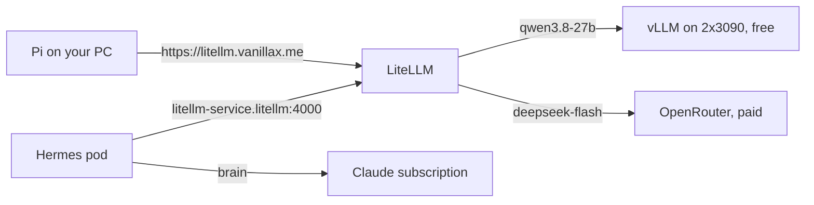
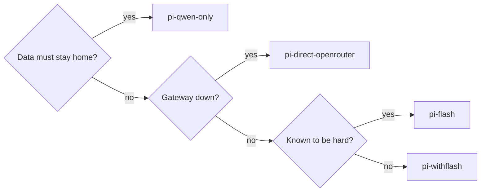

# Pi and Hermes, and which agent to use

This page helps you choose between the two AI agents in this homelab, then sets up Pi on a workstation.
Use Pi when you sit at your keyboard. Use Hermes when the work must run without you.
If the stack is unfamiliar, read the [Local AI starter kit](index.md) first.

!!! tip "Do this first"
    1. Pick the agent from the table below.
    2. For Pi, follow [Pi in five minutes](#pi-in-five-minutes). About 5 minutes.
    3. For Hermes, follow [Connect](hermes.md#connect) in the Hermes page.

## Choose an agent

An agent is an LLM that can also run tools: read files, run commands, edit code.
This homelab has two agents. Both send requests to the same LiteLLM gateway, the authenticated proxy in front of the models.
For that reason both appear in Grafana and Langfuse.

| Question | Pi | Hermes |
|---|---|---|
| Where does it run? | your PC, in a terminal | one pod in the cluster, all day |
| How do you talk to it? | `pi` in a terminal | `https://hermes.vanillax.me` (Tailscale) |
| What is it good for? | coding in a repo on your PC | cluster health checks, daily digest, chat, opening PRs while you are away |
| Which model is its brain? | your launcher picks Qwen, DeepSeek or `pi-auto` | Claude Opus, with Qwen in the picker as a no-cost choice |
| Who writes code? | Pi itself, with the brain model | Codex or Claude Code inside the pod |
| Where is its config? | `~/.pi/agent/` from `mitchross/dotfiles` | [`my-apps/development/hermes/config/config.yaml`](https://github.com/mitchross/talos-argocd-proxmox/blob/main/my-apps/development/hermes/config/config.yaml) |
| Which gateway URL? | `https://litellm.vanillax.me/v1` | `http://litellm-service.litellm.svc.cluster.local:4000/v1` |
| Where is the LiteLLM key? | file `~/.pi/agent/litellm-api-key` | `LITELLM_API_KEY` from 1Password `litellm/master_key` through External Secrets |
| Can it reach the cluster? | only what your PC can reach | `kubectl` in the pod reads the cluster and does day-to-day fixes. It cannot read Secrets through the API |
| How do you change it? | dotfiles PR, then `chezmoi apply` | PR to `my-apps/development/hermes/`, then Argo CD rolls the pod |



Hermes does not run Pi and does not use `pi-auto`.
Its LiteLLM provider lists `qwen3.8-27b` and `qwen3.8-27b-local`.
To add a model to the Hermes picker, add it under `providers.litellm.models` in its `config.yaml` through a PR.
[Hermes in the cluster](hermes.md) owns login, coding agents and troubleshooting for Hermes.

The rest of this page sets up Pi on a workstation.

## Pi in five minutes

1. Install Pi: `npm install -g @earendil-works/pi-coding-agent`.
2. Write the LiteLLM key to `~/.pi/agent/litellm-api-key` (see [Credentials](#credentials)).
3. Copy the [`models.json`](#reference-piagentmodelsjson) and
   [`settings.json`](#reference-piagentsettingsjson) references below into `~/.pi/agent/`.
4. Add the [launcher aliases](#the-four-launchers) to `~/.zshrc`, then run `source ~/.zshrc`.
5. Run `pi-withflash` in a repo and ask "what does this repo do?".

It worked when Pi answers and Grafana `/d/pi-routing` counts one request.

## Credentials

Create these files once, outside chezmoi. Both are in `.chezmoiignore`.

```bash
(umask 077; op read 'op://homelab-prod/litellm/master_key' > ~/.pi/agent/litellm-api-key)
(umask 077; op read 'op://homelab-prod/open-router/api-key-open-router' > ~/.pi/agent/openrouter-api-key)
```

The OpenRouter credential lives only inside LiteLLM.
The one exception is the [`pi-direct-openrouter`](#direct-openrouter-when-the-cluster-is-down) emergency launcher.

`apiKey` in Pi takes a literal, `$NAME` or `${NAME}` for an environment variable, or `!command`.
Do not write a bare `LITELLM_API_KEY`, because Pi sends it as a literal key.
LiteLLM then sees an unknown key, looks for a key database it does not have, and returns `400 No connected db`.

## The four launchers

A launcher is a shell alias that starts Pi with one model and one thinking level.



| Launcher | Model | Use it for |
|---|---|---|
| `pi-withflash` | `pi-auto` | automatic local/cloud selection |
| `pi` / `pi-qwen-only` | local Qwen, xhigh | nothing may leave the cluster |
| `pi-flash` | DeepSeek Flash | you already know it is hard |
| `pi-direct-openrouter` | DeepSeek Flash, no cluster | the gateway is down |

In `~/.zshrc`:

```bash
# Provider name is load-bearing: scripts/pi/qwen-sampling.ts only fires on
# vanillax-vllm, so a renamed provider silently drops Qwen's sampler.
QWEN=vanillax-vllm/qwen3.8-27b
FLASH=vanillax-openrouter/deepseek-flash
AUTO=vanillax-auto/pi-auto
alias pi-qwen-only="pi --model $QWEN --thinking xhigh --models $QWEN"
alias pi-flash="pi --model $FLASH --thinking high --models $FLASH"
alias pi-withflash="pi --model $AUTO --thinking medium --models $AUTO"
unset QWEN FLASH AUTO
```

Ctrl+P does not pick the backend under `pi-withflash`.
Pi always asks for `pi-auto`, and LiteLLM decides behind that alias.
To override the choice, use a different launcher.

A later message can move the same session from Qwen to OpenRouter.
If the current conversation holds anything that must not leave the cluster, start `/new` before a cloud-eligible task.

## What `pi-auto` does

Under `pi-withflash`, LiteLLM grades every request.
Easy work stays on local Qwen.
Hard work, stuck tool loops and oversized prompts go to paid DeepSeek Flash.
The [router section of the model catalog](model-catalog.md#the-router) owns the tiers, the grading and the safety rails.
Routing changes are server-side, so they need no Pi reinstall.

## Which model answered?

Pi always displays `pi-auto`, so Pi does not tell you. Use the dashboards:

1. Grafana `/d/pi-routing` shows the ratio, the escalation count and the spend.
2. Langfuse `langfuse.vanillax.me` shows each trace. Filter tag `pi`, then read `providedModelName`.

[AI gateway and analytics](ai-observability.md) explains how to read both.

Pi's cost readout prices every turn as DeepSeek, so local turns look paid when they cost nothing.
Trust the dashboards.

## Reasoning defaults

Direct Qwen (`pi`, `pi-qwen-only`) defaults to xhigh reasoning with preserved thinking.
Pick medium, low or off per session when you want less.
Xhigh uses more time and more output tokens. It does not promise better answers.

`pi-auto` shows `medium` in Pi but sends no effort to Qwen.
Auto-routed Qwen uses the server default, xhigh, with a 16,384-token thinking cap.
DeepSeek uses high or max by tier.
Do not change the auto provider to xhigh, and do not forward Qwen kwargs into cloud routes.

A resumed session keeps its saved thinking level.
Start a new session with `/new` after you change defaults.

## Tools Pi can use

Pi ships `read`, `bash`, `edit` and `write`. Packages add more:

| Package | Adds |
|---|---|
| `@narumitw/pi-subagents` | background subagent jobs that message the main agent |
| `@dreki-gg/pi-lsp` | LSP diagnostics, hover, definitions, references, symbols |
| `pi-web-access` | web search, URL fetch, GitHub clone, PDF extraction |
| `pi-mcp-adapter` | MCP servers as Pi tools; the built-in MCP is off (`"-builtin:mcp"`) |
| `@narumitw/pi-chrome-devtools` | Chrome DevTools Protocol tools |
| `@d3ara1n/pi-ask-user` | an ask-user tool that keeps the transcript visible |
| `@narumitw/pi-goal` | `/goal`: work one objective on its own until done |
| `pi-plan` | plan mode: read-only exploration, then execute |
| `@narumitw/pi-statusline` | replaces the footer with a detailed status line |

Install one with `pi install npm:<package>`. Pi adds it to `settings.json`.
Every tool call runs on the workstation. Only the model request goes to LiteLLM.

## Subagents

Children inherit the parent's model.
Under `pi-withflash` they inherit `vanillax-auto/pi-auto`, and LiteLLM classifies each child's work separately.
Use `pi-flash` for a forced DeepSeek second opinion.

## Images

Local Qwen accepts one image per request.
The sampler hook keeps the newest image and replaces older ones with a text marker, so a second screenshot cannot hang a session.
To compare two images at once, use an explicit cloud route.

## The sampler hook

The sampler hook is the Pi extension `~/.pi/agent/extensions/qwen-sampling.ts`. It does three things:

1. It keeps only the newest image for local Qwen and `pi-auto`.
2. It attaches the Langfuse session id and the `pi` tag.
3. It applies Qwen's sampling to direct `vanillax-vllm` requests.

Auto-routed Qwen uses the matching vLLM server defaults instead.

### Sampling when thinking is off

Pi's thinking toggle changes template kwargs but does not switch Qwen's sampler.
The hook switches the sampler, for direct Qwen only:

| Thinking | temperature | top_p | presence_penalty | repetition_penalty |
|---|---|---|---|---|
| on | 1.0 | 0.95 | 0.0 | 1.05 |
| off | 0.7 | 0.8 | 1.5 | 1.0 |

Both keep `top_k: 20` and `min_p: 0.0`.
Never set `temperature: 0` here, because greedy decoding makes Qwen repeat itself.
That value is for the classifier, not for generation.

### Keep the sampler current

The hook is a chezmoi external with a 168-hour refresh.
A machine can therefore use a week-old copy and miss a fix. To refresh and compare:

```bash
chezmoi --refresh-externals apply ~/.pi/agent/extensions/qwen-sampling.ts
command diff -u ~/.pi/agent/extensions/qwen-sampling.ts \
        ~/src/talos-argocd-proxmox/scripts/pi/qwen-sampling.ts
```

No output from `diff` means the copy is current. Running Pi sessions need `/reload`.
The xhigh default is set in `settings.json` and the launchers, not in the sampler extension.

## Direct OpenRouter when the cluster is down

`pi-direct-openrouter` calls DeepSeek Flash with a workstation key, high reasoning and a 32K output cap.
It bypasses LiteLLM and Langfuse entirely, and OpenRouter bills it.

```bash
alias pi-direct-openrouter='pi --model vanillax-direct-openrouter/~deepseek/deepseek-flash-latest --thinking high --models vanillax-direct-openrouter/~deepseek/deepseek-flash-latest'
```

The provider definition is in
[`scripts/pi/direct-openrouter.json`](https://github.com/mitchross/talos-argocd-proxmox/blob/main/scripts/pi/direct-openrouter.json).
The sampler leaves these requests untouched on purpose.

## Verify

```bash
pi --version
pi --list-models pi-auto
type pi-qwen-only; type pi-flash; type pi-withflash
```

Expect these values:

| Model | Context | Output |
|---|---|---|
| Qwen | roughly 262K | 48K |
| DeepSeek Flash | roughly 1M | the deliberate 32K Pi cap |
| `pi-auto` | 262K | 48K |

All three report thinking and image support.
The aliases must expand to the provider/model pairs above, including `--thinking xhigh` for `pi-qwen-only` and `--models $AUTO` for `pi-withflash`.

Check the outgoing request kwargs, not the answer length.
Direct Qwen sends `enable_thinking=true`, `reasoning_effort=xhigh` and `preserve_thinking=true` by default.
Repeat the check with explicit medium, low and off.
The [vLLM acceptance matrix](https://github.com/mitchross/talos-argocd-proxmox/blob/main/my-apps/ai/vllm/README.md#reasoning-acceptance-checks)
covers tools, images and multi-turn history.
A run that exhausts its output budget is inconclusive.
The server caps thinking at 16K, which leaves the rest of the 48K for the answer.

## Reduce reasoning or turn off routing

To reduce reasoning for one session, select medium on direct Qwen or launch:

```bash
pi --model vanillax-vllm/qwen3.8-27b --thinking medium --models vanillax-vllm/qwen3.8-27b
```

To lower the default permanently, change `settings.json` and the launcher aliases through PRs in dotfiles and in this Git repo.
Apply the changed settings and zshrc, then start a fresh session.
Do not change model weights, sampler or KV precision to reduce effort.

To turn off automatic routing, point `pi-withflash` at `$QWEN` instead of `$AUTO`.
Everything then stays local and nothing is billed.
To revert router behaviour, open a PR to `my-apps/ai/litellm/config.yaml`.

## CachyOS workstation inventory

This table shows where each part of the Pi setup lives on the workstation.

| Item | State |
|---|---|
| OS | CachyOS rolling release, Arch-based |
| Pi | npm package under `mise`'s Node LTS |
| Launchers | interactive zsh aliases in `~/.zshrc` |
| Providers | `~/.pi/agent/models.json` |
| Defaults, Ctrl+P scope | `~/.pi/agent/settings.json` |
| Request hook | `~/.pi/agent/extensions/qwen-sampling.ts` |
| Packages | listed under `packages` in `~/.pi/agent/settings.json` |

## Reference: `~/.pi/agent/models.json`

The file defines three providers, and all three point at the authenticated gateway.
`mitchross/dotfiles` tracks the workstation copy.
This block is the Git repo's copy. CI checks it against `litellm/config.yaml`, so keep both copies the same.

```json
{
  "providers": {
    "vanillax-vllm": {
      "baseUrl": "https://litellm.vanillax.me/v1",
      "api": "openai-completions",
      "apiKey": "$LITELLM_API_KEY",
      "compat": {
        "supportsDeveloperRole": false,
        "supportsReasoningEffort": false,
        "supportsUsageInStreaming": true,
        "maxTokensField": "max_tokens",
        "thinkingFormat": "chat-template",
        "chatTemplateKwargs": {
          "enable_thinking": { "$var": "thinking.enabled" },
          "reasoning_effort": {
            "$var": "thinking.effort",
            "omitWhenOff": true
          },
          "preserve_thinking": { "$var": "thinking.enabled" }
        }
      },
      "models": [
        {
          "id": "qwen3.8-27b",
          "name": "Qwen3.8 27B (vLLM INT4, 2x3090, 262K)",
          "reasoning": true,
          "thinkingLevelMap": {
            "off": "off",
            "minimal": null,
            "low": "low",
            "medium": "medium",
            "high": null,
            "xhigh": "xhigh",
            "max": null
          },
          "input": ["text", "image"],
          "contextWindow": 262144,
          "maxTokens": 49152,
          "cost": {
            "input": 0,
            "output": 0,
            "cacheRead": 0,
            "cacheWrite": 0
          }
        }
      ]
    },
    "vanillax-openrouter": {
      "baseUrl": "https://litellm.vanillax.me/v1",
      "api": "openai-completions",
      "apiKey": "$LITELLM_API_KEY",
      "compat": {
        "supportsDeveloperRole": false,
        "supportsUsageInStreaming": true,
        "maxTokensField": "max_tokens",
        "thinkingFormat": "openrouter",
        "requiresReasoningContentOnAssistantMessages": true
      },
      "models": [
        {
          "id": "deepseek-flash",
          "name": "DeepSeek Flash Latest (OpenRouter via LiteLLM, Pi 32K cap)",
          "reasoning": true,
          "thinkingLevelMap": {
            "off": null,
            "minimal": null,
            "low": "low",
            "medium": null,
            "high": "high",
            "xhigh": null,
            "max": "max"
          },
          "input": ["text", "image"],
          "contextWindow": 1048576,
          "maxTokens": 32768,
          "cost": {
            "input": 0.3,
            "output": 1.2,
            "cacheRead": 0.03,
            "cacheWrite": 0
          }
        }
      ]
    },
    "vanillax-auto": {
      "baseUrl": "https://litellm.vanillax.me/v1",
      "api": "openai-completions",
      "apiKey": "$LITELLM_API_KEY",
      "compat": {
        "supportsDeveloperRole": false,
        "supportsReasoningEffort": false,
        "supportsUsageInStreaming": true,
        "maxTokensField": "max_tokens",
        "requiresReasoningContentOnAssistantMessages": true
      },
      "models": [
        {
          "id": "pi-auto",
          "name": "Pi Auto (LiteLLM: local Qwen or OpenRouter DeepSeek Flash)",
          "reasoning": true,
          "thinkingLevelMap": {
            "off": null,
            "minimal": null,
            "low": null,
            "medium": "medium",
            "high": null,
            "xhigh": null,
            "max": null
          },
          "input": ["text", "image"],
          "contextWindow": 262144,
          "maxTokens": 49152,
          "cost": {
            "input": 0.3,
            "output": 1.2,
            "cacheRead": 0.03,
            "cacheWrite": 0
          }
        }
      ]
    }
  }
}
```

Do not rename a provider or a model id.
The sampler hook runs only for the Qwen provider name, and LiteLLM or the launchers reference all three model names.

## Reference: `~/.pi/agent/settings.json`

This file sets the defaults and the Ctrl+P scope.
CI checks `defaultThinkingLevel` and the per-model thinking levels, so keep this block the same as the workstation copy.

```json
{
  "defaultProvider": "vanillax-vllm",
  "defaultModel": "qwen3.8-27b",
  "defaultThinkingLevel": "xhigh",
  "modelThinkingLevels": {
    "vanillax-vllm/qwen3.8-27b": "xhigh",
    "vanillax-openrouter/deepseek-flash": "high"
  },
  "enabledModels": [
    "vanillax-vllm/qwen3.8-27b"
  ],
  "compaction": {
    "enabled": true,
    "reserveTokens": 49152,
    "keepRecentTokens": 20000
  }
}
```

`compaction.reserveTokens` holds back 49,152 tokens, so a long session compacts before it overflows.
