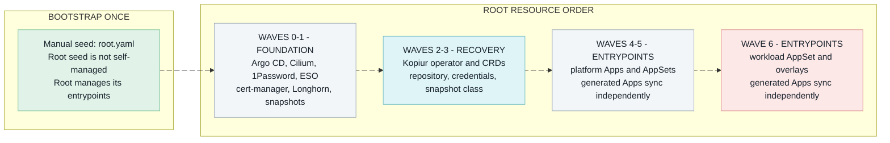

# How Argo CD deploys this repo

Argo CD is the controller that reads this Git repo and applies it to the cluster.
This page explains how it starts, in what order it deploys, and which sync settings this repo uses.
Read it before you add an infrastructure component or debug an Application that does not sync.
The runbooks at the end cover three cases: pause reconciliation, replace an immutable object, and clear a stale render.

Two words have fixed meanings here. An **Application** is the Argo CD object that deploys one directory.
An **app** is the workload in that directory. The [glossary](../../glossary.md) has the full list.



The root Application orders the resources it creates directly.
Applications that an ApplicationSet generates reconcile on their own, in no fixed order.

## How deployment starts

A person applies one file by hand, once:

```text
infrastructure/controllers/argocd/root.yaml
```

That file is the root Application. Argo CD does not manage `root.yaml` itself.
After it exists, Argo CD manages everything under `infrastructure/controllers/argocd/apps/`.

The root Application renders three layers:

1. `core-dependencies`: foundational controllers and storage dependencies.
2. `custom-entrypoints`: repository-specific Applications with explicit wave ordering.
3. `applicationsets`: infrastructure, database, monitoring, and workload generators.

An ApplicationSet is a generator. It scans directories in the Git repo and creates one Application for each match.
That is why a new directory with a `kustomization.yaml` becomes a deployed app with no other change.

[Entrypoints and sync waves](entrypoints.md) lists every file in these layers.

## Bootstrap rule

Apply resources in this order:

```text
CRDs first, controllers/apps second, CRs third.
```

A CRD is the definition of a custom resource type. A CR is one object of that type.
The API server rejects a CR when its CRD does not exist yet.

Observability is not a core dependency. Core apps must bootstrap without Prometheus.

Do not install Prometheus Operator CRDs early to satisfy bootstrap apps.
Put ServiceMonitor and PrometheusRule resources in later observability overlays.
`kube-prometheus-stack` is the sole owner and provider of `monitoring.coreos.com` CRDs.

## Current wave ordering

| Wave | Applications |
|---|---|
| `0` | Argo CD projects and bootstrap, Cilium, 1Password Connect, External Secrets |
| `1` | cert-manager, Longhorn, snapshot-controller |
| `2` | kopiur operator (CRDs, controller, webhook, volume populator) |
| `3` | kopiur config (ClusterRepository `cluster-kopia`, credential fanout, VolumeSnapshotClass) |
| `4` | KEDA core, VPA controller and system policies, Temporal worker controller, infrastructure and database ApplicationSets |
| `5` | Monitoring ApplicationSet, which includes `kube-prometheus-stack` |
| `6` | OpenTelemetry operator, observability overlays, workload ApplicationSet |

cert-manager is in wave `1` so that apps in later waves can get webhook certificates.
The kopiur operator is in wave `2`, and its repository and credential config is in wave `3`.
KEDA and OpenTelemetry ServiceMonitor resources render from wave `6` observability overlays.

## How Argo CD sync waves and waiting work

A sync wave is an order number. The `argocd.argoproj.io/sync-wave` annotation sets it on a resource or an Application.
This repo uses waves `0` to `6`.

Inside one sync of one Application, Argo CD does this:

1. It applies all resources in wave `N`.
2. It waits. It does not apply wave `N+1` until every resource in wave `N` is `Healthy`.
3. It stops if a resource fails or stays `Progressing`. This prevents a later wave from starting without its dependency, for example a database before cert-manager.

The root Application is the only place where waves order whole Applications.
A Lua health check in `values.yaml` copies each child Application's health to the root, so the root waits for its direct children.

An ApplicationSet is a generator. It does not collect the health of the Applications it creates.
A wave annotation on a generated Application does not order it against Applications from another generator.

For example, the monitoring ApplicationSet is created in wave 5.
That does not prove that Prometheus CRDs exist before the root reaches wave 6.
Observability overlays must tolerate that gap on a cold start and reconcile after the CRDs arrive.
Keep monitoring out of the core bootstrap dependency chain.

The OpenTelemetry Application is created in wave 6, next to the workload ApplicationSet.
An unavailable Collector therefore cannot hold back workload discovery.
Argo CD still shows the OpenTelemetry Application's own health and sync failures.

### How a restore fits into a sync

On a cluster rebuild, each app waits for its own data. Wave order and restore-before-bind work together:

```text
Root sync (health checks gate direct child Applications):

  Wave 0  Foundation ........ Cilium CNI, 1Password Connect, External Secrets
     |  (all Healthy)
     v
  Wave 1  Core Controllers .. cert-manager, Longhorn, Snapshot Controller
     |  (all Healthy)
     v
  Wave 2  Backup Engine ..... Kopiur Operator
     |  (all Healthy)
     v
  Wave 3  Backup Config ..... Kopiur ClusterRepository + Credential Fanout
     |  (all Healthy)
     v
  Waves 4-6  Apps & Databases

Inside each generated Application, independently:

  PVC created (dataSourceRef -> Restore)  ->  binding withheld, PVC Pending
  Kopiur Mover Job  --(1. hydrates volume)-->  PVC
  PVC  --(2. binds)-->  App Pod
  App Pod  --(3. reaches Ready)-->  Argo CD marks App Healthy
```

The sequence inside one Application is:

1. The PVC, the request an app makes for a disk, points at a kopiur `Restore` through `dataSourceRef`. Kubernetes keeps the PVC `Pending`.
2. The pod has no volume, so it stays in `ContainerCreating` or `Pending`. Argo CD marks the Application `Progressing`.
3. Kopiur's volume populator starts the mover Job. The mover fills the Longhorn volume from the Kopia repository, and the PVC binds.
4. The pod starts and reaches `Ready`. Argo CD marks the Application `Healthy` and completes the sync.

A waiting Application does not block unrelated generated Applications.

## What a Kustomize Component is

{ loading=lazy }

*The application owns varying fields; the Component owns shared defaults; the
rendered object contains both. [Open the Kustomize Component flow full size](../../assets/kustomize-component-mixin.svg).*

A **Kustomize Component** is an optional bundle of resources and patches that several unrelated apps can share.
This repo uses Components for features such as backup defaults.
Bases and overlays solve a different problem: one workload that differs per environment.

A Component works like this:

- An app loads it through `components:` in its `kustomization.yaml`. Nothing loads it automatically.
- During `kustomize build`, Kustomize reads the app's objects and matches the Component's patches by API group and kind.
- JSON Patch operations add values at exact object paths. Kustomize then emits complete YAML for Argo CD to diff and apply.

The Component does not run inside Kubernetes. It does not discover files by name, and it does not edit the source YAML as text.
The [kopiur backup architecture](../storage/kopiur-backup-architecture.md#2-how-a-kustomize-component-composes-read-this-if-components-are-new) has the complete mechanism and a rendered example.

### How the `kopiur-backup` Component works

The shared Component `my-apps/common/kopiur-backup` defines no backups itself.
It finds each `SnapshotPolicy`, `SnapshotSchedule`, or `Restore` in the app's folder and adds the cluster-wide fields.

```yaml
# What the developer writes in the app folder (the stub)
apiVersion: kopiur.home-operations.com/v1alpha1
kind: SnapshotPolicy
metadata:
  name: storage
spec:
  sources:
    - pvc:
        name: storage
  identity:
    username: storage
    hostname: open-webui
  mover:
    securityContext:
      runAsUser: 568 # Varies per app (data owner UID)
```

At build time, the Component adds these fields:

| Path | Value |
|---|---|
| `/spec/copyMethod` | `Snapshot` |
| `/spec/volumeSnapshotClassName` | `longhorn-snapclass` |
| `/spec/repository` | `ClusterRepository/cluster-kopia` |

The per-PVC stub stays small. It holds only what varies, such as the cron schedule and the data owner UID.
The cluster-wide backup fields live in one shared file.

## Which template mechanism to use

This repo has four kinds of reuse. Each solves a different problem, so do not merge them into one abstraction.

| Mechanism | Use it for | Do not use it for |
|---|---|---|
| ApplicationSet Go template | Generating Argo CD `Application` objects from repository or cluster metadata | Templating Kubernetes workload YAML |
| Kustomize base + overlay | A workload that genuinely differs by cluster/environment | Every single-cluster app "just in case" a second cluster appears |
| Kustomize Component | An optional cross-cutting capability mixed into unrelated apps, such as kopiur backup wiring | Parameter-heavy objects such as HTTPRoutes with unique hostnames/backends |
| Helm | Packaging an upstream controller or application chart | Replacing small, readable first-party manifests |

The four ApplicationSets use Go templates with `missingkey=error`.
The Git directory generator exposes `path` as an object, so templates use `{{ .path.path }}` and `{{ .path.basename }}`.
The strict option is deliberate. A renamed generator field must fail generation.
Without it, the template produces an Application with an empty name or path.

`templatePatch` is not in use. Add it only when a generated `Application` must vary a non-string field, such as conditional automated sync.
Directory paths and names are ordinary string templates.

## Sync safety defaults

Generated Applications use these sync options:

| Option | Where | Why |
|---|---|---|
| `ServerSideApply=true` | All four ApplicationSets | Explicit field ownership, and support for large resources |
| `FailOnSharedResource=true` | All four ApplicationSets | A directory or layout mistake cannot make two Applications fight over one Kubernetes object |
| Retry with `limit: 10` | All four ApplicationSets | A failed hook cannot hold the root Application on a stale manifest snapshot forever |
| `RespectIgnoreDifferences=true` | Infrastructure, database, and monitoring | Use it only with narrowly scoped ignore rules |
| `ApplyOutOfSyncOnly=true` | `my-apps` only | A PVC whose only drift is an ignored restore field stays Synced and is not re-applied |

The `my-apps` ApplicationSet does not set `RespectIgnoreDifferences=true`.
On Argo CD `v3.6.1` that option rewrites resources from live state before the apply, so HTTPRoute rule edits did not reach the cluster.
For the same reason, never add an ignore rule for a path inside a list where `RespectIgnoreDifferences=true` is on.
Argo CD then replaces the whole list from Git with the live list.

### Do not ignore PVC size globally

Do not globally ignore PVC `spec.resources.requests.storage`.
With `RespectIgnoreDifferences=true`, Argo CD replaces the ignored desired value with the live value before the apply.
That blocks a valid PVC expansion from Git.
Scope any unavoidable exception to one Application and one resource.

The rule that follows is that Git must stay at or above the live request.
If you expand a PVC by hand in an emergency, Git is then smaller than live.
Kubernetes rejects the shrink that Argo CD attempts.
Raise the size in Git to the live size, or larger, before the next reconcile.
If an Application already retries, fix the size in Git. Do not add the global ignore.

### `PruneLast=true` is not global

Sync waves already order creates and updates.
A global `PruneLast=true` can hide the order of a destructive migration.
Add it to one Application only when its deletion order has a tested requirement.

### Server-side diff

The `my-apps` ApplicationSet sets `ServerSideDiff=true` on each Application.
With Server-Side Apply and a client-side diff, a field deleted from Git never shows as a difference.
The field stays live while the Application reads Synced.

Turn server-side diff off for one app only during a kopiur repoint.
In that case the live PVC's `dataSourceRef` differs from Git in an immutable field.
The comment in `appsets/my-apps-appset.yaml` shows the template condition to use.

Do not put `argocd.argoproj.io/compare-options: ServerSideDiff=false` on an individual resource.
Argo CD reads that option only from the `Application`, as `root.yaml` does. On a resource it does nothing.

## Renderer version contract

CI must render with the same major and minor tool versions as the Argo CD repo-server.
The repo-server is the Argo CD component that renders manifests from Git.
With Argo CD `v3.6.1`, Cluster CI pins these versions:

| Tool | Version |
|---|---|
| Kustomize | `5.8.3` |
| Helm | `4.3.1` |
| Kubeconform | `0.7.0` |
| Kubernetes schema | `1.37.0` |

Argo CD 3.5 already uses Helm 4. Keep CI and local tooling aligned when you upgrade Argo CD.
The Kubernetes schema pin is separate from the cluster's current Kubernetes version.

Argo CD also passes the cluster's installed API versions to Kustomize's Helm renderer.
A plain local render has no `monitoring.coreos.com/v1`, so it omits the four ServiceMonitors of the Argo CD chart.
That does not mean the live monitors are unmanaged.
Run this command to reproduce that part of the live render without a cluster:

```bash
kustomize build infrastructure/controllers/argocd --enable-helm \
  --helm-kube-version 1.37.0 \
  --helm-api-versions monitoring.coreos.com/v1
```

Expect four ServiceMonitors in `argocd`. Argo CD owns them after the monitoring CRDs are available.
The core Argo CD installation still works before those CRDs exist.
The [versioned renderer implementation](https://github.com/argoproj/argo-cd/blob/v3.6.1/util/kustomize/kustomize.go)
passes both Kubernetes and API capabilities to Helm through Kustomize.

## Replace an object with an immutable field

Some fields cannot change in place, such as the `parameters` of a `StorageClass`.
When Git changes one, the Application stays in `ComparisonError` with "field is immutable".
`Replace=true` does not help, because the comparison fails before any sync runs.

1. Confirm that the error names the object you changed in Git.
2. Delete the live object once: `kubectl delete storageclass <name>`.
3. Wait for the next sync. Argo CD re-creates the object from Git.

Existing PVCs keep working, because Kubernetes reads a StorageClass only when it creates a volume.

Jobs avoid this problem with sync hooks. See the Job hook annotation rule in the root `CLAUDE.md`.

## Pause reconciliation during an incident

`selfHeal: true` reverts a hand-made fix on the next reconcile.
To patch live resources during an incident, pause reconciliation first. Use the smallest level that works.

1. **One Application.** Annotate the Application. The database ApplicationSet already preserves this annotation.
   ```bash
   kubectl -n argocd annotate application <app> argocd.argoproj.io/skip-reconcile=true
   # resume:
   kubectl -n argocd annotate application <app> argocd.argoproj.io/skip-reconcile-
   ```
   An ApplicationSet removes manual annotations unless it lists them under `ignoreApplicationDifferences`.
   Only the database ApplicationSet lists this one.
   Add the pointer to the other ApplicationSets through a PR before you rely on it there.

2. **Whole cluster (Argo CD 3.4+).** The same annotation on the cluster Secret pauses every Application that targets that cluster.
   This path is not available here. This cluster uses the implicit in-cluster destination
   (`https://kubernetes.default.svc`), which has no cluster Secret by default.
   A declarative in-cluster Secret must exist first.

3. **Stop the controller.** This works on any version.
   ```bash
   kubectl -n argocd scale statefulset argocd-application-controller --replicas=0
   # resume:
   kubectl -n argocd scale statefulset argocd-application-controller --replicas=1
   ```
   Nothing reconciles or prunes, and the UI shows stale state.
   After you resume, the controller compares everything against current Git again, like a fresh sync.

## App is Synced at HEAD but the cluster runs an older commit

Use this runbook when merged commits do not reach the cluster.
The Application reports `Synced` at the latest revision, but live resources match an earlier commit.
For example, a configMapGenerator hash does not change, or an image bump does not roll the pods.
A hard refresh does not help.

The cause is an open upstream bug, [argoproj/argo-cd#26530](https://github.com/argoproj/argo-cd/issues/26530).
The repo-server caches manifests that it rendered from a stale checkout, under the cache key of the new revision.
That cache entry survives a hard refresh and the scheduled hard refresh (`timeout.hard.reconciliation`, `15m`).

### Confirm

```bash
kubectl -n argocd logs deploy/argocd-repo-server --since=10m | grep "manifest cache hit"
```

Expect repeated cache hits for the app path at the current revision, even while you issue hard refreshes.

### Fix

Restart the repo-server and Redis, then hard-refresh the Application.
Both components hold only cache and render state. Sync is unavailable for about 30 seconds, and workloads are not affected.

```bash
kubectl -n argocd rollout restart deploy/argocd-repo-server deploy/argocd-redis
kubectl -n argocd rollout status deploy/argocd-repo-server
kubectl -n argocd annotate application <app> argocd.argoproj.io/refresh=hard --overwrite
```

Expect the Application to go `OutOfSync` on the next render. Automated sync then applies the real HEAD.

### What limits the problem

`reposerver.repo.cache.expiration: "1h"` in `values.yaml` (`configs.params`) caps the lifetime of a bad cache entry.
The Argo CD default is 24h.

`timeout.hard.reconciliation` solves a different problem.
It clears a stale cache of live cluster state, which makes an Application read Synced while a live object is old.
It does not clear the manifest cache in this runbook.

The [manifest cache contract](manifest-cache-contract.md) covers a third cause of stale renders, wrong cache path hints.

### Two hook behaviors that look like the same problem

An edit to only a hook resource never makes an Application OutOfSync.
A hook, such as a Job with `argocd.argoproj.io/hook: Sync`, is outside the desired state.
The change applies only on the next sync operation. Force one:

```bash
kubectl -n argocd patch application <app> --type merge \
  -p '{"operation":{"initiatedBy":{"username":"manual"},"sync":{"prune":true}}}'
```

A running sync operation blocks while it waits for a hook Job, and no new operation can start.
If the hook cannot finish, delete the Job with `kubectl delete job <hook-job>`.
The operation fails. A fresh sync then recreates the hook from the current spec (`BeforeHookCreation`).

## When a second cluster arrives

Do not add overlays to the current apps before a second cluster exists.
The flat rule "one directory is one Application" is the simplest correct model for one cluster.

More nodes and more clusters are separate changes.
More nodes add capacity and availability to this cluster, and they do not change the directory model.
A second cluster adds a second desired-state target. Cluster overlays and matrix generation become useful only then.

### Before you raise availability on this cluster

The sole control plane shares the HP SFF host with one worker.
The shed reaches the LAN through a Wi-Fi media bridge. Do not make a shed node a quorum member because it has spare RAM.
GPU workloads depend on the two RTX 3090s in the Threadripper.
The [fleet inventory](../../inventory/2026-11-03-fleet-inventory.md) has the current machine list.

Review placement, storage, and capacity together:

- Raise Longhorn replica counts only after replicas can land on distinct physical hosts.
- Increase Argo CD and repo-server replicas, and enable Redis HA, only when anti-affinity can succeed on the schedulable nodes. Quorum components normally need three failure domains.
- Add PodDisruptionBudgets and `topologySpreadConstraints` when more than one replica can schedule independently.
- Replace the whole-card GPU scale-swap model only when GPUs exist on several workers or a sharing policy exists.
- Measure VPA recommendations and capacity again after expansion. Do not carry over resource requests tuned for one worker.

### Steps for a real second cluster

1. Register the cluster declaratively in Argo CD. Label cluster Secrets by environment and role.
2. Keep cluster foundations cluster-specific. Cilium, storage, backup repository config, and secret plumbing are not ordinary application overlays.
3. Move only workloads that deploy to both clusters into a base plus explicit `clusters/dev/...` and `clusters/prod/...` overlays.
4. Add a separate matrix ApplicationSet that combines cluster labels with overlay paths. Keep the current single-cluster ApplicationSets until each migrated workload has a verified replacement.
5. Prefer directories and overlays over long-lived environment branches. One revision then describes both clusters, and overlays hold the intended differences.

ApplicationSet RollingSync is not required for this topology.
Consider it only when a multi-cluster rollout needs dev to become Healthy before prod.
The current waves order the root's direct dependencies, not every generated workload.

## Related docs

- [Entrypoints and sync waves](entrypoints.md)
- [Check a risky change before merge](gitops-risk-check.md)
- [Disaster recovery runbook](../../disaster-recovery.md)
- [Docs index](../../index.md)
