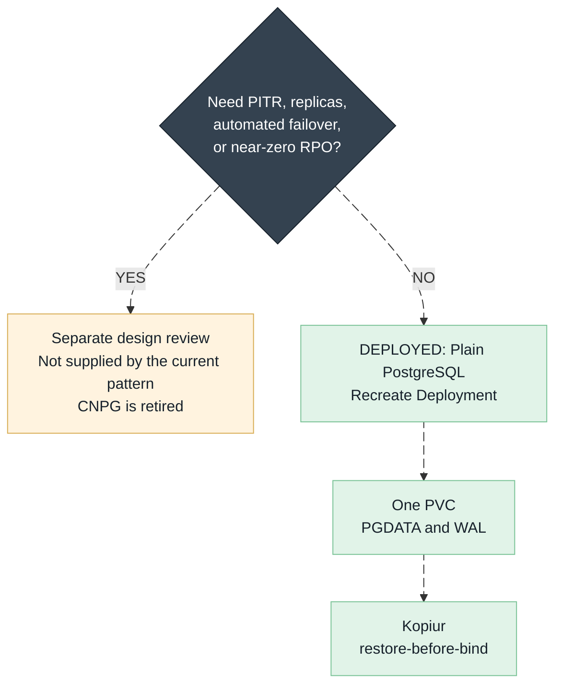

# Run Postgres in this cluster

This page tells you how to check, change, and restore a Postgres database in
this cluster without working against GitOps. It is for anyone who operates a
database here, including people who are new to Kubernetes. To create a database,
read [The pattern](#the-pattern) and run `/project:new-database <app>`.

Every Postgres database here is plain Postgres with a kopiur backup. No
database operator runs in this cluster. CNPG (CloudNativePG) is retired. Do not
add it back.

## The short version

!!! tip
    - A database here is an ordinary app. It is a Deployment that runs the
      official `postgres` image, a Service, a PVC (the request for a disk), and
      a small backup stub.
    - Git is the only place to make a change. Argo CD applies your commit to
      the cluster. Argo CD also reverts a `kubectl edit` within minutes.
    - kopiur makes a backup of the database volume once a day. Databases with
      data that cannot be re-created get a backup every 6 hours.
    - When a PVC is recreated, kopiur fills it from the newest backup before the
      pod starts. This is restore-before-bind. You lose the changes made since
      that backup.
    - A PVC that stays `Pending` after a rebuild usually means the restore is
      running. Read [A `Pending` PVC is usually good news](#a-pending-pvc-is-usually-good-news)
      before you change anything.
    - To roll a database back to its newest backup, delete two objects and let
      Argo CD recreate them. The steps are in
      [Level 2](#level-2-roll-the-database-back-to-the-last-snapshot).

## How it works


*The cluster can be thrown away, because everything it needs for a rebuild is
stored outside it.
[Open the full-size lifecycle diagram](../../assets/postgres-nuke-lifecycle.svg).*

```text
DIES ON NUKE                 SURVIVES (off-cluster)          REBUILT
--------------               ----------------------          -------
The cluster                  Git repo          ── rebuilds objects ──┐
  every pod & object         RustFS S3 (Kopia) ── refills disks   ──┤→ New cluster
  every Longhorn disk        1Password         ── recreates secrets ┘  same apps,
  the databases                                                        same data
```

Three loops run all the time. They explain most of the behavior on this page.

| Loop | When it runs | What it does |
|---|---|---|
| 1. Argo CD | About every 3 minutes, and on each Git push | Compares the cluster with Git and makes the cluster match. It recreates objects you deleted and reverts objects you edited. |
| 2. kopiur backup | On a daily cron per database, or every 6 hours for data that cannot be re-created | Takes a CSI snapshot of the PVC and uploads it to the Kopia repository on RustFS. |
| 3. kopiur restore-before-bind | Only when a PVC is created | Keeps the new PVC `Pending`, copies the newest backup into it, and then lets it bind. |

Postgres keeps running during a backup. Before the CSI snapshot, a kopiur hook
runs `CHECKPOINT` in the database. The CSI snapshot is crash-consistent, which
means it looks like the disk after a power cut. Postgres is built to recover
from that state. On start, it replays its write-ahead log (WAL), the journal of
recent changes.

Because of loops 1 and 3, you recover by deleting. You do not copy data back by
hand. You delete the broken object, Argo CD recreates it from Git, and loop 3
fills in the data. A full cluster rebuild works the same way.

Gitea is the reference database. Copy it.

| Piece | File (reference) | What it is |
|---|---|---|
| The database | `my-apps/development/gitea/postgres/deployment.yaml` | Plain `postgres:18.x` Deployment, `Recreate` strategy, runs as uid 999 |
| The address apps use | `my-apps/development/gitea/postgres/service.yaml` | `gitea-postgres.gitea.svc.cluster.local:5432` |
| The disk | `my-apps/development/gitea/postgres/pvc.yaml` | Longhorn PVC whose `dataSourceRef` points at the kopiur `Restore` |
| The backup stub | `my-apps/development/gitea/kopiur/gitea-postgres-data.yaml` | `SnapshotPolicy` (daily) + `SnapshotSchedule` + `Restore` |
| The password | 1Password, through an ExternalSecret, into `gitea-db-secret` | Never in Git. See [the password rule](#gotcha-4-the-password-lives-in-two-places) |

This pattern restores a whole volume to its newest backup. It has no
point-in-time recovery (PITR), no replicas, and no automatic failover. If you
need one of those, start a separate design review first.



### The pattern

The reference is `my-apps/development/gitea/postgres/`. A database is four
pieces in the directory of the app that owns it. Use `/project:new-database <app>`
to create them. Do not write the four files from memory.

| Piece | Key points |
|---|---|
| `postgres/deployment.yaml` | `postgres:<MAJOR.MINOR>` pinned; `Recreate`; uid/gid/fsGroup **999**; `PGDATA` subdir; `POSTGRES_DB`/`POSTGRES_USER`/`POSTGRES_PASSWORD` env declare the database on first (empty-volume) boot, with no admin tool; `--data-checksums`; `pg_isready` startup/readiness/liveness probes; 60s termination grace |
| `postgres/service.yaml` | named port `postgres`/5432 |
| `postgres/pvc.yaml` | `longhorn`, a `dataSourceRef` pointing at the kopiur `Restore`, and the two masking annotations |
| `kopiur/<app>-postgres-data.yaml` | stub with mover `999:999`, **daily** retention tier (`keepDaily: 7, keepWeekly: 8`), distinct cron minute |

The pattern has three limits:

- A restore gives you the newest backup, not any point in time. The daily tier
  makes one backup a day. Data that cannot be re-created gets one every 6 hours.
- There are no replicas and no failover. One pod runs, with the `Recreate` strategy.
- A Postgres major upgrade is a manual dump and restore. Renovate automates
  minor and patch versions only.

The CSI snapshot that kopiur reads is crash-consistent. Postgres recovers from
it by WAL replay on start. `--data-checksums` lets Postgres detect a page that
was only half written. The startup probe allows about five minutes before the
liveness probe can restart the container. For a large database, set that time
from the recovery time you measure.

## Check that a database is healthy

All of these commands only read. Run them before you decide that something is
broken. The examples use gitea. Replace the namespace and the app name.

```bash
# 1. Pod running and ready?
kubectl -n gitea get pod -l app=gitea-postgres
# EXPECT: 2/2 Running (postgres + metrics exporter), restarts not climbing

# 2. Disk bound and not full?
kubectl -n gitea get pvc gitea-postgres-data
# EXPECT: Bound

# 3. Backups actually happening? (THE most important check)
kubectl -n gitea get snapshot
# EXPECT: newest Snapshot no older than its schedule (1 day, or 6h on the
# 6-hourly tier), phase Succeeded, non-zero files. If the newest Snapshot is
# older than that, fix the backup first. See the kopiur architecture doc.

# 4. Talk to the database directly (troubleshooting only, changes nothing):
kubectl -n gitea exec -it deploy/gitea-postgres -c postgres -- \
  psql -U gitea -d gitea -c 'select version();'
```

For trends, use Grafana. The postgres exporter sidecar publishes connection
counts, database size, and long-running-query gauges for each database that
carries it. See [Metrics](#metrics-seeing-inside-the-database).

## The GitOps gotchas (why your instinct is wrong here)

These five rules surprise people who are used to `kubectl` changes or managed
databases. Each rule has a reason.

### Gotcha 1: `kubectl edit` doesn't stick

Applications under `my-apps` run with self-heal on. Argo CD reverts every live
edit, including `kubectl scale --replicas=0`, usually within a few minutes. This
is intended. It guarantees that Git alone can rebuild the cluster.

Change the YAML in Git, push, and let Argo CD sync. If the database must go
down now, use [the restore ladder](#the-restore-ladder-start-at-level-0-escalate-only-if-needed).
Its steps work with self-heal.

### Gotcha 2: every database change causes a short outage (on purpose)

The Deployment uses `strategy: Recreate`. The old pod stops completely before
the new pod starts. A `ReadWriteOnce` disk requires this, because it attaches to
one node at a time.

Do not switch to `RollingUpdate` to remove the downtime. `RollingUpdate` tries
to attach one disk to two pods. The new pod then stays in `ContainerCreating`
with a `Multi-Attach error`, and it never recovers.

Expect about 30 to 60 seconds without the database on each image or
configuration change. The apps reconnect without help.

### Gotcha 3: version bumps, minors are free, majors are a project

Renovate updates minor versions automatically, for example
`postgres:18.3 → 18.4`. A minor update is safe because the data format does not
change.

A major update, for example `18 → 19`, is different. A Postgres data directory
works with one major version only. If you merge a major update, the pod
crash-loops on its old data directory. Renovate therefore holds major updates
until you approve them by hand.

To do a major update on purpose, follow this order:

1. Dump the database with the image of the old major version.
2. Wipe and re-initialize the data directory.
3. Restore the dump.

The comment block at the top of the gitea postgres `deployment.yaml` has the
exact order.

### Gotcha 4: the password lives in two places

The 1Password item fills the Kubernetes Secret. Postgres also stores the
password inside its own data, and the copy in the data is the one Postgres
checks. The environment variables matter only on the first start of an empty
volume. Two rules follow.

A change in 1Password alone does not change the database password. The app then
sends a password that Postgres rejects. Rotate in this order:

1. Run `ALTER ROLE ... WITH PASSWORD` in psql. Authenticate with the current password.
2. Update 1Password.
3. Restart the consumers.
4. Verify the consumers before you discard the old credential.

Keep the password and the SQL out of Git and out of your shell history.

After a restore, the database has the password from the time of the backup. If
someone rotated the password after that backup, the app gets authentication
errors. Run the `ALTER ROLE` again with the current 1Password value.

### Gotcha 5: the PVC's odd annotations matter

The database PVC carries the annotations `argocd.argoproj.io/compare-options`
and `argocd.argoproj.io/sync-options`, and a `dataSourceRef`. Kubernetes does
not allow a change to `dataSourceRef` after the PVC is created. The annotations
stop Argo CD from trying to change that field again and again.

Do not remove the annotations. Without them, the PVC shows a permanent
`ComparisonError` or stays OutOfSync. A PVC that looks OutOfSync but is `Bound`
and works is fine.

## A `Pending` PVC is usually good news

When a database PVC is created or recreated, it stays `Pending` while kopiur
copies the newest backup into it. That is the restore at work. A small database
takes under a minute. A large one takes as long as the download.


*An outage can delay a restore. It cannot produce an empty database. A PVC binds
empty only when the Kopia repository is reachable and holds no backup, which is
true only for a database that never existed before.
[Open the full-size decision diagram](../../assets/postgres-restore-decision.svg).*

| State when the PVC is created | Result |
|---|---|
| A backup exists | The PVC fills from the newest backup, then binds with the data. Postgres starts and replays its WAL. |
| The Kopia repository is unreachable (NAS down, S3 credentials broken) | The PVC stays `Pending` and kopiur retries. The PVC never binds empty. Fix the repository and the restore continues. |
| The database is new and has no backup | The PVC binds empty once. Scheduled backups start from there. |

Watch the restore:

```bash
# Watch the hydration:
kubectl -n <ns> get restore <pvc-name>-restore
kubectl -n <ns> get events --sort-by=.lastTimestamp | tail -20
```

After the PVC binds, the startup probe gives Postgres about 5 minutes to replay
its WAL. Do not delete a pod because it starts slowly.

## The restore ladder (start at level 0, escalate only if needed)

### Level 0: pod crashed, node rebooted, OOM-kill

Do nothing. Kubernetes restarts the pod, and Postgres replays its WAL as it does
after a power cut. No data is lost. If it happens again, run
`kubectl -n <ns> get events`.

### Level 1: database is up but the app can't reach it

This is a connection problem, not a data problem. Do not restore anything.
Check these in order:

1. The Secret is in sync: `kubectl -n <ns> get externalsecret`.
2. The app points at the correct Service name.
3. Nobody rotated the password without the `ALTER ROLE` step (gotcha 4).

### Level 2: roll the database back to the last snapshot

Use this level after a bad migration, after data corruption, or when the app
wrote wrong data and you want the state of the newest backup.

!!! warning "This discards data. Check what you roll back to first"
    Everything written after the newest backup is lost. A daily schedule loses
    up to a day. A 6-hourly schedule loses up to 6 hours. Confirm the age and
    the size of the newest `Snapshot` before you delete anything:
    ```bash
    kubectl -n <ns> get snapshot   # newest age + Succeeded + non-zero files?
    ```
    This pattern has no point-in-time recovery. The newest backup is the only
    restore point.

You do not pause Argo CD for this. Self-heal does the work. The restore canary
drill uses the same steps.

```bash
NS=gitea; APP=gitea-postgres; PVC=gitea-postgres-data

# 1. Do not scale the app to 0. Self-heal puts it back. The app shows errors
#    while its database is gone (expected), and anything it writes in the
#    meantime is lost with the old volume.

# 2. Delete the pinned Restore CR. A Restore remembers ("pins") the snapshot
#    it used the first time. Deleting it makes the recreated Restore pull the
#    NEWEST snapshot instead of the old pinned one.
kubectl -n $NS delete restore $PVC-restore

# 3. Delete the PVC, then the postgres pod holding it (the PVC finalizer
#    waits for the pod; deleting the pod releases it).
kubectl -n $NS delete pvc $PVC --wait=false
kubectl -n $NS delete pod -l app=$APP

# 4. Let ArgoCD do the restore: self-heal notices the missing Restore + PVC
#    and recreates both from Git; the new PVC hydrates from the newest
#    snapshot; the new postgres pod starts on the restored data.
#    To go faster, click SYNC on the my-apps-<app> Application in the ArgoCD UI.
kubectl -n $NS get pvc,restore,pod -w
# EXPECT within a few minutes: Restore recreated → PVC Pending → PVC Bound →
# postgres pod 2/2 Running.
```

Finish: when Postgres is `Running`, restart the app pods so that they open new
connections:

`kubectl -n $NS delete pod -l <app's pod label>`

Verify: connect with psql (health check 4 above). Confirm that the data matches
the time of the backup. Confirm that the app works.

If the restore fails: none of these steps change the backups in the Kopia
repository. Run the same steps again to retry.

### Level 3: the whole namespace is wrecked

Delete the namespace:

`kubectl delete namespace <ns>`

Argo CD recreates everything from Git (`CreateNamespace=true`). Every PVC in the
namespace that has a backup fills from its newest backup. The level 2 warning
applies to all of them: each PVC goes back to its newest backup.

### Level 4: the whole cluster is gone

Do not decide this alone. Databases need no special step in a cluster rebuild.
The bootstrap runs, Argo CD deploys everything, the PVCs fill from their
backups, and Postgres recovers. The full runbook and the pre-nuke checklist are
in the [disaster recovery runbook](../../disaster-recovery.md).

## Metrics: seeing inside the database

A plain Postgres Deployment can carry a small `postgres-exporter` sidecar. It
publishes database internals to Prometheus and Grafana. The reference is
`my-apps/development/gitea/postgres/`. Copy three pieces for another database:
the sidecar in the Deployment, the `metrics` port on the Service, and
`servicemonitor.yaml`.

| Metric | Question it answers |
|---|---|
| `pg_stat_activity_count` vs `pg_settings_max_connections` | Are the connections running out? Above 80% for a long time means an app leaks connections. |
| `pg_database_size_bytes` | Will the PVC fill up? Watch the trend and resize the PVC in Git before it is urgent. |
| `pg_stat_activity_max_tx_duration` | Is something stuck? A transaction that stays open for minutes usually means a hung migration or a lock queue. |
| `pg_up` | Can the exporter reach Postgres? If it is 0, the database or its password is the problem, not the metrics. |

## The never-do list

- Never use `RollingUpdate` on the database Deployment (gotcha 2).
- Never merge a Postgres major version update without the dump and restore (gotcha 3).
- Never rotate the password with a 1Password edit alone (gotcha 4).
- Never remove the PVC's compare and sync annotations or its `dataSourceRef`
  (gotcha 5).
- Never create or edit kopiur `SnapshotPolicy`, `SnapshotSchedule`, or `Restore`
  objects by hand. They come from Git. The level 2 delete is the only allowed
  live action on them.
- Never remove the `dataSourceRef` from a `Pending` PVC to make it bind empty.
  That turns a delayed restore into permanent data loss.

## Related

- [How kopiur backup and restore work](../storage/kopiur-backup-architecture.md): loops 2 and 3 in detail
- [Why the kopiur mover runs as the data owner](../storage/kopiur-mover-permissions.md): the uid:gid to set when you add a backup
- [Disaster recovery runbook](../../disaster-recovery.md): levels 3 and 4 in full, and the restore canary
