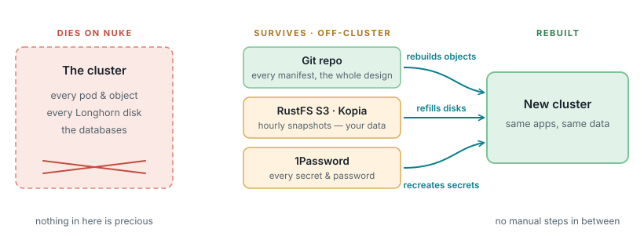
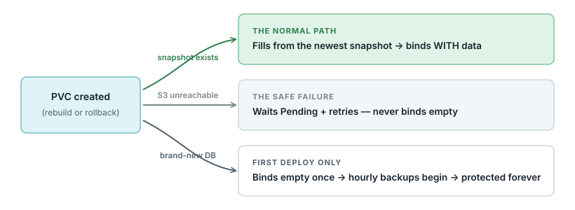

# Run Postgres in this cluster: the plain-English guide

**Purpose:** what a junior Kubernetes operator needs to run, check,
restore, and change a Postgres database in this cluster without fighting
GitOps.
**Status:** current truth. This is the **only** database pattern in the
cluster (plain Postgres + kopiur, default since 2026-07-09; the last two
CloudNativePG databases were retired 2026-08-13 in a data-zero cutover).
**Scope:** day-to-day operations and recovery. [The pattern](#the-pattern) below and the
`/project:new-database` command cover creating a brand-new database.

---

## TL;DR

!!! tip
    - A database here is **just an app**: a Deployment running the official
      `postgres` image, a Service, a PVC, and a small backup stub. It has no operator
      and no StatefulSet.
    - **Git is the only control panel.** ArgoCD notices your commit and makes
      the cluster match. ArgoCD silently reverts `kubectl edit` within minutes.
    - kopiur snapshots the database volume **every hour** to S3. If the PVC is
      ever recreated, it **refills itself from the newest snapshot before the
      pod starts** ("restore-before-bind"). Worst case you lose 1 hour of data.
    - A PVC stuck `Pending` after a rebuild is usually the restore **working**,
      not broken. Read [the Pending section](#a-pending-pvc-is-usually-good-news)
      before touching anything.
    - To roll a database back to its last snapshot, delete two objects and let
      ArgoCD recreate them. Full steps [below](#level-2-roll-the-database-back-to-the-last-snapshot).

---

## The mental model (read this once, slowly)



*Everything inside the cluster is disposable, because everything it needs to
rebuild itself lives outside it.
[Open the full-size lifecycle diagram](../../assets/postgres-nuke-lifecycle.svg).*

```text
DIES ON NUKE                 SURVIVES (off-cluster)          REBUILT
--------------               ----------------------          -------
The cluster                  Git repo          ── rebuilds objects ──┐
  every pod & object         RustFS S3 (Kopia) ── refills disks   ──┤→ New cluster
  every Longhorn disk        1Password         ── recreates secrets ┘  same apps,
  the databases                                                        same data
```

Three loops run all the time. Once you understand them, the odd behavior in this
page makes sense:

```text
LOOP 1 — ArgoCD (every ~3 min, or on git push)
  "Does the cluster match Git?"  If not → make it match.
  This includes re-creating things you deleted and reverting things you edited.

LOOP 2 — kopiur backup (daily cron per database; 6-hourly if irreplaceable)
  "Snapshot the PVC → upload to S3 (RustFS bucket)."
  Postgres is never stopped for this; the snapshot is crash-consistent,
  which Postgres is designed to recover from (it looks like a power cut).

LOOP 3 — kopiur restore-before-bind (only when a PVC is CREATED)
  New PVC appears → it does NOT bind empty. It waits (Pending) while kopiur
  downloads the newest snapshot into it, THEN binds with data, THEN the
  Postgres pod starts and replays its write-ahead log like after a power loss.
```

This makes GitOps with databases *easier* here, not harder.
**Deleting things is the recovery mechanism.** You never restore by hand.
You delete the broken object, ArgoCD recreates it from Git, and loop 3 refills
the data. The whole cluster rebuild works the same way.

Where the pieces live (gitea is the reference, so copy it):

| Piece | File (reference) | What it is |
|---|---|---|
| The database | `my-apps/development/gitea/postgres/deployment.yaml` | Plain `postgres:18.x` Deployment, `Recreate` strategy, runs as uid 999 |
| The address apps use | `my-apps/development/gitea/postgres/service.yaml` | `gitea-postgres.gitea.svc.cluster.local:5432` |
| The disk | `my-apps/development/gitea/postgres/pvc.yaml` | Longhorn PVC whose `dataSourceRef` points at the kopiur `Restore` |
| The backup contract | `my-apps/development/gitea/kopiur/gitea-postgres-data.yaml` | `SnapshotPolicy` (daily) + `SnapshotSchedule` + `Restore` |
| The password | 1Password, through an ExternalSecret, into `gitea-db-secret` | Never in Git. See [rotation gotcha](#gotcha-4-the-password-lives-in-two-places) |

To **create** a new database, follow [The pattern](#the-pattern) or
run `/project:new-database <app>`. Don't hand-roll the four files.

The deployed pattern restores volume snapshots; PITR and automatic database failover need a separate design review.


### The pattern

The reference is `my-apps/development/gitea/postgres/`. Four pieces live in the
owning app's directory:

| Piece | Key points |
|---|---|
| `postgres/deployment.yaml` | `postgres:<MAJOR.MINOR>` pinned; `Recreate`; uid/gid/fsGroup **999**; `PGDATA` subdir; `POSTGRES_DB`/`POSTGRES_USER`/`POSTGRES_PASSWORD` env declare the database on first (empty-volume) boot, with no admin tool; `--data-checksums`; `pg_isready` startup/readiness/liveness probes; 60s termination grace |
| `postgres/service.yaml` | named port `postgres`/5432 |
| `postgres/pvc.yaml` | `longhorn`, a `dataSourceRef` pointing at the kopiur `Restore`, and the two masking annotations |
| `kopiur/<app>-postgres-data.yaml` | stub with mover `999:999`, **daily** retention tier (`keepDaily: 7, keepWeekly: 8`), distinct cron minute |

The trade: restores land on the **last snapshot** (daily tier targets daily
snapshots, 6h for irreplaceable data), not any point in time. There are no
replicas or failover (single pod, `Recreate`). Postgres **major** upgrades are
a manual dump and restore. Renovate still automates minors and patches.

kopiur's CSI VolumeSnapshot is crash-consistent. Postgres recovers from that
by WAL replay on boot, as after a power cut, and `--data-checksums` makes
torn-page corruption detectable. The startup probe allows about five
minutes before liveness can restart the container; size it from observed
recovery time for a large database.

---

## Daily driving: is my database healthy?

All of these are read-only. Run them before you decide anything is broken (gitea shown;
substitute your namespace and app):

```bash
# 1. Pod running and ready?
kubectl -n gitea get pod -l app=gitea-postgres
# EXPECT: 2/2 Running (postgres + metrics exporter), restarts not climbing

# 2. Disk bound and not full?
kubectl -n gitea get pvc gitea-postgres-data
# EXPECT: Bound

# 3. Backups actually happening? (THE most important check)
kubectl -n gitea get snapshot
# EXPECT: newest Snapshot age < 1h, phase Succeeded, non-zero files.
# A database whose newest snapshot is a day old has a broken safety net —
# fix that BEFORE it matters, see kopiur architecture doc.

# 4. Talk to the database directly (troubleshooting only, changes nothing):
kubectl -n gitea exec -it deploy/gitea-postgres -c postgres -- \
  psql -U gitea -d gitea -c 'select version();'
```

For trends, use Grafana. The postgres exporter sidecar (see
[Metrics](#metrics-seeing-inside-the-database)) publishes connection counts,
database size, and long-running-query gauges for every database that carries it.

---

## The GitOps gotchas (why your instinct is wrong here)

These five things bite people who come from `kubectl`-driven or
managed-database setups. Each one exists for a reason.

### Gotcha 1: `kubectl edit` doesn't stick

`my-apps` Applications run with self-heal on: ArgoCD reverts any live edit,
including `kubectl scale --replicas=0`, usually within a few minutes. This is
intended, because it means the cluster can always be rebuilt from Git alone.

**Instead:** change the YAML in Git, push, and let ArgoCD sync. If you need
the DB down now, see the restore ladder below. Those runbooks work *with*
self-heal, not against it.

### Gotcha 2: every database change causes a short outage (on purpose)

The Deployment uses `strategy: Recreate`, so the old pod fully stops before the
new one starts. A `ReadWriteOnce` disk requires this. `RollingUpdate`
would try to attach one disk to two pods and deadlock forever
(`Multi-Attach error`, pod stuck `ContainerCreating`).

**Never** "fix" the brief downtime by switching to RollingUpdate. Expect ~30–60
seconds of database unavailability on any image bump or config change. The apps
reconnect on their own.

### Gotcha 3: version bumps, minors are free, majors are a project

Renovate auto-bumps `postgres:18.3 → 18.4` (safe, data format unchanged).
A **major** bump (`18 → 19`) is different. Postgres data directories are not
major-version compatible, and merging one crashloops the pod on its old data
dir. This happened in PR #1621, 17 to 18. Renovate therefore gates majors
behind manual approval. To do one on purpose, dump with
the **old** major's image first, wipe and reinit the data dir, then restore. The exact
order is in the comment block at the top of the gitea postgres
`deployment.yaml`.

### Gotcha 4: the password lives in two places

The 1Password item feeds the Kubernetes Secret, but Postgres **also** stores
the password inside its own data, and the in-data copy wins. The env vars only
matter on the very first boot of an *empty* volume. Two traps follow:

- Changing the 1Password item alone does **not** change the database password.
  It just makes the app present a wrong password. Rotate in this order:
  run `ALTER ROLE ... WITH PASSWORD` inside psql **first**, then update 1Password,
  then restart consumers. Authenticate with the current password, keep the
  password and the SQL out of Git and shell history, and verify consumers
  before discarding the old credential.
- After a **restore**, the database has the password from snapshot time. If
  someone rotated since the snapshot, the app gets auth errors until you
  re-run the `ALTER ROLE` with the current 1Password value.

### Gotcha 5: the PVC's odd annotations matter

The database PVC carries `argocd.argoproj.io/compare-options` /
`sync-options` annotations and a `dataSourceRef`. A PVC's `dataSourceRef` is
immutable after creation, and those annotations stop ArgoCD from endlessly
trying (and failing) to "fix" that immutable field. Removing them causes
a permanent `ComparisonError` or a forever-OutOfSync PVC. Leave
them alone. An OutOfSync-looking PVC that is `Bound` and working is fine.

---

## A `Pending` PVC is usually good news

When a database PVC is (re)created, it sits `Pending` while kopiur downloads
the newest snapshot into it. **This is the restore working.** Small DBs take
under a minute. Big ones take as long as the download takes.



*Remember this: an outage delays a restore and can never fake one.
"Empty after rebuild" requires a reachable repo with no snapshot, which only
describes a database that never existed before.
[Open the full-size decision diagram](../../assets/postgres-restore-decision.svg).*

```text
PVC created ──┬─ snapshot exists  → fills from newest snapshot → binds WITH data
              ├─ S3 unreachable   → waits Pending + retries — NEVER binds empty
              └─ brand-new DB     → binds empty once → scheduled backups begin
```

```bash
# Watch the hydration:
kubectl -n <ns> get restore <pvc-name>-restore
kubectl -n <ns> get events --sort-by=.lastTimestamp | tail -20
```

Only two outcomes are possible, both safe:

- **Snapshot exists.** The PVC binds *with the data in it*. Postgres then boots
  and replays its journal. The startup probe allows ~5 minutes for this, so do
  not "help" by killing a pod that's starting slowly.
- **Backup repo unreachable** (NAS down, S3 creds broken). The PVC **stays
  Pending forever rather than binding empty.** This is deliberate: an outage
  can never silently give you a blank database. Fix the repo and the restore
  proceeds.

A new PVC binds empty only for a genuinely **brand-new** database
that has never had a snapshot. That is the intended first-deploy path.

---

## The restore ladder (start at level 0, escalate only if needed)

### Level 0: pod crashed, node rebooted, OOM-kill

**Do nothing.** Kubernetes restarts the pod, Postgres replays its
write-ahead log exactly like after a power cut, and comes back consistent.
Data loss: none. Wait, and run
`kubectl -n <ns> get events` if it recurs.

### Level 1: database is up but the app can't reach it

This is a plumbing problem, not a data problem. Do **not** restore anything.
Check in order: Secret in sync (`kubectl -n <ns> get externalsecret`), the Service
name the app points at, and whether someone rotated the password without
the `ALTER ROLE` step (gotcha 4).

### Level 2: roll the database back to the last snapshot

For: bad migration, corrupted data, "the app wrote garbage for the last
20 minutes and I want the 10 a.m. state back."

!!! warning "This discards data: check what you're rolling back to first"
    Everything written **after the newest snapshot is gone** (a daily schedule
    loses up to a day, a 6-hourly one up to 6 hours). Confirm the newest snapshot's age and size *before*
    deleting anything:
    ```bash
    kubectl -n <ns> get snapshot   # newest age + Succeeded + non-zero files?
    ```
    Point-in-time recovery ("2:37 p.m. exactly") does **not** exist on this
    pattern. We accepted that trade-off against CNPG. The last snapshot is the
    only restore point.

The runbook needs no ArgoCD pausing. Self-heal does the
work, and the weekly restore-canary drill exercises the same mechanic:

```bash
NS=gitea; APP=gitea-postgres; PVC=gitea-postgres-data

# 1. Don't bother scaling the app to 0 — self-heal puts it back. It doesn't
#    matter: the app will error while its database is gone (expected) and
#    anything it writes in the meantime dies with the old volume anyway.

# 2. Delete the pinned Restore CR. A Restore remembers ("pins") the snapshot
#    it used the first time — deleting it is what makes the recreate pull the
#    NEWEST snapshot instead of the ancient pinned one.
kubectl -n $NS delete restore $PVC-restore

# 3. Delete the PVC, then the postgres pod holding it (the PVC finalizer
#    waits for the pod; deleting the pod releases it).
kubectl -n $NS delete pvc $PVC --wait=false
kubectl -n $NS delete pod -l app=$APP

# 4. Let ArgoCD do the restore: self-heal notices the missing Restore + PVC
#    and recreates both from Git; the new PVC hydrates from the newest
#    snapshot; the new postgres pod starts on the restored data.
#    Impatient? Click SYNC on the my-apps-<app> Application in the ArgoCD UI.
kubectl -n $NS get pvc,restore,pod -w
# EXPECT within a few minutes: Restore recreated → PVC Pending → PVC Bound →
# postgres pod 2/2 Running.
```

**Finish:** once postgres is `Running`, bounce the app so it reconnects
cleanly instead of nursing dead connections:
`kubectl -n $NS delete pod -l <app's pod label>`.

**Verify:** psql in (health check #4 above), confirm the data state matches
the snapshot time, and confirm the app works. **If it goes sideways:** nothing
here is unrecoverable. The snapshots in S3 are untouched by all of the above,
and re-running the same steps retries the restore.

### Level 3: the whole namespace is wrecked

Delete the namespace. This is the proven DR drill (karakeep,
2026-06-27). Run `kubectl delete namespace <ns>`. ArgoCD recreates everything
from Git (`CreateNamespace=true`), and **every** backed-up PVC in it hydrates
from its newest snapshot. The level 2 warning applies: all PVCs in the namespace
roll back to their last snapshots.

### Level 4: the whole cluster is gone

Don't decide this alone. The database part is easy: databases need
**zero special steps** in a cluster rebuild. Bootstrap runs, ArgoCD deploys
everything, PVCs hydrate, and Postgres recovers. The full runbook, with the pre-nuke
checklist, is [docs/disaster-recovery.md](../../disaster-recovery.md).

---

## What happened to CloudNativePG?

Retired 2026-08-13. gitea and immich migrated with their data. paperless and
temporal were cut over as fresh empty databases, a deliberate data-zero
decision during a cluster rebuild. Their old Barman buckets are aging out
via the RustFS lifecycle policy. Any CNPG instructions you find
are history, and this page is the pattern. The migration steps are in git
history. See [plain-postgres-migration.md](plain-postgres-migration.md).

---

## Metrics: seeing inside the database

Each plain-Postgres deployment can carry a small `postgres-exporter` sidecar
that publishes database internals to Prometheus/Grafana. The reference
implementation is `my-apps/development/gitea/postgres/` (sidecar in the
Deployment, `metrics` port on the Service, and `servicemonitor.yaml`). Copy those
three pieces for any other database.

What to look at, and why:

| Metric | Question it answers |
|---|---|
| `pg_stat_activity_count` vs `pg_settings_max_connections` | "Are we running out of connections?" Running out is a classic silent DB killer. Sustained >80% means an app is leaking connections. |
| `pg_database_size_bytes` | "Will the PVC fill up?" Trend this, and resize the PVC in Git *before* it's urgent. |
| `pg_stat_activity_max_tx_duration` | "Is something stuck?" A transaction open for minutes usually means a hung migration or a lock pile-up. |
| `pg_up` | "Can the exporter even reach Postgres?" If 0, the DB or its password is the problem, not the metrics. |

---

## The never-do list

- **Never** `RollingUpdate` on the database Deployment (gotcha 2).
- **Never** merge a Postgres **major** version bump casually (gotcha 3).
- **Never** rotate the password by editing 1Password alone (gotcha 4).
- **Never** remove the PVC's compare/sync annotations or `dataSourceRef`
  (gotcha 5).
- **Never** hand-create or hand-edit kopiur `SnapshotPolicy` /
  `SnapshotSchedule` / `Restore` objects. They come from Git, and deleting them
  (level 2) is the only sanctioned live interaction.
- **Never** "fix" a `Pending` PVC by removing its `dataSourceRef` to make it
  bind empty. You'd be trading a delayed restore for permanent data loss.

## Related

- [CNPG retirement note](plain-postgres-migration.md): the old cutover runbook lives in git history
- [kopiur backup architecture](../storage/kopiur-backup-architecture.md): how loops 2 and 3 work inside
- [kopiur mover permissions](../storage/kopiur-mover-permissions.md): the uid/gid gotcha when adding backups
- [Cluster disaster recovery runbook](../../disaster-recovery.md): levels 3–4 in full, restore canary
