# Switch ports and VLANs

**Purpose:** show how the three managed switches connect, and which VLANs each port carries.

**Status:** current state, read from the switch web pages on 2026-10-30. Run the checks below to refresh it.

**Scope:** physical switch ports and VLAN membership. See [network topology](topology.md) for Kubernetes and host addressing.

[Open the full-size switch diagram](../../assets/switch-port-vlan-map.svg)

## Failure boundary

The switches form one chain: router → `192.168.1.2` → `192.168.1.4` → `192.168.1.5`.

- `192.168.1.2` is the only observed path from the other two switches to the router.
- A `192.168.1.2` outage removes the gateway for every device on the chain.
- The `192.168.1.2` to `192.168.1.4` link is 2.5G, so router traffic from all downstream devices shares that limit.

## VLANs

| VLAN ID | Name | Subnet | Use |
| --- | --- | --- | --- |
| 1 | default | `192.168.1.0/24` | Switch management; native VLAN on trunks |
| 10 | homelab | `192.168.10.0/24` | Kubernetes nodes, Proxmox hosts, TrueNAS |
| 50 | trusted wired | Not read from the switches | Trusted wired clients |
| 100 | wireless | Not read from the switches | Wi-Fi clients |
| 101 | iot | Not read from the switches | IoT devices |
| 103 | work | Not read from the switches | Work devices |

A trunk in the tables below means tagged VLANs 10, 50, 100, 101 and 103, plus untagged VLAN 1.

## Switches

| Address | Model or hostname | Firmware | Ports |
| --- | --- | --- | --- |
| `192.168.1.2` | Sodola SL-SG0024W | V1.9.1 | 4 × 2.5G, 2 × 10G |
| `192.168.1.4` | 2G080110GSM | V100.9.9.1.7 | 8 × 2.5G, 1 × 10G |
| `192.168.1.5` | `10gswitch` | V300SP10240913 | 8 × 10G fiber |

## Port map

Device names come from MAC address tables matched to ARP entries. "Not identified" means no ARP or inventory match.

### `192.168.1.2`

| Port | Link | PVID | VLANs | Connected device |
| --- | --- | --- | --- | --- |
| 1 | 2.5G | 10 | 10 untagged | `192.168.10.15` (Technitium, Omni, booter) |
| 2 | 2.5G | 10 | 10 untagged | CachyOS desktop `192.168.10.186` |
| 3 | Down | 10 | 10 untagged | None |
| 4 | 2.5G | 1 | Trunk | `192.168.1.4` port 8 |
| 5 | 2.5G | 1 | Trunk | Firewalla router |
| 6 | Down | 10 | 10 untagged; 100, 101, 103 tagged | None |

### `192.168.1.4`

| Port | Link | PVID | VLANs | Connected device |
| --- | --- | --- | --- | --- |
| 1 | 1G | 10 | 10 untagged | Not identified (1 MAC address) |
| 2 | 1G | 10 | 10 untagged | `hp-elite-gen12` |
| 3 | 2.5G | 10 | 10 untagged | `mini-pc-dell-ultra-worker`, `hp-elite-gen13`, 1 not identified |
| 4 | 2.5G | 10 | 10 untagged | HP SFF host `.21` and its VMs |
| 5 | 2.5G | 101 | 101 untagged | 17 IoT MAC addresses |
| 6 | 100M | 100 | 100 untagged, 1 untagged | Not identified (1 MAC address) |
| 7 | 2.5G | 1 | Trunk | Firewalla MAC address, ASUS media bridge `.70`, Wi-Fi clients |
| 8 | 2.5G | 1 | Trunk | `192.168.1.2` port 4 |
| 9 | 10G | 1 | Trunk | `192.168.1.5` port 8 |

Port 3 shows three MAC addresses, so an unmanaged switch is probably attached. This is a hypothesis.

### `192.168.1.5`

| Port | Link | Mode | VLANs | Connected device |
| --- | --- | --- | --- | --- |
| 1 | 10G | Hybrid | 10 untagged | TrueNAS `.133` |
| 2 | Down | Hybrid | 10 untagged | None |
| 3 | 10G | Hybrid | 10 untagged | Threadripper `.14` and GPU worker VM |
| 4 | 10G | Hybrid | 10 untagged | Not identified; 0 packets received |
| 5 | Down | Access | 1 | None |
| 6 | Down | Access | 101 | None |
| 7 | Down | Trunk | Trunk | None |
| 8 | 10G | Trunk | Trunk | `192.168.1.4` port 9 |

## Protection settings

| Setting | `192.168.1.2` | `192.168.1.4` | `192.168.1.5` |
| --- | --- | --- | --- |
| STP role on all ports | Disabled | Disabled | Not enabled |
| Loop detection | Off | Not read | Off on all ports |
| Storm limit on client ports | 10 Mb/s on ports 1-3 | 10 Mb/s on ports 1-6 | 50 Mb/s on ports 1-3 |
| Storm limit on other ports | Off on 4-5; 50 Mb/s on 6 | 50 Mb/s on 7; off on 8-9 | Off on 4-8 |
| MAC limit | Unlimited | Unlimited | Not read |
| Timed reboot | **On, 04:00** | No such page | Not read |

Storm limits apply to broadcast, unknown unicast and unknown multicast traffic.

!!! warning "Loops have no automatic stop"
    STP and loop detection are off, and the inter-switch ports have no storm limit.
    A cabled loop on an inter-switch path can flood the whole chain.

## Flood check on 2026-10-30

The result shows no flood during the sampled periods. Each packet rate is one 30-second sample.

| Evidence | Value |
| --- | --- |
| `192.168.1.2` bad packets | 0 on all ports |
| `192.168.1.4` bad packets | 13 received on port 8; 0 on other ports |
| `192.168.1.5` errors | 0 input and output errors on all ports |
| MAC addresses seen on two ports | None on `192.168.1.2` or `192.168.1.4` |
| Broadcast into `192.168.1.5` port 8 | About 17 packets per second since the last restart |
| Multicast into `192.168.1.5` port 8 | About 13 packets per second since the last restart |
| Highest packet rate | About 71,000 per second, `192.168.1.4` port 3 to port 4 |
| Idle port transmit rate on `192.168.1.4` | 6-7 packets per second on ports 1 and 6 |

The 71,000 packets per second did not appear on other ports, so the traffic was not flooded.

**Limit:** samples can miss a short storm. `192.168.1.2` and `192.168.1.4` have no broadcast counters on their statistics pages.

## Refresh this page

1. Open the switch web page for each address.
2. Read the VLAN, port, MAC table, storm control and statistics pages.
3. Compare the results with the tables above.
4. Run `npm run diagrams` if the diagram changes.

**Expected result:** the tables and diagram match the live switches.

Do not store switch credentials in this repository.
