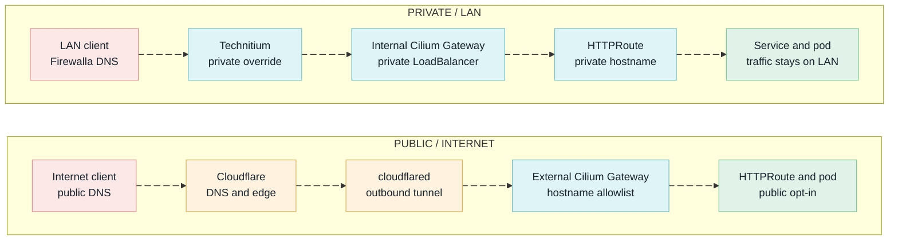

# Split DNS with Technitium

This page explains how one name under `vanillax.me` resolves to a private address on
the LAN and to Cloudflare from the internet. It also shows how to check the setup,
operate it, and rebuild the Technitium side.

Split DNS means the same hostname gets a different answer depending on where the
client is. Here, Technitium (`192.168.10.15`, on the Pi) holds the private answers.
LAN clients get a private record when one exists, and the public Cloudflare record
when none exists.

## How a request finds an app



Private exposure and public exposure are separate choices. Each one has its own DNS
record, its own Gateway, and its own HTTPRoute parent.

A lookup from a LAN client takes this path:

```text
LAN client
  -> Firewalla DNS (192.168.10.1)
  -> vanillax.me forwarded to Technitium (192.168.10.15)
  -> local private record returned when present
  -> otherwise forwarded over DoH to Cloudflare
```

Technitium serves `vanillax.me` as a Conditional Forwarder zone. Do not change it to
a Primary zone. A Primary zone is authoritative, so it returns NXDOMAIN for a missing
record and never asks Cloudflare. A Conditional Forwarder zone returns a local record
when one exists and forwards every other name upstream.

## The parts

| Component | Responsibility |
| --- | --- |
| Firewalla | Client DNS endpoint and one `vanillax.me` zone forward to Technitium |
| Technitium | Private `*.vanillax.me` overrides and Cloudflare DoH fallback |
| `external-dns-technitium` | RFC2136 A/TXT records for private HTTPRoutes |
| Cloudflare ExternalDNS | Public records for `gateway-external` routes |
| `gateway-internal-technitium` | Private routes at `192.168.10.52` |
| `gateway-external` | Public Cloudflare routes at `192.168.10.49` |

To give an app a private name, set the parent of its HTTPRoute to
`gateway-internal-technitium`. The `external-dns-technitium` controller then writes
the A and TXT records into Technitium. To give an app a public name, set the parent
to `gateway-external`.

## Check that it works

Check the `external-dns-technitium` controller:

```bash
kubectl -n external-dns get pods
kubectl -n external-dns logs deploy/external-dns-technitium -f
```

In the steady state the log shows this message:

```text
All records are already up to date
```

These messages mean the TSIG or AXFR configuration is broken:

```text
dns: bad authentication
AXFR error
bad xfr rcode: 5
```

Query private records directly against Technitium. All of them return `192.168.10.52`:

```bash
dig @192.168.10.15 argocd.vanillax.me A +short
dig @192.168.10.15 homeassistant.vanillax.me A +short
dig @192.168.10.15 grafana.vanillax.me A +short
dig @192.168.10.15 registry.vanillax.me A +short
```

Query names that have no private record. They return public Cloudflare addresses,
not NXDOMAIN:

```bash
dig @192.168.10.15 vanillax.me A +short
dig @192.168.10.15 news.vanillax.me A +short
dig @192.168.10.15 search.vanillax.me A +short
```

Repeat through Firewalla, which is the path that clients use:

```bash
dig @192.168.10.1 argocd.vanillax.me A +short    # 192.168.10.52
dig @192.168.10.1 homeassistant.vanillax.me A +short   # 192.168.10.52
dig @192.168.10.1 vanillax.me A +short           # public Cloudflare
dig @192.168.10.1 news.vanillax.me A +short      # public Cloudflare
```

Check TLS and application routing:

```bash
curl -fsS -o /dev/null -w '%{http_code} %{remote_ip}\n' https://argocd.vanillax.me/
curl -fsS -o /dev/null -w '%{http_code} %{remote_ip}\n' https://homeassistant.vanillax.me/
```

Private endpoints connect to `192.168.10.52` with valid TLS.

## Rules for operating it

**Restart the pod after you rotate the TSIG secret.** The pod reads the secret into
the env var `EXTERNAL_DNS_RFC2136_TSIG_SECRET` through `secretKeyRef` when it starts.
A changed Kubernetes Secret does not reach a running pod. After External Secrets
rewrites the Secret, restart the deployment:

```bash
kubectl -n external-dns rollout restart deploy/external-dns-technitium
```

**Keep the TSIG key name and the secret bytes matched.** ExternalDNS signs RFC2136
updates with key name `externaldns-vanillax` and the secret from the
`external-dns-technitium-vanillax` 1Password item. A mismatch in the name or the
bytes returns `dns: bad authentication` on both UPDATE and AXFR.

**Keep clients pointed at Firewalla.** Never point a client directly at Technitium.

**Add no per-host DNS overrides in Firewalla.** An override such as
`address=/homeassistant.vanillax.me/...` hides the Technitium record and resolves the
private name to the wrong endpoint.

**Ignore only the defaulted `parentRefs` subfields in Argo CD.** In
`infrastructure/controllers/argocd/values.yaml`, ignore `group` and `kind` only.
Never ignore the whole `parentRefs` array or a whole entry:

```yaml
jqPathExpressions:
- .spec.parentRefs[].group
- .spec.parentRefs[].kind
```

`name`, `namespace`, and `sectionName` must stay visible to the diff. Otherwise Argo
CD does not apply a change of a route's parent Gateway.

## One certificate for both gateways

Both gateways use the same publicly trusted wildcard certificate. There is no
separate internal certificate.

| Resource | Value |
| --- | --- |
| ClusterIssuer | `cloudflare-cluster-issuer` (ACME DNS-01 via Cloudflare) |
| Certificate / Secret | `cert-vanillax` in namespace `gateway`, SAN `*.vanillax.me` |
| `gateway-external` (`192.168.10.49`) | `certificateRefs: cert-vanillax` |
| `gateway-internal-technitium` (`192.168.10.52`) | `certificateRefs: cert-vanillax` |

The public path and the private path use the same hostnames under `*.vanillax.me`,
so the same Let's Encrypt wildcard is valid on both. TLS authenticates the name, not
the IP. A browser therefore accepts the public certificate from the private address
`192.168.10.52` without a warning.

cert-manager renews `cert-vanillax` through DNS-01 against the public Cloudflare
zone. The renewal does not depend on where the gateway is reachable.

## Rebuild the Technitium and Firewalla configuration

Use this procedure when you rebuild Technitium or Firewalla. It configures the DNS
zone, the key that ExternalDNS signs with, and the Firewalla forward. It does not
change anything in the cluster.

All update and transfer settings in steps 4 and 5 must be on the `vanillax.me`
Conditional Forwarder zone. The same settings on any other zone have no effect.

### 1. Create the Conditional Forwarder zone

In the Technitium web console:

1. Open **Zones**.
2. Select **Add Zone**.
3. Set the zone name to `vanillax.me`.
4. Select **Conditional Forwarder Zone**.
5. Configure an HTTPS forwarder:

   ```text
   https://cloudflare-dns.com/dns-query (1.1.1.1)
   ```

6. Enable DNSSEC validation when the UI offers it.
7. Save the zone.

The forwarder uses DNS over HTTPS (DoH) because Firewalla intercepts plain DNS
traffic. The IP in parentheses tells Technitium where to find the DoH hostname.
Without it, Technitium cannot resolve `cloudflare-dns.com` when recursion is
disabled, and it returns `SERVFAIL`.

Expected result: both lookups return public Cloudflare addresses, not NXDOMAIN.

```bash
dig @192.168.10.15 vanillax.me A +short
dig @192.168.10.15 news.vanillax.me A +short
```

### 2. Create the TSIG key

A TSIG key is a shared secret that signs DNS update requests. In
**Settings -> TSIG**:

1. Add key name `externaldns-vanillax`.
2. Select `HMAC-SHA256`.
3. Leave **Shared Secret** empty so Technitium generates a strong Base64 key.
4. Save the settings.

Treat the generated key as a credential. Keep it out of Git, terminal history,
screenshots, tickets, and chat.

### 3. Store the key in 1Password

Put the generated key in one 1Password item:

```text
Item:  external-dns-technitium-vanillax
Field: tsig-secret
Value: <exact Base64 value generated by Technitium>
```

The ExternalSecret passes this value through unchanged. Do not Base64-encode it
again.

### 4. Allow RFC2136 dynamic updates

RFC2136 is the DNS protocol that ExternalDNS uses to add and remove records. Open
**Zones -> vanillax.me -> Options -> Dynamic Updates (RFC 2136)**:

```text
Dynamic Updates: Allow

Security Policy:
  TSIG Key Name:      externaldns-vanillax
  Domain Name:        *.vanillax.me
  Allowed Record Types: A, AAAA, CNAME, TXT
```

The wildcard domain stops the key from changing the zone apex. The record-type list
limits the key to the types that ExternalDNS needs.

### 5. Allow zone transfer (AXFR)

ExternalDNS uses AXFR to read the existing records and its TXT ownership records.
Without AXFR, updates can succeed, but ExternalDNS submits the same records again on
every run and logs `AXFR error: dns: bad xfr rcode: 5`.

Open **Zones -> vanillax.me -> Options -> Zone Transfer**:

```text
Zone Transfer: Allow
Zone Transfer TSIG Key Names: externaldns-vanillax
```

The transfer mode is `Allow`, but the TSIG key list means that a transfer still
requires authentication.

### 6. Forward the zone from Firewalla

In Firewalla, add one conditional-forwarding rule that sends the whole zone to
Technitium:

```text
Domain: vanillax.me
DNS server: 192.168.10.15
Include subdomains: enabled
Scope: all LAN/VLAN networks that should use the homelab DNS view
```

Leave client DHCP and DNS pointed at Firewalla. Add no per-host overrides.

Expected result: the checks in [Check that it works](#check-that-it-works) pass.

## References

- [Technitium DNS Server help](https://technitium.com/dns/help.html)
- [Technitium maintainer guidance for local overrides in Conditional Forwarder zones](https://github.com/TechnitiumSoftware/DnsServer/discussions/818)
- [Technitium Conditional Forwarder zone introduction](https://blog.technitium.com/2020/07/technitium-dns-server-v5-released.html)
