# kopiur backup architecture: the instruction manual

> How the pieces fit together for backup and restore, and which part lives
> where. If you're new to Kustomize components, start at §2. That section trips people up.
> Permissions deep-dive: [`kopiur-mover-permissions.md`](kopiur-mover-permissions.md).

kopiur is the cluster's backup system, a Kopia-native operator. You declare small
CRs, it runs Jobs, and kopia moves bytes to RustFS.



*The app stub owns what varies per PVC. The shared Component adds cluster-wide
defaults. Kustomize renders complete resources for Argo CD, and those resources
drive both the scheduled backup and restore-before-bind paths.*

[Open the full-size diagram](../../assets/kopiur-kustomize-flow.svg)

## Lifecycle and flows

<div class="grid cards" markdown>

-   **1. GitOps and Kustomize assembly**

    `Build time`

    1. The **app stub** declares the policy, schedule, restore target, and mover
       UID:GID.
    2. The shared **kopiur component** adds the repository, copy method, and
       volume-populator settings.
    3. **ArgoCD** combines both with Kustomize and applies the rendered resources
       to Kubernetes.

-   **2. Scheduled backup**

    `Runtime`

    1. A **SnapshotSchedule** creates a Snapshot custom resource.
    2. The **kopiur operator** takes a Longhorn CSI snapshot and starts a mover
       Job as the data owner.
    3. The mover reads S3 credentials from `kopiur-rustfs` and uploads encrypted,
       deduplicated data to `s3://kopiur`.

-   **3. Restore before bind**

    `Disaster recovery`

    1. **ArgoCD** recreates a PVC that references a kopiur Restore.
    2. Kubernetes keeps the PVC `Pending` while the **restore populator** starts
       a mover Job.
    3. The mover restores data from RustFS. Only then does Kubernetes bind the
       PVC and start the application.

</div>

---

## 1. The pieces (what exists, and where)

**Cluster-wide, set up once**

- `infrastructure/backup/kopiur/` defines the `cluster-kopia` repository,
  the `kopiur-rustfs` credential fanout, and `longhorn-snapclass`.
- The operator in `kopiur-system` watches kopiur resources and runs snapshot and
  restore Jobs.
- `my-apps/common/kopiur-backup/` holds the shared Kustomize component.

**Per app, added for every protected PVC**

- Label `namespace.yaml` to receive repository credentials.
- Point `pvc.yaml` at the Restore with `dataSourceRef`.
- Add the `kopiur/<pvc>.yaml` stub.
- Include the stub under `resources:` and the shared component under
  `components:` in `kustomization.yaml`.

| Piece | Scope | What it does |
|---|---|---|
| `ClusterRepository cluster-kopia` | cluster | the kopia repo definition → RustFS `s3://kopiur` |
| `ClusterExternalSecret kopiur-rustfs` | cluster | fans the repo creds into any namespace labeled `kopiur.home-operations.com/repo: cluster-kopia` |
| `VolumeSnapshotClass longhorn-snapclass` | cluster | how CSI snapshots are taken (Longhorn) |
| kopiur operator | cluster | reconciles the CRs; launches the mover Jobs |
| component `common/kopiur-backup` | shared | injects the **uniform** fields into your stub |
| stub `kopiur/<pvc>.yaml` | per-PVC | the **varying** bits: name, identity, cron, **mover UID** |
| namespace label | per-app | turns on creds + repo access for that namespace |
| PVC `dataSourceRef` | per-PVC | wires restore-before-bind to the `Restore` |

---

## 2. How a Kustomize component composes (read this if components are new)

A component is a reusable bundle of patches. Your app's `kustomization.yaml`
pulls it in with `components:`. At build time Kustomize takes the resources you
list, then lets the component patch them. So the per-PVC stub stays tiny, with just
the bits that differ. The component fills in everything that's the same for every
backup.

In plain English: the app explicitly opts into the Component. Kustomize loads the
app's resources and finds the Kubernetes objects the Component targets. It adds the
shared fields in memory and prints complete YAML. Argo CD then compares and
applies that rendered YAML.

Kustomize parses the YAML into structured Kubernetes objects and matches the
Component patches to resources by API group and kind. It applies JSON Patch
operations to exact object paths such as `/spec/repository`, and serializes the
result as complete YAML. Neither source file is rewritten. Components are a
standard Kustomize feature for packaging reusable, opt-in configuration.
They are not a repository workaround ([upstream Components example](https://github.com/kubernetes-sigs/kustomize/blob/master/examples/components.md)).

A Component does **not** run just because a certain filename exists. The app's
`kustomization.yaml` is the build entrypoint and must list the
Component under `components:`. The Component then sees the resources the app has
accumulated and transforms matching objects. It is not a parent manifest, and it
does not run independently.

### Is this like Kyverno?

No. The outcome can look similar because both tools can add fields, but they run
at different times and own different boundaries:

| Kustomize Component | Kyverno policy |
|---|---|
| Runs during `kustomize build`, before submission | Runs inside the cluster during admission/background reconciliation |
| Explicitly included by an app's `components:` list | Watches API requests or existing cluster resources |
| Produces the desired YAML that Argo CD compares and applies | Validates or mutates resources as they enter or live in the cluster |
| No controller remains running for the Component | Kyverno controllers must remain running |

With Argo CD, the actual path is:

```text
Git files -> Argo CD repo-server -> kustomize build
          -> rendered YAML -> Argo CD diff/apply -> Kubernetes API
```

`kubectl apply -k <app>` performs the same build-then-apply sequence locally.

Conceptually, the build does this:

```javascript
function applyKopiurComponent(resource) {
  // Kustomize works on parsed objects, not raw text or filenames.
  const output = structuredClone(resource);

  const isSnapshotPolicy =
    output.apiVersion.startsWith("kopiur.home-operations.com/") &&
    output.kind === "SnapshotPolicy";

  if (isSnapshotPolicy) {
    output.spec.copyMethod = "Snapshot";
    output.spec.volumeSnapshotClassName = "longhorn-snapclass";
    output.spec.repository = {
      kind: "ClusterRepository",
      name: "cluster-kopia",
    };
  }

  return output;
}

const appResources = loadResourcesFromKustomization();
const renderedResources = appResources.map(applyKopiurComponent);

printYaml(renderedResources); // this is what Argo CD applies
```

That JavaScript is only a teaching model. Real Kustomize uses the Component's
target selector and JSON Patch operations, but the data flow is equivalent.
Non-matching resources pass through unchanged, and the source YAML files are not
rewritten.

{ loading=lazy }

*Coral fields belong to the application. Green fields are shared defaults from
the Component. The rendered resource contains both before Argo CD sees it.*

[Open the full-size Component diagram](../../assets/kustomize-component-mixin.svg)

### Why use it here?

Every protected PVC needs the same repository, snapshot class, copy method,
restore populator, and scheduling safety defaults. Repeating those fields in
every app would make drift likely and a cluster-wide change tedious. The
Component makes those settings one shared policy. Each app still owns its
identity, retention, schedule, and mover UID.

The trade-off is visibility. Read by itself, the stub is not the complete deployed object.
Use `kubectl kustomize <app>` to inspect the real output. Keep
varying fields out of the Component, keep targets narrow, and render every app in
CI. In this repository the Component affects every matching
`SnapshotPolicy`, `SnapshotSchedule`, and `Restore` included by that one app's
Kustomization. It cannot reach resources in another Argo CD Application.

```yaml
resources:
  - namespace.yaml
  - pvc.yaml
  - kopiur/<pvc>.yaml
components:
  - ../../common/kopiur-backup
```

Read that as: "load these resources, opt into these shared transformations,
then print the combined result."

| Resource | App stub supplies | Component adds |
|---|---|---|
| `SnapshotPolicy` | name, source PVC, identity, retention, mover UID:GID | repository, `copyMethod: Snapshot`, `volumeSnapshotClassName`, `deletion.onPolicyDelete: Retain` |
| `SnapshotSchedule` | cron schedule | `concurrencyPolicy: Forbid`, `runOnCreate: false` |
| `Restore` | source policy, mover UID:GID | repository, `target.populator`, `onMissingSnapshot: Continue` |

`kubectl kustomize <app>` combines both sets of fields into the complete custom
resources that ArgoCD applies.

**Keep the mover UID in the stub, not the component.** It varies per PVC. The
data owner differs app to app, even within one namespace. A component
patches all resources of a kind the same way, so it can't set a per-PVC value.
The component sets only what's identical everywhere.

---

## 3. Backup flow (what happens on a schedule)

1. A `SnapshotSchedule` fires on its cron, for example `10 3 * * *`, and creates
   a Snapshot custom resource.
2. The kopiur operator creates a point-in-time CSI `VolumeSnapshot` through
   `longhorn-snapclass`.
3. The operator launches a mover Job as the data owner UID:GID and mounts the
   snapshot read-only.
4. The mover reads S3 credentials from the local `kopiur-rustfs` Secret, which
   the `ClusterExternalSecret` placed in the namespace.
5. Kopia uploads deduplicated, encrypted data to RustFS at `s3://kopiur`, then
   marks the Snapshot `Succeeded` with its file and byte counts.

The mover must run as the **data owner** or it can't read the files. See
[`kopiur-mover-permissions.md`](kopiur-mover-permissions.md).

A backup against an unreachable repo errors. The Snapshot Job fails and retries,
and nothing garbage is written.

---

## 4. Restore-before-bind flow (the DR magic)

The whole point: when a PVC is recreated, it does **not** come up empty. It
holds at `Pending` until kopiur restores its data, then binds.

1. ArgoCD recreates the PVC from Git after a PVC deletion, namespace recreation,
   or full disaster recovery.
2. The PVC's `dataSourceRef` points to `<pvc>-restore`, so Kubernetes withholds
   binding and leaves the PVC `Pending`.
3. The kopiur restore populator checks the repository and decides how to proceed.

| Repository state | Result |
|---|---|
| Reachable, snapshot exists | A mover restores the data, the PVC binds, and the pod starts. |
| Reachable, no snapshot yet | `onMissingSnapshot: Continue` binds an empty PVC, which backs up forward. |
| Unreachable | The restore errors and retries. The PVC stays `Pending` and never binds empty. |

> A restore against an unreachable repo leaves the PVC `Pending`. kopiur raises
> the backend error *before* the "no snapshot → empty" decision, so an outage can
> never bind an empty volume. (Source: `crates/controller/src/restore/mod.rs`
> `resolve_snapshot`.) With `onMissingSnapshot: Continue`, a brand-new PVC with a
> *reachable* repo but no snapshot still binds empty and backs up forward.
> That is deploy-or-restore in one path.

---

## 5. To add a backup (checklist)

Follow [`/project:add-backup`](https://github.com/mitchross/talos-argocd-proxmox/blob/main/.claude/commands/add-backup.md). It is the one procedure: data owner, namespace label, per-PVC stub, PVC `dataSourceRef`, kustomization and verification.

---

## 6. Upstream 0.5.x–0.8 notes (chart pinned `0.8.0`)

What changed upstream in 0.5.0–0.8.0 and how it lands here:

- **0.8.0 adds a SnapshotPolicy deletion cascade and snapshot auto-adoption**
  (#272), with mass-deletion protection. Two new `SnapshotPolicy` fields:
    - `spec.deletion.onPolicyDelete` (`Retain` default / `Delete`). `Retain`
      leaves the kopia repo snapshots when a policy is pruned. Only `Snapshot`
      CRs are GC'd. We **pin `Retain`** in the `kopiur-backup` component. Like
      `copyMethod`, a server-defaulted field has no SSA owner, so a future
      default flip could let an ArgoCD prune cascade-delete backup history.
      Cleanup of a decommissioned app is a manual `Delete`.
    - `spec.adoption` (`Adopt` default / `Ignore`). Identity-matched orphan
      snapshots are adopted so retention prunes them. Foreign-cluster snapshots
      are guarded. We leave it at the default. CRDs are unchanged (still 8), so no stub
      edits are needed.
- **0.7.1–0.7.5.** Only additive or opt-in CRD fields and features we don't use
  (CLI tuning flags, `credentialProjection` naming, multi-cluster identity, a
  `securityContext`-inherit fix). Nothing we consume changed.
- **0.7.0 is a trivial bump for us** (2026-07-07). The chart's `values.yaml` is
  byte-identical to 0.6.0, the `kubeVersion` floor is unchanged (`>=1.32.0-0`),
  and the CRD set is the same 8. Its breaking changes are all internal Rust
  dependency upgrades (kube 4.0, croner 3.0, reqwest/rand), plus the
  `RepositoryReplication` sync-to credential fix (#200), which we don't use
  (no replication). Render-verified with our values: 20 objects, images at
  `0.7.0`, `failurePolicy: Ignore` intact.
- **0.5.2: transient VolumeSnapshot errors are retried, not terminal** (#201).
  Before, a Longhorn hiccup during CSI staging burned the whole backup run.
- **Failed `Snapshot` CRs are terminal by design.** kopiur never retries a
  failed run in place. The next cron fires a fresh Snapshot, and it reuses
  partial uploads in the Kopia repo, so retries are cheap. kopiur prunes failed CRs
  at `failedJobsHistoryLimit` (default 10). A staging hang fails at
  `spec.staging.timeout` (default 10m, reason `StagingTimedOut`).
- **`inheritSecurityContextFrom: pvcConsumer: {}`** exists as an alternative to
  hand-set mover uids. We deliberately DON'T use it. bjw-s reported it
  detecting the wrong consumer uid intermittently, and during a DR cold-start
  restore there is **no consumer pod to inherit from**. Explicit
  data-owner uids in the stubs stay the rule
  (`kopiur-mover-permissions.md`).
- **0.6.0 is the breaking chart refactor** (#203 → #206), bumped here
  2026-07-06. Our values keys (`installScope`, `webhook.failurePolicy`,
  `webhook.tls.mode`) kept their paths. We deleted the inert `installCRDs` line.
  Images follow appVersion as before. New in the render: a
  leader-election Role/RoleBinding, which is benign.
  **Warning: this upgrade burned everyone else.** CRDs moved from templated
  chart resources to Helm's native `crds/` dir, and Helm does NOT manage
  `crds/` on upgrade. Flux HelmRelease users had the old templated CRDs
  **deleted on upgrade, taking every kopiur CR with them**. They then had to
  force-reconcile them back (upstream Discord, 2026-07-06). **This repo's
  render path is immune.** Kustomize runs `helm template --include-crds`,
  which emits the same 8 CRDs before and after the move, so ArgoCD never
  sees them leave the manifest (CRD-set continuity render-verified at the
  bump). The key line is `includeCRDs: true` in
  `kopiur-operator/kustomization.yaml`. Never remove it.
  CI caught a second 0.6.0 gotcha. The chart's `kubeVersion` floor rose to
  `>=1.32.0-0`, and `kustomize build --enable-helm` (CI **and** the ArgoCD
  repo-server) templates with helm's default capabilities (v1.31) unless the
  helmCharts entry sets `kubeVersion:`. We added it, pointing at the real cluster
  version. Any future chart with a kubeVersion constraint needs the same.

- **`copyMethod` now defaults to `Snapshot` upstream** (was `Direct`). We were
  already pinning `Snapshot` via the component. **Keep the explicit pin.**
  Upstream warns a server-defaulted field has no SSA field owner, so a GitOps
  re-apply of a manifest that *omits* the field can silently flip it on a CRD
  upgrade. An explicit value is an owned field and is immune. (The comment lives on the patch
  in `my-apps/common/kopiur-backup/kustomization.yaml`.)
- **`verification.quick` reshaped** to `{ schedule: { cron, jitter, timezone } }`
  (was a bare `{ cron, jitter }`). We don't use `verification` yet. If you add
  it, use the nested shape, because new writes reject the old shape.
  Verification also now waits for a verifiable snapshot to exist (no more
  verify-Job-fails-against-empty-repo on a fresh policy).
- **We scrape kopiur metrics.** `custom-servicemonitors.yaml` defines a
  `kopiur-controller-metrics` ServiceMonitor feeding `kopiur-alerts.yaml` (the
  chart's own ServiceMonitor/PrometheusRule stay disabled). 0.8.0 adds a
  `mode="delete"` cascade counter (`kopiur_policy_cascade_children_deleted_total`)
  that the `KopiurCascadeDeletedSnapshots` tripwire watches. It should never
  fire while `onPolicyDelete: Retain` is pinned.
- **`scheduleDefaults.timezone`** can now be set once on the
  `ClusterRepository`, and every cron (backup schedules, verification,
  maintenance) inherits it. We stay on UTC, because setting it would
  shift every existing schedule slot.
- **`failedJobsHistoryLimit`** on `SnapshotSchedule` (default 10) bounds failed
  `Snapshot` CRs. The policy's GFS `retention` prunes *succeeded* ones.
  So **every SnapshotPolicy must set `retention`** (audit-verified:
  all 22 do).
- **`files.ignoreRules` defaults** to OS-artifact junk (`/lost+found`,
  `System Volume Information`, `$RECYCLE.BIN`, `@eaDir`, `.snapshot`). No action needed.
- **`kubectl kopiur` CLI shipped in 0.5.1** (krew + Homebrew). It is the easiest
  way to debug backup state. Install it on workstations:
  `kubectl krew install kopiur`, then `kubectl kopiur --help`.
- **`credentialProjection` is heading for removal.** The maintainer is migrating
  off it upstream. We never used it. The ESO `ClusterExternalSecret` fanout
  in `infrastructure/backup/kopiur/externalsecret.yaml` is the
  replacement pattern upstream recommends, so the eventual removal is a
  no-op here.
- **Known upstream race (#194).** In a namespace with the `privileged-movers`
  annotation, the grant event can be missed when namespace + CRs land together
  (DR cold-start). That leaves `MoverPermitted=False` until a ~5 min backstop.
  Only the three root-mover namespaces (home-assistant, tubesync,
  nginx-example) qualify. The nudge is any no-op metadata touch on the CR.
  See the DR runbook.
- **Least-privilege reminder.** The `privileged-movers` annotation belongs
  ONLY on namespaces whose mover is elevated (uid 0, `runAsNonRoot: false`,
  added caps, or `privilegedMode`). The 2026-07-04 audit stripped it from 15
  namespaces where it had been blanket-copied during the VolSync migration.
