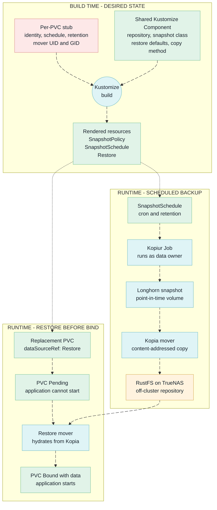

# How kopiur backup and restore work

This page explains how a PVC (the request an app makes for a disk) gets a
backup, and how a recreated PVC gets its data back before the app starts.
Read it before you add a backup or debug one. For file permission errors, read
[why the mover runs as the data owner](kopiur-mover-permissions.md).

kopiur is the backup operator in this cluster. It is built on Kopia, a backup
tool that stores encrypted, deduplicated data. You declare three small objects
per PVC in Git. kopiur runs a mover, a short-lived Job, that copies the data to
the Kopia repository on RustFS, an S3 store on the NAS.

The words on this page follow the [glossary](../../glossary.md). A backup is one
kopiur `Snapshot` upload of one PVC. A CSI snapshot is the point-in-time
`VolumeSnapshot` that the mover reads from, and it stays in the cluster.



The stub holds the values that differ per PVC. The shared component adds the
values that are the same for every PVC. Kustomize joins the two into complete
objects, and Argo CD applies them. Those objects then drive the scheduled backup
and restore-before-bind.

## The three stages in short

<div class="grid cards" markdown>

-   **1. Build in Git**

    `Build time`

    1. The stub declares the `SnapshotPolicy`, the schedule, the `Restore`,
       and the mover UID:GID.
    2. The shared component adds the Kopia repository, the copy method, and the
       restore settings.
    3. Argo CD runs Kustomize on both and applies the result.

-   **2. Scheduled backup**

    `Runtime`

    1. A `SnapshotSchedule` creates a `Snapshot` object.
    2. The kopiur operator takes a CSI snapshot and starts a mover as the data
       owner.
    3. The mover uploads encrypted, deduplicated data to `s3://kopiur`.

-   **3. Restore-before-bind**

    `Disaster recovery`

    1. Argo CD recreates a PVC that points at a `Restore`.
    2. Kubernetes keeps the PVC `Pending` while kopiur starts a mover.
    3. The mover copies the data back. Then the PVC binds and the app starts.

</div>

---

## 1. The pieces (what exists, and where)

Three things exist once for the whole cluster:

- `infrastructure/backup/kopiur/` defines the Kopia repository
  `cluster-kopia`, the `kopiur-rustfs` credential copy, and `longhorn-snapclass`.
- `infrastructure/backup/kopiur-operator/` installs the kopiur operator into the
  `kopiur-system` namespace. The operator watches the kopiur objects and starts
  the movers.
- `my-apps/common/kopiur-backup/` holds the shared Kustomize component.

Each app adds four things for every PVC that needs a backup:

- A label on `namespace.yaml`, so the namespace receives the repository credentials.
- A `dataSourceRef` in `pvc.yaml` that points at the `Restore`.
- The stub `kopiur/<pvc>.yaml`.
- Two lines in `kustomization.yaml`: the stub under `resources:` and the shared
  component under `components:`.

| Piece | Scope | What it does |
|---|---|---|
| `ClusterRepository cluster-kopia` | cluster | Defines the Kopia repository on RustFS `s3://kopiur` |
| `ClusterExternalSecret kopiur-rustfs` | cluster | Copies the repository credentials into each namespace labeled `kopiur.home-operations.com/repo: cluster-kopia` |
| `VolumeSnapshotClass longhorn-snapclass` | cluster | Tells Longhorn how to take a CSI snapshot |
| kopiur operator | cluster | Reconciles the kopiur objects and starts the movers |
| component `common/kopiur-backup` | shared | Adds the fields that are the same for every PVC |
| stub `kopiur/<pvc>.yaml` | per PVC | Holds the fields that differ: name, identity, cron, retention, mover UID:GID |
| namespace label | per app | Gives that namespace the credentials and access to the Kopia repository |
| PVC `dataSourceRef` | per PVC | Connects the PVC to its `Restore` for restore-before-bind |

The one-time setup of RustFS and the credentials is in
[backup repository setup](../../backup-repository-setup.md).

---

## 2. How a Kustomize component composes (read this if components are new)

A component is a reusable bundle of patches. The app's `kustomization.yaml`
includes it under `components:`. At build time Kustomize loads the resources the
app lists, then lets the component patch them. The stub stays small because the
component fills in every field that is the same for all backups.

The build works in four steps:

1. Kustomize parses the app's YAML into Kubernetes objects.
2. Kustomize matches each component patch to objects by API group and kind.
3. Kustomize applies JSON Patch operations to exact paths such as `/spec/repository`.
4. Kustomize prints complete YAML. Argo CD compares and applies that YAML.

Kustomize does not rewrite either source file. Components are a standard
Kustomize feature for reusable, opt-in configuration. See the
[upstream Components example](https://github.com/kubernetes-sigs/kustomize/blob/master/examples/components.md).

A component does not run because a file with a certain name exists. The app's
`kustomization.yaml` is the build entrypoint, and it must list the component
under `components:`. The component then patches the matching objects that the
app loaded. It is not a parent manifest, and it does not run alone.

### Is this like Kyverno?

No. Both tools can add fields to an object, but they run at different times.
Kyverno is not installed in this cluster. Do not add it back to the backup path.

| Kustomize component | Kyverno policy |
|---|---|
| Runs during `kustomize build`, before anything reaches the cluster | Runs inside the cluster, at admission or in the background |
| An app includes it in its `components:` list | Watches API requests or existing cluster objects |
| Produces the YAML that Argo CD compares and applies | Validates or changes objects as they enter the cluster |
| Needs no running controller | Needs the Kyverno controllers to stay running |

With Argo CD, the path is:

```text
Git files -> Argo CD repo-server -> kustomize build
          -> rendered YAML -> Argo CD diff/apply -> Kubernetes API
```

`kubectl apply -k <app>` runs the same build and then applies it from your machine.

In concept, the build does this:

```javascript
function applyKopiurComponent(resource) {
  // Kustomize works on parsed objects, not raw text or filenames.
  const output = structuredClone(resource);

  const isSnapshotPolicy =
    output.apiVersion.startsWith("kopiur.home-operations.com/") &&
    output.kind === "SnapshotPolicy";

  if (isSnapshotPolicy) {
    output.spec.copyMethod = "Snapshot";
    output.spec.volumeSnapshotClassName = "longhorn-snapclass";
    output.spec.repository = {
      kind: "ClusterRepository",
      name: "cluster-kopia",
    };
  }

  return output;
}

const appResources = loadResourcesFromKustomization();
const renderedResources = appResources.map(applyKopiurComponent);

printYaml(renderedResources); // this is what Argo CD applies
```

That JavaScript is only a teaching model. Kustomize uses the component's
target selector and JSON Patch operations, but the data moves the same way.
Objects that do not match pass through unchanged.

{ loading=lazy }

*Coral fields belong to the app. Green fields are shared defaults from the
component. The rendered object contains both before Argo CD sees it.*

[Open the full-size Component diagram](../../assets/kustomize-component-mixin.svg)

### Why use it here?

Every PVC with a backup needs the same Kopia repository, snapshot class, copy
method, and restore settings. If each app repeated those fields, the copies
would drift, and one cluster-wide change would need an edit in every app. The
component keeps those fields in one file. Each app still owns its identity,
retention, schedule, and mover UID:GID.

The cost is that the stub alone is not the complete deployed object. Run
`kubectl kustomize <app>` to see the real output. The component patches every
`SnapshotPolicy`, `SnapshotSchedule`, and `Restore` that one app's Kustomization
includes. It cannot reach objects in another Argo CD Application.

```yaml
resources:
  - namespace.yaml
  - pvc.yaml
  - kopiur/<pvc>.yaml
components:
  - ../../common/kopiur-backup
```

Read that file as three steps. Load these resources. Apply these shared patches.
Print the combined result.

| Object | The stub supplies | The component adds |
|---|---|---|
| `SnapshotPolicy` | name, source PVC, identity, retention, mover UID:GID | repository, `copyMethod: Snapshot`, `volumeSnapshotClassName`, `staging.storageClassName: longhorn-kopiur-staging-local`, `sourcePathStrategy: PvcName` and `readOnly: true` on the source, `deletion.onPolicyDelete: Retain` |
| `SnapshotSchedule` | cron schedule | `concurrencyPolicy: Forbid`, `runOnCreate: false` |
| `Restore` | source policy, mover UID:GID | repository, `target.populator`, `onMissingSnapshot: Continue` |

Keep the mover UID:GID in the stub, not in the component. The data owner
differs per PVC, even inside one namespace. A component patches every object of
a kind the same way, so it cannot set a per-PVC value.

---

## 3. Backup flow (what happens on a schedule)

1. A `SnapshotSchedule` fires on its cron, for example `10 3 * * *`. It creates
   a `Snapshot` object.
2. The kopiur operator creates a CSI snapshot through `longhorn-snapclass`.
3. The operator starts a mover as the data owner UID:GID. The mover mounts the
   CSI snapshot data read-only.
4. The mover reads the S3 credentials from the `kopiur-rustfs` Secret in its own
   namespace. The `ClusterExternalSecret` put that Secret there.
5. Kopia uploads deduplicated, encrypted data to RustFS at `s3://kopiur`. kopiur
   then marks the `Snapshot` `Succeeded` and records the file and byte counts.

The mover must run as the data owner, or it cannot read the files. See
[why the mover runs as the data owner](kopiur-mover-permissions.md).

If the Kopia repository is unreachable, the backup fails with an error. The
next run tries again. kopiur writes no partial or empty backup.

---

## 4. Restore-before-bind flow (the DR magic)

A recreated PVC does not start empty. It stays `Pending` until kopiur has copied
its data back, and only then does it bind. The app cannot start on an empty disk.

1. Argo CD recreates the PVC from Git. This happens after someone deletes a PVC
   or a namespace, and during a full cluster rebuild.
2. The PVC's `dataSourceRef` points at `<pvc>-restore`. Kubernetes does not bind
   a PVC with that reference, so the PVC stays `Pending`.
3. kopiur checks the Kopia repository and picks one of three results.

| Kopia repository state | Result |
|---|---|
| Reachable, a backup exists | A mover copies the data back. The PVC binds and the pod starts. |
| Reachable, no backup yet | `onMissingSnapshot: Continue` binds an empty PVC. Scheduled backups start from there. |
| Unreachable | The `Restore` reports an error and retries. The PVC stays `Pending` and never binds empty. |

kopiur raises the backend error before it decides what to do about a missing
backup. An outage therefore cannot bind an empty volume. The source is
`crates/controller/src/restore/mod.rs`, function `resolve_snapshot`.

The middle row is the first deploy of a new app. The same manifests deploy a new
PVC and restore an old one.

A `Restore` picks its backup once, when it is created, and keeps that choice.
To restore a newer backup into a PVC, delete both the PVC and its `Restore`.
The [disaster recovery runbook](../../disaster-recovery.md#the-restore-canary)
explains this rule.

---

## 5. To add a backup (checklist)

Follow [`/project:add-backup`](https://github.com/mitchross/talos-argocd-proxmox/blob/main/.claude/commands/add-backup.md).
It is the one procedure. It covers the data owner, the namespace label, the
stub, the PVC `dataSourceRef`, the kustomization, and the checks.

After Argo CD syncs the app, check the result:

```bash
kubectl -n <ns> get secret kopiur-rustfs
kubectl -n <ns> get snapshotpolicy,snapshotschedule,restore,snapshot
```

Expect the Secret to exist. Expect the `Snapshot` to reach `Succeeded` with a
file count above zero.

---

## 6. Rules and upstream behavior to know

kopiur is pre-1.0, so chart upgrades can change behavior. The pinned chart
version is in `infrastructure/backup/kopiur-operator/kustomization.yaml`. The
chart version equals the app version. Check that the chart still ships the same
8 CRDs on every version change.

### Do not remove these lines

- Keep `includeCRDs: true` in `infrastructure/backup/kopiur-operator/kustomization.yaml`.
  The chart ships its CRDs in Helm's `crds/` directory, and Helm does not manage
  that directory on upgrade. With this line, Kustomize renders the CRDs on every
  build, so Argo CD always owns them. Without it, an upgrade can delete the CRDs
  and every kopiur object with them.
- Keep `kubeVersion:` on the same `helmCharts` entry. The chart requires
  Kubernetes `>=1.32.0-0`. Without the line, `kustomize build --enable-helm`
  renders against Helm's default version (v1.31), and the render fails in CI and
  in Argo CD. Any chart with a `kubeVersion` constraint needs the same line.
- Keep `copyMethod: Snapshot` explicit in the component. A field that the server
  defaults has no owner in server-side apply. A CRD upgrade can then change its
  value without a Git change. An explicit value has an owner and stays fixed.
- Keep `deletion.onPolicyDelete: Retain` explicit in the component, for the same
  reason. With `Retain`, pruning a `SnapshotPolicy` removes only the `Snapshot`
  objects and leaves the backups in the Kopia repository. With `Delete`, an Argo
  CD prune would delete the backup history. To clean up a retired app, set
  `Delete` by hand.
- Keep `webhook.failurePolicy: Ignore` in the operator `values.yaml`. A kopiur
  outage must not block the creation of kopiur objects during a rebuild.

### Rules for stubs

- Set `retention` in every `SnapshotPolicy`. Retention prunes succeeded
  backups. Nothing else does.
- Set the mover UID:GID by hand in every stub. Do not use
  `inheritSecurityContextFrom: pvcConsumer: {}`. During restore-before-bind
  there is no app pod to inherit from, and the upstream community has reported
  that it sometimes detects the wrong UID.
- Use the nested shape for `verification.quick`:
  `{ schedule: { cron, jitter, timezone } }`. kopiur rejects the old flat shape.
  Only the restore canary uses verification.
- Leave `spec.adoption` at its default, `Adopt`. kopiur then adopts orphan
  backups that match the policy identity, so retention can prune them.
- Leave `scheduleDefaults.timezone` unset on the `ClusterRepository`. Schedules
  run in UTC. Setting a time zone moves every existing schedule.
- Put the `privileged-movers` namespace annotation only on a namespace whose
  mover has extra rights (uid 0, `runAsNonRoot: false`, added capabilities, or
  `privilegedMode`). Do not copy it to other namespaces.

### How failures behave

- A failed `Snapshot` object stays failed. kopiur does not retry it in place.
  The next cron run creates a new `Snapshot`, and Kopia reuses the data that the
  failed run already uploaded.
- kopiur keeps at most `failedJobsHistoryLimit` failed `Snapshot` objects per
  `SnapshotSchedule`. The default is 10.
- kopiur retries a short CSI snapshot error. If staging does not finish within
  `spec.staging.timeout` (default 10m), the run fails with reason `StagingTimedOut`.
- In a namespace with the `privileged-movers` annotation, kopiur can miss the
  annotation when the namespace and its kopiur objects arrive together (upstream
  issue #194). The mover then shows `MoverPermitted=False` for about 5 minutes.
  Any metadata change on the object triggers a new check. The
  [disaster recovery runbook](../../disaster-recovery.md) has the command.

### Tools and monitoring

- Install the `kubectl kopiur` plugin on your workstation. It is the fastest way
  to read backup state. Run `kubectl krew install kopiur`, then
  `kubectl kopiur --help`.
- Prometheus scrapes kopiur through the `kopiur-controller-metrics`
  ServiceMonitor in `custom-servicemonitors.yaml`. The alert rules are in
  `kopiur-alerts.yaml`. The chart's own ServiceMonitor and PrometheusRule stay
  disabled.
- The `KopiurCascadeDeletedSnapshots` alert watches the counter
  `kopiur_policy_cascade_children_deleted_total` with `mode="delete"`. It must
  never fire while `onPolicyDelete: Retain` is set.
- kopiur skips common operating-system leftovers by default (`/lost+found`,
  `System Volume Information`, `$RECYCLE.BIN`, `@eaDir`, `.snapshot`).
- This cluster does not use kopiur's `credentialProjection`. External Secrets
  copies the credentials with the `ClusterExternalSecret` in
  `infrastructure/backup/kopiur/externalsecret.yaml`, so the operator needs no
  cluster-wide right to write Secrets.
