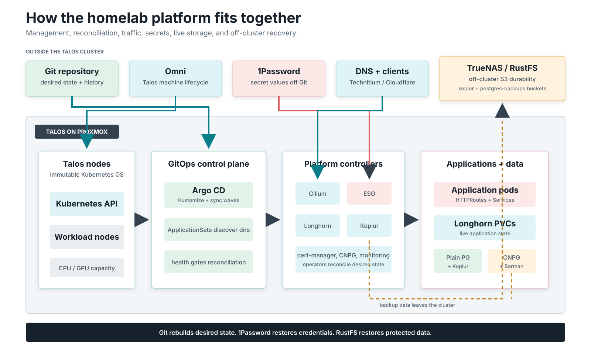
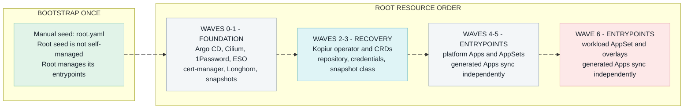
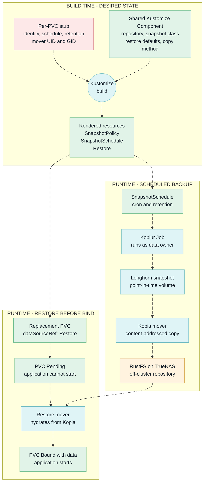
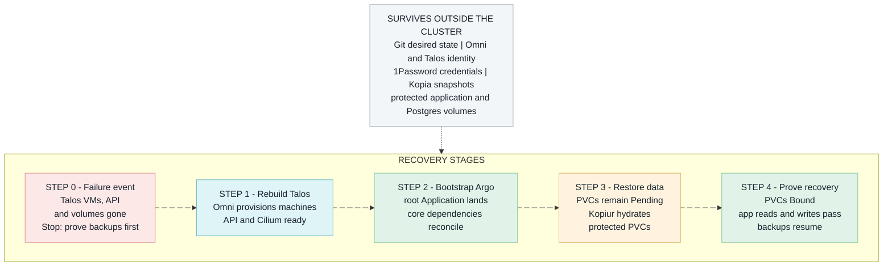

# The easy guide: how this cluster works

This page explains how the cluster deploys apps, backs up their data, and rebuilds
itself after a total loss. Read it first if you are new to this lab. It assumes no
Kubernetes experience and shows the real YAML from this Git repo.



*Git holds the desired state, 1Password holds the credentials, and RustFS holds the
backed-up data. [Open the platform map full size](assets/platform-overview.svg).*

---

## The short version

You can destroy the whole Kubernetes cluster, including every node, disk, and app.
You then follow one runbook. Every app comes back with its data, in the right order.
You do not run restore scripts or look up snapshot IDs.

Three ideas make that work. Each idea builds on the one before it.

1. GitOps. The whole cluster is described in a Git repo. One directory is one app.
2. Sync waves. Argo CD, the tool that applies Git to the cluster, starts core
   dependencies in order. The backup machinery exists before anything needs it.
3. Restore-before-bind. Each protected volume is filled with its backed-up data
   before its app can start.

The rest of this page explains each idea in order.

!!! question "Are you here only to try kopiur?"
    You do not need sync waves, Argo CD, namespace labels, or Kustomize components
    to back up a volume. This cluster uses them because it runs many backups
    unattended. The minimum for kopiur is one operator and ~30 lines of YAML on
    any cluster with CSI snapshots. Go to
    [the adoption ladder](#part-8-i-just-want-to-try-kopiur-the-adoption-ladder)
    and climb only as far as you need.

---

## Part 0. What has to exist first

This guide starts at the point where you have a working Kubernetes cluster.
Building that cluster is a separate job. Three layers sit under everything on
this page. Each layer must work before the next one makes sense.

```
Proxmox        the hypervisor: actual machines with CPUs and disks
   ↓
Omni           the control plane that turns those machines into Talos nodes
   ↓
Talos          minimal Linux that runs only Kubernetes, with no SSH and no shell
   ↓
[you are here] GitOps, sync waves, kopiur, DR
```

| Layer | What it is | Where it is set up |
| --- | --- | --- |
| Proxmox | The hypervisor, the software that runs virtual machines (VMs). This lab has three Proxmox hosts. One host is enough. | Your own hardware. The machine list is in the [fleet inventory](inventory/2026-11-03-fleet-inventory.md). |
| Omni | The control plane from Sidero. It provisions Talos, manages upgrades, and gives you a kubeconfig. It runs as one Docker container. A Raspberry Pi 5 with an NVMe drive is enough. | [Omni setup guide](https://github.com/mitchross/talos-argocd-proxmox/blob/main/omni/omni/README.md) |
| Proxmox infrastructure provider | The add-on that lets Omni create VMs, so you do not build them by hand. It runs one container per Proxmox host, all in one compose project. | [proxmox-providers/](https://github.com/mitchross/talos-argocd-proxmox/tree/main/omni/proxmox-providers) |
| Talos | The operating system on the nodes. You never log in to it. Omni and `talosctl` control it through an API. | Provisioned by Omni |

!!! question "Do I need all of this to use the ideas on this page?"
    No. GitOps, sync waves, and kopiur do not depend on Talos or Omni. They work
    on any Kubernetes cluster that supports CSI snapshots. If you already have a
    cluster, go to [Part 1](#part-1-gitops-a-directory-is-an-application) and
    skip the Proxmox and Omni layers. Those layers are how this cluster gets
    built. They make "destroy everything and rebuild" a repeatable operation.

### Three rules before you build Omni

If you build the Omni layer, read these three rules first.

1. Set up an identity provider first. Omni has no login of its own, no admin
   account, and no password file. It authenticates only against an external
   identity provider (Auth0, SAML, or OIDC). This step is the one most likely
   to block you.
2. Put etcd on an SSD or NVMe drive. Omni runs an embedded etcd, its database,
   which writes to disk constantly. On an SD card or USB stick it works for a
   while. Then it logs `apply entries took too long`, and then it corrupts
   itself. This is the most common cause of a broken Omni.
3. **Back up `omni.asc` to another machine now.** It is the GPG key that
   decrypts Omni's etcd. If you lose it, you cannot recover any cluster that
   Omni manages. There is no reset. No other file in this stack is
   irreplaceable.

The [Omni setup guide](https://github.com/mitchross/talos-argocd-proxmox/blob/main/omni/omni/README.md)
has the full procedure: certificates, GPG, config, first login, and provider keys.
It is written for a reader who has never set up Omni.

---

## Part 1. GitOps: a directory is an application

Argo CD is the controller that reads this Git repo and applies it to the cluster.
An Argo CD `Application` is the object that tells Argo CD to deploy one directory.

Nobody writes `Application` manifests by hand for the apps in this cluster.
An ApplicationSet is an Argo CD object that generates Applications from a rule.
The ApplicationSets here scan the directory structure and create one Application
for each directory:

```text
my-apps/ai/open-webui/               →  ArgoCD Application "my-apps-open-webui"
infrastructure/storage/longhorn/     →  ArgoCD Application "longhorn"
infrastructure/networking/gateway/   →  ArgoCD Application "infrastructure-gateway"
monitoring/metrics/prometheus-stack/ →  ArgoCD Application "monitoring-prometheus-stack"
```

To deploy an app, create a directory, add a `kustomization.yaml`, and push to Git.
There is no other deployment step.

This chain lets Argo CD manage itself:

```text
bootstrap-argocd.sh (manual, once)
        |
        v
root Application (root.yaml)
        |
        v
argocd/apps/  (projects + AppSets + entrypoint Applications)
        |
        v
4 ApplicationSets  (infra, databases, monitoring, my-apps)
        |
        v
auto-discovered apps  (my-apps/*/* etc.)
```

The only manual step is to apply `root.yaml`. After that, Argo CD manages
everything. That includes its own Helm values and the ApplicationSets that discover
the other apps. Git is the source of truth. The cluster is a copy that Argo CD can
rebuild from Git.

---

## Part 2. How Argo waits (sync waves)

A cluster rebuild has an ordering problem. Apps need volumes. Volumes need the
backup operator. The operator needs credentials. Credentials need the secrets
machinery. Everything needs a network. If you deploy all of it at once, most of it
fails and retries.

Sync waves solve the ordering problem. The diagram shows the order.



Wave numbers order the resources. Health checks make each wave wait for the one
before it.

You set a wave with one annotation:

```yaml
metadata:
  annotations:
    argocd.argoproj.io/sync-wave: "3"
```

Within one Application sync, a lower wave must become Synced and Healthy before
the next wave starts. The root Application orders its direct child Applications
this way.

An ApplicationSet does not work the same way. Its generated Applications
reconcile independently. Creating an ApplicationSet does not wait for every
generated app to become healthy.

This table lists the waves in this cluster and the reason for each position.

| Wave | What | Why it comes before the next wave |
|---|---|---|
| 0 | Cilium (the CNI, the pod network), Argo CD itself, 1Password Connect, External Secrets | Without a network, no pod can be scheduled. Without a secrets engine, no app gets credentials. |
| 1 | cert-manager, Longhorn, Snapshot Controller | These provide storage and the `VolumeSnapshot` CRDs that the backup system uses for CSI snapshots. |
| 2 | kopiur operator (CRDs, controller, and webhook) | The volume populator must exist before any PVC references a `Restore`. |
| 3 | kopiur config (`ClusterRepository`, credential fanout, `VolumeSnapshotClass`) | The Kopia repository definition and the S3 credentials must exist before a mover runs. |
| 4 | Infrastructure and database AppSets, KEDA, VPA, Temporal worker | This is the platform layer. Databases are ordinary apps, and their PVCs restore like any other PVC. |
| 5 | Monitoring AppSet (kube-prometheus-stack) | Monitoring is not a core dependency. Core apps start without Prometheus. |
| 6 | OTEL operator and the my-apps AppSet, which holds every user app and its per-PVC backup objects | By this point, everything a restoring PVC needs already exists. |

Two details make the waves work. If you copy this pattern, copy both of them.

### The Application health check

By default, Argo CD does not assess the health of `Application` resources. A
parent Application then treats a child as healthy as soon as the child exists,
and the waves stop waiting. No error tells you about it.

Turn the health check back on in the Argo CD values
(`infrastructure/controllers/argocd/values.yaml`). This is the core of the check:

```yaml
resource.customizations.health.argoproj.io_Application: |
  hs = {}
  hs.status = "Progressing"
  if obj.status ~= nil and obj.status.health ~= nil then
    hs.status = obj.status.health.status
  end
  return hs
```

This Lua check lets a parent wait for the health of its direct child
Applications. It does not add up the health of the Applications that an
ApplicationSet generates. The built-in health checks for Deployments and other
Kubernetes resources stay separate.

### Restore-before-bind holds back the app that needs the volume

During a rebuild, a restoring PVC stays `Pending` ([Part 5](#part-5-restore-before-bind)
explains why). Its pod cannot start, and its Application stays `Progressing`.
Unrelated Applications from the same ApplicationSet continue to reconcile.

```text
A generated Application applies its resources
        |
        v
PVC created with dataSourceRef -> Restore
        |  (K8s withholds binding)
        v
PVC: Pending
        |
        v
kopiur populator mover Job hydrates volume from S3
        |
        v
PVC: Bound (with data)
        |
        v
Pod starts -> Ready
        |
        v
Application: Healthy, and the Argo CD sync completes
```

---

## Part 3. Kustomize components (shared build-time patches)

{ loading=lazy }

*The app opts in, Kustomize patches the matching objects during the build, and
Argo CD receives the complete rendered output.
[Open the Kustomize Component flow full size](assets/kustomize-component-mixin.svg).*

Kustomize is the tool that builds the final Kubernetes YAML from the files in a
directory. Its usual model is a base and an overlay. An overlay inherits one base
and patches it.

That model does not fit one feature that many unrelated apps share. "Back up this
volume" is such a feature. Many apps need it, and they share no base.

A Component is an optional Kustomize package that contains reusable resources and
patches. Nothing discovers a Component automatically. An app opts in with
`components:`.

```yaml
# my-apps/ai/open-webui/kustomization.yaml
components:
  - ../../common/kopiur-backup     # ← mix in "backed up"
resources:
  - kopiur/storage.yaml            # ← the app's tiny per-PVC stub
```

During `kustomize build`, Kustomize does four things:

1. It reads the resources of the app.
2. It finds the objects that match each patch target, by API group and kind.
3. It applies the JSON Patch operations to exact field paths.
4. It writes complete Kubernetes YAML.

Argo CD then compares that rendered output with the cluster and applies it. The
Component does not run in the cluster. It does not watch live resources, scan the
Git repo for filenames, or replace text.

The backup configuration is split into two parts:

- The stub is one file per PVC, in the folder of the app. It holds only the values
  that differ per PVC: the PVC name, the backup identity, the retention, the cron
  schedule, and the mover user ID ([Part 6](#part-6-the-mover-runs-as-the-data-owner)).
- The component is one shared file, `my-apps/common/kopiur-backup/`. It adds the
  values that are the same for every backup in the cluster.

The component is short. It contains only JSON patches, and each patch targets a
resource `kind`.

```yaml
# my-apps/common/kopiur-backup/kustomization.yaml (abridged)
apiVersion: kustomize.config.k8s.io/v1alpha1
kind: Component
patches:
  - target: { kind: SnapshotPolicy, group: kopiur.home-operations.com }
    patch: |
      - { op: add, path: /spec/copyMethod, value: Snapshot }
      - { op: add, path: /spec/volumeSnapshotClassName, value: longhorn-snapclass }
      - { op: add, path: /spec/repository, value: { kind: ClusterRepository, name: cluster-kopia } }
  - target: { kind: SnapshotSchedule, group: kopiur.home-operations.com }
    patch: |
      - { op: add, path: /spec/schedule/concurrencyPolicy, value: Forbid }
      - { op: add, path: /spec/schedule/runOnCreate, value: false }
  - target: { kind: Restore, group: kopiur.home-operations.com }
    patch: |
      - { op: add, path: /spec/repository, value: { kind: ClusterRepository, name: cluster-kopia } }
      - { op: add, path: /spec/target, value: { populator: {} } }
      - { op: add, path: /spec/policy, value: { onMissingSnapshot: Continue } }
```

At build time (`kubectl kustomize my-apps/ai/open-webui`), Kustomize merges the
stub and the component into complete objects. To change the Kopia repository name
or the snapshot class for every backup, edit this one file.

The component does not set the mover user ID. A component patches every resource
of a kind in the same way. The mover user ID must match the owner of the data on
each PVC, and that owner differs between apps and even inside one namespace.

Use this rule to decide where a field goes. Put a value that is the same
everywhere in the component. Put a value that differs per PVC in the stub.

---

## Part 4. kopiur: the backup operator

[kopiur](https://github.com/home-operations/kopiur) is a Kubernetes operator,
written in Rust, that runs [Kopia](https://kopia.io) backups. You declare small
objects, and kopiur runs Jobs for them. Kopia encrypts the data, removes duplicate
data, and uploads it to S3 object storage.

A PVC (PersistentVolumeClaim) is the request an app makes for a disk. A backup is
one upload of one PVC to the Kopia repository, the encrypted backup store on
RustFS.



At build time, Git declares what to back up and how to restore it. At runtime,
kopiur moves the data and enforces restore-before-bind.

kopiur uses these custom resources (CRs):

| CR | Scope | What it declares |
|---|---|---|
| `ClusterRepository` | cluster | Where the Kopia repository is (RustFS, `s3://kopiur`) and which namespace label permits its use. |
| `SnapshotPolicy` | per PVC | Which PVC to back up, under which identity, how much history to keep, and which user the mover runs as. |
| `SnapshotSchedule` | per PVC | The cron schedule that starts the policy. |
| `Snapshot` | created per run | One backup run. It ends `Succeeded` with file and byte counts. |
| `Restore` | per PVC | That kopiur can rebuild this volume from the Kopia repository. The `dataSourceRef` of the PVC points at it. |

One more part is not a kopiur CR. A single `ClusterExternalSecret` copies the
Kopia repository credentials from 1Password, through External Secrets, into
every namespace that has the label `kopiur.home-operations.com/repo: cluster-kopia`.
The `ClusterRepository` uses the same label to decide which namespaces can use the
Kopia repository. One label therefore opts a namespace in to backups.

### What a scheduled backup actually does

```text
SnapshotSchedule cron fires
        |
        v
Snapshot CR created
        |
        v
kopiur operator
        |  (1) CSI VolumeSnapshot (Longhorn, point-in-time)
        |  (2) mover Job (runs AS the data owner)
        v
CSI snapshot --(mounted read-only)--> mover Job
        |
        v  kopia: encrypt + dedup
RustFS S3  (s3://kopiur)
```

The mover is the Job that kopiur starts to copy the data. It reads a CSI snapshot,
a frozen point-in-time copy of the volume, and not the live volume. That gives a
consistent backup.

Kopia splits data into chunks and uploads only the chunks that the Kopia
repository does not already hold. Unchanged data uploads almost instantly and
uses almost no new space. This applies across all apps, because they share one
Kopia repository.

### The complete real example (open-webui)

These four small changes are the whole backup configuration for the open-webui
volume. All four are in Git. The YAML here is shortened to the fields that
matter. Select each tab.

=== "1 · namespace.yaml"

    One label opts the namespace in. It controls both the credential fanout and
    permission to use the Kopia repository.

    ```yaml
    metadata:
      labels:
        kopiur.home-operations.com/repo: cluster-kopia
    ```

=== "2 · pvc.yaml"

    The `dataSourceRef` points the PVC at its `Restore`.
    [Part 5](#part-5-restore-before-bind) explains why these lines matter.

    ```yaml
    spec:
      storageClassName: longhorn
      dataSourceRef:
        apiGroup: kopiur.home-operations.com
        kind: Restore
        name: storage-restore
    ```

=== "3 · kopiur/storage.yaml (the stub)"

    The stub holds only the values that differ per PVC. The component adds the
    rest.

    ```yaml
    apiVersion: kopiur.home-operations.com/v1alpha1
    kind: SnapshotPolicy
    metadata: { name: storage, namespace: open-webui }
    spec:
      sources: [{ pvc: { name: storage } }]
      identity: { username: storage, hostname: open-webui }
      retention: { keepDaily: 14, keepWeekly: 8 }
      mover:   # runs as the data owner (Part 6)
        securityContext: { runAsUser: 568, runAsGroup: 568, runAsNonRoot: true }
        podSecurityContext: { fsGroup: 568, supplementalGroups: [568] }
    ---
    apiVersion: kopiur.home-operations.com/v1alpha1
    kind: SnapshotSchedule
    metadata: { name: storage-daily, namespace: open-webui }
    spec:
      policyRef: { name: storage }
      schedule: { cron: "5 3 * * *" }   # a different minute per PVC, so backups do not all start at once
    ---
    apiVersion: kopiur.home-operations.com/v1alpha1
    kind: Restore
    metadata: { name: storage-restore, namespace: open-webui }
    spec:
      source: { fromPolicy: { name: storage, offset: 0 } }   # offset 0 = latest
      mover:
        securityContext: { runAsUser: 568, runAsGroup: 568, runAsNonRoot: true }
        podSecurityContext: { fsGroup: 568, supplementalGroups: [568] }
    ```

=== "4 · kustomization.yaml"

    Two lines connect the parts.

    ```yaml
    components: [ ../../common/kopiur-backup ]
    resources:  [ kopiur/storage.yaml ]   # (plus the app's other resources)
    ```

Run these commands at any time to check the result:

```bash
kubectl -n open-webui get snapshotpolicy,snapshotschedule,restore,snapshot,pvc
kubectl -n open-webui get secret kopiur-rustfs   # creds arrived via the fanout
```

Expect the latest `Snapshot` to show `Succeeded` and the PVC to show `Bound`.
The second command proves that the credential fanout delivered the Secret.

---

## Part 5. Restore-before-bind

Restore-before-bind is the idea that the rest of this system depends on.

### The problem with a separate restore step

Most backup tools restore as a separate step after the app starts. On a rebuild,
Kubernetes recreates the PVC empty, and the app starts on the empty volume. Three
things can then go wrong:

- The next scheduled backup of the app saves the empty state. Retention can then
  delete the backups that hold your real data.
- The app writes new state to the empty volume. If you restore the old data after
  that, you lose the new writes, and the app no longer agrees with external systems.
- An app that stores logins locks you out. The credential you need was in the
  data you lost.

A game server shows the worst case. A fresh world starts, players join, and the
backup system saves the fresh world over the real one.

### The fix: a volume populator

Kubernetes has a contract called the volume populator. A PVC whose
`dataSourceRef` points at a populator object does not bind until the populator
fills it. An unbound PVC is `Pending`, and a pod cannot start on a `Pending` PVC.

```yaml
spec:
  dataSourceRef:
    apiGroup: kopiur.home-operations.com
    kind: Restore
    name: storage-restore
```

These lines change what happens when the PVC is created. The cause can be a first
install, a rebuild, or a deleted PVC. Exactly one of three outcomes follows:

| State of the Kopia repository | Outcome |
|---|---|
| Reachable, and a snapshot exists | The mover restores the latest snapshot. The PVC binds with data, and the app starts. |
| Reachable, and no snapshot exists yet | `onMissingSnapshot: Continue` binds the PVC empty, and backups start from there. A first install and a rebuild use the same code path. |
| Unreachable | The populator reports an error and retries. The PVC stays `Pending`. **It never binds empty when the backup store is down.** |

The last row is the safety property. An outage can delay recovery. An outage can
never give your app an empty volume that the next backup then saves as real data.

!!! example "Try it yourself, no cluster needed"
    The [kopiur playground](kopiur-playground.md) simulates this state machine in
    your browser. Delete the PVC, take S3 offline, or destroy the cluster, and
    watch each of the three outcomes.

### Every backed-up PVC needs the `dataSourceRef`

A PVC without the `dataSourceRef` is recreated empty. The backup exists, but
nothing tells Kubernetes to use it.

A CI check (`validate-kopiur-coverage.py`) fails any pull request where a
backed-up PVC has no `dataSourceRef`. A volume that has no backup on purpose
carries a `backup-exempt` label and a written reason.

### Why this cluster uses kopiur

Among Kubernetes backup tools, only tools built on the volume populator hold the
PVC until its data is back. Velero, K8up, and Stash make good backups, but they
restore as a separate step. That brings back the race described above.

---

## Part 6. The mover runs as the data owner

Wrong mover permissions are the most common reason that a first backup fails on a
hardened cluster.

The mover pod runs under the Pod Security "baseline" level. That level drops all
Linux capabilities. Two of them, `CAP_DAC_READ_SEARCH` and `CAP_DAC_OVERRIDE`,
are what let root ignore file permissions.

A root mover on this cluster therefore has uid 0 but cannot override file
permissions. If it reads files owned by uid 568 with mode `600`, it gets
`PermissionDenied` every time.

Do not give the capabilities back. Run the mover as the uid:gid that owns the
data.

First, find the owner:

```bash
# find the owner
kubectl -n <ns> exec <pod> -- stat -c '%u:%g' <data-mountpath>
```

Then put that uid:gid in the stub, in both the `SnapshotPolicy` and the `Restore`:

```yaml
# put it in the stub (both SnapshotPolicy and Restore)
mover:
  securityContext: { runAsUser: 568, runAsGroup: 568, runAsNonRoot: true }
  podSecurityContext: { fsGroup: 568, supplementalGroups: [568] }
```

This is why the user ID is in the per-PVC stub and not in the shared component.
It is the one field that differs for each volume.

Do not run the mover as plain root to fix a permission error.
[Mover permissions](domains/storage/kopiur-mover-permissions.md) covers two
special cases. One is a daemon that drops to another user (mysql, `999:568`).
The other is root-owned data, which needs uid `0` and the `privileged-movers`
namespace annotation.

---

## Part 7. Putting it together: the full DR story

Disaster recovery (DR) follows one rule. Protect the parts that live outside the
cluster, and treat the cluster as disposable.



Recovery is complete only when the desired state, the credentials, the protected
data, and runtime health are all back.

```text
Dies with the cluster:
  - Longhorn volumes
  - every Kubernetes object

Survives (off-cluster):
  - Git repo
  - Kopia repository (RustFS S3)
  - 1Password vault
  - Omni/Talos machine config

  Survivors  --(bootstrap + sync waves)-->  New cluster
  New cluster  --(populators hydrate PVCs)-->  Everything back, with data
```

A rebuild has three stages:

1. Follow the procedure in [disaster recovery](disaster-recovery.md). It includes
   two manual seeds, Cilium and 1Password, that `bootstrap-argocd.sh` expects.
   If you skip them, the cluster has no CNI and External Secrets cannot start.
2. Waves 0 to 3 run in order: network, secrets, storage, the kopiur operator,
   and the Kopia repository config.
3. App PVCs, including database PVCs, stay `Pending` while kopiur fills them.
   The apps then start on restored data, in parallel.

The [restore canary](disaster-recovery.md#the-restore-canary) is a small app with
an isolated test PVC. It takes daily backups and runs a quick verification each
week. Use its test PVC to repeat the destructive drill safely: delete, recreate,
populate, and verify the bytes.

### Limits

- Database recovery has no point-in-time recovery. Each database is a plain
  single-instance Postgres. kopiur takes a crash-consistent snapshot of its one
  volume, daily or every 6 hours for irreplaceable data. On restore, Postgres
  replays its write-ahead log (WAL). You can go back only to the last snapshot.
- All Postgres here is plain Postgres backed up by kopiur. Do not bring back CNPG.
- There is one copy of the Kopia repository, and it is on the LAN. This is not a
  3-2-1 backup. A disaster that destroys the NAS destroys the backups. This lab
  accepts that risk.
- The recovery point objective (RPO), the most data you can lose, equals the
  backup interval.
- kopiur is pre-1.0. The chart version is pinned, and CRD fields can change
  between versions.

---

## Part 8. "I just want to try kopiur" (the adoption ladder)

People often ask if they need sync waves, Argo CD, namespace labels, and
Kustomize components to back up a PVC. They do not. Those parts are what it takes
to run dozens of backed-up PVCs unattended. kopiur itself takes an afternoon to
set up.

Every part of this repo is one rung of this ladder. Climb only as far as your
problem requires.

| Rung | You add | What you get | You need it when |
|---|---|---|---|
| 0. Backups | The kopiur operator (Helm), a `ClusterRepository`, a plain Secret, and one `SnapshotPolicy` and `SnapshotSchedule` | Scheduled, encrypted, deduplicated PVC backups. You need only `kubectl`. | You have at least one PVC that you cannot afford to lose. |
| 1. Self-restoring PVCs | A `Restore` CR and a `dataSourceRef` on the PVC | Restore-before-bind. A recreated PVC comes back with its data and never binds empty without warning. | You delete a PVC for the first time, on purpose or by accident. |
| 2. GitOps | Argo CD or Flux owns the manifests | Unattended recreation. If you delete the app or the namespace, Git puts it back, and the restore starts without you. | You no longer want to type `kubectl apply` during an incident. |
| 3. Credential fanout | The namespace label and a `ClusterExternalSecret` (or any secret sync) | A new namespace needs one label. The label delivers the Kopia repository credentials and grants access. No app needs its own secret wiring. | Backed-up apps are in more than ~3 namespaces. |
| 4. The component | The `common/kopiur-backup` Kustomize component | The per-PVC config shrinks to a ~20-line stub. You change the backup settings for the whole cluster in one file. | You copy the same CR fields for the fifth time. |
| 5. Sync waves | Wave annotations and the Application health Lua | A whole-cluster rebuild that orders itself: storage, operator, Kopia repository, then apps. Each restore holds back its own app. | You want "destroy it and bootstrap again" to be a supported operation. |
| 6. Trust at scale | The CI coverage check and the restore canary | A pull request cannot add a backed-up PVC without its `dataSourceRef`. Backup verification runs on a schedule. Destructive restore drills have an isolated target. | The system must stay correct, and you must test it without risk to production data. |

### Rungs 0 and 1 on your own cluster

Before you start, you need two things:

- A CSI driver with VolumeSnapshot support. `kubectl get volumesnapshotclass`
  must return at least one class.
- An S3 endpoint, such as MinIO, Garage, B2, or TrueNAS.

Then do these steps:

1. Install the operator from the OCI Helm chart
   `oci://ghcr.io/home-operations/charts/kopiur`. Pin the version, because kopiur
   is pre-1.0.
2. Create a Secret in `kopiur-system` with `AWS_ACCESS_KEY_ID`,
   `AWS_SECRET_ACCESS_KEY`, and `KOPIA_PASSWORD`. A plain `kubectl create secret`
   is enough. External Secrets belongs to rung 3.
3. Declare a `ClusterRepository` that points at your bucket. Use a bare
   `host:port` endpoint, and set `tls.disableTls: true` for plain HTTP. Set
   `allowedNamespaces` to match a label that you choose. Copy the shape of the
   repository CR in [backup repository setup](backup-repository-setup.md).
4. Label the namespace of your app and copy the same Secret into it. Add the
   three CRs from [tab 3 of the open-webui example](#the-complete-real-example-open-webui).
   Set the mover uid:gid to the owner of the data
   ([Part 6](#part-6-the-mover-runs-as-the-data-owner)).
5. Run `kubectl -n <ns> get snapshot` until the `Snapshot` shows `Succeeded`.
   You are now on rung 0.
6. Add the `Restore` and the `dataSourceRef` (tabs 2 and 3). Then test them.
   Scale the app to zero, delete the PVC, and recreate it. The PVC stays
   `Pending` and then binds with your data. You are now on rung 1.

!!! tip "What comes from kopiur and what comes from this repo"
    kopiur gives you rungs 0 and 1: the CRs, the populator, and the mover.
    Rungs 2 to 6 are ordinary Kubernetes and GitOps tools: Argo CD, External
    Secrets, Kustomize, and CI. This repo arranges them so that a backup or a
    restore needs no manual step. You need none of them to start. You need all
    of them for an unattended rebuild of the whole cluster.

---

## Common questions

### Why not Velero?

Velero restores as a separate step after the PVC exists. That brings back the
empty-volume race from [Part 5](#part-5-restore-before-bind). Only a tool built
on the volume populator can hold the PVC until the data is back.

### Why kopiur?

kopiur is built on Kopia and has dedicated CRs. For example, one
`ClusterRepository` replaces hand-made secrets in each namespace. It has a small
mover and uses the volume populator contract for restore-before-bind. The
home-operations community maintains it.

### Why explicit per-PVC CRs, and not a label on the PVC?

`dataSourceRef` is immutable, and it must exist when the PVC is created. A
controller that reacts to a label acts too late, because the PVC has already
bound empty. The wiring must therefore be in Git when Kustomize renders the app.
The Kustomize component keeps the repeated fields out of each app.

### Is one shared Kopia repository for all apps a risk?

Yes, a known one. One encryption password protects the backups of every app. If
it leaks, it exposes all of them. This lab accepts that risk because it has one
operator and the Kopia repository is reachable only on the LAN.

In return, Kopia removes duplicate data across all apps. Each policy has its own
`identity` (`hostname` and `username`), so the snapshots of two apps never
collide.

### What happens if the S3 server is down during a rebuild?

Restores fail and retry. The PVCs stay `Pending`, and nothing binds empty.
Recovery is late but the data is not damaged. This is the third row of the table
in [Part 5](#part-5-restore-before-bind).

### What about the databases?

Databases use the same flow. Every database is a plain Postgres Deployment. Its
PVC follows the same restore-before-bind path as every other PVC.
[Run Postgres in plain English](domains/cnpg/run-postgres-plain-english.md) is
the guide for operating one.

### How do I add a backup to a new app?

There are six steps, and they take about 5 minutes. Find the uid:gid of the data
owner, label the namespace, write the stub, add the `dataSourceRef`, add the
component, and verify. The checklist is in
[kopiur backup architecture](domains/storage/kopiur-backup-architecture.md).

---

## Cheat sheet

```bash
# Is everything wired? (per namespace)
kubectl -n <ns> get snapshotpolicy,snapshotschedule,restore,snapshot,pvc
kubectl -n <ns> get secret kopiur-rustfs

# Cluster-wide backup health
kubectl get snapshot -A                        # recent runs Succeeded?
kubectl -n kopiur-system get pods,clusterrepository
# Or the official CLI (0.5.1+): kubectl krew install kopiur && kubectl kopiur --help
# On-demand backup right now: kubectl kopiur snapshot now --policy <name> -n <ns>

# Sync-wave order at a glance
kubectl get applications -n argocd \
  -o custom-columns=NAME:.metadata.name,WAVE:.metadata.annotations.argocd\\.argoproj\\.io/sync-wave,STATUS:.status.sync.status

# Render what the component injects (no cluster needed)
kubectl kustomize my-apps/ai/open-webui
```

| Task | Page |
|---|---|
| Learn the same material step by step | [Course: survive a cluster wipe](learn/course.md) |
| Look up a term | [Glossary](glossary.md) |
| Operate storage day to day (design decisions, operations, troubleshooting) | [Storage architecture](storage-architecture.md) |
| Add a backup | [Kopiur backup architecture](domains/storage/kopiur-backup-architecture.md) |
| Fix `PermissionDenied` | [Mover permissions](domains/storage/kopiur-mover-permissions.md) |
| Rebuild the cluster | [Disaster recovery](disaster-recovery.md) |
| Set up the S3 backend | [Backup repository setup](backup-repository-setup.md) |
