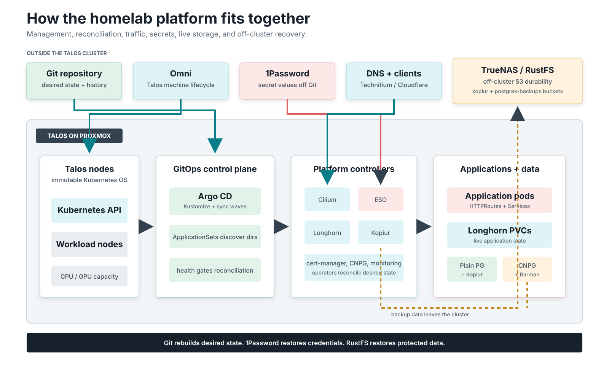

# The big picture

This site documents one homelab: a Kubernetes cluster on Talos Linux that Argo CD
deploys from a Git repo. Read it to learn how the cluster works, to operate it,
or to copy a pattern into your own cluster.

Source: [`mitchross/talos-argocd-proxmox`](https://github.com/mitchross/talos-argocd-proxmox).
This site renders the `docs/` folder of that repo.

*Git rebuilds the desired state. 1Password rebuilds the credentials. RustFS
rebuilds the protected data. [Open the full-size platform map](assets/platform-overview.svg).*

## The one idea

You can destroy the whole cluster and rebuild it, and every protected volume
comes back with its data. Nobody runs a storage command by hand.

Three things make that work:

1. Argo CD reads the Git repo and creates every app. A folder with a
   `kustomization.yaml` is one app.
2. kopiur, the backup operator, uploads each protected volume to a Kopia
   repository that lives outside the cluster.
3. When an app asks for its volume on a new cluster, kopiur fills the volume
   from the last backup before the app starts.

The [disaster recovery runbook](disaster-recovery.md) has the full procedure.

## Where to start

| You want to | Read |
|---|---|
| Understand the whole system from zero | [The easy guide](easy-guide.md) |
| Learn backup and restore by doing, in the browser | [Course: survive a cluster wipe](learn/course.md) |
| Look up a word such as restore, snapshot, or sync | [Glossary](glossary.md) |
| Add an app or learn how Argo CD finds it | [How ArgoCD deploys this repo](domains/argocd/argocd.md) |
| Choose where an app's data lives | [Pick a StorageClass](domains/storage/storage-tiers.md) |
| Add or fix a backup | [How kopiur backup and restore work](domains/storage/kopiur-backup-architecture.md) |
| Run a Postgres database | [Run Postgres here](domains/cnpg/run-postgres-plain-english.md) |
| Rebuild the cluster | [Disaster recovery runbook](disaster-recovery.md) |
| Run a local LLM on your own GPUs | [Local AI starter kit](domains/ai-gpu/index.md) |

## What is in each section

The sidebar has eight sections. Read them top to bottom the first time.

| Section | What it covers |
|---|---|
| Start here | The big picture, the easy guide, the interactive course, and the glossary |
| GitOps and ArgoCD | How a change in Git becomes a running app, and how to check a risky change |
| Storage | Which disk holds which data, the storage classes, and SSD wear |
| Backups and recovery | kopiur backups, Postgres, and the cluster rebuild runbook |
| Networking | The network layout, Cilium policies, VPN egress, and split DNS |
| Hardware and hosts | The machines, how Ansible configures them, and power metering |
| Running apps | Pod sizing and placement, Temporal workers, PostHog, and observability |
| Local AI | Models, GPUs, measurement, and the Pi and Hermes agents |

## The stack

| Layer | What runs here |
|---|---|
| Operating system | Talos Linux on Proxmox VMs and bare-metal machines. Omni provisions the nodes. |
| Network | Cilium, with Gateway API for routing and LoadBalancer addresses |
| GitOps | Argo CD manages itself. ApplicationSets discover app folders. |
| Storage | Longhorn for app volumes. A TrueNAS NAS holds bulk files and the backups. |
| Backup | [kopiur](https://github.com/home-operations/kopiur) uploads each volume to RustFS S3 and restores it before the app starts |
| Databases | Plain Postgres Deployments, backed up by kopiur |
| Secrets | 1Password Connect and External Secrets Operator |
| Observability | kube-prometheus-stack, Loki, Tempo, and OpenTelemetry |
| Local AI | vLLM serves `qwen3.8-27b` on two RTX 3090s. LiteLLM is the gateway for apps. |
| Hosts | Ansible configures the Proxmox hosts and the Pi. Argo CD does not manage them. |

The [fleet inventory](inventory/2026-11-03-fleet-inventory.md) lists the machines.
The [disk map](domains/storage/disk-map.md) lists every disk.

## Copy a pattern from this lab

This is one operator's homelab, not a product. You can copy the patterns: the
per-volume backup files, the off-cluster Kopia repository, the restore canary,
and the sync-wave bootstrap. You cannot copy the image tags, hostnames, or
1Password item names; replace them with your own.

Start with [the easy guide](easy-guide.md). It ends with the order in which to
adopt the pieces.

To change these docs, read [how these docs are written](documentation-standard.md).
