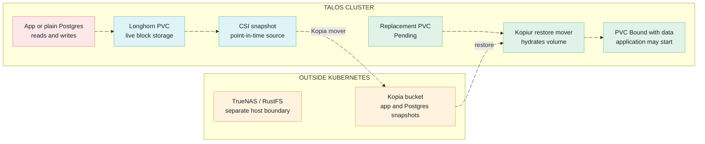

# Storage architecture

This page explains where application data lives in this cluster: which StorageClass an app
uses, which physical disk holds the data, and how many copies exist. It also gives a short
summary of how backups protect that data. Read it before you add a PVC, the request an app
makes for a disk.



Longhorn keeps data available inside Kubernetes. kopiur keeps a copy that you can recover
outside Kubernetes, in the Kopia repository on RustFS, an S3 server on the TrueNAS host.
A Longhorn volume with one replica does not survive the loss of its host. The backup does.

## Where data lives

Three kinds of storage hold application data.

| Storage | What it is | Use it for |
|---|---|---|
| Longhorn classes (`longhorn`, `longhorn-flash`, `longhorn-wired-ha`) | Block volumes on SSDs inside the cluster nodes. The volumes are RWO, which means one node mounts a volume at a time. | App state and every database |
| `truenas-nfs` | A dataset per PVC on the TrueNAS HDD pool, shared over NFS | Bulk, read-mostly files |
| Static NFS and SMB PVs | An existing NAS share named in the PV | Media, model files and shared data |

[Pick a StorageClass](domains/storage/storage-tiers.md) gives the rule for each class.
The [disk map](domains/storage/disk-map.md) shows which physical drive is behind each
Longhorn disk. All Postgres here is plain Postgres on a Longhorn PVC, backed up by kopiur.

Do not re-enable the Longhorn V2 engine. Every Longhorn class here sets `dataEngine: v1`
or uses the V1 default.

### Disk placement follows drive endurance

Data stays on the disk it was written to. `dataLocality` is `disabled` on the
default class, so a pod that moves reads its volume over the network. Longhorn does not
copy the volume to the pod's new node. Do not set `dataLocality: best-effort` on a general
StorageClass, because every pod move then copies the whole volume.

Longhorn disks are grouped by how many writes the physical SSD can survive, not by free
space. The full layout for each host is in the [disk map](domains/storage/disk-map.md).

| Disk | Physical drive | Holds |
|---|---|---|
| `ssd-flash` (GPU node, tags `flash`, `clone-ok`) | 440 GiB guest disk on a mirrored HPE enterprise SATA pair | GPU-node hot volumes and kopiur backup clones (`longhorn-kopiur-staging-local` selects `clone-ok`) |
| `hp-sff-ssd2` (hp-sff, tags `hp-sff-ssd2`, `clone-ok`) | 920 GiB guest disk on a consumer PNY 1 TB | ordinary replicas and backup clones; Longhorn picks either `clone-ok` disk for each clone |
| `gpu-bulk` (GPU node, tag `gpu-bulk`) | 800 GiB guest disk on the Threadripper's consumer PNY boot SSD | ordinary GPU-node volumes, so they don't take `clone-ok` space from backup clones |
| `talos-ephemeral` on the GPU node | budget NVMe that also carries `/var` | nothing new (`allowScheduling: false`) |
| `hp-elite-nvme`, `hp-sff-ssd`, `dell-ultra-ssd` (`wired-storage` nodes; the GPU node carries the tag too) | consumer SATA/QLC | ordinary replicas |
| hp-sff control-plane disk | Intel DC S3610, enterprise SATA with power-loss protection | **etcd only**. Keeps Longhorn traffic off the single control plane's disk |
| `hp-micro-ssd` (shed) | budget SATA behind Wi-Fi | nothing (`allowScheduling: false`). Never holds replicas or second copies |

Only `clone-ok` disks take backup clones, because every kopiur run clones the whole volume
before it reads it. Two disks on two hosts carry the tag. If one of those hosts is down,
kopiur can still clone any volume that has a readable copy. A volume whose only copy is on
the dead host cannot be backed up until that host returns. [Disk writes](domains/storage/disk-writes.md)
lists the other rules that limit SSD wear.

### Two copies for data that can't be re-created

The default `longhorn` class and `longhorn-wired-ha` both make two replicas on
different `wired-storage` nodes. Replica anti-affinity is hard, so Longhorn never puts both
replicas on one node. A volume created or restored from either class gets two copies, and
the loss of one node does not stop it.

Two kinds of volume keep one copy:

- **`longhorn-flash` volumes.** The class uses one disk on one host. Its users (PostHog,
  radar-ng, product-bench) stop when the Threadripper stops. PostHog also needs the memory
  of that host.
- **Volumes created before the classes made two copies.** The replica count is stored on
  the live Longhorn Volume, not read again from the class. Caches and data that an app can
  re-create stay at one copy on purpose.

Two copies survive one failed node. They do not survive a house power cut, because every
wired node loses power at once. Recover damaged data from the kopiur backup.

To raise one existing volume to two copies, run this for its `<ns>/<pvc>`:

```bash
pv=$(kubectl -n <ns> get pvc <pvc> -o jsonpath='{.spec.volumeName}')
kubectl -n longhorn-system patch volumes.longhorn.io "$pv" --type merge \
  -p '{"spec":{"numberOfReplicas":2}}'
kubectl -n longhorn-system get volumes.longhorn.io "$pv" \
  -o jsonpath='{.spec.numberOfReplicas} {.status.robustness}{"\n"}'
```

Expect `2 degraded` while Longhorn copies the second replica, then `2 healthy`.

## Backup and restore in short

[How kopiur backup and restore work](domains/storage/kopiur-backup-architecture.md) owns
the mechanism. This section gives the rules that decide whether a volume comes back after
you delete it or rebuild the cluster.

A backed-up PVC needs four things in Git:

1. The namespace label `kopiur.home-operations.com/repo: cluster-kopia`.
2. A stub, the file `kopiur/<pvc>.yaml`, with a `SnapshotPolicy`, a `SnapshotSchedule` and a `Restore`.
3. The shared `my-apps/common/kopiur-backup` Kustomize component, which adds the fields
   that are the same for every PVC.
4. A `dataSourceRef` on the PVC that points at `<pvc>-restore`.

The mover is the Job that kopiur starts to copy data to or from the Kopia repository. Its
`securityContext` must be the UID:GID that owns the data on disk. The component cannot set
it, because ownership differs for each PVC. See
[mover permissions](domains/storage/kopiur-mover-permissions.md).

Backups need a `longhorn*` StorageClass, because the mover reads from a CSI snapshot.
Bulk data on `truenas-nfs` uses a kopiur policy with `copyMethod: Direct` instead.

### What happens when a PVC is created

First install, cluster rebuild and a deleted app all follow the same path:

```text
  PVC created from Git
    |
    +-- dataSourceRef -> Restore ?
        |
        +-- YES (-> <pvc>-restore)
        |     K8s withholds binding (PVC = Pending)
        |       -> kopiur Restore populator:
        |            - snapshot exists        -> mover restores latest
        |            |                           -> PVC Bound with prior data
        |            - no snapshot             -> binds empty, backs up forward
        |            |   (onMissingSnapshot:      (disposable)
        |            |    Continue)
        |            - backend unreachable     -> errors + retries, stays
        |                                         Pending -- never empty
        |
        +-- NO bundle
              Longhorn provisions empty
                -> intentional?
                     - backup-exempt / disposable -> fine, disposable
                     - no                          -> DR GAP: add the
                                                       kopiur bundle
```

!!! danger "A PVC without a `dataSourceRef` comes back empty"
    A PVC with no `dataSourceRef` that points at a `Restore` is recreated **empty**. The
    backup still exists in the Kopia repository, but nothing tells Kubernetes to restore
    it. Git must carry the `dataSourceRef` and the matching `Restore` for a volume to be
    recoverable. No operator watches for this gap. CI fails a PR when a backed-up PVC
    lacks its `dataSourceRef` (see [limitations](#known-limitations-and-non-goals)). Only
    Git review catches a PVC that has no backup files at all.

### If this, then that

| You do this | What happens |
|---|---|
| Add the namespace label, the stub and a `dataSourceRef` to `<pvc>-restore` | kopiur reconciles the `SnapshotPolicy`, `SnapshotSchedule` and `Restore`. Backups run on the stub's cron. |
| Recreate that PVC, in the same cluster or in a rebuilt one | The `Restore` fills the PVC from the latest backup **before the app starts**. You do nothing. |
| Delete the app from Git, then add it again next month | Same as the row above. |
| Destroy and rebuild the whole cluster | Every PVC that carries a `dataSourceRef` restores during bootstrap, in parallel. |
| Recreate a PVC that has **no backup yet** | `onMissingSnapshot: Continue` binds it empty, and backups start from there. |
| Recreate a PVC while RustFS is down | The `Restore` reports an error and retries. The PVC stays `Pending`. **It never binds empty when the Kopia repository is unreachable.** |
| Label a PVC `backup-exempt: "true"` with a fully-qualified reason annotation | The PVC has no backup. It is recreated empty, and the reason is on record. |
| Use the bare `backup-exempt-reason` key | The bare key records nothing and nothing enforces it at runtime. CI (`validate-kopiur-coverage.py`) **warns**. Always use `storage.vanillax.dev/backup-exempt-reason`. |
| Add the kopiur label or stub to a system namespace (`kube-system`, `argocd`, `longhorn-system`, `kopiur-system`) | Do not do this. System namespaces are not backed up by kopiur. |
| The mover fails with `PermissionDenied` | Its `securityContext` UID is not the data owner. Fix the UID:GID in the stub's `mover`. See [mover permissions](domains/storage/kopiur-mover-permissions.md). |

### Design rules

Do not add a validating or mutating webhook on PVC create with `failurePolicy: Fail`.
A webhook that deadlocks stops every app deployment in the cluster. The kopiur webhook
covers only kopiur's own CRDs, never PVCs or Pods, so a kopiur outage cannot block an app.
CI and Git review catch a missing `dataSourceRef`. Nothing blocks it at create time.

kopiur never binds an empty volume when the Kopia repository is unreachable. The `Restore`
raises the backend error before it decides what to do about a missing backup, so an outage
keeps the PVC `Pending`. The code is `resolve_snapshot` in
`crates/controller/src/restore/mod.rs` of the kopiur source.

Argo CD is part of the restore path for two reasons. First, something must recreate the
PVC from Git, and on a rebuild Argo CD creates the PVC of every app in parallel. Second,
sync waves put the backup parts in place before the first backed-up PVC exists. Longhorn
is in wave 1, the kopiur operator in wave 2, the repository config in wave 3, and
backed-up PVCs in waves 4 to 6. Without that order, a `Restore` waits for objects that do
not exist and movers fail because their credentials have not arrived. The wave table is in
[root entrypoints and sync waves](domains/argocd/entrypoints.md).

Do not bring back Kyverno, pvc-plumber, VolSync or CNPG for backups. kopiur is the only
backup path.

### Backup schedules and retention

Each stub carries its own `SnapshotSchedule.spec.schedule.cron` and its own
`SnapshotPolicy.spec.retention`. There are no shared tiers. Pick a different cron minute
for each PVC, so many backups do not start on one node at the same time.

Every run clones the whole volume before Kopia reads it, so each extra run costs disk
writes. Back up daily by default, databases included. Back up every 6 hours
(`keepHourly: 8`) only data that can't be re-created. Today that is the paperless data,
media and Postgres volumes, the immich Postgres volume, the Home Assistant config and the
Hermes data volume. Do not add hourly schedules.

| Field | Where | Example |
|---|---|---|
| cadence | stub `SnapshotSchedule.spec.schedule.cron` | `"5 3 * * *"` (daily 03:05), `"19 */6 * * *"` (every 6 h at :19) |
| retention | stub `SnapshotPolicy.spec.retention` | `{ keepDaily: 14, keepWeekly: 8 }` |
| concurrency | component sets `concurrencyPolicy: Forbid` | no overlapping snapshot Jobs |

The whole cluster shares one Kopia repository. `ClusterRepository cluster-kopia` points at
the dedicated `kopiur` bucket on RustFS, `s3://kopiur`. Each policy's identity
(`hostname` and `username`) keys its backups. Kopia splits data into chunks and stores
each chunk once. When you recreate an app, the next backup finds its chunks already in the
repository, so it adds almost no storage. Files that several apps share are stored once.
Storage grows with unique data, not with the number of PVCs.

The repository lives on RustFS, outside the cluster, because it must outlive any cluster.
[Backup repository setup](backup-repository-setup.md) covers the bucket, the credentials
and the `ClusterRepository`.

## Operations

### Enable a backup

Follow [`/project:add-backup`](https://github.com/mitchross/talos-argocd-proxmox/blob/main/.claude/commands/add-backup.md).
It is the only add-a-backup procedure. Make every change in Git, sync, then check that a
`Snapshot` reaches `Succeeded`.

### Exempt a PVC (deliberate non-backup)

A backup-exempt PVC has no kopiur files at all. It is unprotected on purpose, with a
written reason:

```yaml
metadata:
  labels:
    backup-exempt: "true"
  annotations:
    storage.vanillax.dev/backup-exempt-reason: "<why>"
```

- Use the fully-qualified reason key. The bare `backup-exempt-reason` key records nothing,
  and no runtime admission gate checks it. CI (`validate-kopiur-coverage.py`) warns on a
  missing or unqualified reason key. It does not block.
- **Do not add a `dataSourceRef` to a backup-exempt PVC.** It has no `Restore`, so the
  recreated PVC stays `Pending` forever.
- A backup-exempt PVC is recreated empty after a rebuild. Write the reason for the person
  who reads it during an outage.

Back up user content, databases and config that is hard to re-create. Exempt caches,
message brokers, data that syncs from an external source and disposable analytics. Redis
and PostHog's ClickHouse and Kafka are backup-exempt here. PostHog's Postgres is backed up.

### Restore drill (prove it)

A backup is proven only when you restore it.

```text
  confirm a Snapshot exists (non-zero files)
    -> scale app to 0
    -> delete the PVC
    -> Git recreates it (dataSourceRef -> Restore)
    -> PVC holds Pending while the populator restores
    -> binds WITH data; app starts
    -> verify a sentinel byte-identical
```

!!! warning
    Before you delete the PVC, **wait until the revision that Argo CD has synced contains
    the `dataSourceRef`**. If Argo CD still holds an older render, it recreates the PVC
    empty.

Run this drill against the restore canary, the test PVC in
`my-apps/system/restore-canary/`. Its backup and quick-verification schedules run all the
time. You start the destructive restore yourself. The procedure is in
[disaster recovery](disaster-recovery.md).

## Troubleshooting

### The debugging questions, in order

1. Does the namespace have the label `kopiur.home-operations.com/repo=cluster-kopia`?
2. Did the credentials arrive? Run `kubectl -n <ns> get secret kopiur-rustfs`.
3. Do the `SnapshotPolicy`, `SnapshotSchedule` and `Restore` exist, and has kopiur reconciled them?
4. Does the PVC carry a `dataSourceRef` to `<pvc>-restore`? If not, it is recreated empty.
5. Did the last `Snapshot` complete with non-zero files?

### Common failure modes

| Symptom | Cause / fix |
|---|---|
| Mover fails `PermissionDenied` / "unable to open file … permission denied" | The mover `securityContext` UID isn't the data owner. `stat -c '%u:%g'` the data, set the stub's `mover` UID:GID to match. [Mover permissions](domains/storage/kopiur-mover-permissions.md). |
| Mover for a root-owned volume blocked (`MoverPermitted=False`) | Namespace missing `kopiur.home-operations.com/privileged-movers: "true"`. |
| PVC recreates **empty** | No `dataSourceRef` to a `Restore` in Git. Add the backup files, or mark the PVC backup-exempt on purpose. |
| New PVC `Pending` forever, no progress | `dataSourceRef` points at a `Restore` that doesn't exist (or a wrong name). Add the `Restore` or fix the name. |
| New PVC `Pending`, `Restore` reports errors | The Kopia repository is unreachable: RustFS down, wrong endpoint or credentials, or the workload key lacks read/write on the `kopiur` bucket. This is the safe state (the PVC never binds empty). Fix the backend. |
| `PVC is invalid: Forbidden` ComparisonError | `dataSourceRef` added to a **Bound** PVC (immutable). Harmless. It applies on the next recreate. The `ServerSide*` annotations and the AppSet `ignoreDifferences` hide the live diff. |
| Mover stuck `Init`/`Pending`, "volume hasn't been attached" with an old VolumeAttachment | Stale CSI state. Delete the mover pod. Its Job retries with a fresh attach. |
| Pod crashloops on `read-only file system` after a storage disruption | The volume must fully detach to drop the stale mount. Scale to 0, wait for Longhorn volume `detached`, then scale up (plain Postgres: scale the Deployment). |
| Restored volume `degraded` briefly | Longhorn is rebuilding its second replica. Wait. Do not change anything. |

### Quick health commands

```bash
kubectl -n kopiur-system get pods,clusterrepository      # the operator + repo
kubectl get snapshotpolicy,snapshotschedule,restore -A   # all per-PVC wiring
kubectl get snapshot -A                                  # backup runs
kubectl -n <ns> get secret kopiur-rustfs                 # creds fanned out?
```

Expect the three objects for each backed-up PVC, recent `Snapshot` objects in `Succeeded`
with non-zero files, and the PVC `Bound`.

## Known limitations and non-goals

This is a working homelab system, not a hardened product.

**Trust model.** One operator runs this lab. The threat is an accidental delete, not an
attacker in the cluster. One shared Kopia password protects every backup, so a leak
exposes all of them. That is accepted because backups never leave the LAN.

**One backup copy.** This is not a 3-2-1 backup scheme. RustFS holds the only copy. A
disaster on the NAS (fire, ransomware) loses the backups. Add a second destination, such
as rclone to B2 or ZFS replication, if you need an off-site copy.

**No coverage ledger.** kopiur reports only on its own resources. Nothing lists the PVCs
that have no backup. The automated gate is the `validate-kopiur-coverage.py` CI check,
which reads the rendered manifests. It fails a PR when a backed-up PVC is missing its
`dataSourceRef` or a backed-up namespace lacks the repo label. It warns on a PVC that is
neither backed up nor backup-exempt, a missing mover `securityContext`, and an unqualified
exempt reason. A PVC with no backup files at all is only a warning, so Git review must
catch it.

**kopiur is pre-1.0.** CRD fields can change between releases. The chart pin is in
`infrastructure/backup/kopiur-operator/kustomization.yaml`. Review the versioned CRDs and
the recovery behavior when you upgrade it.

**The age of recovered data is the age of the latest successful backup.** A schedule is a
target, not a guaranteed limit on data loss. A delayed or failed backup makes the data
older. Databases use crash-consistent filesystem snapshots with Postgres WAL recovery.
They do not use continuous WAL archiving or point-in-time recovery.

**The restore canary proves the storage path, not every app.** Postgres uses the same
backup path. A consistent CSI snapshot that contains PGDATA and its WAL permits crash
recovery. A restored app still needs read and write checks. An app that spans several PVCs
needs file and database restore points that match. See the post-restore acceptance checks
in [disaster recovery](disaster-recovery.md).

## Files reference

| Concern | Path |
|---|---|
| Longhorn chart values and StorageClasses | `infrastructure/storage/longhorn/` (`values.yaml`, `storageclass-*.yaml`) |
| Longhorn node-failure and rebuild settings | `infrastructure/storage/longhorn/node-failure-settings.yaml` |
| `truenas-nfs` StorageClass | `infrastructure/storage/truenas-csi/storageclass.yaml` |
| Longhorn disks and tags for each node | `omni/cluster-template/cluster-template-prod-v2.yaml` |
| kopiur operator (Helm chart Application) | `infrastructure/controllers/argocd/apps/core-dependencies/kopiur-operator-app.yaml`, which renders `infrastructure/backup/kopiur-operator/` |
| kopiur config (`ClusterRepository`, credentials `ClusterExternalSecret`, snapshot class) | `infrastructure/backup/kopiur/` and `…/core-dependencies/kopiur-config-app.yaml` |
| Shared backup component | `my-apps/common/kopiur-backup/` |
| App PVCs and per-PVC stubs | `my-apps/<category>/<app>/pvc.yaml` and `…/kopiur/<pvc>.yaml` |
| Simple example (single UID 568) | `my-apps/ai/open-webui/` |
| Daemon-drop example (uid 999:568) | `my-apps/knowledge/_archive/project-nomad/mysql/` |
| Root-owned example (uid 0) | `my-apps/home-automation/home-assistant/kopiur/` |
| Restore canary | `my-apps/system/restore-canary/` |
| kopiur source | [`home-operations/kopiur`](https://github.com/home-operations/kopiur) |

## Related

- [The easy guide](easy-guide.md) explains the whole stack from zero, including how to try kopiur on another cluster.
- [How kopiur backup and restore work](domains/storage/kopiur-backup-architecture.md) covers the objects, the component and the backup and restore flows.
- [Disaster recovery](disaster-recovery.md) is the runbook for a full cluster rebuild.
