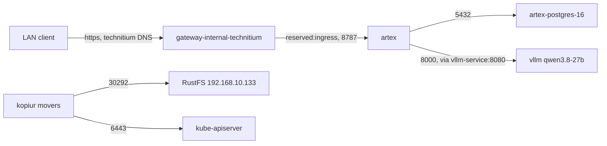

# ARTEX (staged, not deployed)

[ARTEX](https://github.com/BaaRai/ARTEX) v0.7.0, a security testing agent platform, at `https://artex.vanillax.me` on the internal gateway only.
This directory sits outside `my-apps/`, so no ApplicationSet deploys it. Move it only when every gate below holds.

## Activation gates

1. **Network baseline live.** The `feat/artex-network-isolation` change is merged and synced:
   `kubectl get ccnp artex-namespace-baseline` exists and
   `kubectl get ccnp default-deny-lan-egress -o jsonpath='{.spec.endpointSelector}'` shows the `NotIn [artex]` expression.
2. **Image published.** The homelab-images `build-artex.yml` run on `main` has published `ghcr.io/mitchross/artex:0.7.0`.
   Set `image:` in `deployment.yaml` to `ghcr.io/mitchross/artex:0.7.0@sha256:<digest from the run summary>`.
   Make the GHCR package public, or the pull fails.
3. **Database password.** The owner adds the `artex_db_password` field to the 1Password item `postgres-secrets`. Use letters and digits; the DSN template URL-escapes it anyway.
4. **Move.** `git mv proposals/artex my-apps/development/artex`, change the component path in `kustomization.yaml` to
   `../../common/kopiur-backup`, and force-add the env file: `git add -f my-apps/development/artex/artex.env` (`*.env` is ignored).

## After the first sync

- Read the setup token from the log: `kubectl -n artex logs deploy/artex | grep -i 'setup token'`. Claim the admin account at `/setup` straight away: until then, anyone who can read pod logs (including the log pipeline) holds the token.
- Check the LLM line: `[engine] LLM configured from env: ollama / qwen3.8-27b`.
- Check the first snapshot of each PVC: `kubectl -n artex get snapshot` shows `Succeeded`.
- Check the network with Hubble: only DNS, 5432, vLLM 8000 and the gateway are forwarded; anything else from `artex` is dropped.

## Configuration

| Setting | Where | Notes |
| --- | --- | --- |
| Non-secret env | `artex.env` (ConfigMap `artex-config`) | Key directory, LLM, noise profile, update check. |
| `ARTEX_PG_DSN`, Postgres password | ExternalSecret `artex-db` | One 1Password field feeds both. |
| LLM profile | Postgres, after a save in the UI | A saved profile wins over env. After the first save, `ARTEX_LLM_*` changes here do nothing. |
| `ARTEX_TRUSTED_PROXIES` | Unset | Unset, every user behind the gateway shares one login rate-limit budget (10 a minute). Setting it to the envoy addresses would make ARTEX trust `X-Forwarded-For`; not needed for one user. |

`ARTEX_LLM_PROVIDER=ollama` is ARTEX's keyless OpenAI Chat Completions mode; it talks to vLLM and needs no Ollama.
The connection is direct, not through LiteLLM, because LiteLLM's qwen alias can fall back to a paid model.
`scripts/validate-llm-gateway.py` allows the URL in `my-apps/development/artex/artex.env` only.

## Security

- **Server.** Root with only `CHOWN DAC_OVERRIDE FOWNER FSETID KILL SETGID SETUID`, no privilege escalation, RuntimeDefault seccomp, no service account token.
- **Agent commands.** These are Bash, shell, custom tools and MCP. They drop to uid 10001. `-exec-uid 10001 -exec-gid 10001` makes a failed drop stop the server.
- **Recording proxy.** It listens on `127.0.0.1:8788` and has no Service port.
- **Network.** There is no egress to scan targets, the internet or the LAN. Add targets one at a time, each with separate approval, as an extra CiliumNetworkPolicy.
- **Database credential.** An agent command shares the pod's network identity, so it can reach Postgres on 5432. It has no credential: ARTEX removes `ARTEX_PG_DSN` from its environment after startup.

## Storage and backup

| PVC | Size | Holds | Mover |
| --- | --- | --- | --- |
| `artex-data` | 10Gi | Tasks, transcripts, traffic, executor home | uid 0 (privileged movers) |
| `artex-keys` | 1Gi | `jwt.key`, `secret.key` (encrypts secrets stored in Postgres) | uid 0 |
| `artex-postgres-16-data` | 5Gi | Postgres 16 | 999, `CHECKPOINT` hook |

All three PVCs restore before bind from kopiur. A first install binds empty.
Keep the keys and the database restored as a pair: an old `secret.key` cannot read secrets stored after it.

## Known limits

- Postgres 16, not the repo's usual 19: it is the only major ARTEX v0.7.0 tests on. Renovate is held below 17.
- The singletons use `RollingUpdate` with `maxSurge: 0`, which releases the RWO volume first, rather than `Recreate`.
- Untested in the cluster: the capability set, the `ingress`-entity-only allow and the mover egress. The image test covers the capability set under Docker. Check the rest with Hubble after the first sync.
